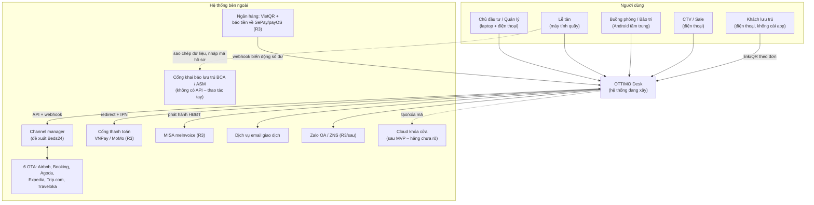
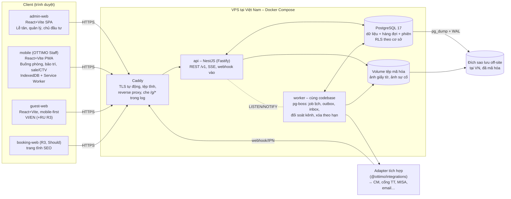

# Kiến trúc hệ thống – OTTIMO Desk (Pha A)

- Người viết: ARC | Round 1 – Bước 4 | Ngày: 16/10/2026 | Phiên bản: 0.2
- Trạng thái: **Đã sửa theo review bước 3** (SEC, BE, DATA – `rounds/round-01/responses/ARC-responses.md`) và decision-log 15/10 (SEC, DOM, PO, DATA, phân xử ORC)
- Đầu vào: `00-brief/investor-brief.md`, `01-decisions/decision-log.md`, `rounds/round-01/plan.md`, `product/docs/PRD.md`, `03-backlog/backlog.md`, `product/docs/business-rules.md` (BR, mục 13 tham số), `product/docs/integrations.md`, `product/docs/integrations/channel-manager-comparison.md`, `product/integrations/README.md`, `product/docs/security/data-risk-assessment.md`, `02-escalations/ESC-002.md`, `product/docs/round-0-baseline.md` (gọi tắt **BL**)
- Quyết định chi tiết: `product/docs/adr/` (ADR-001 … ADR-013)
- **Pha B (Đợt 3) đã làm**: `erd.md`, `api/openapi.yaml`, `coding-standards.md`, danh sách job đầy đủ (mục 9.1), sinh mã chứng từ (mục 9a + erd mục 10). Mục 18 giữ lại để truy vết đầu vào.

---

## 1. Tóm tắt quyết định

| # | Chủ đề | Quyết định | ADR |
|---|---|---|---|
| 1 | Dạng kiến trúc | Modular monolith (1 API + 1 worker cùng codebase), contract-first OpenAPI | 001 |
| 2 | Backend | Node.js 22 LTS, TypeScript strict, NestJS (Fastify), Drizzle ORM + SQL tay, zod | 002 |
| 3 | Dữ liệu | PostgreSQL 17 là kho duy nhất; hàng đợi/lịch **pg-boss**; **chưa dùng Redis**; real-time SSE + LISTEN/NOTIFY | 003 |
| 4 | Web quản trị, web khách | React + Vite SPA, build tĩnh, Caddy phục vụ; booking-web (R3) chọn công nghệ sau | 004 |
| 5 | App nhân viên | **PWA** (không native ở MVP), đọc offline + hàng đợi ghi offline cho thao tác buồng phòng | 005 |
| 6 | App khách | Web mở bằng link/QR **gắn theo đơn**, token băm, hết hạn sau trả phòng, 2 mức xác minh | 006 |
| 7 | Đa cơ sở | 1 DB, `organization_id` + `property_id` mọi bảng, Row Level Security; MVP 1 cơ sở | 007 |
| 8 | Thời gian | UTC cho thời điểm; `date` cho ngày lưu trú theo `property.timezone` (Asia/Ho_Chi_Minh); `Clock` tiêm được | 008 |
| 9 | Chống đặt trùng | Exclusion constraint PostgreSQL trên `(room_id, daterange)` + idempotency key + khóa lạc quan | 009 |
| 10 | Hosting | 1 VPS tại Việt Nam, Docker Compose, Caddy; ước **0,45–0,9 tr/tháng** | 010 |
| 11 | Tích hợp | Chấp nhận adapter INT + outbox/inbox, bổ sung 10 điểm (B1–B10) | 011 |
| 12 | Repo & công cụ | pnpm + Turborepo, ESLint 9, Prettier, Vitest, Playwright, k6, gitleaks | 012 |
| 13 | Ảnh giấy tờ | Mã hóa phong bì, xóa bằng hủy khóa, log mỗi lần xem | 013 |

Lệch so với mặc định gợi ý của skill ARC (Flutter, Next.js, Redis) – có lý do trong ADR-003, 004, 005: quy mô 10 căn + ngân sách ≤ 1 tr/tháng + đội nhỏ → ít thành phần nhất, một ngôn ngữ (TypeScript) cho mọi phần.

## 2. Ràng buộc và yêu cầu phi chức năng đầu vào

| Nguồn | Ràng buộc | Kiến trúc đáp ứng |
|---|---|---|
| Brief 7 #5, PRD N10 | Hạ tầng ≤ 1 tr/tháng [GIẢ ĐỊNH] | ADR-010: 1 VPS, không dịch vụ managed |
| Brief 7 #7 | Đa cơ sở thiết kế sẵn, MVP 1 | ADR-007 |
| PRD N2, N4; BL 9 #22 | Buồng phòng Android tầm trung, mạng chập chờn | ADR-005 (PWA + offline có giới hạn) |
| PRD N5; BR-001 | Mọi hạn theo giờ Việt Nam | ADR-008 |
| PRD S1; BL 8.2 #30; BR-906 | 0 đặt trùng | ADR-009 |
| PRD N6; SEC | ND 13/2023, Luật 91/2025; C3 mã hóa, log xem, tự xóa | ADR-013, mục 10 |
| PRD N7; SEC | Không chạm số thẻ | Chỉ trang thanh toán của cổng (ADR-011) |
| PRD N8; BR-008 | Truy vết mọi thao tác tiền | Bảng `audit_event` append-only (Pha B) |
| PRD N11 | Mất dữ liệu ≤ 24 giờ | Backup hằng ngày + WAL (mục tiêu ≤ 15 phút) – ADR-010 |
| ESC-002 | Dữ liệu khách nên ở VN | ADR-010 chọn VPS VN, không proxy nước ngoài |
| PRD 2 nguyên tắc 6; decision-log | Mọi con số quy tắc cấu hình được | Bảng tham số theo cơ sở, có ngày hiệu lực + snapshot vào đơn (ADR-007 mục 7, BR-006) |

## 3. C4 – Mức Context



## 4. C4 – Mức Container



## 5. Thành phần

### 5.1 `services/api` – module theo phân hệ PRD
| Module (code) | Phân hệ PRD | Trách nhiệm chính |
|---|---|---|
| `platform` | M0 | Tổ chức, cơ sở, căn, nhóm căn, tham số cấu hình (có hiệu lực theo ngày), bộ đếm mã chứng từ, `Clock` |
| `identity` | M0 | Đăng nhập nhân viên, phiên, vai × cơ sở, kiểm quyền theo màn hình/hành động/trường (theo `rbac-matrix.md` của BA), phê duyệt (FOC) |
| `audit` | M0 | Nhật ký thao tác tiền + thao tác nhạy cảm (append-only), `c3_access_log` |
| `reservations` | M2, M8 | Đơn, phân đoạn, giữ chỗ, gia hạn, đổi phòng, `room_occupancy` (ADR-009), báo giá, hợp đồng dài hạn, lịch thu |
| `frontdesk` | M2 | Nhận/trả phòng 3 bước, phụ thu sớm/muộn, nhắc trả phòng |
| `folio` | M2, M12 | Folio, bút toán (không xóa, chỉ điều chỉnh), thanh toán, hoàn tiền, bill, hóa đơn điện tử (gọi adapter) |
| `registration` | M3 | Giấy tờ (C3, ADR-013), đối chiếu, đồng ý, khai báo bán tự động, hạn khai báo |
| `housekeeping` | M4 | Trạng thái buồng (BR-802), việc hôm nay, checklist, lịch dọn dài hạn |
| `maintenance` | M5 | Phiếu sửa chữa, OOO (ghi `room_occupancy` loại `ooo`), công tơ điện nước |
| `inventory` | M6 | Minibar, mặt hàng, (R3: xuất nhập tồn) |
| `guests` | M7 | Hồ sơ khách cấp tổ chức, chống trùng (BR-95x), người đi cùng, đồng ý theo mục đích |
| `channels` | M9 | Ánh xạ kênh (`channel_mapping`), đơn OTA vào, đẩy tồn/giá, đối soát |
| `reporting` | M1, M10 | KPI tính từ dữ liệu (theo `metrics-definitions.md` của DATA), "Cần chú ý" (BR-907) |
| `guest-portal` | M11 | Phiên khách theo token đơn, yêu cầu khách (định tuyến BL 5.19), check-in online |
| `messaging` | M13 | Mẫu tin đa ngôn ngữ, gửi qua `NotificationAdapter` |
| `doorlock` | M14 | Mã cửa (MVP nhập tay; sinh mã ở lõi), thẻ phòng |
| `integrations-hub` | – | Outbox/inbox, webhook endpoint, `integration_log`, `IntegrationRegistry` |

Quy tắc module: module khác chỉ gọi qua `modules/<x>/public` (service + DTO); thư mục `internal` bị lint chặn import chéo.

### 5.2 `worker`
Cùng image với `api`, entrypoint khác (`node dist/worker.js`). Chạy: job theo lịch (mục 9), dispatcher outbox, xử lý inbox, đối soát kênh hằng đêm, xóa dữ liệu theo hạn, tạo việc buồng phòng định kỳ.

### 5.3 Client
| App | Thư mục | Người dùng | Ghi chú |
|---|---|---|---|
| Web quản trị | `apps/admin-web` | Lễ tân, quản lý, chủ đầu tư (laptop; responsive cho chủ đầu tư dùng điện thoại xem Tổng quan) | Room rack, đơn, folio, khai báo, cấu hình, báo cáo |
| App nhân viên | `apps/mobile` | Buồng phòng, bảo trì, sale/CTV, (chủ đầu tư khi cần duyệt nhanh) | PWA, offline mục 11 |
| App khách | `apps/guest-web` | Khách | ADR-006 |
| Đặt phòng trực tiếp | `apps/booking-web` | Khách mới (R3, Should) | Chỉ giữ thư mục + README ở R1–R2 |

## 6. Đa cơ sở (ADR-007)
- `organization` → nhiều `property`. Người dùng thuộc tổ chức; quyền theo `(user, property, role)`.
- Mọi bảng nghiệp vụ: `organization_id`, `property_id` (nếu cấp cơ sở), RLS bật. Hồ sơ khách ở cấp tổ chức (khách quen dùng chung chuỗi), nhưng **dữ liệu C3 gắn với lượt lưu trú tại cơ sở**, không chia sẻ chéo cơ sở.
- API: `/v1/properties/{propertyId}/…`. Mã chứng từ, tham số, múi giờ theo cơ sở.
- MVP: seed 1 tổ chức "OTTIMO", 1 cơ sở "OTTIMO Boutique Stay – Đà Lạt", 10 căn / 3 nhóm (BL 4.1).
- Kiểm chứng: bộ test có 2 cơ sở; người dùng cơ sở A gọi API cơ sở B → 404 (không lộ tồn tại).

## 7. Thời gian và múi giờ (ADR-008)
- `timestamptz` (UTC) cho thời điểm; `date` cho ngày lưu trú/kỳ thu; `time` cho giờ cấu hình (14:00, 12:00, 23:00).
- Khoảng lưu trú `[arrival, departure)` (BR-002). Đêm gắn ngày bắt đầu ngủ; nhận phòng trước 06:00 tính đêm trước (BR-003) – logic ở module `frontdesk`, dùng `Clock.atLocal`.
- Server/DB chạy `TZ=UTC`; API trả thời điểm có offset `+07:00`; client hiển thị theo `property.timezone`.
- **Ngày nghiệp vụ đổi lúc 06:00** (BR-010): 00:00–05:59 thuộc ngày hôm trước cho "hôm nay", KPI đêm nay, nhận phòng, phạm vi T; hạn pháp lý (BR-602/603) tính theo giờ thực.
- `Clock` là nguồn thời gian duy nhất: `SystemClock` (production), `MutableClock` (dev/test/staging – offset trong bảng `dev_clock` dùng chung api + worker, `NOTIFY clock_changed`); đặt/tua giờ và chạy job theo yêu cầu qua `/__test__/*` (`docs/api/openapi.test.yaml`), không bao giờ đăng ký ở production (ADR-008).

## 8. Tồn phòng và chống đặt trùng (ADR-009)

```mermaid
sequenceDiagram
  participant A as Lễ tân A
  participant B as Lễ tân B / webhook OTA
  participant API
  participant DB as PostgreSQL
  A->>API: POST /reservations (Idempotency-Key k1) căn 203, 20–21/10
  B->>API: POST /reservations (Idempotency-Key k2) căn 203, 20–22/10
  API->>DB: BEGIN; INSERT reservation; INSERT room_occupancy(203,[20,21))
  API->>DB: BEGIN; INSERT reservation; INSERT room_occupancy(203,[20,22))
  DB-->>API: A: COMMIT OK
  DB-->>API: B: lỗi 23P01 (exclusion violation) → ROLLBACK
  API-->>A: 201 Created OTM-00172
  API-->>B: 409 ROOM_UNAVAILABLE {room:203, nights:[2026-10-20]}
  Note over API,DB: Webhook OTA bị 409 → không từ chối im lặng:<br/>thử căn khác cùng nhóm → hết thì đơn cờ "xung đột" + Cần chú ý (BR-312)
```

**Chốt ở Pha B (khớp BA `state-machines.md` 1.3)**: đơn OTA không còn căn vẫn tạo `confirmed` với `conflict_state='open'`, segment **chưa gán căn** (`room_id NULL`), không chèn `room_occupancy` → ràng buộc chống trùng giữ tuyệt đối; hiện ở làn "Chưa gán căn" trên rack + `overbooking_incident`; xử lý bằng B7/B14. Chi tiết `erd.md` mục 7. Thay thế điểm 5 để ngỏ của ADR-009.

Điểm chính:
1. Bảng `room_occupancy` (căn × `daterange` × loại `reservation|hold|ooo` × `active`) + `EXCLUDE USING gist (room_id WITH =, stay_range WITH &&) WHERE (active)`.
2. Mọi luồng (đặt, giữ chỗ, gia hạn, đổi phòng, hợp đồng, OOO, đơn OTA) ghi qua **một service** `OccupancyService` trong giao dịch của luồng đó.
3. Hold hết hạn/hủy/no-show → `active=false` cùng giao dịch → outbox đẩy mở phòng lên kênh.
4. Phòng trống cho kênh và rack tính trực tiếp từ bảng này (không bảng đếm riêng).
5. Xung đột mức giờ (trả muộn vs khách đến cùng ngày) kiểm ở ứng dụng với `SELECT … FOR UPDATE` trên dòng căn.
6. `Idempotency-Key` cho POST quan trọng; `If-Match`/`version` cho sửa đơn.
7. Test bắt buộc (QA + BE): 2 request song song cùng căn/đêm → đúng 1 thành công; OOO chặn bán (BL 8.2 #5); hold hết hạn mở lại phòng.

## 9. Bất đồng bộ: outbox/inbox và job theo lịch
- Outbox ghi cùng giao dịch nghiệp vụ; worker gửi qua adapter; retry 5 lần lùi cấp số nhân → "Cần chú ý".
- Inbox: khóa duy nhất theo `(provider, external_event_id)`; xử lý idempotent.
- Job theo lịch: **danh sách đầy đủ chốt ở Pha B – mục 9.1**. Mã chứng từ: **mục 9a**.

### 9.1 Danh sách job theo lịch (Pha B)

Nguyên tắc chung cho mọi job:
1. Chạy trong `worker` bằng pg-boss; pg-boss chỉ là "chuông" **tick mỗi phút** – handler lấy danh sách cơ sở bằng `worker_list_properties()` (erd 2.4), lặp theo từng cơ sở, đặt ngữ cảnh RLS và **so mốc theo `Clock.now()` + `property.timezone`** (không dùng cron theo tz). QA chạy job theo yêu cầu bằng `POST /__test__/jobs/{jobKey}/run` với `MutableClock`.
2. **Mốc giờ đọc từ tham số tại thời điểm chạy** (erd mục 9), không viết cứng – đổi tham số không cần deploy (rủi ro T8).
3. **Đúng một lần** – theo **mẫu handler** ở cuối mục này: `job_run` + hiệu ứng nghiệp vụ + outbox trong **cùng một** giao dịch của pool app; job theo thời điểm lưu trên bản ghi (hạn giữ chỗ, hạn khai báo) dùng `SELECT … FOR UPDATE SKIP LOCKED` và kiểm lại điều kiện theo `$now` trong giao dịch.
4. **Bắt kịp sau khi worker dừng**: job theo thời điểm luôn chạy bù; job nhắc theo mốc chỉ chạy bù nếu trễ ≤ `job_catchup_minutes` (mặc định 60), quá thì ghi `skipped` vào `job_run.stats` (không gửi nhắc "20:00 hôm trước" vào sáng hôm sau).
5. Không job nào **tự đánh dấu no-show** hay tự đổi tiền – chỉ tạo nhắc/"Cần chú ý" (BR-311). Mọi chuyển trạng thái do SYS ghi `state_transition` với `actor_type='system'`.
6. Kết quả hiển thị cho người dùng qua bảng nghiệp vụ, `attention_event` (mục sự kiện), `staff_notification` ("báo người tạo / nhắc bộ phận") + SSE `attention.changed`, `notification.created`; lỗi job → log + cảnh báo OPS (R2 cấu hình giám sát).

| # | Job (`job_key`) | Kích hoạt (giờ cơ sở) | Việc làm | Tham số | BR / US | R |
|---|---|---|---|---|---|---|
| J1 | `hold.expire` | Job hẹn giờ tại `hold_expires_at` (pg-boss `startAfter`, `singletonKey` = `reservationId:hold_expires_at` để gia hạn B3 sinh job mới) **+** quét mỗi 1 phút (nguồn đúng đắn) | B6: đơn `hold` quá hạn mà **không** có giao dịch cọc `succeeded` nhận trước hạn → `cancelled` (lý do `hold_expired`), `room_occupancy.active=false`, `stay_night` void, khai báo `void`, lead → `quoted`, outbox mở phòng, báo người tạo. Tiền về sau khi đã hủy → cảnh báo "Tiền về cho đơn đã hủy" (không tự khôi phục) | `hold_hours_*` (đã chép vào đơn) | BR-302/303; US-085 AC1, AC4; DATA S7 (≤ 5 phút – thiết kế đạt ≤ 1–2 phút) | R2 |
| J2 | `hold.remind` | Tick mỗi 1 phút (ADR-008 điểm 4): đơn `hold` có `hold_expires_at − hold_expiry_reminder_hours ≤ Clock.now()` chưa nhắc (khóa `reservationId:hold_expires_at` trong `job_run` – gia hạn B3 sinh mốc mới); **không** dùng job hẹn giờ của pg-boss | Nhắc người tạo + mục "Cần chú ý" `hold_expiring` | `hold_expiry_reminder_hours` | BR-303; US-085 AC2 | R2 |
| J3 | `quote.expire` | Hằng ngày 00:05 | Q3: báo giá `active` có `expires_at` đã qua → `expired` | `quote_validity_days` (đã chép) | BR-304 | R2 |
| J4 | `checkout.reminders` | Tick mỗi 1 phút, so với từng mốc của `checkout_reminders` | Mốc "tối hôm trước": tạo nhắc (mẫu tin `checkout_reminder` để sao chép – R2; gửi Zalo/email – R3); mốc sáng: nhắc lần 2; mốc "cần gọi": đơn chưa phản hồi → `call_needed` + báo lễ tân; mốc giờ trả: `overdue` → báo đỏ FD + MGR, đẩy căn có khách đến hôm nay lên đầu. Ghi `checkout_reminder_log`. Dài hạn: nhắc trước 7 và 1 ngày | `checkout_reminders`, `checkout_time` | BR-425; US-030, US-031 | R2 |
| J5 | `registration.deadline` | Tick mỗi 5 phút **+** mốc `registration_reminder_times` | Hồ sơ trạng thái < `sent` và `deadline_at` đã qua → `registration_overdue` (đỏ); còn ≤ `registration_reminder_before_minutes` → nhắc; tại mốc nhắc ca tối/sáng (BR-611) gửi tổng hợp cho người trực FD + MGR. `deadline_at` tính khi nhận phòng (B9) theo công thức dưới; đổi tham số → tính lại hạn các hồ sơ chưa khai (US-042 AC3) | `registration_deadline_vn`, `registration_deadline_foreigner_hours`, `registration_deadline_foreigner_mode`, `registration_reminder_*` | BR-602, 603, 611; US-042; S8 | R2 |
| J6 | `no_show.call` | Mốc `no_show_call_time` | Đơn `confirmed` đến hôm nay chưa nhận phòng, không có giờ đến dự kiến sau mốc → "Cần chú ý" `no_show_call` cho FD | `no_show_call_time` | BR-311; US-136 AC1 | R2 |
| J7 | `no_show.mark_prompt` | Mốc `no_show_mark_time` | Đơn trên vẫn chưa đến → `no_show_mark` (mở khóa nút No-show khi đã ghi kết quả liên lạc). **Không tự đánh dấu** | `no_show_mark_time` | BR-311; US-136 AC2, AC3 | R2 |
| J8 | `hk.daily` | Mốc `daily_clean_status_time` | (a) R8: căn có khách **ngắn ngày** `OC` → `OD` + việc "Dọn phòng khách đang ở" (trừ khách từ chối); (b) việc dọn dài hạn theo `cleaning_schedule` trong ngày (US-056); (c) xếp ưu tiên BR-807; (d) R5: `VI` quá `vacant_reinspect_days` → `VC`; (e) đối chiếu buồng – đơn (BR-806) → cảnh báo, không tự sửa | `daily_clean_status_time`, `linen_change_every_nights`, `vacant_reinspect_days` | BR-802, 805, 806, 807; US-054, US-056 | R2 |
| J9 | `ooo.activate` | Hằng ngày 00:01 | O2: khối `planned` có `start_date` = hôm nay → `active`, buồng → `OOO` (R10), hủy việc dọn mở của căn | – | BR-804; SM-02 | R2 |
| J10 | `guest_request.sla` | Mỗi 1 phút | Yêu cầu `new` quá `ack_due_at` → nhắc bộ phận được định tuyến; trả lời tự động ngoài giờ trực xảy ra **lúc tạo** (không chờ job) | `guest_request_response_minutes`, `front_desk_hours` | BR-811; US-110 AC2 | R2 |
| J11 | `work_order.sla` | Mỗi 5 phút | Phiếu quá hạn nhận/xử lý theo mức → "Cần chú ý"; mức Cao quá hạn phương án → gợi ý đổi phòng + FOC bù sự cố | `wo_sla` | BR-809 | R2 |
| J12 | `billing.status` | Hằng ngày 08:00 | T1: kỳ thu `scheduled → due_soon → due → overdue → escalated` theo số ngày; "Cần chú ý" kỳ thu trong 7 ngày; không khóa cửa | `rent_reminder_days`, `rent_overdue_alert_days`, `rent_overdue_escalate_days`, `utility_bill_due_days` | BR-207, 504; US-012 AC2 | **R3** (R-C: US-012 AC2 + J12 dời R3 – ESC-012, plan R2 mục 2.2; R2 không có kỳ thu – đơn dài hạn nhập tay AC5a không sinh kỳ) |
| J13 | `lease.renewal_offer` | Hằng ngày 08:00 | HĐ hết hạn trong `lease_renewal_offer_days` → "Cần chú ý" chào gia hạn | `lease_renewal_offer_days` | BR-211, 907 | **R3** (R-C: R2 không có HĐ dài hạn trong app) |
| J14 | `visa.warning` | Hằng ngày 06:00 | Giấy tờ có `visa_alert_on ≤ hôm nay` của đơn `confirmed`/`in_house` → `visa_expiring` | `visa_expiry_warning_days` | BR-605; US-044 AC3, US-012 AC3 | R2 |
| J15 | `folio.close` | Mỗi giờ | Folio `settled` quá `post_checkout_window_until` và còn phải thu = 0 (hoặc công nợ đã ghi) → `closed` | `post_checkout_charge_window_hours` | BR-427; SM-13 | R2 |
| J16 | `retention.purge` | Hằng ngày 03:00 | Xóa/ẩn danh theo T01–T18 (erd mục 12), hủy DEK, bỏ qua `legal_hold`, ghi `retention_run` **và `purge_journal`**; tạo phân vùng nhật ký tháng tới, xóa phân vùng quá hạn; xóa `inbox_message.filtered_payload` > 90 ngày; dọn `user_session`, `guest_session`, `guest_access_token`, `guest_verification_code`, `idempotency_key` hết hạn | `retention.*`, `id_image_retention_days_after_checkout`, `idempotency_ttl_hours` | BR-609, 610; SEC mục 7; US-049 AC1 | R2 (ảnh T01/T02, mã cửa T11, phiên); R3 (phần còn lại) |
| J17 | `data.integrity` | Hằng ngày 04:00 | Kiểm DATA R-04, R-05, **R-06a** (đêm sold đã gán + OOO + trống = số căn), **R-06b** (đơn xung đột chưa gán mà còn căn trống phù hợp → `unassigned_with_free_room`); kiểm không có 2 dòng `room_occupancy` active giao nhau (phòng thủ S1); lệch → `attention_event data_quality` cho OWN | – | metrics mục 6; PRD S1; DATA FB-03 | R2 |
| J18 | `outbox.dispatch` | Liên tục (LISTEN/NOTIFY + quét 5 giây) | Gửi qua adapter (Mock ở R2); retry 5 lần lùi cấp số nhân → `dead` + "Cần chú ý" `channel_sync_error` | – | BR-905; ADR-011 | R2 |
| J19 | `inbox.process` | Liên tục | Xử lý webhook/IPN idempotent; webhook kênh = tín hiệu → kéo lại đơn (ADR-011 B4); đơn OTA trùng → luồng xung đột (erd mục 7) | – | BR-312, 905 | R3 |
| J20 | `channel.reconcile` | Hằng ngày 02:00 | So tồn Desk với channel manager, đẩy lại chênh lệch, báo lệch | – | BR-905 | R3 |
| J21 | `foc.alert` | Hằng ngày 06:00 | FOC tháng > ngưỡng % doanh thu phòng hoặc một người duyệt > N lần → báo OWN | `foc_alert_*` | BR-435 | R3 |
| J22 | `commission.cycle` | Ngày 1 hằng tháng | SM-11 `earned → payable` gộp theo tháng (chờ DOM SQ-4); đợt 2 dài hạn khi qua mốc thời hạn | `commission_payout` | BR-212, 903 | R3 |
| J23 | `maintenance.plan` / `meter.reminder` | Hằng ngày 07:30 | Bảo trì định kỳ sắp đến hạn; công tơ chưa chốt quanh `meter_reading_day` | `meter_reading_day` | BR-502, 810 | R3 |

**Mẫu handler job chạy đúng một lần** (BE-ARC-05 – bắt buộc cho mọi job J1–J23):
```
for property in worker_list_properties():                 -- hàm SECURITY DEFINER (erd 2.4)
  now  = clock.now(); slot = slotFor(jobKey, now, property.timezone)
  if slot is None or (slot is reminder and now - slot > job_catchup_minutes): continue / ghi skipped_catchup
  BEGIN                                                   -- kết nối từ pool APP, không dùng kết nối pg-boss
    SELECT set_config('app.property_id', …, true) …       -- ngữ cảnh RLS
    INSERT INTO job_run(job_key, property_id, business_date, slot, run_at, status)
      VALUES (…, 'done') ON CONFLICT DO NOTHING RETURNING id
    -- không ra dòng → slot đã chạy xong → COMMIT, sang cơ sở kế
    ... làm việc: SELECT … FOR UPDATE (SKIP LOCKED) theo thứ tự khóa đơn → room (id tăng dần) → folio,
        kiểm lại điều kiện theo $now, ghi nghiệp vụ, state_transition, attention_event/staff_notification, outbox
    UPDATE job_run SET stats = …
  COMMIT                                                  -- lỗi → ROLLBACK cả job_run → pg-boss retry
```
- Không có trạng thái `started`: rollback xóa luôn dấu `job_run`, nên worker chết giữa chừng không "mất" slot; hai worker chồng lấn khi deploy thì một bên chờ UK rồi không ra dòng.
- **J1 đua với `confirm-deposit`**: cả hai `SELECT … FROM reservation WHERE id=$1 FOR UPDATE` trước, rồi kiểm lại `status='hold'` và `hold_expires_at <= $now` (J1) / chưa hết hạn hoặc có giao dịch `succeeded` nhận trước hạn (B4).
- **LISTEN/NOTIFY**: api giữ 1 kết nối riêng ngoài pool để `LISTEN` (`config_changed`, `clock_changed`, `sse_event`), tự nối lại (lùi tối đa 30 giây) và refetch sau khi nối lại.

**Công thức hạn khai báo** (tính một lần khi nhận phòng, lưu `registration.deadline_at` + `deadline_basis`; `t` = giờ nhận phòng thực tế theo giờ cơ sở):
- `vn(t)` = 23:00 cùng ngày nếu `t` trước 23:00; ngược lại 08:00 ngày hôm sau (`registration_deadline_vn`, BR-602).
- Hồ sơ có người nước ngoài: **mặc định `hours_only`** → `t + registration_deadline_foreigner_hours` (12 giờ) – decision-log DOM 15/10 THAY dòng cũ, [GIẢ ĐỊNH – chờ luật sư qua ESC-001]; chế độ `earlier_of` (`min(t + giờ, vn(t))`) giữ làm tham số dự phòng. Hồ sơ hỗn hợp lấy hạn sớm nhất. Hạn pháp lý tính theo giờ thực, không theo ngày nghiệp vụ 06:00.
- Trước khi nhận phòng, danh sách hiển thị "Khi nhận phòng" (US-042). Ví dụ BR-603 "nhận 21:30 → 09:30 hôm sau" khớp chế độ `hours_only`.

## 9a. Mã chứng từ do server cấp (BR-007, BL 8.2 #18)
Bộ đếm `doc_sequence` theo `(cơ sở hoặc tổ chức, loại mã, kỳ)`, cấp trong **cùng giao dịch** tạo bản ghi bằng `UPDATE … SET next_value = next_value + 1 RETURNING` (khóa hàng) – không hở số khi rollback, không trùng, không dùng thời gian/số ngẫu nhiên/`SEQUENCE`. Bill cấp số khi folio `settled`, dạng **`F26-000123`** – liên tục theo cơ sở trong năm, đặt lại 1/1 (BR-007 v0.2). Chi tiết định dạng, thuật toán, seed nối tiếp prototype: `erd.md` mục 10. Test bắt buộc: 50 request song song → 50 mã liên tiếp, không trùng (US-023).

## 10. Bảo mật ở mức kiến trúc (SEC Phần 2 sẽ chi tiết trong `threat-model.md`, `security-requirements.md`)
- **Xác thực nhân viên**: phiên phía server (`user_session`), cookie `__Host-ottimo_sid` (`HttpOnly; Secure; SameSite=Lax; Path=/`), mật khẩu argon2id, khóa tạm sau nhiều lần sai; `username` duy nhất toàn hệ thống; mật khẩu tạm buộc đổi (`POST /v1/me/password`). **Thu hồi ngay mọi phiên** khi đổi vai/khóa/đặt lại hoặc đổi mật khẩu/tắt 2FA; quyền đọc theo `user_property_role` mỗi request (cache ≤ 60 giây theo `roles_version`). Phiên admin 30 phút không hoạt động – tối đa 12 giờ; PWA 72 giờ – tối đa 30 ngày. 2FA TOTP bắt buộc owner/manager – R3 trước khi đưa dữ liệu thật. Phê duyệt FOC bằng tài khoản người duyệt (BR-432): **R2 nhập lại mật khẩu**, R3 PIN duyệt/2FA.
- **Thiết bị tin cậy cho C3** (SR-DEV): bảng `trusted_device`, cookie `__Host-ottimo_did`, `x-requires-trusted-device` trên mọi endpoint C3 → `403 DEVICE_NOT_TRUSTED`. Loại `desk` (máy quầy, 180 ngày) và `facility_mobile` (máy tính bảng/điện thoại **của cơ sở** mở admin-web, ≤ 30 ngày); không bao giờ cấp cho máy cá nhân hay PWA. **Trực đêm dùng thiết bị của cơ sở** (phân xử ORC 15/10). Thao tác C3 cần thêm xác nhận lại trong cửa sổ trượt 15 phút (SR-C3-09).
- **Phân quyền**: kiểm ở server theo vai × cơ sở × hành động; **lọc trường nhạy cảm ở server** (serializer theo quyền) – client không nhận dữ liệu nó không được xem (sửa BL 8.2 #27).
- **Khách**: token theo đơn (ADR-006). Mức 2 = OTP email hoặc mã lễ tân cấp (tại quầy/điện thoại; qua kênh OTA/Zalo chỉ khi owner bật – mặc định tắt); đếm sai theo token; sau trả phòng chỉ còn bill + phát sinh.
- **C3**: ADR-013. **Không** đưa C2/C3 vào URL, log, thông báo đẩy, tiêu đề email.
- **Bí mật**: biến môi trường (file `.env` trên máy chủ, quyền 600; `.env.example` chỉ placeholder); **KEK và `ID_HASH_KEY` nạp từ tệp** (`*_FILE`, Compose `secrets:`, ngoài thư mục dự án, loại khỏi backup – SR-KEY-10); không bí mật nào trong image Docker. IP trong log/nhật ký là HMAC với `LOG_IP_HMAC_KEY`.
- **Webhook/IPN**: `/v1/webhooks/{provider}/{propertySlug}` (+ GET cho VNPay); xác thực chữ ký theo bí mật của cơ sở; IPN chỉ chấp nhận khi khớp số tiền; body ≤ 64 KB; route `mock` không có ở production; webhook kênh → kéo lại dữ liệu qua API (ADR-011 B4); payload kênh chỉ lưu bản đã lọc allowlist (không bao giờ lưu trường thẻ – SR-PAY-09).
- **Đường vào trước ngữ cảnh RLS**: đăng nhập, phiên, thiết bị, token khách, webhook, trang QR căn, danh sách cơ sở của worker đi qua hàm `SECURITY DEFINER` hẹp (erd 2.4); api/worker chạy vai `ottimo_app` không superuser, không BYPASSRLS.
- **Biên mạng**: chỉ mở 80/443 (+ SSH bằng khóa, giới hạn IP nếu được); Postgres không mở ra ngoài; rate limit đăng nhập và endpoint khách (trong API, bộ đếm ở Postgres/RAM).
- **Header**: CSP chặt cho SPA, HSTS, `X-Content-Type-Options`, `Referrer-Policy: no-referrer` cho guest-web (token trong đường dẫn). Tệp C3 trả kèm `Content-Security-Policy: sandbox; default-src 'none'`.
- **Ba origin** (SR-HDR-04): admin-web, PWA nhân viên, guest-web ở 3 tên miền con; mỗi origin proxy `/v1` tới api (cùng origin, không CORS); cookie host-only `__Host-`. OPS cấu hình Caddy.
- **Sao lưu**: vòng đời ≤ 35 ngày; xóa bằng hủy DEK chỉ có hiệu lực trong backup sau ≤ 35 ngày; `purge_journal` áp lại sau khôi phục (ADR-010, ADR-013).

## 11. Offline cho app nhân viên (ADR-005)
| Nhóm thao tác | Offline? | Cách làm |
|---|---|---|
| Xem việc hôm nay, trạng thái 10 căn, checklist, danh mục minibar | Đọc được | Cache IndexedDB, hiện "cập nhật lúc hh:mm" |
| Đổi trạng thái buồng, tick checklist, đếm minibar, báo sự cố (kèm ảnh nén) | Ghi vào hàng đợi | Idempotency-Key sinh trên máy + `performedAt`; gửi lại bằng Background Sync / khi online |
| Đặt/giữ chỗ/gia hạn/thu tiền/FOC/xem giấy tờ | **Không** | Nút khóa + "Cần có mạng" (cần server kiểm trùng/kiểm quyền) |
| Xung đột khi gửi lại | – | Server kiểm chuyển trạng thái hợp lệ; bị từ chối → mục "Không áp dụng được" + lý do; không ghi đè im lặng |

Lễ tân mất mạng tại quầy (tình huống S7): admin-web giữ rack đã tải ở chế độ chỉ xem + banner; khi có mạng, worker đẩy lại tồn và đối soát kênh. **UXD** cần thiết kế: banner mất kết nối, huy hiệu "đang chờ gửi (n)", danh sách mục không áp dụng được.

## 12. Cập nhật thời gian thực
SSE `GET /v1/properties/{id}/events` phát sự kiện nhẹ (`room.status_changed`, `reservation.changed`, `attention.changed`, `task.assigned`, `notification.created` – chỉ tới người nhận) chỉ chứa ID + loại; client gọi lại API để lấy dữ liệu theo quyền của mình (không đẩy dữ liệu nhạy cảm qua kênh sự kiện). Mất kết nối → TanStack Query refetch khi online/focus + poll 30 giây.

### 12.1 "Cần chú ý" và thông báo nhân viên (BE-ARC-06)
| Loại | Lưu ở | Cách sinh | Đóng |
|---|---|---|---|
| Mục suy ra từ trạng thái (giữ chỗ sắp hết, khai báo đến hạn/quá hạn, thị thực, kỳ thu, HĐ sắp hết, OOO, phiếu Cao mở, cần gọi/đánh dấu no-show) | **Không lưu** – `listAttentionItems` tính lúc đọc từ bảng nghiệp vụ | Truy vấn có chỉ mục | Tự hết khi trạng thái nghiệp vụ đổi |
| Mục sự kiện (`deposit_after_cancel`, `channel_sync_error`, `data_quality`, `overbooking`, `unassigned_with_free_room`, `security_alert`) | `attention_event` (`dedupe_key` chống trùng) | Trong giao dịch nghiệp vụ hoặc job | `resolveAttentionEvent` có ghi chú |
| "Báo người tạo / nhắc bộ phận" (J1, J2, J10, J11, báo cọc, duyệt, bảo mật tài khoản) | `staff_notification` theo người nhận | Cùng giao dịch + `NOTIFY` → SSE `notification.created` | `markNotificationRead` |
R2: thông báo trong app + SSE; **R3**: Web Push (`push_subscription`, `VAPID_PUBLIC_KEY`, `VAPID_PRIVATE_KEY`). Nội dung chỉ loại + mã tham chiếu, không C2/C3.

## 13. Lớp adapter tích hợp – khớp interface INT (ADR-011)

| Interface INT (`product/integrations/README.md`) | Module lõi gọi | Mock R2 | Thật | Nhận xét ARC |
|---|---|---|---|---|
| `ChannelAdapter` | `channels` | Có (kịch bản trễ/trùng/xung đột) | Beds24 (R3, theo ESC) | Chấp nhận; bổ sung B1–B4, B9 (đa cơ sở, `LocalDate`, thêm trường sự kiện, webhook = tín hiệu rồi kéo lại, push theo khoảng ngày). Cần thêm `fetchBooking(externalId)` |
| `PaymentAdapter` | `folio` | Có | VietQR (R2, chỉ sinh chuỗi), VNPay/MoMo (R3), bankfeed (R3) | Chấp nhận; `verifyCallback` → async (B5); `paymentId` sinh trước khi gọi cổng là đúng. **Sửa câu cũ**: trạng thái giao dịch trong ERD theo BA SM-12 (`pending/succeeded/failed/expired/reversed`), **hoàn tiền là `payment` riêng `type=refund`**; adapter ánh xạ trạng thái của cổng sang SM-12 (FB-R1-ARC-INT-11). Thêm `payment.method_detail`, `payment.reconciliation` (BR-527) |
| `EInvoiceAdapter` | `folio` | Có | MISA (R3) | Chấp nhận; `invoiceRef` = khóa idempotency; phát hành qua outbox, lỗi không chặn trả phòng |
| `DoorLockAdapter` | `doorlock` | `manual` + `mock` | TTLock/Tuya (sau MVP) | Chấp nhận; sinh mã ở lõi (không trùng mã hiệu lực trên cùng khóa); mã cửa đang hiệu lực là C3 → mã hóa trường |
| `NotificationAdapter` | `messaging` | `mock`, `manual_copy` | email (R2), ZNS (R3/sau) | Chấp nhận; nội dung render ở lõi theo `templateId` + `locale` |
| `GuestRegistrationAdapter` | `registration` | – | `semi_auto` duy nhất | Chấp nhận; không scrape cổng BCA |
| (chung) | `integrations-hub` | – | – | Thêm `IntegrationError` (B6), `healthCheck()` (B7), credential theo cơ sở (B8), Mock có kịch bản lỗi (B10) |

Biến môi trường: dùng nguyên danh sách INT mục 4; OPS đưa vào `product/.env.example` (giá trị trống). Thêm của ARC: `APP_ENV` (`dev|test|staging|production`), `DATABASE_URL` (vai `ottimo_app`), `MIGRATION_DATABASE_URL` (vai `ottimo_migrator`), `ADMIN_BASE_URL`, `STAFF_BASE_URL`, `GUEST_BASE_URL` (3 origin), `SESSION_SECRET`, `DATA_KEK_CURRENT` (32 byte base64) + `DATA_KEK_VERSION`, `ID_HASH_KEY` – staging/production nạp từ tệp qua `DATA_KEK_CURRENT_FILE`, `ID_HASH_KEY_FILE` (quy tắc chung: mọi biến `X` đọc được từ `X_FILE`, Docker secret 0400 – `config.ts`, hosting-plan 8.1), `GUEST_CODE_SIGNING_KEY` (HMAC mã xác minh khách – tách khỏi `ID_HASH_KEY`, ADR-013 điểm 5, BUG-R1-SEC-07), `LOG_IP_HMAC_KEY`, `BLOBSTORE_PROVIDER=local|s3`, `BLOBSTORE_LOCAL_PATH`, `CLOCK_MODE=system|mutable` (production luôn `system`), `INCLUDE_TEST_SUPPORT=0|1` (biến chạy nạp `/__test__/*`; cấm `1` ở production), `TEST_SUPPORT_TOKEN` (≥ 32 ký tự, bắt buộc khi `INCLUDE_TEST_SUPPORT=1`, cấm ở production), `TRUST_PROXY` (rỗng = không tin proxy nào; hoặc danh sách IP/CIDR của Caddy, phân tách dấu phẩy; `true` và **số bước** bị từ chối lúc khởi động – Fastify ≥ 5.12, ADR-012 cập nhật R2), `COOKIE_SECURE_PREFIX=true|false` (mặc định `true`; `false` chỉ dev/test), `VAPID_PUBLIC_KEY`/`VAPID_PRIVATE_KEY` (R3), `LOG_LEVEL`. **Bỏ** `CLOCK_OVERRIDE` (đặt khác rỗng → dừng khởi động). Bảng chi tiết 4 biến này: `erd.md` 2.1, ADR-008 cập nhật R2 Đợt 0.
**Khớp tên biến với mã (R2 tuần 1, BE G3)**: nguồn sự thật là `services/api/src/config.ts` + `.env.example` (đã chạy thật). `TRUST_PROXY`, `DATA_KEK_CURRENT`(`_FILE`), `ID_HASH_KEY`(`_FILE`) dùng như trên. `CLOCK_MODE`, `TEST_SUPPORT_TOKEN` và đủ 3 origin `ADMIN_BASE_URL`/`STAFF_BASE_URL`/`GUEST_BASE_URL` **BE thêm vào `config.ts` khi làm MutableClock/TestSupportModule (BE-A module 1)**, OPS cập nhật `.env.example` cùng PR; `CLOCK_OVERRIDE` (nếu còn trong mã/tài liệu OPS) bị bỏ trong cùng PR đó.

Các điểm B1–B10 sẽ được ghi thành thẻ trong `rounds/round-01/reviews/ARC-on-INT.md` ở bước 3 để INT cập nhật README (ARC không sửa file của INT).

## 14. Nhận xét bảng so sánh channel manager – góc kỹ thuật (cùng INT)

Đánh giá trên `product/docs/integrations/channel-manager-comparison.md` bản 1. ARC **đồng ý đề xuất Beds24** với các điều kiện kỹ thuật dưới.

| Tiêu chí kỹ thuật | Beds24 | ezCloud | Channex | Cloudbeds |
|---|---|---|---|---|
| App OTTIMO giữ vai nguồn tồn duy nhất (BR-905) | Được – API V2 đẩy tồn/giá, webhook đơn | **Không được** khi chưa có API: phải dùng PMS ezCloud song song → 2 nguồn tồn → nguy cơ đặt trùng (vi phạm ADR-009 mục tiêu S1) | Được – sản phẩm thiết kế cho PMS bên ngoài | Không – Cloudbeds tự là PMS; OTTIMO sẽ "đứng sau" |
| Hợp mô hình tồn theo từng căn (ADR-009) | Hợp: Beds24 quản lý theo "room" có số lượng đơn vị; ánh xạ được cả căn lẻ (Airbnb) và nhóm (OTA khác) qua `channel_mapping` | Chưa rõ | Hợp | – |
| Giới hạn tốc độ | 100 credit/5 phút [Nguồn INT] → **bắt buộc gộp lô** (ADR-011 B9, mục tiêu ≤ 1 phút vẫn đạt với 10 căn); cân nhắc gói +€10 nếu đối soát tốn credit | – | Không thấy giới hạn chặt [chưa xác minh] | – |
| Môi trường thử | Không có sandbox tách riêng [Chưa xác minh] → **rủi ro**: thử trên tài khoản thật có thể đẩy tồn ra OTA thật. Giảm thiểu: tài khoản thử riêng chưa nối OTA, hoặc chỉ bật kênh sau khi đối soát | Dùng thử 7 ngày | Staging miễn phí – tốt nhất | Staging đối tác |
| Độ tin cậy webhook | Chưa xác minh có chữ ký → dùng mẫu "webhook = tín hiệu, kéo lại qua API" (B4) – an toàn bất kể | – | Có API đầy đủ | – |
| Rủi ro khóa nhà cung cấp | Thấp nhờ adapter (ADR-011); dự phòng Channex chỉ cần viết adapter mới | Cao nếu phải dùng PMS của họ | Thấp | Cao |
| Dữ liệu ra nước ngoài (ESC-002) | Có (C2: tên, ngày ở, liên hệ OTA) – không tránh được với mọi CM nước ngoài; **không gửi giấy tờ, không kéo VCC** | Có thể ở VN [chưa xác minh] – điểm cộng duy nhất về pháp lý | Có | Có |

Đề nghị kỹ thuật bổ sung trước khi chốt ESC (INT làm, không cần tài khoản thật):
1. Đọc tài liệu Beds24 API V2: cách xác thực webhook, đơn vị tính "credit" của từng lời gọi, có đặt được tồn theo khoảng ngày trong 1 lời gọi không → ước số lời gọi/ngày cho 10 căn × 365 ngày.
2. Xác nhận Beds24 có cho tắt sửa đơn/tồn trực tiếp trên giao diện Beds24 (tránh nhân viên sửa ở 2 nơi); nếu không, quy định vận hành + đối soát hằng đêm phát hiện lệch.
3. Hỏi ezCloud bằng văn bản về API đối tác 2 chiều – nếu không có, **ARC đề nghị loại ezCloud** khỏi ESC vì mâu thuẫn nguyên tắc "một nguồn sự thật cho phòng trống" (PRD mục 2 nguyên tắc 2).
4. Ghi trong ESC: phí CM nằm **ngoài** ngân sách hạ tầng ≤ 1 tr/tháng (Beds24 ước 0,9–2,3 tr) – INV duyệt riêng.

## 15. Hosting, chi phí, triển khai (ADR-010)

Tóm tắt bảng chi phí (chi tiết, nguồn và mức xác minh ở ADR-010):

| | A. Việt Nam (đề xuất) | B. Singapore | C. Châu Âu |
|---|---|---|---|
| Tổng ước/tháng | **~450.000–900.000 đ** | ~650.000–1.150.000 đ | ~300.000–450.000 đ |
| Dữ liệu khách tại VN | Có | Không | Không |
| Trễ từ Đà Lạt | thấp | trung bình | cao |

→ **Không vượt ngân sách**; ủng hộ phương án A của ESC-002. Mọi giá là [Bên thứ ba]/[Chưa xác minh]; OPS lấy báo giá chính thức ở `hosting-plan.md`.

Triển khai: image Docker build trong CI → đẩy lên registry (GitHub Container Registry, gói miễn phí cho repo riêng tư trong hạn mức [Chưa xác minh]) → VPS `docker compose pull && up -d`; migration DB chạy như bước riêng trước khi bật api mới; giữ image trước để quay lui. Chi tiết: OPS (R2).

## 16. Ngân sách hiệu năng

| Chỉ số | Đích | Cách đo |
|---|---|---|
| API p95 (đọc) | < 300 ms tại máy chủ | Log thời gian xử lý; k6 (R3) |
| API p95 (ghi đặt phòng/folio) | < 500 ms | k6 |
| Mở app (admin-web, PWA, guest-web) trên 4G, Android tầm trung | < 2 giây (lần đầu), < 1 giây (lần sau, có cache SW) | Lighthouse CI / Playwright trace |
| Chuyển màn hình | < 300 ms | Playwright |
| Bundle JS lần tải đầu (gzip) | guest-web ≤ 150 KB; mobile ≤ 180 KB; admin-web ≤ 300 KB (chia theo route) | Kiểm trong CI (`size-limit`) từ R2 |
| Phản hồi lưu (PRD N3) | ≤ 1 giây cảm nhận | Cập nhật lạc quan ở UI chỉ cho thao tác buồng phòng; thao tác tiền chờ server |
| Đồng bộ tồn lên kênh | ≤ 1 phút (BR-905) | `integration_log` |
| Room rack 14 ngày × 10 căn | 1 request, < 200 ms | Truy vấn `room_occupancy` theo khoảng |

## 17. Cấu trúc repo `product/` và công cụ (cho OPS dựng khung – ADR-012)

```
<gốc repo>/
├── .github/workflows/ci.yml          # CI: working-directory product/
└── product/
    ├── package.json                  # scripts gốc: lint, test, build, format:check, dev, db:migrate, db:seed, e2e
    ├── pnpm-workspace.yaml           # apps/*, services/*, packages/*, integrations, tests/e2e
    ├── pnpm-lock.yaml
    ├── turbo.json
    ├── tsconfig.base.json
    ├── .nvmrc                        # 22
    ├── .env.example                  # chỉ placeholder (mục 13 + INT mục 4)
    ├── .editorconfig, .prettierrc, eslint.config.js
    ├── apps/
    │   ├── admin-web/                # FE – React+Vite SPA
    │   ├── mobile/                   # MOB – PWA "OTTIMO Staff" (React+Vite, service worker)
    │   ├── guest-web/                # MOB (chính) + FE – app khách theo link/QR
    │   └── booking-web/              # FE – R3; R1–R2 chỉ README
    ├── services/
    │   └── api/                      # BE – NestJS; src/main.ts (api), src/worker.ts (worker)
    │       ├── src/modules/<module>/{public,internal}
    │       ├── src/db/{schema,migrations,seed}
    │       └── test/                 # Vitest: unit + integration với Postgres thật
    ├── packages/
    │   ├── contracts/                # kiểu TS sinh từ docs/api/openapi.yaml + zod dùng chung
    │   ├── ui/                       # token CSS từ design/tokens.json + component
    │   ├── i18n/                     # chuỗi vi/en/ru
    │   ├── config-eslint/            # cấu hình ESLint chung + quy tắc riêng (Clock, tiền)
    │   └── config-ts/                # tsconfig preset (nếu cần tách khỏi tsconfig.base)
    ├── integrations/                 # INT – package @ottimo/integrations (cấu trúc theo README của INT)
    ├── infra/
    │   ├── docker/                   # Dockerfile.api (multi-stage, dùng cho api + worker), Dockerfile.web
    │   ├── docker-compose.yml        # dev – vị trí thực tế OPS đã dựng (thay `compose/` cũ)
    │   ├── caddy/Caddyfile
    │   └── scripts/                  # backup.sh, restore.sh, deploy.sh
    ├── tests/
    │   ├── e2e/                      # Playwright (R2+)
    │   ├── load/                     # k6 (R3)
    │   ├── fixtures/                 # dữ liệu mẫu 10 căn, khách mẫu BL 3.21 (giả, không dữ liệu thật)
    │   └── test-cases/               # tài liệu test case của QA
    ├── design/                       # UXD (không phải code build)
    ├── docs/
    └── legacy/round-0-prototype/     # giữ nguyên, không build
```

Ghi chú cho OPS (Đợt 3):
- Thư mục `product/apps/mobile` (đã có) **giữ tên** theo protocol, nội dung là PWA – không phải Flutter.
- Khung R1 tối thiểu để CI xanh: `services/api` có endpoint `GET /health` (trả `{status:"ok", db:"ok", time:"<ISO +07:00>"}`) và 1 test Vitest; `apps/admin-web`, `apps/mobile`, `apps/guest-web` mỗi app 1 trang trống build được + 1 test; `packages/contracts` rỗng build được; `integrations` có interface + 1 Mock + 1 test.
- `infra/docker-compose.yml` dev: `postgres:17-alpine` (có `btree_gist`), `api`, `worker`, `caddy` (tùy chọn ở dev); Vite dev server chạy ngoài container cho nhanh.
- **Yêu cầu OPS (R1 bước 4 – ARC không sửa file OPS)**: (1) init Postgres tạo vai `ottimo_owner`, `ottimo_migrator`, `ottimo_app`, `ottimo_readonly` (erd 2.1), cho cả DB `ottimo_test` và CI; (2) tách `DATABASE_URL`/`MIGRATION_DATABASE_URL` trong compose, `.env.example`, CI; api/worker không dùng superuser; (3) `trustProxy` = IP/subnet Caddy qua `TRUST_PROXY` (đã làm – OPS R2 W1); (4) job CI `api-contract` (redocly + openapi-spec-validator + kiểm `x-roles`) và 2 bước migration (erd 16); (5) CI kiểm bundle production không chứa `__test__`; (6) Compose `secrets:` cho KEK/`ID_HASH_KEY`; (7) Caddy 3 origin + che `/g/*` và query `/v1/webhooks/*`; (8) đổi `src/db.ts` → `src/db/pinger.ts`; (9) `/health` trả `503 {status:error, db:down}` (OpenAPI đã khai); (10) backup ≤ 35 ngày + `purge_journal` riêng ≥ 36 ngày.
  - **Trạng thái sau R1 bước 5** (soát SEC Phần B): (1) **chưa xong** – `02-roles.sh` tạo `ottimo_owner` LOGIN, chưa có `ottimo_migrator`; ARC giữ mô hình 4 vai (erd 2.1, BUG-R1-SEC-06), OPS sửa **trước migration đầu tiên R2**. (5) **chưa có** bước CI chặn `__test__`/`TestSupportModule` trong bundle production – OPS thêm **trước khi** BE merge module kiểm thử (BUG-R1-SEC-08); `openapi.test.yaml` đã khai `testToken` **và** `staffSession`.
- Lệnh và bước CI: xem ADR-012.

## 18. Pha B (Đợt 3) cần gì từ các vai khác

| Từ | Cần | Dùng cho | Mức tối thiểu để ARC bắt đầu |
|---|---|---|---|
| **BA** | `state-machines.md`: đơn (gồm cách biểu diễn "xung đột OTA" – trạng thái hay cờ), phân đoạn đơn/đổi phòng, hợp đồng dài hạn + kỳ thu, buồng (7 mã, BR-802), phiếu sửa chữa, khai báo lưu trú, thanh toán/hoàn tiền, yêu cầu khách | Enum + bảng trạng thái + chuyển trạng thái hợp lệ trong ERD/OpenAPI | Sơ đồ có điều kiện chuyển + vai được chuyển |
| **BA** | `rbac-matrix.md` theo màn hình × hành động × **trường** (C0–C3), gồm khách (mức 1/mức 2 – ADR-006) | Thiết kế serializer theo quyền, scope API, RLS | Bảng vai × hành động × trường nhạy cảm |
| **BA** | `use-cases.md` các luồng R2 (ít nhất luồng 2–7 của plan 3.3) | Danh sách endpoint OpenAPI | Tên use case + bước chính |
| **DATA** | `metrics-definitions.md` + **danh sách trường dữ liệu bắt buộc**: trạng thái đơn theo đêm, đêm OOO, phí kênh thực tế vs ước tính, phân bổ doanh thu dài hạn (theo đêm vs theo kỳ thu), doanh thu phòng vs doanh thu khác, nguồn/kênh/người bán, thời điểm các mốc (tạo, xác nhận, nhận, trả) để đo S2–S5 | Cột trong ERD; bảng/khung nhìn báo cáo | Danh sách trường + công thức Occupancy/ADR/RevPAR/GOP |
| **DOM** | Xác nhận: quy tắc gán căn tự động cho đơn OTA (ưu tiên căn nào), định dạng mã chứng từ (BR-007), chính sách xung đột (BR-312) đủ để code | Thuật toán gán căn, bộ đếm mã | Có trong BR hiện tại – chỉ cần DOM xác nhận khi review |
| **SEC** | Bảng thời hạn lưu (mục 7) dạng khóa tham số; danh sách trường C3 cuối cùng; yêu cầu xác minh khách mức 2 | Bảng `retention_policy`, mã hóa trường, endpoint khách | Đã có ở Phần 1 – đủ để bắt đầu |
| **INT** | Phản hồi B1–B10; mẫu payload Beds24 (đơn, tồn) từ tài liệu API V2; danh sách trường `channel_mapping` | Bảng `channel_mapping`, `inbox_message`, `ota_booking_raw` | Sau thẻ review bước 3; không chặn ERD lõi |
| **PO** | Danh sách story **Must R2** đã có AC (backlog mục 4) | Phạm vi OpenAPI R2 (QC A11, C1) | Đã có 71 story Must R2 |
| **UXD** | Wireframe luồng 2–7 (để đối chiếu endpoint, dữ liệu mỗi màn hình) | Kiểm OpenAPI đủ dữ liệu cho màn hình | Không chặn; đối chiếu ở bước 4 |

Sản phẩm Pha B: `product/docs/erd.md` (bảng, khóa, constraint, RLS, cột C3 mã hóa, bảng tham số có hiệu lực), `product/docs/api/openapi.yaml` (luồng R2, chuẩn lỗi RFC 9457 `application/problem+json`, phân trang cursor, `Idempotency-Key`, `If-Match`, ví dụ request/response), sinh mã chứng từ an toàn (BL 8.2 #18 – bộ đếm theo `(property, doc_type, kỳ)` khóa hàng trong giao dịch), danh sách job đầy đủ (mục 9), `product/docs/coding-standards.md` (hoặc `product/CONTRIBUTING.md`).

## 19. Rủi ro kỹ thuật

| # | Rủi ro | Mức | Giảm thiểu |
|---|---|---|---|
| T1 | Phạm vi R2 lớn (77 story Must sau bước 4 PO) so với năng lực BE/FE/MOB. ARC ước ban đầu 9–11 tuần-người BE là **thiếu**: chưa tính đủ phần nền (vai DB, RLS + hàm đường vào, middleware idempotency/If-Match/x-roles/x-visible-to, MutableClock, test kiến trúc ≈ 3–3,5 tuần), ~30 BR có ví dụ số thành test, C3 + thiết bị tin cậy, 18 job theo mẫu đúng-một-lần. **ARC chấp nhận ước của BE: ≈ 20–25 tuần-người** (bảng module ở `rounds/round-01/reviews/BE-on-ARC.md`); sau bước 4 thêm thiết bị tin cậy, OTP/mã lễ tân, thông báo, đổi chéo căn → nghiêng về cận trên | Cao | Phân xử ORC 15/10: PO lập plan R2 theo PRD D6 + phương án thu hẹp trong ESC-012 (đội đề xuất R-C). Không cắt: nền tảng, chống trùng, folio/thu tiền, C3 |
| T2 | PWA trên iOS hạn chế (Background Sync, push) | Thấp–TB | Nhân viên buồng phòng dùng Android (giả định); fallback gửi lại khi mở app; điều kiện chuyển native ở ADR-005 |
| T3 | Beds24 không có sandbox riêng – thử có thể ảnh hưởng OTA thật | TB | Tài khoản thử chưa nối OTA; Mock có kịch bản; bật kênh từng bước ở R3 |
| T4 | 1 VPS là điểm lỗi đơn | TB | Backup + WAL off-site tại VN; runbook dựng lại ≤ 4 giờ; thử khôi phục mỗi round |
| T5 | Mất KEK = mất ảnh giấy tờ; lộ KEK = lộ ảnh | TB | KEK ngoài máy chủ, INV giữ bản sao; xoay khóa; ảnh chỉ giữ ngắn hạn |
| T6 | Drizzle/pg-boss là thư viện nhỏ hơn Prisma/BullMQ | Thấp | Khóa phiên bản; lớp repository/queue bọc lại để thay được (Kysely; BullMQ+Redis) |
| T7 | Giá hosting chưa xác minh | Thấp | OPS lấy báo giá R2; nếu vượt → ESC |
| T8 | Hạn khai báo NN 12 giờ (SEC L4) chưa chắc | TB | Hạn là tham số cấu hình (BR mục 13), job đọc tham số – đổi không cần sửa code |

## 20. Lịch sử thay đổi
| Ngày | Round | Thay đổi | Người |
|---|---|---|---|
| 15/10/2026 | 1 – Đợt 2 | Bản Pha A: kiến trúc tổng thể, ADR-001…013, chi phí hạ tầng, adapter, nhận xét channel manager, cấu trúc repo | ARC |
| 15/10/2026 | 1 – Đợt 3 | Pha B: danh sách 23 job theo lịch + nguyên tắc chạy đúng một lần/bắt kịp (9.1), công thức hạn khai báo, mã chứng từ (9a), chốt biểu diễn đơn OTA xung đột (8); tài liệu mới `erd.md`, `api/openapi.yaml`, `coding-standards.md` | ARC |
| 16/10/2026 | 1 – Bước 4 | v0.2: mẫu handler job đúng một lần + tick theo Clock (9.1); ngày nghiệp vụ 06:00, MutableClock + `/__test__` (7); bảo mật: thiết bị tin cậy, thu hồi phiên, 2FA, OTP/mã lễ tân, 3 origin, KEK qua tệp, backup ≤ 35 ngày (10); "Cần chú ý" + thông báo (12.1); sửa câu PaymentAdapter (13); biến môi trường; vị trí compose + yêu cầu OPS (17); T1 nhận ước BE (19); BR-603 `hours_only`; bill `F26-000123` | ARC |
| 16/10/2026 | 1 – Bước 5 | Sửa lỗi QA/SEC: mẫu tin chứa mã cửa tách `renderDoorCodeMessage` (C3 đầy đủ kiểm soát); tham số bảo mật chỉ OWN + biên cứng; link chờ khi gửi lại từ QR căn; `GUEST_CODE_SIGNING_KEY` tách khỏi `ID_HASH_KEY`; trạng thái yêu cầu OPS (vai DB, CI `__test__`). Chi tiết `rounds/round-01/qa/fix-notes-ARC.md` | ARC |
| 16/10/2026 | 2 – Tuần 1 | Theo BE W10 (G1–G3): 9.1 J12, J13 dời **R3** theo R-C; J2 đổi từ job hẹn giờ sang **tick theo Clock** (ADR-008 điểm 4); mục 13 tên biến đúng như mã/OPS: `TRUST_PROXY` (IP/CIDR, không số bước), `DATA_KEK_CURRENT`(`_FILE`), `ID_HASH_KEY`(`_FILE`) | ARC |
