# Quy trình nghiệp vụ – OTTIMO Desk

- Tác giả: BA | Round 2 – Đợt 0 | Ngày: 16/10/2026 | Phiên bản: 0.3 (R2: P07 bộ đồ dùng thêm BR-812; bản 0.2 đã xử lý review DOM, ARC R1 – xem `rounds/round-01/responses/BA-responses.md`)
- **"Hôm nay" = ngày nghiệp vụ, đổi theo BR-010** (tham số `business_day_rollover`, mặc định 06:00 giờ VN; decision-log DOM 15/10/2026; `state-machines.md` 0.2 điểm 7).
- Nguồn: `business-rules.md` (**BR-xxx**, nguồn sự thật duy nhất cho con số), `round-0-baseline.md` (**BL**), `baseline-issues-triage.md`, `PRD.md` mục 6, `research/journeys.md`, `security/data-risk-assessment.md` (**SEC**).
- Trạng thái và vai: theo `state-machines.md` (mã B1…, K1…) và `rbac-matrix.md` (OWN, MGR, FDL, FD, HK, MT, SAL, CTV, GST, SYS).
- Sơ đồ swimlane vẽ bằng Mermaid `flowchart`, mỗi làn (subgraph) là một vai. Mỗi quy trình có: luồng chính, luồng ngoại lệ (E), luồng lỗi (X).

## 0. Danh mục quy trình
| Mã | Quy trình | Phân hệ | Round code | Use case |
|---|---|---|---|---|
| P01 | Đặt phòng ngắn ngày (trực tiếp, CTV, OTA) – gồm giữ chỗ, cọc, hủy, no-show, overbooking, OTA sửa đơn, đơn nhóm | M2, M8, M9 | R2 | UC-01…UC-05, UC-31 |
| P02 | Báo giá → giữ chỗ → cọc → hợp đồng dài hạn – gồm kỳ thu, gia hạn, chấm dứt sớm | M8 | R2 (kỳ thu, gia hạn R3) | UC-06…UC-09 |
| P03 | Nhận phòng + giấy tờ + khai báo lưu trú | M2, M3, M11 | R2 | UC-10…UC-12 |
| P04 | Lưu trú: gia hạn, trả muộn, nhắc trả phòng, yêu cầu khách, sự cố, đổi phòng | M2, M4, M5, M11 | R2 | UC-13…UC-17 |
| P05 | Trả phòng 3 bước + bill (ngắn ngày), trả phòng nhanh, quyết toán dài hạn | M2, M6, M12, M8 | R2 (dài hạn R3) | UC-18…UC-20 |
| P06 | Chốt điện nước tháng | M5, M12 | R2 chốt số, R3 hóa đơn | UC-21 |
| P07 | Buồng phòng / kiểm phòng | M4 | R2 | UC-22, UC-23 |
| P08 | Bảo trì: phiếu sửa chữa, khóa phòng, bảo trì định kỳ | M5 | R2 (định kỳ R3) | UC-24, UC-25 |
| P09 | Hoa hồng CTV / sale | M8 | R3 | UC-26 |
| P10 | Duyệt FOC / giảm giá đặc biệt / ngoại lệ (dùng chung) | M0 | R2 | UC-27 |
| P11 | Đóng ca / chốt ngày, đối soát tiền | M2, M12 | R2 (phạm vi PO chốt) | UC-32 |
| P12 | Vận hành khi mất mạng / mất điện ở quầy | M2 | R2 (quy trình + danh sách dự phòng) | UC-33 |

---

## P01 – Đặt phòng ngắn ngày

**Mục tiêu**: mọi đơn ngắn ngày (trực tiếp, CTV, OTA) nằm trên một room rack, không trùng phòng, cọc đúng chính sách.
**Vai**: GST, CTV/SAL, FD, MGR, SYS. **Kích hoạt**: khách hỏi qua Zalo/điện thoại/CTV, hoặc đơn OTA về. **Tiền điều kiện**: lịch giá có giá cho các đêm (BR-104), căn đang mở bán.
**Kết quả**: đơn `confirmed` (hoặc `cancelled`/`no_show` với lý do), bản ghi khai báo `none`, tồn phòng đồng bộ.

### Luồng chính – đơn trực tiếp/CTV
| Bước | Ai | Việc | Quy tắc |
|---|---|---|---|
| 1 | GST → SAL/CTV/FD | Khách gửi ngày, số khách, căn mong muốn | – |
| 2 | SAL/CTV/FD | Báo giá ngắn ngày: kiểm phòng trống, giá theo lịch giá kênh Trực tiếp, giảm theo đêm, phụ thu người, cọc | BR-104, BR-107, BR-110, BR-111, BR-305; từ ngưỡng BR-108 hiện song song phương án tháng |
| 3 | SAL/CTV/FD | Gửi văn bản báo giá (VI/EN/RU) cho khách | BR-304 |
| 4 | GST | Đồng ý | – |
| 5 | SAL/CTV/FD | Tạo giữ chỗ (B1) với hạn giữ chọn trong BR-302 | BR-302, BR-906 |
| 6 | SYS | Khóa căn, đẩy đồng bộ, sinh khai báo `none`, nhắc trước hạn | BR-303, BR-905, BR-608 |
| 7 | GST | Chuyển cọc (VietQR nội dung = mã đơn) | BR-521 |
| 8 | FD/SAL (CTV báo kèm biên nhận) | Kiểm tiền vào, ghi giao dịch, xác nhận cọc (B4) | BR-305; CTV không tự xác nhận (rbac A04) |
| 9 | SYS | Đơn `confirmed`, lead `won`, gửi xác nhận + link app khách | – |

### Luồng chính – đơn OTA
| Bước | Ai | Việc | Quy tắc |
|---|---|---|---|
| 1 | SYS (R3) / FD (R2 nhập tay) | Tạo đơn `confirmed` (B2): kênh, mã OTA, giá thực tế, kiểu thanh toán (OTA thu hộ / trả tại chỗ). R2 nhập tay vào căn đã kín → server trả `409` kèm gợi ý căn trống, lễ tân chọn; hết căn → lễ tân xác nhận đưa vào làn "Chưa gán căn" (B7b, decision-log PO) | BR-307, BR-901, BR-312 |
| 2 | SYS | Gắn/tạo hồ sơ khách theo khóa định danh | BR-951 |
| 3 | SYS | Đóng phòng các kênh khác; sinh khai báo `none` | BR-905, BR-608 |

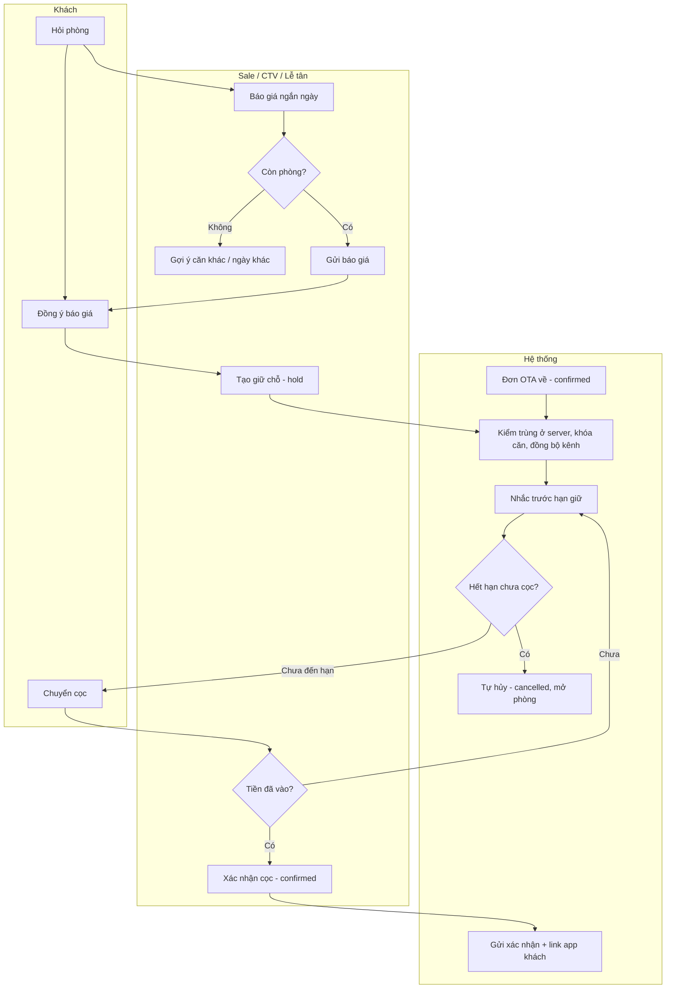

### Ngoại lệ
| Mã | Tình huống | Xử lý | Quy tắc |
|---|---|---|---|
| E1 | Khách đặt cho hôm nay | Không giữ chỗ; thu cọc/thu đủ ngay rồi tạo `confirmed` | BR-302 |
| E2 | Sale xin thêm thời gian giữ | Gia hạn giữ 1 lần (B3) trước khi hết hạn | BR-303 |
| E3 | Số đêm vượt giới hạn ngắn ngày | Chặn, chuyển sang báo giá dài hạn (P02) | BR-108, BR-112 |
| E4 | Khách hủy giữ chỗ chưa cọc | B5, lý do bắt buộc, không phí | BR-308 |
| E5 | Khách hủy đơn đã cọc (trực tiếp/CTV) | B10; hệ thống tính phần hoàn/phí hủy theo mốc ngày; hoàn qua P10 (MGR duyệt); hoặc MGR dời ngày (B8) | BR-309, BR-522 |
| E6 | OTA hủy | Nhận trạng thái + tiền phạt từ kênh, không tự tính | BR-310 |
| E7 | Khách không đến | Sau mốc gọi BR-311 lễ tân gọi/nhắn; sau mốc đánh dấu và không liên lạc được → B11 (thủ công). Đơn OTA: tạo việc báo no-show trên kênh | BR-311 |
| E8 | Khách báo đến trễ | Ghi giờ đến dự kiến; không đánh dấu no-show | BR-311 |
| E9 | Đổi căn/ngày trước khi đến | B7, kiểm trùng, lý do | BR-906 |
| E10 | **OTA sửa đơn** (đổi ngày, số khách, loại phòng, hủy một phần đêm) | B7c: SYS (R3) hoặc FD (R2, theo extranet) áp thay đổi; kiểm trùng lại – phần không xếp được → làn "Chưa gán căn"; giá snapshot theo OTA mới; số người cần khai báo cập nhật (đã `confirmed` → `needs_update`); đồng bộ kênh. Đơn đang `in_house` mà OTA rút ngắn ngày → việc "Xác nhận thay đổi từ OTA" cho FD, không tự áp | BR-312, BR-601, BR-905 |
| E11 | Đơn OTA ở làn "Chưa gán căn" | FD gán căn trống (B7a) theo thứ tự BR-312; không còn căn → MGR dời khách ra ngoài, đóng sự cố; cấm nhận phòng khi chưa gán | BR-312 |

### Lỗi
| Mã | Lỗi | Hành vi hệ thống / thông báo |
|---|---|---|
| X1 | Hai người cùng đặt một căn – đêm | Một người thành công; người kia: "Căn {số} đêm {ngày} vừa được đặt. Chọn căn khác." (BR-906) |
| X2 | Đơn OTA về trùng (đồng bộ trễ) | Vẫn tạo đơn, không tự hủy đơn nào; tự gán căn trống cùng nhóm, không có → "Chưa gán căn"; cảnh báo đỏ FD + MGR; đồng bộ lỗi > 15 phút → FD đóng bán thủ công trên extranet (decision-log DOM) | BR-312 |
| X1b | Nhập tay đơn **trực tiếp/CTV** vào căn đã kín | Chặn: "Căn {số} đã có đơn {ngày}–{ngày}. Chọn căn khác." kèm gợi ý căn trống | BR-906 |
| X3 | Tiền cọc về sau khi giữ chỗ đã tự hủy | Cảnh báo "Tiền về cho đơn đã hủy" → tạo lại đơn nếu căn trống, không thì hoàn | SM-01 mục 1.3 |
| X4 | Giá trống/0 hoặc ngoài sàn–trần | Báo lỗi tại ô, không lưu | BR-105 |
| X5 | Số khách vượt sức chứa (người lớn + trẻ 6–11; trẻ dưới 6 không tính; tối đa = định mức + 1 người ngủ sofa – INV quyết ESC-014) | Chặn: "Căn {số} tối đa {n} khách" | BR-110 |
| X6 | Thiếu SĐT với đơn trực tiếp/CTV | Chặn lưu | BL 5.16 |
| X7 | Đồng bộ kênh lỗi | Cảnh báo lễ tân, tự thử lại | BR-905 |

### Đơn nhóm – đoàn / gia đình nhiều căn (FB-R1-DOM-BA-05; SM-16; UC-31)
Mỗi căn là một đơn SM-01 riêng; nhóm chỉ gom cọc, hủy bớt và bill. Quy tắc đoàn (mức cọc nhóm, hạn danh sách khách) do DOM bổ sung trong BR; nếu chưa có thì dùng quy tắc đơn lẻ.
| Bước | Ai | Việc | Quy tắc |
|---|---|---|---|
| 1 | SAL/CTV/FD | Báo giá nhiều căn trong một báo giá (mỗi căn một dòng: căn, ngày, số khách) | BR-110, BR-304 |
| 2 | SAL/CTV/FD | Tạo giữ chỗ từ báo giá → mỗi căn một đơn `hold`, cùng `group_id`, khách đầu mối là người đặt/người trả (G1) | BR-302, BR-906 – căn nào trùng thì báo căn đó, các căn khác vẫn tạo được |
| 3 | GST | Chuyển **một** khoản cọc cho cả nhóm (VietQR nội dung = mã nhóm) | BR-521 |
| 4 | FD/SAL | Ghi giao dịch cho nhóm, phân bổ theo căn (mặc định theo tỷ lệ tiền phòng, sửa được); đơn nào đủ mức BR-305 → `confirmed` (G2 + B4) | BR-305 |
| 5 | FD | Trước ngày đến: cập nhật danh sách khách từng căn (người đứng tên từng căn) | BR-601 |
| 6 | FD | Nhận phòng từng căn (B9) – có thể lệch giờ | BR-402 |
| 7 | FD | Trả phòng: chọn **bill gộp** (một bill liệt kê từng căn, người trả chung) hoặc **bill tách** từng căn | BR-523 |
Ngoại lệ: **hủy một căn** (G3) – phí hủy/hoàn tính theo BR-309 trên phần cọc đã phân bổ cho căn đó; phần hoàn mặc định giữ làm cọc cho các căn còn lại nếu khách đồng ý, không thì yêu cầu hoàn (P10). **Khách trong đoàn ở thêm** – gia hạn đơn của căn đó (P04a). **Đơn OTA nhiều phòng** – mỗi phòng OTA một đơn, gom nhóm theo mã OTA. Lỗi: tổng phân bổ ≠ số tiền giao dịch → chặn lưu; bỏ một đơn khỏi nhóm khi đơn đó còn phần cọc chung → bắt chọn phần cọc đi theo đơn hay ở lại nhóm.

---

## P02 – Báo giá → giữ chỗ → cọc → hợp đồng dài hạn

**Mục tiêu**: chốt khách thuê tháng đúng công thức, ký quỹ và kỳ thu đúng, hoa hồng ghi nhận đúng người.
**Vai**: GST, SAL/CTV, FD, MGR, SYS. **Kích hoạt**: khách hỏi thuê tháng, hoặc khách ngắn ngày vượt ngưỡng BR-108.
**Kết quả**: đơn dài hạn `confirmed`, HĐ `signed`, lịch kỳ thu, hoa hồng `projected`.

### Luồng chính
| Bước | Ai | Việc | Quy tắc |
|---|---|---|---|
| 1 | SAL/CTV | Lập báo giá dài hạn: căn, ngày vào ở, kỳ hạn, loại khách VN/NN, số người, gói dọn, người chốt | BR-009, BR-201–205, BR-209 |
| 2 | SYS | Tính tiền thuê/tháng, phí dịch vụ, điện nước ước tính, ký quỹ, chu kỳ thu, thu khi chốt, hoa hồng; lưu snapshot; mã báo giá | BR-203–208, BR-212, BR-006, BR-007 |
| 3 | SAL/CTV | Gửi văn bản báo giá VI/EN/RU; báo giá `active`, lead `quoted` | BR-304 |
| 4 | GST | Đồng ý | – |
| 5 | SAL/CTV | Tạo giữ chỗ từ báo giá (Q2 → B1) | BR-302, BR-906 |
| 6 | GST | Chuyển ký quỹ | BR-306 |
| 7 | FD/SAL | Xác nhận ký quỹ (B4) | BR-206, BR-306 |
| 8 | SYS | Sinh HĐ `signed` + lịch kỳ thu (SM-07) + hoa hồng `projected`; lead `won` | BR-207, BR-208, BR-212 |
| 9 | SAL/FD | Xuất PDF HĐ (R3), ký giấy với khách | PRD X4 |
| 10 | FD | Ngày vào ở: thu kỳ đầu trước khi giao mã cửa → nhận phòng (P03) → HĐ `active` | BR-208 |
| 11 | SYS | Nhắc kỳ thu theo mốc, cảnh báo quá hạn | BR-207 |
| 12 | SYS | Trước hạn HĐ theo BR-211: cảnh báo "chào gia hạn" | BR-211 |

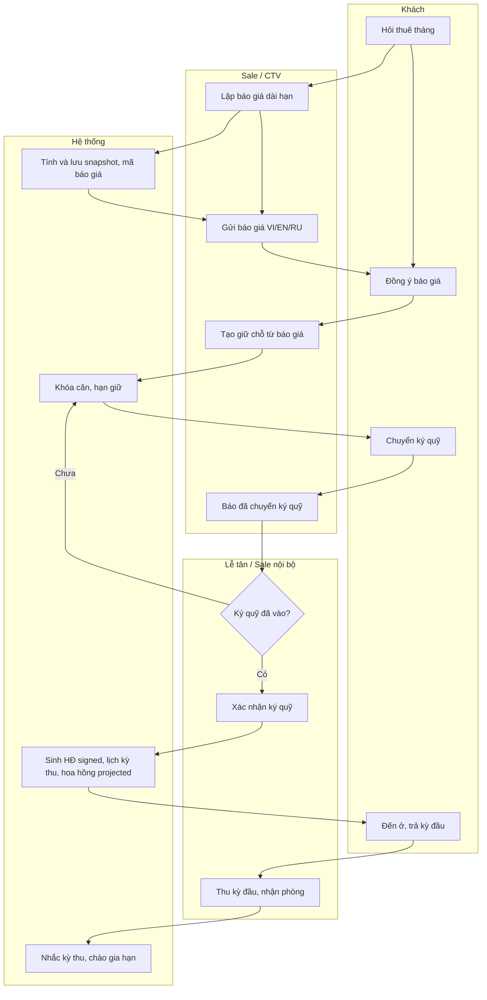

### Ngoại lệ
| Mã | Tình huống | Xử lý | Quy tắc |
|---|---|---|---|
| E1 | Báo giá hết hiệu lực trước khi khách đồng ý | Báo giá `expired`; MGR gia hạn (Q4) hoặc lập báo giá mới theo giá hiện hành | BR-304 |
| E2 | Kỳ hạn không trùng mốc | Áp mức của mốc thấp hơn gần nhất | BR-202 |
| E3 | HĐ cũ không có phí dịch vụ (thực tế Brief 5) | Sale đặt phí dịch vụ = 0 có lý do | BR-204, Q-D1 |
| E4 | Khi nhận phòng, giấy tờ khác loại khách đã báo (VN ↔ NN) | Cảnh báo MGR, **không** tự đổi giá HĐ | BR-009 |
| E5 | Thỏa thuận số tiền khác công thức | Sửa tay có lý do + MGR duyệt (P10) | BR-006 |
| E6 | Hủy trước ngày vào ở | H3: hoàn theo BR-314, MGR duyệt | BR-314, BR-522 |
| E7 | Khách báo chấm dứt sớm | H6: tính mất ký quỹ/hoàn theo BR-313, kỳ chưa bắt đầu `waived`, hoa hồng đợt 2 `void` | BR-313, BR-212 |
| E8 | Gia hạn HĐ | H4: phụ lục/HĐ mới với tham số tại thời điểm gia hạn; bù ký quỹ; NN kiểm thị thực | BR-211, BR-605 |
| E9 | Kỳ thu quá hạn | Mốc cảnh báo/chuyển quản lý theo BR-207; không khóa cửa khách | BR-207 |

### Lỗi
| Mã | Lỗi | Hành vi |
|---|---|---|
| X1 | Căn đã có đơn trong khoảng HĐ | Chặn giữ chỗ, gợi ý căn trống khác | BR-906 |
| X2 | Ngày vào ở đã qua | Chặn | – |
| X3 | Thị thực khách NN hết trước ngày kết thúc HĐ | Cảnh báo đỏ; khai báo đến hết hạn thị thực; nhắc khách gia hạn | BR-605 |

---

## P03 – Nhận phòng + giấy tờ + khai báo lưu trú

**Mục tiêu**: khách vào phòng nhanh, thu đủ tiền, giấy tờ đúng, khai báo đúng hạn.
**Vai**: GST, FD (gồm người trực đêm), FDL, MGR, HK, SYS. **Kích hoạt**: ngày đến của đơn `confirmed` (theo **ngày nghiệp vụ** – BR-010, tham số `business_day_rollover`, mặc định 06:00).
**Thiết bị**: B9 và mọi bước giấy tờ (C3) chỉ làm trên **thiết bị được cấp** mở admin-web – máy quầy hoặc máy tính bảng của cơ sở (`rbac-matrix.md` 8.7). PWA trên điện thoại cá nhân không làm được nhận phòng.
**Kết quả**: đơn `in_house`, buồng `OC`, khai báo ≥ `sent` trước hạn, mã cửa đã giao.

### Luồng chính
| Bước | Ai | Việc | Quy tắc |
|---|---|---|---|
| 0 | SYS → GST | Trước ngày đến: gửi link check-in online | US-107 |
| 1 | GST | (Tùy chọn) Check-in online: tải giấy tờ từng người qua link có hạn, giờ đến dự kiến, đồng ý lưu ảnh (tách mục đích) → khai báo `pre` | SEC R-REG-08, R-CON-01 |
| 2 | FD | Mở đơn ở "Khách đến"; kiểm buồng `VI`/`VC` | BR-402, BR-803 |
| 3 | FD | Nhập/đối chiếu giấy tờ từng người (hoặc xác nhận dữ liệu `pre`) → `partial`/`review` | BR-601, BR-606, BR-612 |
| 4 | SYS | Đối chiếu tự động: tên khớp đơn, hạn hộ chiếu so thật, thị thực đến ngày trả, đủ người | BR-605 |
| 5 | FD | Xử lý cảnh báo (ghi chú); ghi đồng ý lưu ảnh có/không → `scanned` | BR-609, SEC R-REG-05 |
| 6 | FD | Thu phần còn lại (đơn trực tiếp/CTV) hoặc xác nhận OTA đã trả | BR-305, BR-307, BR-402 |
| 7 | FD | Nhập giờ nhận thực tế (mặc định giờ chuẩn); nếu sớm → hệ thống đề xuất phụ thu, FD xác nhận; FOC qua P10 | BR-401, BR-411, BR-413, BR-414 |
| 8 | FD | Bấm Nhận phòng (B9) | BR-402 |
| 9 | SYS | Đơn `in_house`, buồng `OC`, mã cửa hiệu lực, hạn khai báo bắt đầu đếm | BR-403, BR-602, BR-603 |
| 10 | FD | Giao mã cửa/thẻ (tối đa số thẻ BR-511), gửi nội quy VI/EN/RU | BR-403, BR-511 |
| 11 | FD | Khai báo bán tự động: chọn loại, sao chép dữ liệu, tự đăng nhập cổng, dán mã hồ sơ → `sent` → `confirmed` | BR-606, SEC R-REG-06/07 |
| 12 | SYS | Áp hạn lưu ảnh hoặc xóa ngay nếu không đồng ý | BR-609, BR-610 |

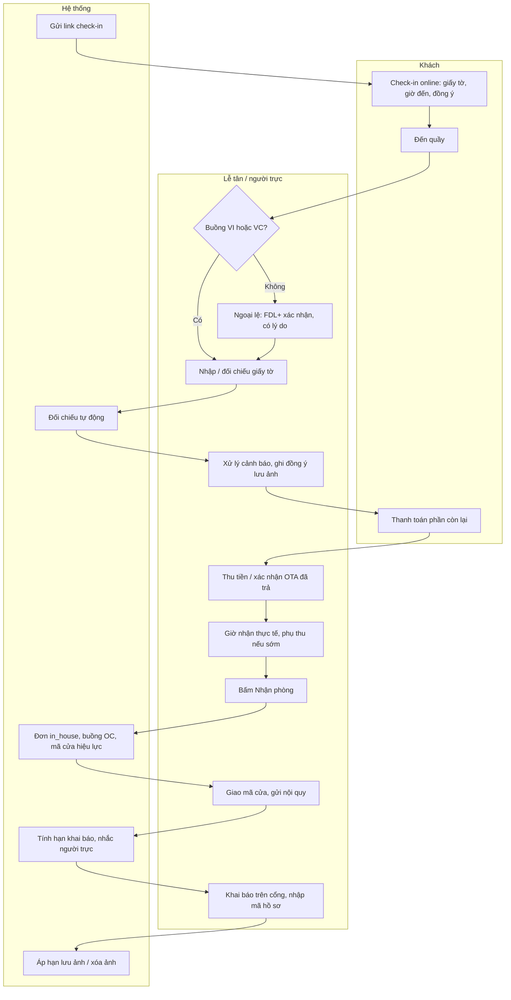

### Ngoại lệ
| Mã | Tình huống | Xử lý | Quy tắc |
|---|---|---|---|
| E1 | Buồng chưa sẵn sàng, khách đến sớm | Gửi hành lý, ưu tiên dọn căn (BR-807); hoặc nhận vào buồng chưa sạch nếu FDL+ đồng ý → `OD` | BR-402, BR-807 |
| E2 | Khách đến khuya (ngoài `front_desk_hours`) | Phân xử ORC 15/10/2026 + **SR-GST-15**: (1) trước ngày đến, mẫu tin mời check-in online (GST1, chỉ ghi giấy tờ) và xác minh GST2 bằng OTP email hoặc mã lễ tân (đọc tại quầy/điện thoại, hoặc qua kênh OTA/Zalo nếu OWN bật) **trong giờ trực**; (2) mã cửa hiện trong app GST2 từ giờ hiệu lực hoặc gửi bằng mẫu mã cửa đúng ngày đến; (3) khách tới mà chưa có GST2 hoặc chưa đối chiếu giấy tờ → **người trực đêm** (vai FD) dùng **thiết bị của cơ sở đã được cấp** (máy quầy hoặc máy tính bảng/điện thoại của cơ sở theo SR-DEV-08 – hạn cấp ≤ 30 ngày, ở lại cơ sở) mở admin-web để đối chiếu giấy tờ, làm B9, khai báo và đọc mã xác minh trực tiếp; **không** dùng điện thoại cá nhân hay PWA (SR-DEV-09); (4) không có người trực và khách chưa GST2 → khách gọi số trực đêm của quản lý (ESC-010). **Cấm** gửi mã cửa qua chat cá nhân. Nhắc theo mốc BR-611 | BR-611, SR-GST-15 |
| E2b | Khách đến trước mốc đổi ngày nghiệp vụ (BR-010, mặc định 00:00–05:59) của đơn có ngày đến là **hôm trước** | Vẫn thuộc ngày nghiệp vụ của ngày đến: đơn nằm trong "Khách đến", nhận phòng bình thường (B9); đêm đầu tính như đã đặt, không phụ thu nhận sớm | Ngày nghiệp vụ (DOM) |
| E3 | Thiếu giấy tờ người đi cùng | Vẫn nhận phòng nếu có giấy tờ người đứng tên; bổ sung trước hạn khai báo | BR-402, BR-601 |
| E4 | Thêm người giữa chừng | Cập nhật số khách (kiểm sức chứa BR-110), nhập giấy tờ → `needs_update` khai bổ sung | BR-601 |
| E5 | Thị thực hết trước ngày đi | Cảnh báo đỏ, khai đến hết hạn thị thực, nhắc khách gia hạn | BR-605 |
| E6 | Khách không đồng ý lưu ảnh | Vẫn khai báo; ảnh xóa sau khi khai xong; chỉ giữ trường văn bản cần thiết | BR-609, SEC R-REG-05 |
| E7 | Cổng khai báo từ chối | `sent` → `scanned`, sửa dữ liệu, khai lại | SM-05 K8 |
| E8 | Đơn đến khi vẫn `hold` | Thu cọc/đủ → B4 → B9 | SM-01 |
| E9 | Khách nhận trước mốc đổi ngày nghiệp vụ (BR-010, mặc định 06:00) **của chính ngày đến** (xe đêm, bay đêm) | **B9a – Thêm đêm trước**: kiểm căn trống đêm trước (BR-906). Đơn Trực tiếp/CTV: thêm 1 đêm vào đầu đơn. Đơn OTA (không đổi ngày đơn OTA): tạo **đơn con kênh Trực tiếp** cho đêm đó, đi thẳng `in_house`. Giá theo BR-411 (đêm bán). Căn không trống đêm trước → không cho nhận, gợi ý gửi hành lý hoặc đổi sang căn trống (B7) nếu khách đồng ý giá | BR-003, BR-411, BR-422, BR-904 |
| E10 | Mất mạng/mất điện khi khách đến | Theo P12: nhận khách bằng danh sách dự phòng, nhập bù khi có mạng với giờ thực tế. Mã cửa (C3) **không** nằm trong danh sách dự phòng – cách cấp mã khi mất mạng do INT/SEC chốt theo loại khóa (P12 bước 5) | P12 |

### Lỗi
| Mã | Lỗi | Hành vi |
|---|---|---|
| X1 | Chưa thu đủ mà bấm Nhận phòng | Chặn: "Còn phải thu {số tiền}" | BR-402 |
| X2 | Chưa có giấy tờ người đứng tên | Chặn giao mã cửa | BR-402 |
| X3 | Sắp quá hạn khai báo | Nhắc trước hạn, đưa vào "Cần chú ý"; quá hạn → cờ đỏ | BR-602, BR-603, BR-907 |
| X4 | Gửi ảnh giấy tờ qua chat | Không có đường nhập; mẫu tin hướng khách dùng link | SEC R-REG-08 |
| X5 | Tệp tải lên sai định dạng/quá lớn | Báo lỗi tại ô, cho tải lại | SEC R-REG-08 |

**Hạn khai báo**: công dân VN theo mốc BR-602 trong ngày đến; người nước ngoài = **giờ nhận thực tế + số giờ BR-603**, không còn áp mốc 23:00 cho khách nước ngoài (decision-log DOM 15/10/2026, thay dòng trước) `[GIẢ ĐỊNH – chờ luật sư qua ESC-001]`.

---

## P04 – Lưu trú: gia hạn, trả muộn, nhắc trả phòng, yêu cầu, sự cố

**Vai**: GST, FD, HK, MT, MGR, SYS.

### P04a – Gia hạn
| Bước | Ai | Việc | Quy tắc |
|---|---|---|---|
| 1 | GST (yêu cầu) / FD | Chọn số đêm thêm trong số đêm liên tiếp còn trống | BR-421 |
| 2 | SYS | Giá mặc định: đơn trực tiếp giữ giá đơn (trừ ngày đặc biệt); đơn OTA lấy giá trực tiếp hiện hành | BR-421 |
| 3 | FD | Xác nhận (sửa giá trong sàn–trần) | BR-105 |
| 4 | SYS | Đơn trực tiếp: kéo dài ngày đi. Đơn OTA: tạo đơn con kênh Trực tiếp liên kết; thông báo tiết kiệm phí kênh theo cấu hình | BR-422 |
| 5 | FD | Thu tiền gia hạn | BR-423 |
| 6 | SYS | Buồng `OD`, việc dọn đổi loại, đồng bộ kênh, khai báo NN `needs_update` | BR-802, BR-604, BR-905 |

Ngoại lệ: vượt giới hạn BR-421 hoặc tổng vượt ngưỡng BR-108 → báo giá dài hạn (P02). Không còn đêm trống liên tiếp → gợi ý căn cùng nhóm (đổi phòng P04e).

### P04b – Nhắc trả phòng và trả muộn
| Bước | Ai | Việc | Quy tắc |
|---|---|---|---|
| 1 | SYS | Nhắc khách theo các mốc (tối hôm trước, sáng ngày trả) kèm lựa chọn Trả đúng giờ / Ở thêm / Trả muộn | BR-425 |
| 2 | GST | Chọn (R3 tự phục vụ; R2 trả lời qua chat, lễ tân ghi) | US-113 |
| 3 | SYS | Chưa trả lời đến mốc → báo lễ tân gọi; quá giờ trả → báo đỏ FD + MGR | BR-425 |
| 4 | FD | Ghi giờ trả đã xác nhận / đặt trả muộn: phụ thu theo bậc; có khách đến cùng ngày và không có căn thay thế → chặn (MGR duyệt); sau mốc 100% → gia hạn | BR-412, BR-416 |
| 5 | FD | FOC nếu có → P10 | BR-431 |

### P04c – Yêu cầu từ app khách
| Bước | Ai | Việc | Quy tắc |
|---|---|---|---|
| 1 | GST | Gửi yêu cầu (6 loại) | BR-811 |
| 2 | SYS | Định tuyến: dọn/khăn → HK (việc); báo hỏng → MT (phiếu mức mặc định); xe/tour, trả muộn, khác → FD | BR-811 |
| 3 | Bộ phận nhận | "Đã nhận" trong thời hạn BR-811; ngoài giờ trực SYS trả lời tự động kèm giờ xử lý | BR-811 |
| 4 | Bộ phận nhận | Xử lý; phát sinh có phí (dọn lẻ, giặt) ghi folio khi xong | BR-506, BR-507 |
| 5 | SYS | Khách thấy trạng thái cập nhật | SM-15 |

### P04d – Sự cố (mất nước nóng, khóa hỏng, mất thẻ, đồ để quên)
| Bước | Ai | Việc | Quy tắc |
|---|---|---|---|
| 1 | GST/HK/FD | Báo sự cố → phiếu sửa (P08); FD nâng mức nếu ảnh hưởng khách | BR-809 |
| 2 | FD | Gửi mẫu tin xin lỗi đúng ngôn ngữ khách | US-125 |
| 3 | MT | Nhận phiếu trong thời hạn mức Cao | BR-809 |
| 4 | FD/MGR | Hết thời hạn phương án mà chưa sửa xong → đổi phòng (P04e) + FOC bù sự cố (P10) | BR-809, BR-424, BR-431 |
| 5 | FD | Mất thẻ phòng: thu phí theo BR-511, cấp thẻ mới, hủy thẻ cũ | BR-511, BR-403 |
| 6 | HK/FD | Đồ để quên: ghi sổ có ảnh, báo khách, lưu giữ; đồ giá trị bàn giao MGR có biên bản | BR-513 |

### P04e – Đổi phòng
FD chọn căn trống `VI`/`VC` (B14), ghi lý do; giá theo BR-424 (lỗi OTTIMO giữ giá cũ, khách yêu cầu tính giá căn mới); căn cũ → `VD`/`OD` + việc dọn; hủy mã cửa cũ, cấp mã mới; khai báo không khai lại (BR-424).

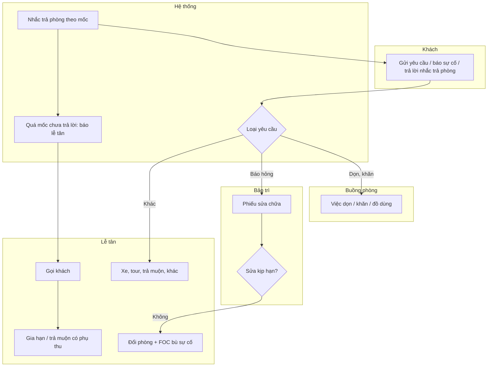

### Lỗi chung P04
| Mã | Lỗi | Hành vi |
|---|---|---|
| X1 | Đêm gia hạn vừa bị đặt | Từ chối, gợi ý căn khác (BR-906) |
| X2 | Trả muộn khi có khách đến | Chặn, đề xuất gửi hành lý; MGR duyệt nếu có căn thay thế (BR-416) |
| X3 | Đổi phòng sang căn OOO/không sạch | Chặn (SM-03) |

---

## P05 – Trả phòng 3 bước + bill

**Mục tiêu**: thu đúng mọi khoản trong ≤ thời gian chờ mục tiêu BR-426, bill khóa, buồng chuyển cần dọn.
**Vai**: GST, FD, HK, MGR, SYS. **Kích hoạt**: khách báo trả hoặc đến quầy ngày đi.

### P05a – Ngắn ngày (luồng chính)
| Bước | Ai | Việc | Quy tắc |
|---|---|---|---|
| 0 | HK | Khi khách báo trả: kiểm minibar, hư hỏng, thẻ phòng qua app nhân viên | BR-426, BR-703 |
| 1 | FD | **Bước 1 – Minibar**: xác nhận số còn lại; tự tính đã dùng, tiền; đồ miễn phí không tính tiền | BR-701, BR-702 |
| 2 | FD | **Bước 2 – Phụ phí**: giặt ủi, ăn uống, hư hỏng (bảng giá), phí phạt có bằng chứng, giờ trả thực tế (mặc định giờ chuẩn) → phụ thu trả muộn; FOC → P10 | BR-412, BR-414, BR-507, BR-511, BR-512 |
| 3 | FD | **Bước 3 – Bill**: tiền phòng từng đêm, phát sinh, dòng FOC âm, trừ đã cọc/đã thu, còn phải thu; VI/EN, quy đổi USD tham khảo; VAT tách khi xuất hóa đơn | BR-004, BR-434, BR-523 |
| 4 | GST | Thanh toán (VietQR / thẻ qua cổng / tiền mặt / đã thu qua OTA), có thể nhiều lần | BR-521 |
| 5 | FD | Ghi giao dịch; nhập thông tin hóa đơn công ty nếu khách cần | BR-521, BR-524 |
| 6 | FD | Bấm Hoàn tất (B18) – chỉ khi còn phải thu = 0 | BR-426 |
| 7 | SYS | Đơn `checked_out`, folio `settled`, số bill server cấp; buồng `VD`; việc "Dọn trả phòng", "Bổ sung minibar"; hủy mã cửa; khai báo NN `needs_update`; hóa đơn điện tử; hoa hồng `earned`; gửi bill + lời cảm ơn/mã quay lại | BR-007, BR-403, BR-524, BR-604, BR-903 |

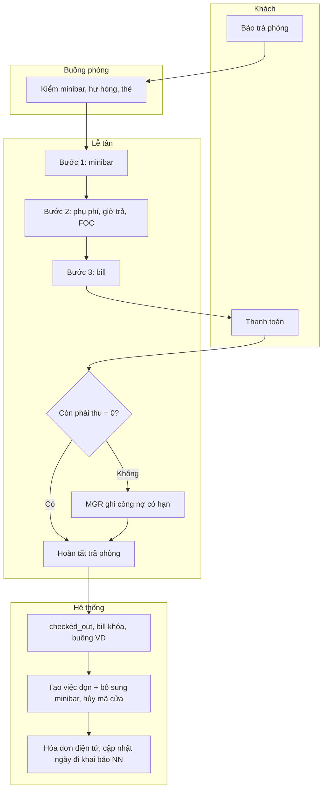

### P05b – Trả phòng nhanh qua app (không có người ở quầy)
GST bấm "Trả phòng" (B18 – chỉ khi còn phải thu = 0) → SYS gửi bill qua email/Zalo → HK kiểm minibar sau → phát sinh ghi vào folio `settled` và gửi khách link thanh toán trong thời hạn BR-427.

### P05c – Trả phòng dài hạn và quyết toán ký quỹ (R3)
| Bước | Ai | Việc | Quy tắc |
|---|---|---|---|
| 1 | SYS | Nhắc trước ngày trả theo BR-425 (dài hạn) | BR-425 |
| 2 | MT/FD | Chốt công tơ ngày trả (ảnh bắt buộc) | BR-502 |
| 3 | HK + FD | Kiểm phòng có ảnh: hư hỏng, mùi thuốc lá, thẻ phòng | BR-214, BR-511 |
| 4 | FD | Lập quyết toán: ngày lẻ chưa thu + điện nước kỳ cuối + minibar/dọn lẻ + phạt/bồi thường − ký quỹ | BR-210, BR-214 |
| 5 | FD | Hoàn tất trả phòng (B18); HĐ → `settling` | – |
| 6 | MGR | Duyệt quyết toán (P10) | BR-214, BR-522 |
| 7 | FD / MGR | Dương → FD thu thêm; âm → **MGR+** thực hiện chuyển khoản hoàn (thấy số TK đầy đủ) và ghi giao dịch hoàn trong thời hạn BR-214; FD chỉ nhập yêu cầu (số TK dạng che) | BR-214, rbac A47 |
| 8 | SYS | HĐ `closed` | SM-06 H9 |

### P05d – Trả sớm
FD ghi ngày rời mới (B16); hoàn theo BR-428 qua P10; mở bán các đêm còn lại; khai báo NN `needs_update`.

### Ngoại lệ và lỗi
| Mã | Tình huống | Xử lý |
|---|---|---|
| E1 | Khách tranh chấp minibar | FD **tự áp** FOC minibar trong hạn mức lần + hạn mức tháng tự áp (PIN của mình, lý do), vượt → FDL (SM-10 A2, DOM SQ-3) |
| E2 | Khách công ty trả sau | MGR ghi công nợ có hạn, cảnh báo quá hạn (BR-525) |
| E3 | Đơn OTA thu hộ | Bill ghi "Đã thu qua OTA"; chỉ thu phát sinh (BR-307, BR-415) |
| E4 | Phát hiện phát sinh sau khi hoàn tất | Ghi bút toán vào folio `settled` (FD trong thời hạn BR-427, sau đó MGR), gửi link thanh toán |
| X1 | Bấm Hoàn tất khi còn phải thu > 0 | Chặn: "Còn phải thu {số tiền}" (BR-426) |
| X2 | Còn FOC chờ duyệt | Chặn: "Có khoản chờ duyệt" (SM-10) |
| X3 | Phát hành hóa đơn điện tử lỗi | Bill vẫn khóa; hóa đơn vào hàng chờ thử lại, cảnh báo FD (R3) |
| X4 | MST sai định dạng | Báo lỗi tại ô (BL 5.16) |

---

## P06 – Chốt điện nước tháng

**Vai**: MT/FD (chốt), MGR (duyệt bất thường), GST (xem/thanh toán), SYS. **Kích hoạt**: ngày chốt theo BR-502; nhận phòng/trả phòng dài hạn.

| Bước | Ai | Việc | Quy tắc |
|---|---|---|---|
| 1 | SYS | Tạo danh sách căn dài hạn cần chốt, nhắc trong khung ngày chốt | BR-502 |
| 2 | MT/FD | Nhập chỉ số điện, nước mới + ảnh công tơ (bắt buộc) | BR-502 |
| 3 | SYS | Kiểm: mới < cũ → chặn (lý do + MGR duyệt); tiêu thụ vượt hệ số bất thường → cảnh báo kiểm tra | BR-503 |
| 4 | MGR | Duyệt trường hợp bất thường (P10) | BR-503 |
| 5 | SYS | Tính tiền theo đơn giá; sinh hóa đơn điện nước tháng (kỳ thu SM-07), hiện trong app khách, hạn thanh toán | BR-501, BR-504 |
| 6 | GST | Xem, thanh toán | BR-521 |
| 7 | FD | Ghi thu; hóa đơn điện tử | BR-524 |

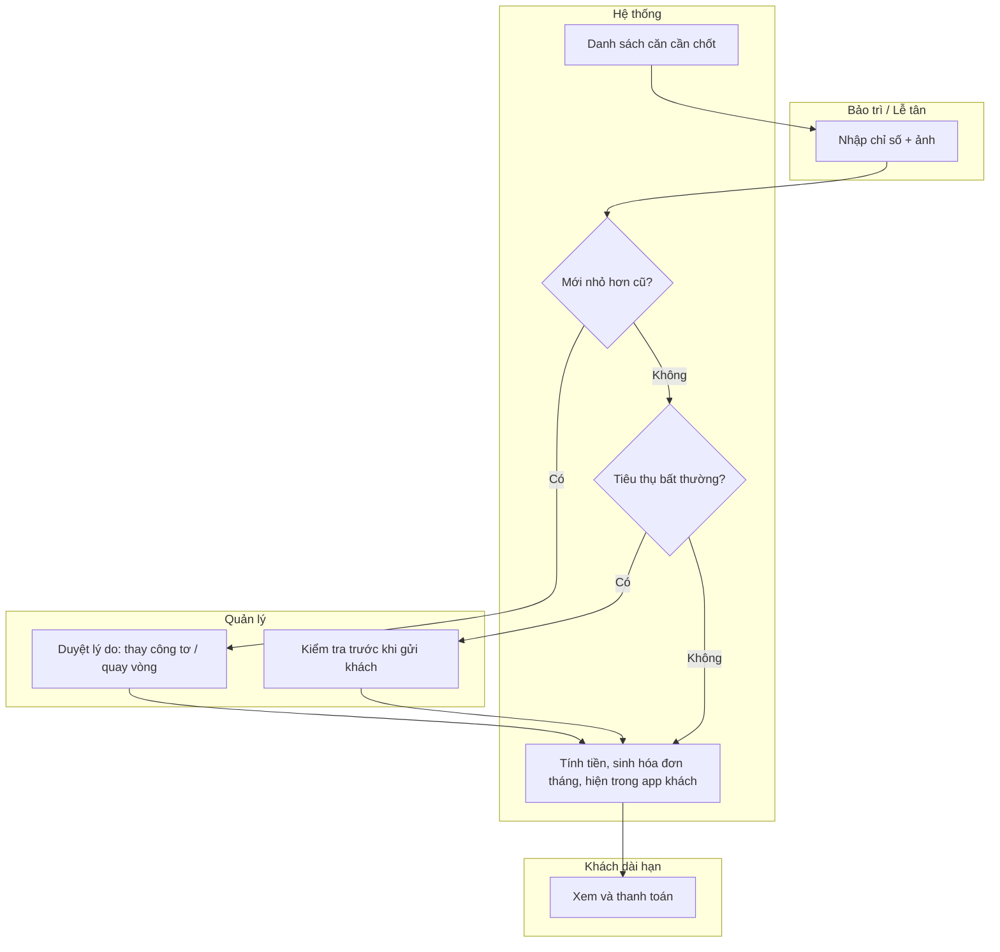

Lỗi: thiếu ảnh → chặn lưu; chỉ nhập một trong hai chỉ số → lưu nháp, chưa tính tiền (BL 5.10); quá khung ngày chốt → "Cần chú ý" (BR-907). Điện nước kỳ cuối khi trả phòng: chốt theo ngày trả (P05c).

---

## P07 – Buồng phòng / kiểm phòng

**Vai**: HK, FDL/MGR (kiểm), FD, SYS. **Kích hoạt**: đầu ca; sự kiện trả phòng, gia hạn, yêu cầu khách, lịch dọn dài hạn; **đơn `confirmed` có người vượt định mức (BR-812)**.

| Bước | Ai | Việc | Quy tắc |
|---|---|---|---|
| 1 | SYS | Sinh việc hôm nay: dọn trả phòng, dọn phòng khách ở (theo mốc hằng ngày, thay ga theo chu kỳ), lịch gói dài hạn, bổ sung minibar, yêu cầu khách; sắp theo ưu tiên | BR-802, BR-807 |
| 1a | SYS | **Việc "Chuẩn bị bộ đồ dùng thêm × n – căn X"** (INV quyết ESC-014 16/10): sinh **ngay khi** đơn vào `confirmed` (B2, B4, B7a, B12) mà số người tính định mức (người lớn + trẻ 6–11; trẻ dưới 6 không tính) vượt định mức căn đã gán – mọi kênh kể cả OTA, không phụ thuộc có thu phụ thu. Hạn = giờ nhận phòng của đơn (giờ chuẩn BR-401 hoặc giờ nhận sớm đã xác nhận BR-411); việc hiện trong danh sách của **ngày nghiệp vụ** ngày đến, cùng mức ưu tiên căn có khách đến. Thêm người giữa kỳ ở (lễ tân xác nhận theo BR-110) → sinh ngay, hạn `extra_guest_kit_midstay_due_minutes`. Đơn `hold` chưa sinh việc | BR-110, **BR-812** (1)(2), BR-807 |
| 2 | HK | Mở điện thoại, xem việc theo thứ tự ưu tiên (căn có khách đến hôm nay trước) | BR-807 |
| 3 | HK | Bắt đầu dọn (R1: `VD`/`OD` → `CL`) | BR-802 |
| 4 | HK | Kiểm minibar khi dọn phòng có khách; báo sự cố/đồ thất lạc nếu có | BR-703, BR-513 |
| 4a | HK | Với căn có việc 1a: đặt **1 bộ/người vượt định mức** (`extra_guest_kit_items`: 1 mền, 1 bộ khăn tắm, 1 bàn chải, 1 bộ đồ vệ sinh cá nhân) lên sofa lớn có sẵn (không nệm phụ) → bấm **"Đã chuẩn bị"**: SYS ghi **xuất khác** kho 1 bàn chải + 1 bộ đồ vệ sinh/người (giá vốn bình quân → chi phí phòng, không tính tiền khách); tồn không đủ vẫn cho bấm, ghi "thiếu kho" + cảnh báo Cần nhập. Mền, khăn là đồ vải luân chuyển – không trừ kho. Không có dòng tiền trên folio (đã gồm trong phụ thu người) | **BR-812** (3)(7), BR-705, BR-701 |
| 5 | HK | Dọn xong (R2/R3: → `OC` hoặc `VC`); việc tự xong | BR-802 |
| 6 | FDL/MGR (hoặc HK tự kiểm khi được phép) | Checklist kiểm phòng đủ mục (+ ảnh) → `VI`; căn có việc 1a thêm điểm kiểm **"bộ đồ dùng thêm đủ"** | BR-802, BR-808, **BR-812** (5) |
| 7 | HK | Bổ sung minibar → kho tự trừ | US-068 |
| 8 | SYS | Đối chiếu buồng – đơn theo mốc, cảnh báo lệch; `VC`/`VI` quá hạn → kiểm lại | BR-805, BR-806 |
| 9 | SYS → HK | **Thu hồi bộ đồ dùng thêm**: việc dọn trả phòng (B18) của căn có bộ thêm tự có dòng "Thu hồi bộ đồ dùng thêm" – mền, khăn đưa đi giặt cùng đồ vải của căn; bàn chải, đồ vệ sinh đã mở bỏ đi. Khách ở nhiều đêm: khăn bộ thêm thay theo lịch dọn hằng ngày, mền thay theo lịch thay ga | **BR-812** (6), BR-807 |

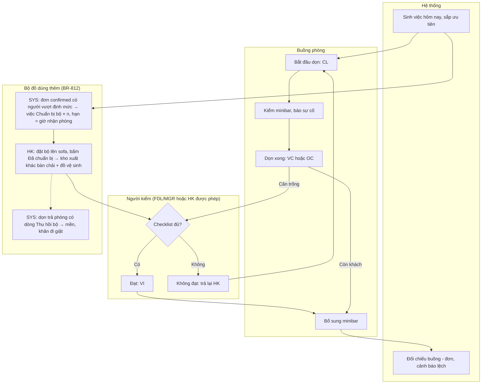

Ngoại lệ bộ đồ dùng thêm (BR-812 (4)(5)): **(E-K1)** đơn giảm người còn ≤ định mức, đổi căn chưa nhận phòng, hủy, no-show **trước** khi HK bấm "Đã chuẩn bị" → SYS hủy việc (`cancelled`, kho không đổi); **sau** khi đã chuẩn bị → việc chuyển thành "Thu hồi bộ đồ dùng thêm" ở lần dọn kế tiếp của căn cũ. **(E-K2)** đổi căn đơn tương lai (B7) → hủy việc ở căn cũ, sinh việc ở căn mới theo định mức căn mới. **(E-K3)** đổi phòng khách đang ở (B14) → việc "Chuyển bộ đồ dùng thêm sang căn {mới}" hạn = giờ đổi phòng. **(E-K4)** khách đến khi việc chưa xong → **không chặn** nhận phòng (B9): lễ tân thấy cảnh báo "Bộ đồ dùng thêm chưa chuẩn bị", việc tự nâng lên **đầu** hàng đợi HK. **(E-K5)** quá hạn mà chưa xong → "Cần chú ý" cho FD. Lỗi: HK bấm "Đã chuẩn bị" cho việc đã bị hủy → server từ chối (SM-14), hiện "Việc này đã hủy do đơn thay đổi".

Ngoại lệ: khách từ chối dọn → việc `cancelled` có lý do (BR-807); khách treo biển không làm phiền → hoãn, báo FD; **kiểm tra an toàn** (FB-R1-DOM-BA-09): căn từ chối dọn hoặc treo biển liên tục quá tham số `welfare_check_hours` (DOM đề xuất 48 giờ, đưa vào BR-807) → SYS tạo việc "Liên hệ khách" cho FD; không liên lạc được → MGR + 1 nhân viên vào kiểm, ghi biên bản (giờ, người, ảnh nếu cần); khách dài hạn từ chối dọn → kiểm tình trạng phòng tối thiểu 1 lần/tháng, báo trước 24 giờ (căn cứ khấu trừ ký quỹ BR-214); mất mạng → thao tác lưu trên máy và gửi lại khi có mạng (US-058, ARC quyết cách làm). Lỗi: chuyển trạng thái không hợp lệ (ví dụ `VD` → `VI`) → server từ chối (SM-03).

---

## P08 – Bảo trì: phiếu sửa chữa, khóa phòng, bảo trì định kỳ

**Vai**: MT, HK, FD, MGR, GST, SYS.

| Bước | Ai | Việc | Quy tắc |
|---|---|---|---|
| 1 | HK/FD/MT/GST | Báo hỏng: căn, mô tả, ảnh, mức độ (W1) | BR-809, BR-811 |
| 2 | FD/MT | Nếu cần khóa phòng: chọn khoảng ngày dự kiến → khối OOO (O1). Căn có khách → đổi phòng trước; trùng đơn tương lai → danh sách đơn cần dời | BR-804 |
| 3 | SYS | Mức Cao → báo ngay MT + FD + MGR; đo thời hạn nhận/xử lý | BR-809, BR-907 |
| 4 | MT | Nhận phiếu (W2) → xử lý → chờ vật tư nếu cần (W3) | BR-809 |
| 5 | MT | Sửa xong (W4), ảnh sau sửa | – |
| 6 | SYS | Khối OOO `released` → buồng `VD` → việc dọn; mở bán, đồng bộ kênh; yêu cầu khách `done` | BR-804, BR-905 |
| 7 | SYS | Bảo trì định kỳ: hoàn thành → sinh kỳ kế tiếp; sắp đến hạn → cảnh báo | BR-810 |

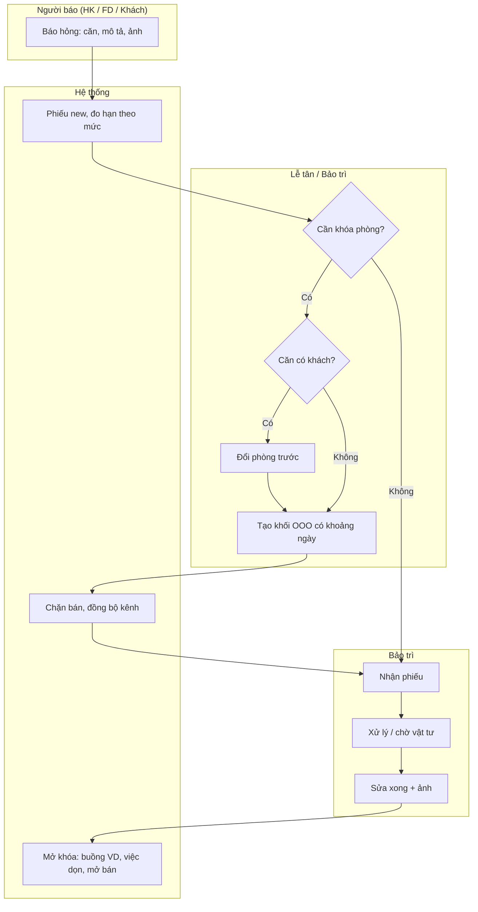

Lỗi: khóa căn đang có khách → chặn; tạo phiếu thiếu mô tả → chặn; mở khóa tay không qua phiếu → chỉ MGR+ có lý do.

---

## P09 – Hoa hồng CTV / sale

**Vai**: SAL/CTV (xem của mình), SYS, OWN/MGR (chi). **Kích hoạt**: đơn/HĐ có người chốt được xác nhận.

| Bước | Ai | Việc | Quy tắc |
|---|---|---|---|
| 1 | SAL/CTV | Ghi người chốt khi báo giá/giữ chỗ | BR-212, BR-903 |
| 2 | SYS | Xác nhận cọc → hoa hồng `projected` với tỷ lệ, cơ sở snapshot | BR-006 |
| 3 | SYS | Ngắn ngày: đơn `checked_out` + thu đủ → `earned`. Dài hạn: đợt 1 khi kỳ đầu `paid`; đợt 2 khi qua mốc thời hạn | BR-212, BR-903 |
| 4 | SYS | Đơn hủy/no-show, HĐ chấm dứt sớm trước đợt 2 → `void` | BR-212, BR-903 |
| 5 | SYS | Job ngày 1 hằng tháng: mọi bản ghi `earned` của tháng trước → `payable`; chi trước ngày 10 `[GIẢ ĐỊNH – chờ INV]`; điều chỉnh sau khi đã `paid` trừ vào kỳ sau (DOM SQ-4) | BR-008 |
| 6 | OWN/MGR | Chi, đánh dấu `paid` (ngày, cách chi, chứng từ) | – |
| 7 | SAL/CTV | Xem hoa hồng của mình theo trạng thái | US-087, US-089 |

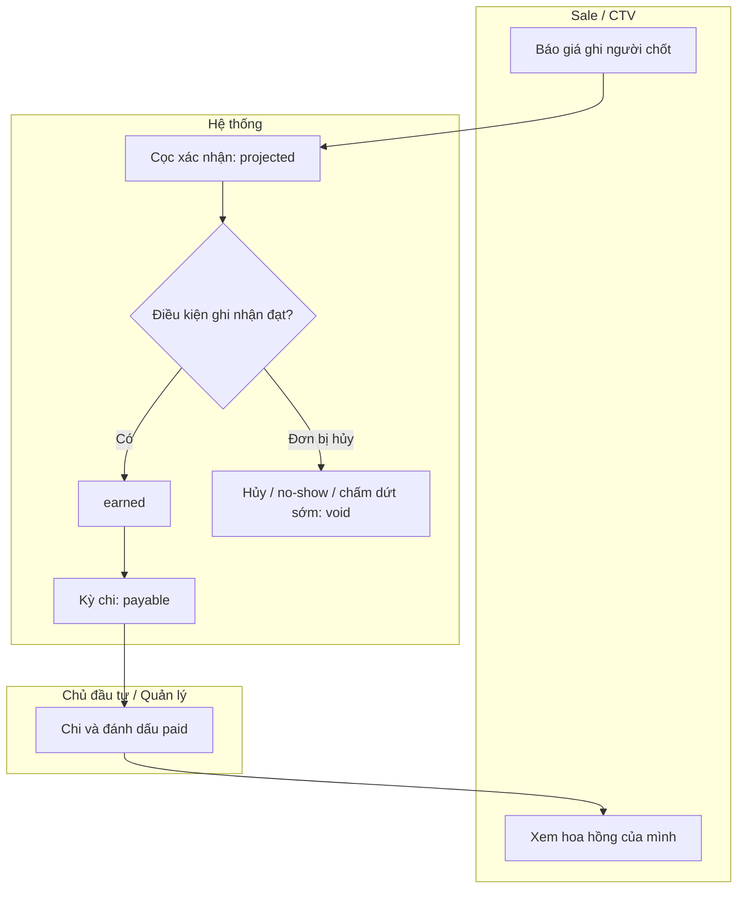

Mâu thuẫn còn mở: tỷ lệ CTV ngắn ngày ở báo giá khác báo cáo kênh (BR-903, Q-D2) – dùng tỷ lệ BR-903, báo cáo lấy từ hoa hồng thực tế từng đơn.

---

## P10 – Duyệt FOC / giảm giá đặc biệt / ngoại lệ (dùng chung)

| Bước | Ai | Việc | Quy tắc |
|---|---|---|---|
| 1 | FD/FDL/SAL/MT | Gửi yêu cầu: loại, giá trị, lý do từ danh mục | BR-432 |
| 2 | SYS | Trong hạn mức tự áp của vai (MGR/OWN theo BR-433; FD/FDL chỉ FOC minibar trong hạn mức lần + hạn mức tháng tự áp) → `approved`; còn lại → `pending`, báo người có quyền | BR-432, BR-433, BR-704 |
| 3 | Người duyệt | Xác nhận bằng PIN/mật khẩu của chính mình; không duyệt yêu cầu của chính mình | BR-432 |
| 4 | SYS | Vượt hạn mức lần/tháng → chuyển cấp trên | BR-433 |
| 5 | SYS | Duyệt: folio có dòng phát sinh + dòng FOC âm; nhật ký; cộng hạn mức tháng; kiểm cảnh báo thất thoát gửi OWN | BR-434, BR-435 |

```mermaid
flowchart TB
  subgraph REQ["Người gửi (FD / FDL / SAL / MT)"]
    A1["Gửi yêu cầu + lý do"]
  end
  subgraph SYS["Hệ thống"]
    Y1{"Được tự áp?"}
    Y2["pending, báo người duyệt"]
    Y3{"Trong hạn mức người duyệt?"}
    Y4["Ghi folio: phát sinh + FOC âm, nhật ký"]
    Y5["Kiểm ngưỡng thất thoát, báo chủ đầu tư"]
  end
  subgraph APP["Người duyệt (FDL / MGR / OWN)"]
    P1["Xác nhận bằng PIN của chính mình"]
    P2["Từ chối có lý do"]
  end
  A1 --> Y1
  Y1 -- "Có" --> Y4
  Y1 -- "Không" --> Y2 --> Y3
  Y3 -- "Có" --> P1 --> Y4 --> Y5
  Y3 -- "Không: chuyển cấp trên" --> P1
  Y2 --> P2
```

Lỗi: người duyệt = người gửi (không phải MGR/OWN) → từ chối; PIN sai → không duyệt, khóa tạm sau số lần sai do SEC quy định; yêu cầu còn `pending` → chặn hoàn tất trả phòng.

---

## P11 – Đóng ca / chốt ngày, đối soát tiền (FB-R1-DOM-BA-03; SM-17; UC-32)

**Mục tiêu**: mỗi ca bàn giao đúng tiền mặt, mọi chuyển khoản ghi tay được đối soát với sao kê, việc tồn không rơi giữa hai ca. INV xem đối soát hằng ngày trong app thay cho sổ tay.
**Vai**: FD/FDL (chủ ca), MGR (xem chênh lệch, đối soát chuyển khoản), OWN (cảnh báo), SYS. **Kích hoạt**: hết ca, bàn giao ca, người trực đêm bàn giao buổi sáng; đối soát chuyển khoản tối thiểu 1 lần/ngày nghiệp vụ.
**Tiền điều kiện**: ca của người đó đang `open` (C1 – mở ca khi bắt đầu, nhập tiền mặt đầu ca nhận bàn giao). **Kết quả**: ca `closed`, biên bản ca, danh sách việc tồn chuyển ca sau; giao dịch chuyển khoản `reconciled`/`disputed`.

| Bước | Ai | Việc | Quy tắc |
|---|---|---|---|
| 1 | FD | Bấm "Đóng ca" (C2) | SM-17 |
| 2 | SYS | Lập báo cáo ca: tổng thu theo cách thanh toán (tiền mặt, chuyển khoản/VietQR ghi tay, cổng thanh toán, đã thu qua OTA), số giao dịch, hoàn đã chi; tiền mặt phải có = đầu ca + thu tiền mặt − chi tiền mặt; danh sách chuyển khoản ghi tay `pending` của ca; FOC tự áp trong ca (SM-10 A2); khôi phục no-show trong ca (B12); nhập bù sau mất mạng (P12) | BR-521, BR-526 (DOM) |
| 3 | FD | Đếm và nhập tiền mặt thực tế; chênh lệch ≠ 0 → lý do bắt buộc | BR-526 |
| 4 | SYS | Danh sách việc tồn cho ca sau: khai báo chưa `sent` và hạn còn lại; khách đến chưa tới (giờ đến dự kiến); khách đi chưa trả phòng; yêu cầu khách đang mở; phiếu sửa mức Cao đang mở; giữ chỗ sắp hết hạn | BR-602/603, BR-311, BR-811, BR-809, BR-303 |
| 5 | FD | Xác nhận đóng ca (C3); bàn giao tiền mặt cho người nhận ca (người nhận mở ca mới với số đầu ca = số bàn giao) | SM-17 |
| 6 | SYS | Chênh lệch ≠ 0 → thông báo MGR; ca `closed` khóa số liệu | BR-008 |
| 7 | MGR | Hằng ngày: mở "Đối soát chuyển khoản", so từng giao dịch `pending` với sao kê ngân hàng → tick `reconciled`; không thấy tiền sau mốc BR-526 → `disputed` (A46) | BR-526 |
| 8 | SYS | `disputed` → cảnh báo đỏ OWN + MGR; `pending` quá mốc → "Cần chú ý"; R3: webhook bank feed khớp số tiền + nội dung → tự `reconciled` | SM-12 |

```mermaid
flowchart TB
  subgraph FD["Lễ tân / người trực (chủ ca)"]
    F1["Bấm Đóng ca"]
    F2["Đếm tiền mặt, nhập số thực tế"]
    F3{"Chênh lệch = 0?"}
    F4["Ghi lý do chênh lệch"]
    F5["Xác nhận đóng ca, bàn giao tiền + việc tồn"]
  end
  subgraph SYS["Hệ thống"]
    Y1["Báo cáo ca: thu theo cách thanh toán, tiền mặt phải có, CK chờ đối soát, FOC tự áp, khôi phục no-show, nhập bù"]
    Y2["Danh sách việc tồn cho ca sau"]
    Y3["Báo MGR nếu chênh lệch"]
    Y4["Cảnh báo CK quá mốc / disputed"]
  end
  subgraph MGR["Quản lý"]
    M1["Đối soát CK với sao kê"]
    M2{"Thấy tiền?"}
    M3["reconciled"]
    M4["disputed: đảo giao dịch, thu lại"]
  end
  F1 --> Y1 --> F2 --> F3
  F3 -- "Có" --> F5
  F3 -- "Không" --> F4 --> F5
  F5 --> Y2
  F4 --> Y3
  M1 --> M2
  M2 -- "Có" --> M3
  M2 -- "Không" --> M4 --> Y4
```

Ngoại lệ: **người trực đêm một mình** – mở ca khi nhận trực, đóng ca khi bàn giao buổi sáng; không có người nhận ca → tiền mặt cất két theo quy định nội bộ `[GIẢ ĐỊNH – chờ INV qua ESC-010]`, người mở ca sáng đếm lại và ghi nhận. **Quên đóng ca** – ca `open` quá `shift_max_hours` → "Cần chú ý" cho MGR; MGR không đóng hộ, chủ ca đóng khi quay lại (giữ trách nhiệm theo người). **Khách đưa ảnh chụp màn hình chuyển khoản** – FD vẫn ghi nhận (`pending`), không giao mã cửa chỉ dựa vào ảnh khi số tiền > tham số `transfer_unverified_max` `[GIẢ ĐỊNH – DOM chốt trong BR-526]`. Lỗi: đóng ca khi chưa nhập tiền mặt → chặn; đối soát giao dịch do chính mình ghi (trừ OWN) → chặn (rbac 5.3).

---

## P12 – Vận hành khi mất mạng / mất điện ở quầy (FB-R1-DOM-BA-04; UC-33)

**Mục tiêu**: khách vẫn được nhận/trả phòng an toàn khi quầy mất mạng hoặc mất điện; dữ liệu nhập bù đúng giờ thực tế, không đặt trùng.
**Vai**: FD/FDL, MGR, SYS. **Bối cảnh**: theo ADR-005, thao tác tiền và tồn phòng bắt buộc có mạng; Đà Lạt mùa mưa hay mất điện, mất mạng cục bộ (BR mục 14 S7).
**Phần kỹ thuật** (bản đọc offline, lưu trữ trên thiết bị, cách đồng bộ) do ARC/UXD quyết; quy trình dưới đây không giả định có chế độ offline ghi dữ liệu.

| Bước | Ai | Việc | Quy tắc |
|---|---|---|---|
| 1 | SYS → FD | **Phòng ngừa, đầu mỗi ngày nghiệp vụ** (BR-010, tham số `business_day_rollover`, mặc định 06:00): sinh "Danh sách dự phòng" của ngày – khách đến (tên, căn, số khách, đã cọc/còn phải thu, giờ đến dự kiến, đã check-in online chưa), khách đi (căn, còn phải thu), trạng thái buồng, số điện thoại khẩn (MGR, kỹ thuật, nhà cung cấp mạng/điện). **Không** chứa số giấy tờ, ảnh, mã cửa (C3). FD in giấy hoặc lưu bản đọc offline trên thiết bị được cấp (S34) | rbac 8.7, SEC mục 3 |
| 2 | FD | Mất mạng: thử theo thứ tự – (a) 4G điện thoại **của cơ sở** phát Wi-Fi cho thiết bị quầy; (b) nếu không được → chế độ giấy | – |
| 3 | FD | Chế độ giấy: ghi sổ dự phòng mỗi việc – giờ thực tế, căn, khách, tiền thu (cách thu), người làm. Nhận khách đã có trong danh sách: cho vào phòng `VI`/`VC` theo danh sách; giấy tờ: xem bản gốc, ghi sổ, nhập lại khi có mạng (hạn khai báo vẫn tính từ giờ nhận thực tế) | BR-402, BR-603 |
| 4 | FD | **Không** nhận đơn mới (điện thoại/khách vãng lai) khi chưa xem được tồn phòng: ghi thông tin, báo khách "sẽ xác nhận lại khi có hệ thống"; không hứa căn | BR-906 |
| 5 | FD | Mã cửa: khóa thông minh hoạt động độc lập mạng quầy thì dùng mã đã cấp trước (khách check-in online) hoặc ứng dụng của nhà cung cấp khóa trên thiết bị cơ sở; cách làm theo loại khóa do INT/SEC chốt (`integrations/smart-lock.md`) | BR-403 |
| 6 | FD | **Có mạng lại**: nhập bù từng việc theo thứ tự thời gian bằng A11b – nhập "giờ thực tế" trong quá khứ + lý do "nhập bù sau mất mạng"; phụ thu nhận sớm/trả muộn tính theo **giờ thực tế**, không theo giờ nhập (BR-414) | BR-414 |
| 7 | SYS | Kiểm trùng khi nhập bù (BR-906); đối soát kênh (BR-905) – đơn OTA về trong lúc mất mạng được xử lý như X2 của P01; danh sách việc nhập bù vào báo cáo ca (P11) và thông báo MGR | BR-905, BR-906 |
| 8 | MGR | Xem danh sách nhập bù, đối chiếu sổ giấy; sổ giấy lưu theo quy định nội bộ | – |

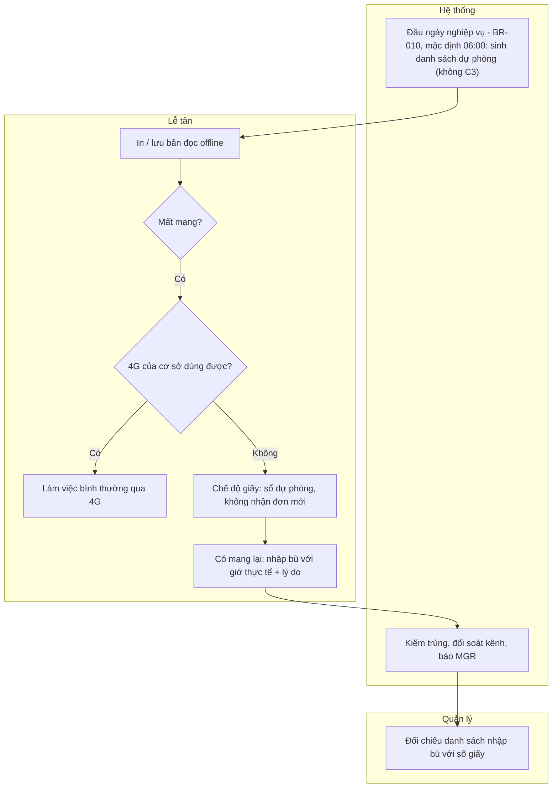

Lỗi: nhập bù trùng căn – đêm với đơn đã có (đơn OTA về trong lúc mất mạng) → server chặn, FD xử lý như xung đột (B7a/B14); giờ thực tế sớm hơn mốc `offline_backfill_max_hours` → cần MGR+; nhập bù không có lý do → chặn.

---

## Lịch sử thay đổi
| Ngày | Round | Thay đổi | Người |
|---|---|---|---|
| 15/10/2026 | 1 (đợt 2) | Bản đầu: 10 quy trình, swimlane Mermaid, ngoại lệ + lỗi | BA |
| 15/10/2026 | 1 (bước 4) | Ngày nghiệp vụ 06:00; P01: OTA nhập tay vào căn kín (409 + gợi ý / làn chưa gán), E10 OTA sửa đơn, E11 làn chưa gán, mục Đơn nhóm; P03: E2 theo phân xử ORC (thiết bị của cơ sở được cấp, admin-web), E2b, E9 thành B9a, E10 mất mạng, hạn khai báo NN theo BR-603 mới; P05: người thực hiện hoàn là MGR+, FOC minibar tự áp; P07 kiểm tra an toàn; P09 kỳ chi tháng; thêm P11 đóng ca/đối soát, P12 mất mạng/mất điện | BA |
| 16/10/2026 | 1 (bước 5) | BUG-R1-019: mọi chỗ ghi mốc "06:00" / "00:00–05:59" của ngày nghiệp vụ dẫn **BR-010** (tham số `business_day_rollover`, mặc định 06:00); không đổi nghiệp vụ | BA |
| 16/10/2026 | 2 (Đợt 0) | P07 thêm bước 1a, 4a, 9 và ngoại lệ E-K1…E-K5: việc **chuẩn bị / thu hồi bộ đồ dùng thêm** tự sinh khi đơn `confirmed` có người vượt định mức (INV quyết ESC-014 + bổ sung 16/10; **BR-812**, BR-110); điểm kiểm "bộ đồ dùng thêm đủ" khi kiểm phòng; sơ đồ thêm làn KIT | BA |
