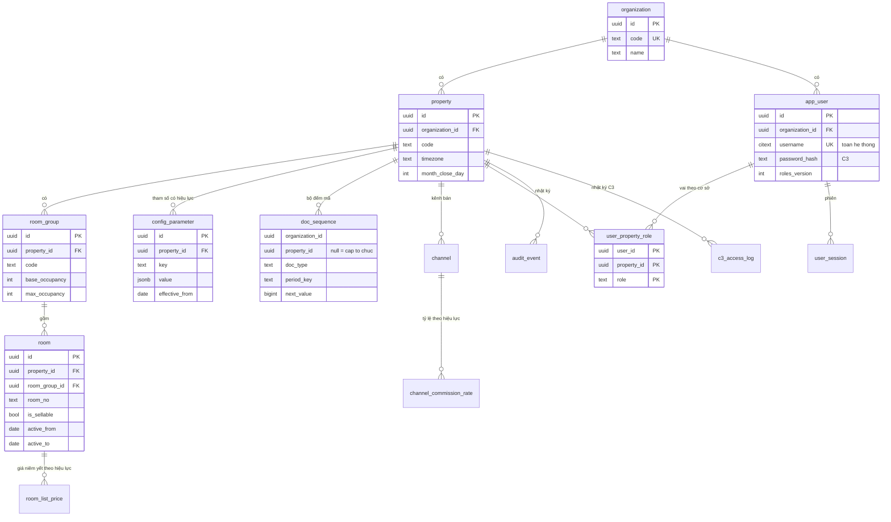
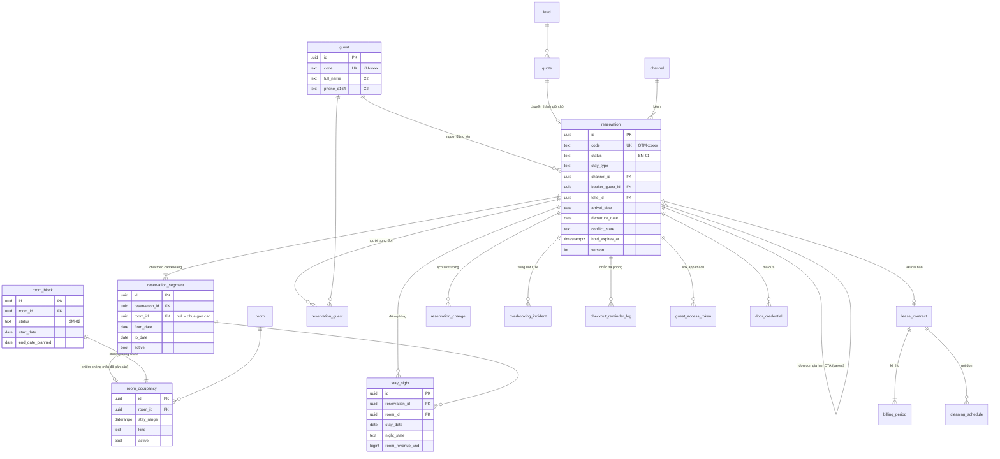
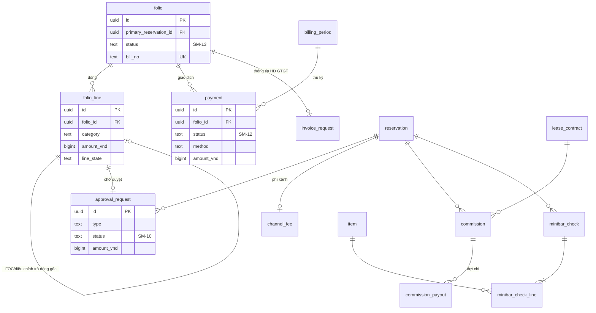
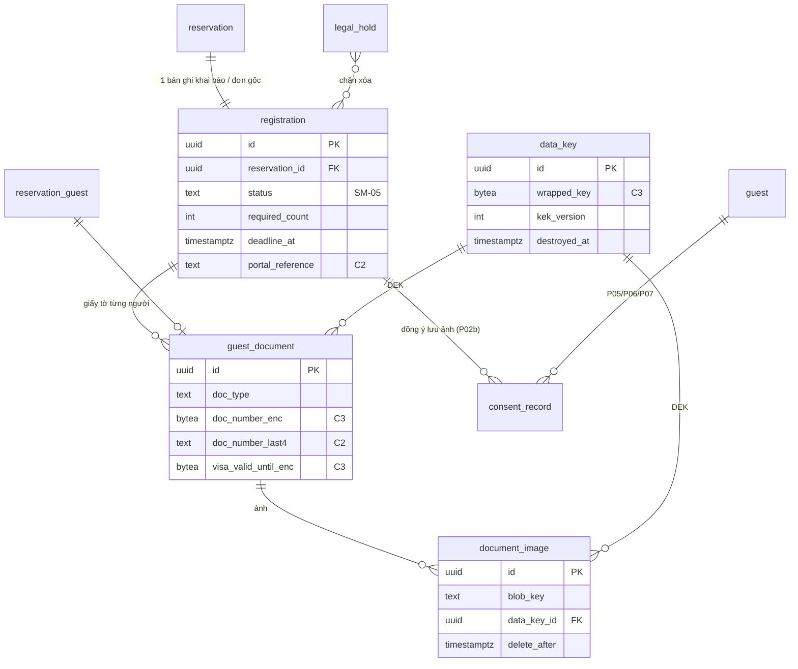
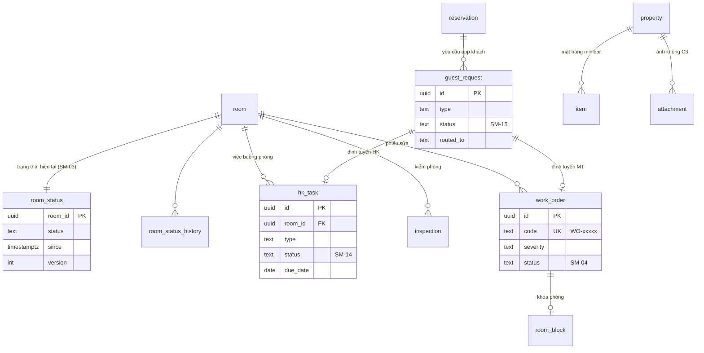
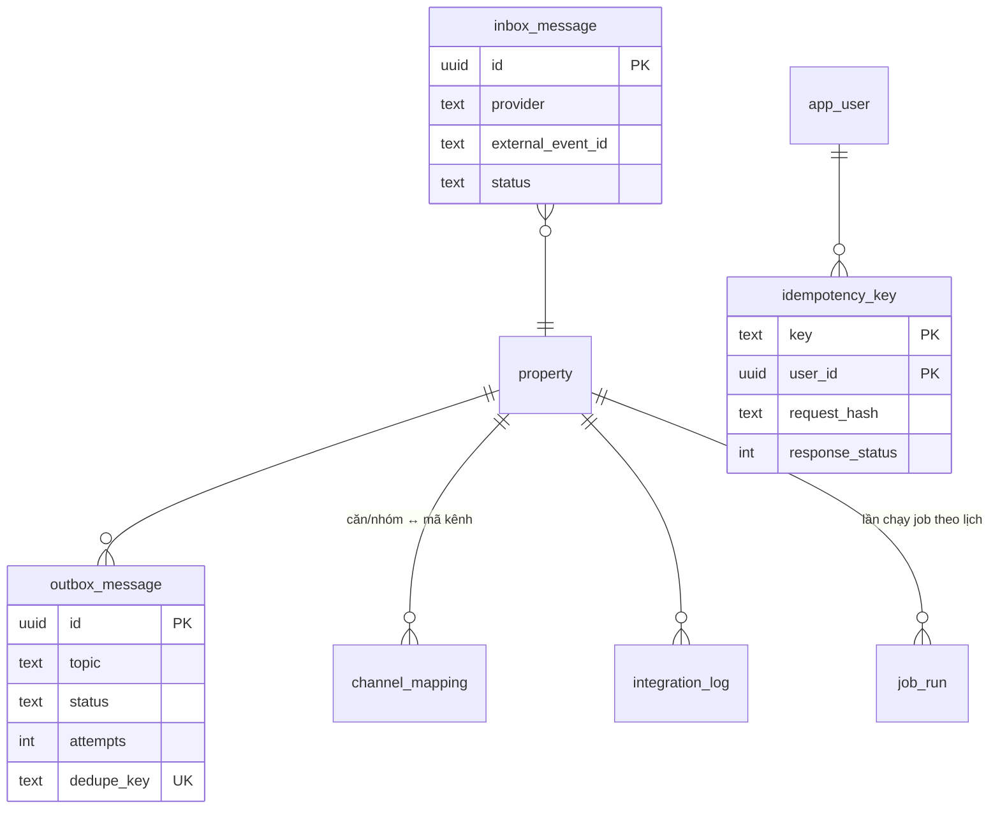

# Mô hình dữ liệu (ERD) – OTTIMO Desk

- Người viết: ARC | Round 1 – Bước 4 | Ngày: 15/10/2026 | Phiên bản: 0.2 · **R2 Đợt 0 (16/10/2026): 0.3.2** – khớp OpenAPI 0.3.2-draft (xem mục 15)
- Trạng thái: **Đã sửa theo review bước 3** (SEC-on-ARC 26 thẻ, BE-on-ARC 18 thẻ, DATA-on-ARC 11 thẻ – xem `rounds/round-01/responses/ARC-responses.md`) và quyết định mới trong decision-log (SEC, DOM, PO, DATA, phân xử ORC 15/10). Đối chiếu `metrics-definitions.md` v0.2 mục 9, `security-requirements.md` v0.2
- Đầu vào: `architecture.md` (ADR-001…013), `state-machines.md` (SM-01…SM-15), `rbac-matrix.md`, `business-rules.md` (BR, mục 13 tham số), `metrics-definitions.md` (mục 9 – trường bắt buộc), `security/data-risk-assessment.md` (C0–C3, D01–D28, T01–T18), `integrations.md`, `product/integrations/README.md`, `round-0-baseline.md` (BL mục 4), `03-backlog/backlog.md` (Must R2)
- Đọc cùng: `api/openapi.yaml` (hợp đồng API), `coding-standards.md` (quy tắc migration, đặt tên), `architecture.md` mục 9 (job theo lịch) và mục 9a (mã chứng từ)
- Tài liệu này **không chép con số nghiệp vụ**: mọi giá trị mặc định nằm trong `business-rules.md` mục 13 và được nạp vào bảng `config_parameter` (mục 9).

---

## 1. Quy ước

| Chủ đề | Quy ước |
|---|---|
| Tên bảng, cột | `snake_case`, tiếng Anh, **số ít** (`reservation`, `room`). Khóa ngoại `<bảng>_id`. Cột thời điểm `*_at`, ngày `*_date`/`*_on`, giờ cấu hình `*_time`, tiền `*_vnd`, tỷ lệ `*_pct` |
| Khóa chính | `id uuid` – UUIDv7 sinh ở ứng dụng bằng thư viện `uuid@^11` (`v7()`) – Node 22 và PG 17 chưa có sẵn (sắp xếp theo thời gian, không lộ số lượng). Ngoại lệ: bảng append-only lớn dùng `bigint generated always as identity` (`audit_event`, `c3_access_log`, `integration_log`) |
| Khóa ngoại cấp cơ sở (BE-ARC-09) | Mọi bảng cấp cơ sở có `UNIQUE (property_id, id)`; FK tới bảng cấp cơ sở **luôn là cặp** `(property_id, x_id) REFERENCES x(property_id, id)` để DB chặn trỏ chéo cơ sở kể cả khi RLS bị bỏ qua. Áp ít nhất cho FK tới: `room`, `room_group`, `reservation`, `reservation_segment`, `folio`, `registration`, `room_block`, `guest_document`, `work_order` |
| Tiền | `bigint` **VND nguyên** (BR-004). Không dùng `numeric`/`float` cho tiền. Âm = giảm trừ/hoàn. Driver `pg` trả `int8` dạng chuỗi → `types.setTypeParser(20, parseSafeBigint)` ném lỗi khi vượt 2^53; Drizzle `bigint({ mode: 'number' })` |
| Ngày nghiệp vụ | Đổi lúc **06:00** giờ cơ sở (`business_day_rollover`, BR-010): 00:00–05:59 thuộc ngày hôm trước. `Clock.businessDate()` áp quy tắc này; hạn pháp lý (BR-602/603) tính theo giờ thực |
| Tỷ lệ | `numeric(7,4)` theo **phần trăm** (15,5% lưu `15.5000`) |
| Thời điểm | `timestamptz` (lưu UTC, ADR-008). API trả kèm offset `+07:00` |
| Ngày lưu trú | `date` theo `property.timezone`. Khoảng lưu trú `[from, to)` (BR-002) – kiểu `daterange` ở bảng chiếm phòng |
| Giờ cấu hình | `time` (14:00, 12:00, 23:00…) – diễn giải theo `property.timezone` |
| Đa cơ sở | Mọi bảng nghiệp vụ có `organization_id`; bảng cấp cơ sở có thêm `property_id` (ADR-007). RLS: mục 2 |
| Cột chung | `created_at`, `created_by` (uuid user, null = hệ thống), `updated_at`, `version int not null default 1` (khóa lạc quan – tăng mỗi lần cập nhật; API dùng `ETag`/`If-Match`) |
| Xóa | **Không xóa cứng** dữ liệu nghiệp vụ (đơn, folio, giao dịch, FOC, khối OOO, kỳ thu…) – dùng trạng thái + bút toán điều chỉnh (BR-008, DATA mục 9 nguyên tắc 1). Chỉ job xóa theo hạn (mục 12) được xóa/ẩn danh dữ liệu cá nhân |
| Snapshot | Bản ghi đơn/báo giá/HĐ lưu `pricing_snapshot jsonb` + các cột tiền/tỷ lệ chốt (BR-006). Đổi tham số sau đó không đổi bản ghi cũ |
| Mức dữ liệu (cột **C**) | C0 công khai · C1 nội bộ (mặc định khi để trống) · C2 nhạy cảm · C3 rất nhạy cảm (SEC mục 3). Cột C3 có hậu tố `_enc` (bytea, mã hóa AES-256-GCM bằng DEK – mục 11) hoặc `_hash`/`_hmac` |
| Phạm vi | Cột **R** trong từ điển: **R2** = MVP giao Round 2 · **R3** = MVP giao Round 3 · **SM** = sau MVP (bảng mô tả để không phải đổi khung, chưa tạo migration) |

## 2. Đa cơ sở và Row Level Security (ADR-007)

### 2.1 Vai DB (BE-ARC-01, -03; yêu cầu gửi OPS)
| Vai | Thuộc tính | Dùng bởi | Quyền |
|---|---|---|---|
| `ottimo_owner` | `NOLOGIN NOSUPERUSER` | Chủ sở hữu schema `public`, các hàm `SECURITY DEFINER` (mục 2.4), schema `pgboss` | Mọi DDL |
| `ottimo_migrator` | `LOGIN NOSUPERUSER NOBYPASSRLS`, `IN ROLE ottimo_owner` (`SET ROLE ottimo_owner` khi chạy) | `pnpm db:migrate` (bước riêng trước khi bật api mới), cài/nâng cấp pg-boss | DDL qua `ottimo_owner` |
| `ottimo_app` | `LOGIN NOSUPERUSER NOBYPASSRLS NOCREATEDB NOCREATEROLE` | **api và worker** (cùng một vai – không có "vai job riêng"; câu cũ ở ADR-007 đã bỏ) | `SELECT/INSERT/UPDATE` trên bảng nghiệp vụ; **không** `UPDATE/DELETE` trên bảng append-only (K8); `DELETE` chỉ trên bảng kỹ thuật được liệt kê (phiên, khóa idempotency, `dev_clock`); `EXECUTE` các hàm 2.4; DML trên schema `pgboss` |
| `ottimo_readonly` | `NOLOGIN BYPASSRLS` (mặc định; chặt hơn bản v0.2 – BUG-R1-SEC-06) | OPS qua runbook (khắc phục sự cố, đối soát) – không bao giờ là vai của ứng dụng. Khi cần: OPS bật `LOGIN` có hạn (`VALID UNTIL`) theo runbook, ghi lý do, tắt lại sau phiên (R3 – runbook production) | `SELECT` |

- Biến môi trường: `DATABASE_URL` (vai `ottimo_app`) cho api/worker/test; `MIGRATION_DATABASE_URL` (vai `ottimo_migrator`) chỉ cho bước migrate. Áp cho cả DB `ottimo_test` và CI.
- **Biến chạy liên quan DB/đồng hồ/kiểm thử (0.3.2, khớp `services/api/src/config.ts` BE Đợt 0; danh sách đầy đủ ở `architecture.md` mục 13):**

  | Biến | Giá trị | Mặc định | Production | Ghi chú |
  |---|---|---|---|---|
  | `CLOCK_MODE` | `system\|mutable` | `system` | bắt buộc `system` (khác → dừng khởi động) | `mutable` = `MutableClock` đọc bảng `dev_clock` (4.12, ADR-008); production còn dừng nếu `dev_clock` có dòng |
  | `INCLUDE_TEST_SUPPORT` | `0\|1` (rỗng = 0) | rỗng | cấm `1` | Biến **chạy**: chỉ khi `1` mới nạp module `/__test__/*` (`openapi.test.yaml`). Khác build-arg cùng tên của `Dockerfile.api` (bản build không có cờ này bị xóa `dist/test-support`) |
  | `TEST_SUPPORT_TOKEN` | chuỗi ≥ 32 ký tự | rỗng | cấm đặt | Bắt buộc khi `INCLUDE_TEST_SUPPORT=1`; header `X-Test-Token`, so sánh thời gian hằng, **và** phải có phiên owner; không được trùng giá trị khóa bí mật khác |
  | `COOKIE_SECURE_PREFIX` | `true\|false` | `true` | bắt buộc `true` | `false` chỉ cho dev/test qua HTTP: cookie bỏ tiền tố `__Host-` (vẫn `HttpOnly`, `SameSite`); staging/production đặt `false` → dừng khởi động |
  | ~~`CLOCK_OVERRIDE`~~ | – | – | – | **Đã bỏ** (thay bằng `CLOCK_MODE=mutable` + `POST /__test__/clock`). Đặt giá trị khác rỗng ở **mọi** môi trường → api/worker dừng khởi động |
- **Chốt mô hình 4 vai (BUG-R1-SEC-06, 16/10)**: giữ bảng trên (khuyến nghị SEC). Lý do: lộ `MIGRATION_DATABASE_URL` không được đăng nhập thẳng bằng
  chủ hàm `SECURITY DEFINER`; `SET ROLE` để lại dấu vết. **Đã làm (OPS, R2 tuần 1 – `rounds/round-02/outputs/OPS/w1-skeleton-run.md` mục 3.1)**:
  `infra/postgres/init/02-roles.sh` tạo đúng 4 vai trên PostgreSQL 17.11 – `ottimo_owner` NOLOGIN không mật khẩu; `ottimo_migrator` LOGIN NOINHERIT,
  thành viên owner kiểu `INHERIT FALSE, SET TRUE` (bắt buộc `SET ROLE`); `ottimo_app` không superuser/BYPASSRLS, không thuộc owner;
  `ottimo_readonly` NOLOGIN BYPASSRLS; chạy lại được trên volume cũ. `db-role.test.ts` 5/5 xanh, không test nào bị bỏ qua.
- **Yêu cầu OPS** (OPS sửa compose/CI/init – ARC không sửa file của OPS): script init tạo 4 vai trên; compose và CI tách 2 URL; api/worker **không** dùng `POSTGRES_USER` (superuser luôn bỏ qua RLS và REVOKE → test RLS/K8 vô nghĩa); `trustProxy` của Fastify giới hạn về địa chỉ/subnet của Caddy.
- Khởi động api/worker kiểm `SELECT rolsuper, rolbypassrls FROM pg_roles WHERE rolname = current_user` → phải `false,false`, nếu không thì dừng (SR-SECR-05(d)); test kiến trúc kiểm như vậy khi chạy test.

### 2.2 Biến phiên – một tên, đặt bằng `set_config`
- Tên chốt: `app.organization_id`, `app.property_id` (**số ít** – mỗi request một cơ sở theo đường dẫn), `app.user_id`, `app.actor_type` (`user|guest|system`). ADR-007 đã sửa cho khớp (bỏ `app.org_id`, `app.property_ids`). Báo cáo chuỗi (R4+) sẽ dùng policy riêng với `app_current_property_ids()`.
- `SET LOCAL` không nhận tham số bind → middleware chạy **câu lệnh đầu tiên** của mọi giao dịch:
  ```sql
  SELECT set_config('app.organization_id', $1, true),
         set_config('app.property_id',     $2, true),
         set_config('app.user_id',         $3, true),
         set_config('app.actor_type',      $4, true);
  ```
- Mọi truy vấn (kể cả chỉ đọc) chạy trong giao dịch có ngữ cảnh. Worker đặt ngữ cảnh theo từng cơ sở khi lặp.

### 2.3 Chính sách (sinh tự động trong migration)
Sau khi một giao dịch có `set_config(..., true)` kết thúc, kết nối tái sử dụng trả `''` (không phải NULL) cho `current_setting(..., true)` → `''::uuid` ném lỗi. Vì vậy dùng hàm bọc `NULLIF`:
```sql
CREATE FUNCTION app_current_property() RETURNS uuid LANGUAGE sql STABLE PARALLEL SAFE
  AS $$ SELECT NULLIF(current_setting('app.property_id', true), '')::uuid $$;
CREATE FUNCTION app_current_org() RETURNS uuid LANGUAGE sql STABLE PARALLEL SAFE
  AS $$ SELECT NULLIF(current_setting('app.organization_id', true), '')::uuid $$;

ALTER TABLE <t> ENABLE ROW LEVEL SECURITY;
ALTER TABLE <t> FORCE ROW LEVEL SECURITY;
-- bảng cấp cơ sở
CREATE POLICY tenant_isolation ON <t>
  USING (property_id = app_current_property()) WITH CHECK (property_id = app_current_property());
-- bảng cấp tổ chức (guest, app_user, consent_record…)
CREATE POLICY tenant_isolation ON <t>
  USING (organization_id = app_current_org()) WITH CHECK (organization_id = app_current_org());
-- bảng có thể ở cả hai cấp (doc_sequence)
CREATE POLICY tenant_isolation ON doc_sequence
  USING (organization_id = app_current_org() AND (property_id IS NULL OR property_id = app_current_property()))
  WITH CHECK (organization_id = app_current_org() AND (property_id IS NULL OR property_id = app_current_property()));
```
Thiếu ngữ cảnh → hàm trả NULL → 0 dòng, **không lỗi** (an toàn mặc định). Bộ sinh policy dựa vào cột `property_id`/`organization_id`; test kiến trúc quét `pg_class` → mọi bảng trong `public` (trừ danh sách ngoại lệ có ghi lý do: `config_parameter_def`, `dev_clock`) phải `relrowsecurity` và `relforcerowsecurity`.

View dùng `WITH (security_invoker = true)` (PG ≥ 15) để RLS áp theo người gọi (ví dụ `v_folio_balance`).

### 2.4 Truy vấn "đường vào" trước khi có ngữ cảnh – hàm `SECURITY DEFINER` (BE-ARC-01)
Sáu truy vấn chạy trước khi biết cơ sở/tổ chức. Không tắt RLS, không dùng vai `BYPASSRLS` cho api; thay bằng hàm hẹp, chủ là `ottimo_owner`, `SET search_path = pg_catalog, public`, chỉ trả đúng cột cần, `REVOKE ALL … FROM PUBLIC; GRANT EXECUTE … TO ottimo_app`:

| Hàm | Trả | Dùng ở |
|---|---|---|
| `auth_find_user(p_username text)` | `(user_id, organization_id, password_hash, status, locked_until, failed_login_count, must_change_password, mfa_enabled)` | `POST /v1/auth/login` – `username` **duy nhất toàn hệ thống** (citext UK) |
| `auth_resolve_session(p_sid_hash text)` | `(session_id text, user_id, organization_id, active_property_id, expires_at, idle_expires_at, revoked_at, roles_version, user_status, trusted_device_id)` – 0.3.2 thêm `idle_expires_at`, `user_status` | Mỗi request nhân viên: từ chối nếu `revoked_at` có, `now ≥ expires_at`, `now ≥ idle_expires_at` hoặc `user_status ≠ active` (401 `UNAUTHENTICATED`). Gia hạn `idle_expires_at`/`last_active_at` bằng UPDATE thường **sau** khi đặt ngữ cảnh (dưới RLS), không ghi trong hàm `STABLE` |
| `auth_resolve_device(p_did_hash text)` | `(device_id, property_id, organization_id, expires_at, revoked_at)` | Kiểm `__Host-ottimo_did` |
| `guest_resolve_token(p_token_hash text)` | `(token_id, reservation_id, property_id, organization_id, expires_at, revoked_at)` | `POST /v1/guest/sessions`, mỗi request khách (qua `guest_session.token_id`) |
| `webhook_resolve_property(p_provider text, p_slug text)` | `(property_id, organization_id)` | `/v1/webhooks/{provider}/{propertySlug}` |
| `public_resolve_unit(p_unit_slug text)` | `(property_id, organization_id, room_id)` | `/v1/public/units/{unitSlug}` |
| `worker_list_properties()` | `(property_id, organization_id, timezone)` của cơ sở `active` | Worker trước khi lặp theo cơ sở |

**Quyết định 0.3.2 (đề nghị BE d0 mục 5)**: thêm `idle_expires_at` vì hạn không hoạt động (admin 30 phút, PWA 72 giờ) phải kiểm ở **mỗi** request mà không cần truy vấn thứ hai trước ngữ cảnh; thêm `user_status` làm lớp phòng thủ thứ hai (khóa người dùng đã thu hồi phiên – SR-SES-06 – nhưng nếu thu hồi sót thì vẫn chặn). Đổi kiểu trả về cần `DROP FUNCTION` + `CREATE` trong migration **mới** (không sửa 0001) – BE-B làm cùng việc đăng nhập; test kiến trúc cập nhật danh sách cột cùng PR.

Sau khi hàm trả kết quả, middleware đặt ngữ cảnh (2.2) rồi mọi truy vấn khác chạy dưới RLS. Mỗi hàm có test riêng: chỉ trả các cột trên, không trả dòng `revoked`/hết hạn sai.

### 2.5 Schema `pgboss` và LISTEN
- `pgboss` nằm **ngoài RLS** (bảng hàng đợi kỹ thuật, không chứa dữ liệu khách – payload job chỉ có id). `ottimo_migrator` cài/nâng cấp schema ở bước migrate (`migrate: false` khi api/worker khởi động); `ottimo_app` chỉ DML.
- Handler job **không** dùng kết nối của pg-boss cho hiệu ứng nghiệp vụ – dùng pool app có ngữ cảnh RLS (mẫu ở `architecture.md` 9.1).
- api giữ **1 kết nối riêng ngoài pool** để `LISTEN` (`config_changed`, `clock_changed`, `sse_event`), tự nối lại khi rớt (lùi cấp số nhân, tối đa 30 giây) và refetch trạng thái sau khi nối lại.

### 2.6 Quyền theo vai, phạm vi, trường
RLS chỉ tách **cơ sở**. Quyền theo **vai, hành động, trường** (rbac-matrix mục 4, 6) kiểm ở tầng ứng dụng: guard theo hành động + serializer theo vai (trường không được phép **không có trong JSON**). Phạm vi "M" lọc bằng `created_by`, `closer_user_id`, `assigned_user_id`; phạm vi "T" lọc bằng việc/phiếu giao trong ngày nghiệp vụ. Quyền đọc từ `user_property_role` mỗi request (cache ≤ 60 giây theo `app_user.roles_version` – SR-AZ-08). Hồ sơ khách ở cấp tổ chức; dữ liệu C3 gắn `property_id` của lượt lưu trú – không chia sẻ chéo cơ sở.

### 2.7 Test bắt buộc (BE + QA)
1. Seed 2 cơ sở; người dùng cơ sở A gọi API/đọc DB với ngữ cảnh cơ sở B → 0 dòng / HTTP 404.
2. **Kết nối tái sử dụng**: chạy 1 giao dịch có ngữ cảnh, rồi trên **cùng kết nối** truy vấn không ngữ cảnh → 0 dòng, **không lỗi**.
3. Vai chạy test: `rolsuper=false, rolbypassrls=false`.
4. Thử `UPDATE/DELETE` bảng append-only bằng `ottimo_app` → lỗi quyền (K8).
5. Mỗi hàm 2.4 không trả cột ngoài danh sách.

## 3. Sơ đồ quan hệ (Mermaid)

Tách theo nhóm để đọc được; chỉ ghi cột khóa và cột quan trọng. Danh sách cột đầy đủ ở mục 4.

### 3.1 Nền tảng, người dùng, cấu hình


### 3.2 Đơn, chiếm phòng, đêm-phòng, khách


### 3.3 Folio, thanh toán, duyệt, hoa hồng


### 3.4 Khai báo lưu trú và dữ liệu C3


### 3.5 Buồng phòng, bảo trì, kho, yêu cầu khách


### 3.6 Tích hợp, hạ tầng ứng dụng


## 4. Từ điển bảng

Ký hiệu cột: **C** = mức dữ liệu (để trống = C1), **R** = phạm vi (R2/R3/SM). Cột chung (`created_at`, `created_by`, `updated_at`, `version`, `organization_id`, `property_id`) không nhắc lại trừ khi có ràng buộc đặc biệt.

### 4.1 `platform` – nền tảng (R2)

**`organization`** – tổ chức (chuỗi). `id`, `code` (UK), `name`, `status` (`active|suspended`).

**`property`** – cơ sở lưu trú.
| Cột | Kiểu | Ràng buộc | C | Ghi chú |
|---|---|---|---|---|
| `code` | text | UK theo tổ chức | | `DL01` |
| `name`, `address`, `map_url`, `phone_public` | text | | C0 | Hiện ở app khách |
| `timezone` | text | not null, mặc định `Asia/Ho_Chi_Minh` | | BR-001 |
| `currency` | char(3) | `VND` | | BR-004 |
| `month_close_day` | smallint | 1–28 | | DATA Q-14 (giả định ngày 5) |
| `house_rules_i18n` | jsonb | `{vi,en,ru}` | C0 | Nội quy + phí phạt (BR-511) |
| `wifi_info_i18n` | jsonb | | C1 | Hiện cho khách từ ngày nhận phòng (US-108) |
| `status` | text | `active\|inactive` | | |

**`room_group`** – nhóm căn (Lầu 1–2 / Căn N / Căn N+). `code`, `name_i18n`, `sort_order`, `base_occupancy`, `max_occupancy` (mặc định nhóm – BR-110), `ota_room_ref` (để ánh xạ kênh theo nhóm).

**`room`** – căn (BL 4.1).
| Cột | Kiểu | Ràng buộc | Ghi chú |
|---|---|---|---|
| `room_group_id` | uuid FK | not null | |
| `room_no` | text | UK (`property_id`, `room_no`) | `201` |
| `name`, `floor`, `area_m2`, `bed_setup` | text/int | | Mô tả (C0) |
| `base_occupancy` | smallint | **not null**, CHECK 1–10 | **Định mức** – số người (người lớn + trẻ 6–11) đã gồm trong giá, **thuộc tính từng căn** (BR-110 v0.3.1: Studio 2; 301, 401: 4; 302, 402: 3); `room_group.base_occupancy` chỉ là mặc định khi tạo căn. Đơn chụp định mức vào `pricing_snapshot` (BR-006) – đổi định mức chỉ áp cho đơn mới. OpenAPI `Room.baseOccupancy` (0.3.1) |
| `max_occupancy` | smallint | **not null**, CHECK `max_occupancy >= base_occupancy` | Sức chứa tối đa, thuộc tính từng căn. INV quyết **ESC-014**: = định mức hoặc định mức + 1 (một người ngủ sofa; Studio 3; 301, 401: 5; 302, 402: 4); trẻ dưới 6 tuổi **không** tính. Quy tắc "+1" kiểm ở tầng ứng dụng (`422` mã trường `MAX_OCCUPANCY_RANGE`), DB chỉ giữ `max ≥ base` để đổi chính sách không cần migration |
| `bed_count` | smallint | | Số giường của căn (BR-110) |
| `public_slug` | text | UK theo cơ sở, ngẫu nhiên ≥ 8 ký tự | Trang công khai QR trong căn (`/v1/public/units/{unitSlug}`, SR-GST-12) – không lộ số căn đoán được |
| `is_sellable` | bool | not null | "Ngừng bán" (US-004 AC2) |
| `active_from`, `active_to` | date | `active_to` null = vô hạn | Đêm khả dụng gộp K-01 (DATA) |
| `lock_ref` | text | null | Mã khóa cửa ở adapter (M14) |

**`room_list_price`** – giá niêm yết theo hiệu lực (BR-101, US-004 AC1). `room_id`, `effective_from date`, `monthly_list_price_vnd`, `nightly_list_price_vnd` (tính theo BR-101 rồi **làm tròn** và lưu, sửa tay được), `changed_by`, `reason`. UK (`room_id`, `effective_from`). **Quy tắc (BE-ARC-15, giả định đội tự chốt)**: mọi phép tính tiếp theo (giảm theo đêm BR-107, phụ thu %, báo giá) dùng **giá đêm niêm yết đã làm tròn đã lưu** – khớp cái lễ tân thấy; DOM sửa ví dụ BR-107 cho khớp.

**`config_parameter`** – bảng tham số có hiệu lực theo ngày (mục 9).
| Cột | Kiểu | Ràng buộc | Ghi chú |
|---|---|---|---|
| `key` | text | not null, thuộc danh mục mục 9 (CHECK qua bảng `config_parameter_def`) | |
| `value` | jsonb | validate bằng schema zod của khóa | |
| `effective_from` | date | not null | Giá trị áp cho bản ghi tạo từ ngày này (theo giờ cơ sở) |
| `status_label` | text null | CHECK `^[A-Z0-9-]{1,16}(\+[A-Z0-9-]{1,16}){0,3}$` | Mã nhãn BR mục 13 (`GD`, `NGANH`, `PL`) hoặc mã quyết định (`INV-004`…), ghép bằng `+` (DS-E: `INV-004+GD`) – là mã, không phải chữ tự do (0.3.2, khớp migration BE 0000 và OpenAPI `statusLabel`) |
| `reason` | text | | Bắt buộc khi sửa (US-005 AC3) |
| | | UK (`property_id`, `key`, `effective_from`) | Không UPDATE giá trị đã có hiệu lực trong quá khứ – thêm dòng mới |

**`config_parameter_def`** – danh mục khóa (seed từ mục 9): `key` PK, `value_schema` (tên schema zod), `edit_roles` (`{owner}` hoặc `{owner,manager}`), `br_ref`, `snapshot_into` (đơn/báo giá/HĐ/không).

**`doc_sequence`** – bộ đếm mã chứng từ (mục 10). Hai cột rõ ràng (BE-ARC-10): `organization_id uuid not null`, `property_id uuid null` (null = mã cấp tổ chức như `KH-`); `doc_type`, `period_key`, `prefix`, `pad_width`, `next_value bigint`. UK một phần: (`property_id`,`doc_type`,`period_key`) WHERE `property_id IS NOT NULL` và (`organization_id`,`doc_type`,`period_key`) WHERE `property_id IS NULL`. Policy RLS riêng (mục 2.3).

**`channel`** – kênh bán (DATA Q-11). `code` (UK theo cơ sở: `direct_web`, `zalo_phone`, `walk_in`, `returning`, `sales_staff`, `collaborator`, `airbnb`, `booking`, `agoda`, `expedia`, `tripcom`, `traveloka`, `google`, `internal` – **lệch mở E8**: metrics Q-11/US-017 AC8 mô tả một kênh "Trực tiếp" + trường nguồn, còn danh mục này và seed QA DS-E/DS-0 có 5 kênh nhóm `direct`; R2 giữ nguyên danh mục, `direct_source` vẫn bắt buộc cho đơn nhóm `direct`), `name_i18n`, `channel_group` (`direct|agent|ota|internal`), `is_active`, `requires_ota_ref` bool.

**`channel_commission_rate`** – `channel_id`, `effective_from`, `rate_pct` (BR-901). Chỉ OWN sửa (rbac A102).

### 4.2 `identity` – người dùng, phiên (R2)

**`app_user`** (cấp tổ chức).
| Cột | Kiểu | C | Ghi chú |
|---|---|---|---|
| `username` | citext **UK toàn hệ thống** | C2 | Đăng nhập không cần mã tổ chức (BE-ARC-01b) |
| `email` | citext null | C2 | Gửi thông báo bảo mật (SR-AUTH-07) |
| `display_name`, `phone` | text | C2 | D27 |
| `password_hash` | text | C3 | argon2id |
| `must_change_password` | bool not null default false | | Mật khẩu tạm sau khi OWN đặt lại (SR-AUTH-05) |
| `password_changed_at` | timestamptz | | |
| `approval_pin_hash` | text null | C3 | PIN duyệt 6 số, argon2id (BR-432, SR-AUTH-09) |
| `approval_pin_failed_count`, `approval_pin_locked_until` | int, timestamptz | | 5 sai → khóa duyệt 15 phút |
| `roles_version` | int not null default 1 | | Tăng khi đổi vai/khóa/đặt lại mật khẩu → xóa cache quyền (SR-AZ-08) |
| `mfa_enabled` | bool not null default false | | R3 – bắt buộc owner/manager (SR-AUTH-06) |
| `mfa_secret_enc` | bytea null | C3 | Bí mật TOTP, DEK riêng (`mfa_data_key_id`) – R3 |
| `mfa_recovery_codes_hash` | text[] | C3 | 10 mã dùng một lần (argon2id) – R3 |
| `status` | text | | `active\|locked\|disabled` |
| `failed_login_count`, `locked_until`, `lock_count_24h` | int, timestamptz, int | | Khóa tạm (SR-AUTH-04) |
| `last_login_at` | timestamptz | | |
| `payee_bank_account_enc`, `payee_tax_id_enc` | bytea | C3 | D26 – **R3** (chi hoa hồng CTV) |

**`user_property_role`** – PK (`user_id`, `property_id`, `role`); `role` ∈ `owner, manager, front_desk_lead, front_desk, housekeeping, maintenance, sales_staff, collaborator` (decision-log BA). `granted_by`, `granted_at`, `revoked_at`. Quyền = hợp các vai còn hiệu lực (rbac 1.2). Chỉ OWN ghi (A100).

**`user_session`** – `id` = SHA-256 của token phiên (C3; token rõ chỉ có ở cookie `__Host-ottimo_sid`), `user_id`, `active_property_id`, `client_origin` (`admin|staff_pwa`), `trusted_device_id` (FK null – thiết bị tin cậy gửi kèm ở request gần nhất; phiên PWA luôn null), `created_at`, `last_active_at`, `idle_expires_at`, `expires_at` (admin 30 phút không hoạt động/tối đa 12 giờ; PWA 72 giờ/tối đa 30 ngày), `revoked_at`, `revoked_reason` (`logout|role_changed|disabled|password_reset|password_changed|mfa_disabled|admin`), `ip_hmac` (HMAC với `LOG_IP_HMAC_KEY` – SR-KEY-08), `user_agent`, `stepup_until` (cửa sổ trượt C3, SR-C3-09). **Thu hồi ngay** mọi phiên của người dùng khi đổi vai/khóa/đặt lại hoặc đổi mật khẩu/tắt 2FA (SR-SES-06). Xóa dòng hết hạn sau T16.

**`trusted_device`** (SR-DEV-01…09, R2) – thiết bị được owner cấp quyền đọc/ghi C3.
| Cột | Ghi chú |
|---|---|
| `id`, `organization_id`, `property_id` | |
| `name` | "Máy quầy 1", "Máy tính bảng ca đêm" |
| `device_kind` | `desk` (máy quầy – hạn `trusted_device_days`, mặc định 180) · `facility_mobile` (máy tính bảng/điện thoại **của cơ sở** mở admin-web trong trình duyệt – hạn ≤ 30 ngày, SR-DEV-08). Không có giá trị cho máy cá nhân/PWA (SR-DEV-09) |
| `token_hash` | SHA-256 của cookie `__Host-ottimo_did` (256 bit), UK |
| `hardening_checklist_version`, `checklist_confirmed_by` | Checklist SR-DEV-07/08 đã kiểm khi cấp |
| `created_by`, `created_at`, `expires_at`, `last_seen_at`, `revoked_at`, `revoked_by`, `revoke_reason` | Thu hồi có hiệu lực ngay |
CHECK `device_kind <> 'facility_mobile' OR expires_at <= created_at + interval '30 days'`. Trực đêm dùng thiết bị loại này hoặc máy quầy (phân xử ORC 15/10).

**`staff_notification`** (R2, BE-ARC-06) – hộp thông báo nhân viên. `user_id`, `kind` (enum `StaffNotification.kind` OpenAPI), `ref_type`, `ref_id`, `ref_code` (mã hiển thị – không C2/C3), `created_at`, `read_at`. Chỉ mục (`user_id`, `read_at` NULLS FIRST, `created_at desc`). Sinh trong cùng giao dịch với sự kiện nghiệp vụ (hoặc trong job) + `NOTIFY sse_event` → SSE `notification.created`. Xóa sau 90 ngày.

**`push_subscription`** (R3) – `user_id`, `endpoint` (UK), `keys_enc` (C2, DEK), `user_agent`, `created_at`, `revoked_at`. Khóa VAPID: `VAPID_PUBLIC_KEY`, `VAPID_PRIVATE_KEY` (biến môi trường – OPS thêm vào `.env.example` khi bật R3). R2 chỉ thông báo trong app + SSE.

**`user_activity_day`** (R2, DATA FB-10, metrics S11) – PK (`user_id`, `property_id`, `activity_date` – ngày nghiệp vụ), `first_seen_at`, `last_seen_at`, `request_count`, `write_count`. Upsert ở middleware tối đa 1 lần/5 phút/phiên (bộ nhớ đệm trong tiến trình). Không chứa IP/thiết bị. Thời hạn T15.

### 4.3 `audit` – nhật ký (R2)

**`audit_event`** – append-only (REVOKE UPDATE, DELETE với `ottimo_app`).
| Cột | Kiểu | Ghi chú |
|---|---|---|
| `id` | bigint identity | |
| `occurred_at` | timestamptz | |
| `actor_type` | text | `user\|guest\|system` |
| `actor_user_id` | uuid null | |
| `category` | text | `money\|state\|config\|access\|security\|data` – lọc US-006 AC2 |
| `action` | text | `folio_line.posted`, `payment.recorded`, `reservation.cancelled`, `access.denied`, `config.changed`… |
| `entity_type`, `entity_id` | text, text | 0.3.2: `entity_id` là **text** – id thực thể có thể là uuid, bigint (`audit_event.id`, `job_run`) hoặc mã (khóa tham số, `doc_sequence`); uuid lưu dạng chuỗi chuẩn chữ thường |
| `before`, `after` | jsonb | Sinh bằng serializer audit theo **danh sách trường cho phép từng thực thể** (allowlist, không phải blocklist); cột `_enc`/giá trị C3 **không bao giờ** vào; C2 che theo danh sách (SR-AUD-03) |
| `reason` | text | |
| `request_id`, `ip_hmac` | text | HMAC với `LOG_IP_HMAC_KEY` (SR-KEY-08) |
| `session_id` | text null | 0.3.2: **text** – `user_session.id` là SHA-256 hex của token (4.2), không phải uuid; phiên khách lưu `guest_session.id` dạng chuỗi |
| `trusted_device_id` | uuid null | |
Chỉ mục: (`property_id`, `category`, `occurred_at desc`), (`entity_type`, `entity_id`).

**`c3_access_log`** – append-only; mỗi lần đọc/ghi/sao chép/xóa dữ liệu C3 (SEC R-REG-09, SR-C3-08, rbac ký hiệu L). `occurred_at`, `actor_type` (`user|guest|system`), `user_id` (null khi khách/hệ thống), `session_id` text (phiên nhân viên = SHA-256 hex, hoặc id `guest_session` – 0.3.2), `trusted_device_id`, `ip_hmac`, `subject_type` (`guest_document|document_image|door_credential|payee_account|portal_data|mfa_secret`), `subject_id`, `reservation_id`, `action` (`view|create|update|copy|delete|purge`), `reason_code` (bắt buộc khi xem ảnh sau `confirmed` – rbac ghi chú 30), `request_id`. **Ghi trước khi trả dữ liệu** (ADR-013). **Khách xem mã cửa** qua `GET /v1/guest/stay` cũng ghi 1 dòng `actor_type=guest` (SR-GST-10).

**`state_transition`** – lịch sử chuyển trạng thái cho **cả 15 máy** (state-machines 0.2.2). `machine` (`SM-01`…`SM-15`), `entity_id`, `from_state`, `to_state`, `event_code` (mã chuyển BA: `B1`, `O4`, `R3`, `K6`…), `actor_type`, `actor_user_id`, `reason_code`, `reason_note`, `occurred_at`, `performed_at` (giờ trên thiết bị khi gửi offline), `rejected bool` (lần chuyển bị từ chối cũng ghi – US-002 AC2). Append-only. **Dùng cho kiểm toán** (thời hạn T15); **nguồn lịch sử cho chỉ số** là `reservation_change` (mục 4.5, DATA FB-05).

**Phân vùng ngay từ R2** (BE-ARC-18): `audit_event`, `c3_access_log`, `state_transition` tạo `PARTITION BY RANGE (occurred_at)` theo tháng ngay migration đầu, có phân vùng `DEFAULT`; PK `(id, occurred_at)`; job J16 tạo trước phân vùng tháng tới và xóa phân vùng quá `retention.audit_months`. Chi phí thêm ~0,5 ngày, tránh migration chép dữ liệu ở R3/R4.

### 4.4 `guests` – hồ sơ khách (R2; gộp hồ sơ R3)

**`guest`** (cấp tổ chức).
| Cột | Kiểu | Ràng buộc | C | Ghi chú |
|---|---|---|---|---|
| `code` | text | UK theo tổ chức | C1 | `KH-0018` (mục 10) |
| `full_name` | text | not null | C2 | D01 |
| `name_search` | text | | C2 | bỏ dấu, in hoa (BR-951), chỉ mục trigram cho US-073 |
| `phone_e164` | text | UK một phần: (`organization_id`, `phone_e164`) WHERE `merged_into_id IS NULL AND anonymized_at IS NULL` | C2 | BR-951 chuẩn hóa `84…` |
| `email_norm` | text | UK một phần như trên | C2 | |
| `messaging_handles` | jsonb | | C2 | Zalo/WhatsApp/Kakao |
| `date_of_birth` | date null | | C2 | D01 (người lớn). Trẻ em không có hồ sơ `guest` |
| `gender`, `nationality_code` (ISO-3166 alpha-2) | text | | C2 | |
| `is_foreigner` | bool | | C2 | BR-009 – cập nhật theo giấy tờ khai báo |
| `preferred_locale` | text | `vi\|en\|ru` | | US-112 AC2 |
| `preferred_contact` | text | | C2 | |
| `company_name`, `tax_code` | text | | C2 | D16 |
| `tags` | text[] | | C2 | VIP, khách quen… |
| `service_notes` | text[] | từ danh mục | C2 | HK chỉ thấy mục này (rbac D12) |
| `free_note` | text | lọc mẫu số thẻ (R-PAY-07) | C2 | |
| `id_doc_last4` | text | | C2 | 4 số cuối giấy tờ gần nhất (BR-610) |
| `id_doc_hmac` | text | | C3 | HMAC số giấy tờ – **chỉ khi có đồng ý P05** (SEC F03); dùng khớp khách quen |
| `crm_consent` | text | `not_asked\|granted\|refused` | | BR-955 (bản ghi chi tiết ở `consent_record`) |
| `merged_into_id` | uuid null | | | BR-953 (R3) |
| `anonymized_at` | timestamptz | | | T05/T06 |

**`guest_code_alias`** (R3) – `old_code` PK, `guest_id` – mã cũ sau gộp vẫn tra được (US-023 AC2). **`guest_merge_log`** (R3) – `kept_guest_id`, `merged_guest_id`, `moved_refs jsonb`, `merged_by`, `merged_at`.

**`consent_record`** – D20 (C2), append-only + cột rút lại.
| Cột | Ghi chú |
|---|---|
| `subject_type` | `guest\|reservation_guest` (người đi cùng tự đồng ý – R-CON-04) |
| `subject_id`, `reservation_id` | |
| `purpose` | `P02B_ID_IMAGE_RETENTION\|P05_CRM\|P06_MARKETING\|P07_REVIEW` |
| `decision` | `granted\|refused` (từ chối cũng ghi – BR-955) |
| `notice_version`, `locale`, `channel` (`guest_app\|desk\|paper`) | R-CON-02 |
| `recorded_by`, `recorded_at`, `withdrawn_at`, `withdrawn_via` | |

**`lead`** (SM-09) – R2 tối thiểu (lead nối báo giá/giữ chỗ), kanban R3. `guest_id` (BR-954: nối bằng mã khách), `need`, `estimated_value_vnd` (C2), `source`, `status` (`new|quoted|holding|won|lost`), `owner_user_id` (phạm vi M), `lost_reason_code`, `last_interaction_at` (T10).

### 4.5 `reservations` – đơn, chiếm phòng, đêm-phòng (R2)

**`reservation`** – đơn ngắn ngày và dài hạn (SM-01).
| Cột | Kiểu | Ràng buộc / ghi chú | C | Nguồn |
|---|---|---|---|---|
| `code` | text | UK (`property_id`,`code`); `OTM-00171` | | BR-007 |
| `status` | text | `hold\|confirmed\|in_house\|checked_out\|cancelled\|no_show` | | SM-01 |
| `stay_type` | text | `short\|long` | | DATA Q-11 |
| `channel_id` | uuid FK | not null | | BR-112 |
| `payment_model` | text | `direct\|ota_prepaid\|ota_pay_at_property` | | BR-307 |
| `ota_ref` | text | UK một phần (`property_id`,`channel_id`,`ota_ref`) | C2 | D19 |
| `booker_guest_id` | uuid FK guest | not null (SĐT bắt buộc cho kênh trực tiếp/CTV – kiểm ở app) | | BL 5.16 |
| `closer_user_id` | uuid FK app_user | Người chốt (SAL/CTV) – phạm vi M, hoa hồng | | rbac 8.2 |
| `parent_reservation_id` | uuid FK self | Đơn con gia hạn OTA (BR-422) | | DATA |
| `stay_group_id` | uuid | = id đơn gốc; dùng cho ALOS | | DATA K-14 |
| `quote_id` | uuid FK | | | SM-08 Q2 |
| `folio_id` | uuid FK folio | not null; đơn con dùng **chung folio** với đơn gốc (BR-422) | | |
| `arrival_date`, `departure_date` | date | CHECK `departure_date > arrival_date`; là khoảng **hiện hành** (sau gia hạn/trả sớm/đổi ngày) | | BR-002 |
| `booked_arrival_date`, `booked_departure_date` | date | Khoảng lúc xác nhận (pickup R3) | | DATA |
| `adults`, `children_6_11`, `children_under_6` | smallint | ≤ sức chứa (kiểm ở app – BR-110) | | |
| `eta_time` | time null | Giờ đến dự kiến | C2 | US-107 |
| `is_complimentary` | bool | Kênh nội bộ, giá 0 | | DATA Q-05 |
| `conflict_state` | text | `none\|open\|resolved` – **mục 7** | | BR-312 |
| `hold_created_at`, `hold_hours`, `hold_expires_at`, `hold_extended_count` | | CHECK `status <> 'hold' OR hold_expires_at IS NOT NULL` | | BR-302/303, DATA |
| `deposit_required_vnd` | bigint | Cọc/ký quỹ cần thu (snapshot) | C2 | BR-305/306 |
| `pricing_snapshot` | jsonb | Tham số chốt: tỷ lệ cọc, chính sách hủy, bậc phụ thu sớm/muộn, giảm theo đêm, tỷ lệ hoa hồng, VAT | C2 | BR-006 |
| `cancelled_at`, `cancelled_by_type`, `cancelled_by`, `cancel_reason_code`, `cancel_note` | | `cancel_reason_code` bắt buộc khi `cancelled` (CHECK); danh mục BR-308 v0.2 (`guest_cancelled`, `guest_changed_mind`, `found_other`, `price`, `date_change`, `unreachable`, `hold_expired`, `ota_cancelled`, `overbooking_relocated`, `group_partial`, `other`) | | BR-308 |
| `confirmed_at` | timestamptz | Lần đầu thành `confirmed` (DATA FB-05) | | K-22 |
| `status_before_cancel` | text | `hold\|confirmed` – điền khi `cancelled`/`no_show` (CHECK) | | K-22 |
| `ota_booked_at` | timestamptz null | Lúc khách đặt trên OTA (lead time) – R2 nhập tay | | DATA FB-05 |
| `direct_source` | text null | Nguồn đơn kênh Trực tiếp: CHECK ∈ (`website`, `zalo_phone`, `walk_in`, `returning`, `sales_staff`) **0.3.1** (US-017 AC8 + "Sale nội bộ" của metrics Q-11); CHECK `direct_source IS NULL` khi kênh không thuộc nhóm `direct` (kiểm ở ứng dụng vì nhóm kênh ở bảng khác). API: bắt buộc khi tạo đơn kênh `direct` ở quầy (`createReservation`); null = "Chưa rõ nguồn" (đơn cũ, đơn tạo từ báo giá/web R3) | | metrics v0.2, US-017 AC8 |
| `has_contact_at_eligibility` | bool | Cờ có liên hệ dùng được tại thời điểm đơn đủ điều kiện gửi link (metrics S5 v0.2) – chỉ cờ | | metrics v0.2 |
| `no_show_marked_at`, `no_show_marked_by` | | | | BR-311 |
| `actual_checkin_at`, `actual_checkout_at` | timestamptz | | C2 | |
| `checkin_started_at`, `checkin_completed_at`, `checkout_started_at`, `checkout_completed_at` | timestamptz | Đo S3, S4 | | DATA |
| `checkout_mode` | text | `desk\|self_service\|debt` | | BR-427, 525 |
| `checkout_started_by` | uuid null | Người mở bước trả phòng (S3, DATA FB-11) | | |
| `agreed_checkout_time` | time null | Giờ trả đã xác nhận / trả muộn đã duyệt (US-030, B15) | | |
| `guest_link_sent_at`, `has_contact_at_send` | | Chỉ cờ, không chép SĐT | | DATA S5 |
| `internal_note` | text | lọc mẫu số thẻ | C2 | R-PAY-07 |
| `group_id` | uuid FK `reservation_group` null | Nhóm đơn (SM-16) – cột tạo ở migration R2, luồng R3 | | BR-321 |
| `external_contract` | bool not null default false | **Đơn dài hạn nhập tay R2** (US-017 AC5a, P-R2-3): HĐ ngoài hệ thống, chuyển vào app ở R3 **giữ nguyên `id` và `code`** (rủi ro R2-7). CHECK `NOT external_contract OR stay_type = 'long'`. Chỉ mục một phần (`property_id`) WHERE `external_contract` để lọc chuyển đổi | | US-017 AC5a |
| `manual_long_stay` | jsonb null | `{monthly_rent_vnd, external_contract_ref, deposit_held_vnd, note}` – chỉ khi `external_contract`; không sinh `lease_contract`/`billing_period`/hoa hồng. R3 đọc để tạo HĐ | C2 | US-017 AC5a |

Chỉ mục: (`property_id`,`status`,`arrival_date`), (`property_id`,`departure_date`) cho danh sách hôm nay; (`closer_user_id`) cho phạm vi M.

Mọi chuyển SM-01 ghi **cả** `state_transition` và `reservation_change(field='status')` trong cùng giao dịch.

**`reservation_segment`** – đơn chia theo căn × khoảng (đổi phòng giữa kỳ = đóng segment cũ, mở segment mới – ADR-009 mục 4).
| Cột | Ràng buộc | Ghi chú |
|---|---|---|
| `reservation_id` | FK | |
| `room_id` | FK null | **NULL chỉ khi đơn OTA xung đột chưa gán căn** (mục 7); CHECK `room_id IS NOT NULL OR reservation.conflict_state='open'` (kiểm bằng trigger) |
| `from_date`, `to_date` | CHECK `to_date > from_date` | `[from, to)` |
| `active` | bool | false khi bị thay bởi segment khác/đơn hủy |
| `change_reason_code`, `change_note` | | B7/B14 bắt buộc lý do |

**`room_occupancy`** – bảng chiếm phòng duy nhất (ADR-009).
| Cột | Ràng buộc | Ghi chú |
|---|---|---|
| `room_id` | FK not null | |
| `stay_range` | daterange not null, `[)` | |
| `kind` | `reservation\|hold\|ooo` | |
| `reservation_segment_id` | FK null | đúng một trong hai nguồn (CHECK `num_nonnulls(reservation_segment_id, room_block_id) = 1`) |
| `room_block_id` | FK null | |
| `active` | bool | |
| | `CONSTRAINT room_occupancy_no_overlap EXCLUDE USING gist (room_id WITH =, stay_range WITH &&) WHERE (active) DEFERRABLE INITIALLY IMMEDIATE` | Cần `btree_gist`. Mặc định kiểm ngay; **chỉ** `swapRoom` dùng `SET CONSTRAINTS room_occupancy_no_overlap DEFERRED` (BE-ARC-08) |
| | `CHECK (NOT isempty(stay_range))` | |
Quy tắc `active` (ADR-009 mục 3): `hold`, `confirmed`, `in_house` → true; `checked_out` → `stay_range` cắt về ngày trả thực tế, giữ true; `cancelled`, `no_show`, hold hết hạn, trả sớm (phần đêm còn lại) → false/cắt **trong cùng giao dịch** đổi trạng thái. Chỉ `OccupancyService` được ghi bảng này.
- **Thứ tự khóa** (chống deadlock): mọi luồng ghi khóa `reservation … FOR UPDATE` trước, rồi các dòng `room` theo `room_id` tăng dần, rồi `folio`.
- Sau lỗi `23P01`: rollback, rồi `SELECT` các dòng `active` giao khoảng để dựng `conflicts[]` + `suggestions[]` (không đọc chi tiết từ thông điệp lỗi).
- **Rời trong ngày** (nhận và trả cùng ngày đến): không tạo khoảng rỗng – giữ đêm đầu là đêm bán (đơn ít nhất 1 đêm); hoàn/giữ tiền theo BR-428. [GIẢ ĐỊNH – chờ DOM xác nhận ở R2].

**`stay_night`** – bảng đêm-phòng (DATA Q-02, mục 8 của tài liệu này). Bảng vật lý, cập nhật trong cùng giao dịch với thay đổi đơn.
| Cột | Kiểu | Ghi chú |
|---|---|---|
| `reservation_id`, `reservation_segment_id` | FK | |
| `room_id` | FK null | null khi xung đột chưa gán căn |
| `stay_date` | date | |
| `night_state` | text | `hold` (không bán) · `sold` (confirmed/in_house/checked_out) · `void` (đã hủy/no-show/trả sớm – giữ để truy vết) |
| `room_revenue_gross_vnd` | bigint | Giá đêm đã chốt **trước** giảm trừ (DATA FB-02) |
| `discount_vnd` | bigint ≥ 0 | Giảm giá/FOC đã duyệt phân bổ vào đêm |
| `room_revenue_vnd` | bigint | = gross − discount. Gồm VAT (DATA Q-08); dài hạn = phân bổ Q-10 |
| `channel_fee_vnd`, `channel_fee_is_estimate` | bigint, bool | Phí OTA phân bổ theo tỷ lệ doanh thu đêm, dư dồn đêm cuối; Σ theo đơn = `channel_fee.amount_actual_vnd` nếu có, không thì `amount_estimated_vnd` (DATA FB-01, Q-12) |
| `agent_commission_vnd`, `staff_commission_vnd` | bigint | Từ `commission` theo `payee_type`, cùng cách chia |
| `service_fee_alloc_vnd` | bigint | Chỉ đêm dài hạn – phí dịch vụ & dọn theo gói (BR-204, BR-215: chia theo số đêm của tháng hợp đồng) |
| `sold_at`, `voided_at` | timestamptz | Lần đầu thành `sold`; lúc thành `void` (DATA FB-04) |
| `void_reason` | text | `hold_expired\|cancelled\|no_show\|early_departure\|lease_terminated\|date_change\|relocated_external\|channel_cancelled` – bắt buộc khi `void` (CHECK) |
| `prev_state` | text | `hold\|sold` – trạng thái ngay trước khi `void` |
| `vat_rate_pct` | numeric | snapshot |
| `is_complimentary` | bool | DATA Q-05 |
| `rate_source` | text | `short_stay_rate\|lease_allocation\|extra_night_early_late\|extension\|odd_days` |
| `channel_id`, `stay_type` | | snapshot từ đơn |
| UK | (`reservation_id`,`stay_date`) WHERE `night_state <> 'void'` | |
Chỉ mục: (`property_id`,`stay_date`) WHERE `night_state='sold'`; (`property_id`,`stay_date`) WHERE `night_state='void'` (đêm mất).
Đêm thuộc tháng đã chốt (R3, `month_close`) **không sửa** – server sinh dòng điều chỉnh (`folio_line.adjusts_group='room'`) ở kỳ hiện hành (DATA FB-07).

**`reservation_guest`** – người trong đơn (BL 4.4 `guests[]`, rbac 9).
| Cột | C | Ghi chú |
|---|---|---|
| `reservation_id`, `guest_id` (null với trẻ em) | | UK (`reservation_id`,`guest_id`) – chặn thêm trùng (US-022 AC3) |
| `role` | | `booker\|companion\|child` |
| `relationship` | C2 | D10 – SAL không thấy |
| `child_name_enc`, `child_birth_year_enc` | C3 | D09, chỉ dùng khai báo (R-CON-05) |
| `child_data_key_id` | | DEK riêng cho dữ liệu trẻ em của dòng này – hủy riêng được (SEC-ARC-23) |
| `is_minor_data` | | Tuổi < tham số `minor_data_age_threshold` (BA mục 9) |
| `price_age_band` | | `adult\|child_6_11\|child_under_6` (BR-110) – độc lập với `is_minor_data` |

**`reservation_change`** – lịch sử trường của đơn (DATA BookingHistory): `reservation_id`, `changed_at`, `changed_by`, `field` (`status|arrival_date|departure_date|room|nightly_rate|adults…`), `old_value`, `new_value`, `reason`. Append-only. **Nguồn lịch sử cho chỉ số** (decision-log DATA 15/10); thời hạn lưu theo **T08 (tài chính)**, không theo T15.

**`quote`** (SM-08).
| Cột | C | Ghi chú |
|---|---|---|
| `code` | | `BG-00049` |
| `type` | | `short\|long` |
| `status` | | `active\|expired\|converted\|withdrawn` |
| `lead_id`, `guest_id`, `room_id`, `room_group_id`, `channel_id`, `closer_user_id` | | |
| `arrival_date`, `nights`, `term_months`, `adults`, `children_bands jsonb`, `guest_category` (`vn\|foreigner`), `cleaning_per_week` | | |
| `pricing_snapshot` | C2 | toàn bộ tham số + kết quả tính (BR-006) |
| `total_vnd`, `deposit_vnd`, `commission_vnd`, `ottimo_remaining_vnd` | C2 | `ottimo_remaining_vnd` không trả cho CTV (rbac ghi chú 34) |
| `started_at`, `sent_at`, `expires_at`, `converted_reservation_id` | | DATA S6; BR-304 |

**`lease_contract`** (SM-06) – phần dài hạn của đơn (DATA Contract).
| Cột | C | Ghi chú |
|---|---|---|
| `reservation_id` | | UK |
| `code` | | `HD-xxxxx` |
| `status` | | `signed\|active\|terminating\|settling\|closed\|cancelled` |
| `start_date`, `term_months`, `end_date` (BR-209), `actual_end_date` | C2 | |
| `monthly_rent_vnd`, `service_fee_monthly_vnd`, `cleaning_package jsonb`, `billing_cycle_months`, `deposit_vnd`, `term_discount_pct`, `foreigner_surcharge_applied` | C2 | snapshot BR-201…208 |
| `commission_rate_pct`, `closer_user_id` | C2 | BR-212 |
| `manual_override jsonb` | C2 | Sửa tay có lý do + người duyệt (H5, BR-006) |
| `termination_type`, `termination_notice_at`, `terminated_at` | | H6; DATA |
| `settlement jsonb`, `settlement_approved_by` | C2 | H8–H9 (R3) |

**`billing_period`** (SM-07). `contract_id`, `kind` (`rent|utilities`), `period_from`, `period_to`, `due_date`, `amount_rent_vnd`, `amount_service_vnd`, `amount_utilities_vnd`, `status` (`scheduled|due_soon|due|overdue|escalated|paid|waived`), `paid_amount_vnd` (cache = Σ payment succeeded), `paid_at`, `waived_reason`. R2: sinh lịch (US-086); thu/nhắc R3.

**`cleaning_schedule`** – gói dọn dài hạn (BR-807, US-056): `contract_id`, `weekdays smallint[]`, `window_start time`, `window_end time`, `valid_from`, `valid_to`. R2.

**`checkout_reminder_log`** – nhắc trả phòng (BL 4.15 `DEPC`, US-030/031): `reservation_id`, `slot` (`evening_before|morning|call_due|overdue` – theo `checkout_reminders`), `sent_at`, `channel` (`app|zalo_copy|phone|system`), `reply_type` (`on_time|time|late|extend|none`), `confirmed_time`, `note`, `recorded_by`. UK (`reservation_id`,`slot`) cho phần hệ thống gửi.

**`overbooking_incident`** – **nơi lưu bản ghi xung đột OTA** (DATA OverbookingIncident, BR-312, mục 7; trả lời yêu cầu INT `booking_conflict` – dùng bảng này, không tạo bảng mới): `reservation_id` (đơn bị xung đột), `requested_room_id`, `stay_from`, `stay_to`, `conflicting_reservation_ids uuid[]`, `source` (`desk|channel_sync`), `cause` (`sync_delay|manual_entry|channel_overbooked|other`), `detected_at`, `handle_by` (hạn xử lý), `status` (`open|resolved`), `resolution` (`reassigned_same_group|upgraded|relocated_external|cancelled_by_channel` – tương ứng phương án i/ii/iii của INT `integrations.md` 3.1.1), `cost_vnd` (vào GOP – DATA R-08), `decided_by`, `decision_note`, `resolved_at`, `resolved_by`.

**`guest_access_token`** – link app khách (ADR-006). `reservation_id` (đơn gốc), `token_hash` (C3, UK), `issued_by`, `issued_at`, `expires_at` (trả phòng + `guest_link_grace_hours`; dài hạn: HĐ `closed`), `revoked_at`, `last_used_at`, `activation` (`active|pending` – BUG-R1-SEC-03), `replaces_token_id` (FK token, null), `first_opened_at`. **Link chờ**: token cấp từ trang QR căn (`resendGuestLinkFromUnit`) ở `pending`, **không** thu hồi token đang dùng; lần mở đầu (`openGuestSession`) → `active` và thu hồi `replaces_token_id` (mã xác minh gắn token cũ vô hiệu) trong cùng giao dịch. Tối đa 2 token chưa thu hồi/đơn (1 `active` + 1 `pending`); cấp link chờ mới thu hồi link chờ cũ. Link chờ **sao chép** bộ đếm sai/khóa từ token đang dùng. Lễ tân cấp lại (`issueGuestLink`) vẫn thu hồi ngay mọi token cũ (dùng khi link lộ). **Bộ đếm xác minh theo token** (SEC-ARC-02, SR-GST-08): `failed_verify_count`, `failed_verify_window_started_at`, `verify_locked_until` (5 sai/24 giờ chung mọi loại mã → khóa), `otp_sent_count`, `otp_window_started_at` (3 OTP/giờ), `channel_code_count`, `channel_code_window_started_at` (mã qua kênh ≤ 3/24 giờ). Mở phiên mới **không** reset bộ đếm.

**`guest_session`** – `id` (hash cookie `__Host-ottimo_gsid`), `token_id`, `level` (`1|2`), `verified_at`, `verified_method` (`email_otp|desk_code`), `last_active_at`, `level2_expires_at` (30 phút không hoạt động, tối đa 24 giờ), `expires_at`, `ip_hmac`. Không còn bộ đếm sai ở đây.

**`guest_verification_code`** (R2, SR-GST-07/13) – OTP email và mã lễ tân. `token_id` (gắn **token link đang hiệu lực**; cấp lại link → mọi mã cũ vô hiệu), `reservation_id`, `kind` (`email_otp|desk_in_person|desk_phone|desk_channel`), `channel` (null hoặc `airbnb_inbox|booking_inbox|agoda_inbox|zalo`), `code_hash` (C3, HMAC-SHA256 với **`GUEST_CODE_SIGNING_KEY`** – khóa riêng, không dùng chung `ID_HASH_KEY` của đối chiếu số giấy tờ; BUG-R1-SEC-07), `sent_to_masked` (email che), `issued_by` (null với OTP), `issued_at`, `expires_at` (OTP/quầy 10 phút; kênh `guest_verify_code_channel_minutes` mặc định 15, tối đa 30), `used_at`, `invalidated_at`. Mã dùng một lần; cấp mã mới vô hiệu mã cũ cùng loại. Xóa sau 7 ngày. Chỉ mã `desk_in_person|desk_phone` dùng được khi token bị khóa.

**`guest_contact_change`** (SR-GST-14) – dùng trong `guest`/`reservation`: cột `reservation.contact_email_changed_at` + `contact_email_reconfirmed_by` – OTP **không** gửi tới email đổi sau khi đã cấp link trong 24 giờ trừ khi FD+ xác nhận lại (ghi `contact_email_reconfirmed_by`).

**`door_credential`** (M14 – R2 nhập tay; API khóa SM). `reservation_id`, `room_id`, `kind` (`pin|card`), `code_enc` (C3 khi còn hiệu lực – D22; mã ≥ 6 số, mặc định lõi sinh CSPRNG – SR-LOCK-01; **bỏ `code_hint`**), `data_key_id`, `valid_from`, `valid_to`, `provider` (`manual`), `external_credential_id`, `installed bool`, `revoked_at`, `purge_after` (T11), `cards_issued smallint` (BR-511). Sửa mã đã có cần `If-Match` (`version`).

### 4.6 `folio` – tiền (R2; hóa đơn điện tử R3)

**`folio`** (SM-13). `primary_reservation_id` (UK, NOT NULL), `status` (`open|settled|closed`), `bill_no` (UK theo cơ sở, dạng **`F26-000123`** – BR-007 v0.2, cấp khi `settled`), `settled_at`, `settled_by`, `closed_at`, `post_checkout_window_until` (BR-427), `debt_due_date`, `debt_approved_by` (BR-525). Số dư **tính** từ dòng và giao dịch (view `v_folio_balance` `WITH (security_invoker = true)`), không lưu cột tổng để tránh lệch. `checkOut`, `recordPayment`, `addFolioLine` khóa `folio … FOR UPDATE` trước khi tính số dư.
**Khóa ngoại vòng** (BE-ARC-09): `reservation.folio_id` NOT NULL là FK `DEFERRABLE INITIALLY DEFERRED`; ứng dụng sinh cả hai UUIDv7 rồi INSERT đơn và folio trong **một** giao dịch.
**Bill gộp nhóm** (BR-325, SM-16): bảng `group_bill(id, reservation_group_id, bill_no, folio_ids uuid[], issued_at, issued_by)` – mỗi bill gộp một số `F`; folio từng đơn vẫn `settled` riêng (R3 nếu PO dời đơn nhóm).

**`folio_line`** – dòng folio, không xóa (BR-008).
| Cột | C | Ghi chú |
|---|---|---|
| `category` | | `room, early_checkin, late_checkout, extra_person, minibar, fnb, laundry, cleaning, service_fee, utilities, penalty, damage, cancellation_fee, no_show_fee, early_departure_fee, deposit_forfeit, discount, foc, adjustment` (DATA) |
| `adjusts_group` | | `room\|other\|non_revenue` – **bắt buộc** khi `category='adjustment'` (CHECK), null với loại khác (DATA FB-07) |
| `revenue_group` | | `room\|other\|non_revenue` = `coalesce(adjusts_group, revenue_group_of(category))` – cột generated, hàm `IMMUTABLE` |
| `description_i18n` | | |
| `quantity`, `unit_price_vnd`, `amount_vnd` | C2 | CHECK `amount_vnd = quantity * unit_price_vnd` trừ dòng `room` dài hạn/điều chỉnh |
| `vat_rate_pct` | | snapshot BR-523 |
| `service_date` hoặc `period_from`/`period_to` | | DATA Q-09 |
| `stay_night_id` | | Dòng `room` trỏ đêm |
| `line_state` | | `posted\|pending_approval\|rejected` – FOC chờ duyệt hiện "chờ duyệt" (SM-10 A1) |
| `related_line_id` | | Dòng FOC/giảm giá trỏ dòng gốc (BR-434) |
| `reversal_of_id` | | Bút toán đảo (sửa = đảo + dòng mới) |
| `approval_request_id` | | |
| `source` | | `manual\|system\|minibar_check\|extension\|checkin\|checkout\|guest_app` |
| `posted_at`, `posted_by` | | |

**`payment`** – giao dịch thu/hoàn (SM-12, BR-521).
| Cột | C | Ghi chú |
|---|---|---|
| `code` | | `PT-xxxxxx` (mục 10) – dùng làm `paymentId` gửi cổng (INT 3.2) |
| `folio_id`, `reservation_id`, `billing_period_id` | | |
| `type` | | `charge\|deposit\|security_deposit\|refund\|deposit_deduction` (DATA) |
| `method` | | `vietqr\|bank_transfer\|cash\|card_pos\|vnpay\|momo\|ota_collect` |
| `method_detail` | | null hoặc `qr\|atm\|intl_card\|wallet` – kênh con do cổng báo (INT-responses mục 4, ARC-INT-11) |
| `reconciliation` | | `not_required\|pending\|reconciled\|disputed` (thuộc tính, không phải trạng thái – SM-12, BR-527). Chuyển khoản/VietQR ghi tay → `pending`; tiền mặt, IPN đã xác thực, "đã thu qua OTA" → `not_required` |
| `reconciled_at`, `reconciled_by`, `reconciliation_note` | | MGR+ tick theo sao kê; R3 bank feed tự khớp |
| `shift_id` | | Ca đang mở khi ghi tiền mặt (SM-17) – bắt buộc với `method='cash'` (CHECK, R2 nếu PO giữ đóng ca R2) |
| `reservation_group_id`, `allocations` | | Cọc chung nhóm (SM-16 G2): giao dịch gắn nhóm, phân bổ ở bảng `payment_allocation(payment_id, reservation_id, amount_vnd)` với Σ = `amount_vnd` (kiểm trong giao dịch) |
| `amount_vnd` | C2 | Dương; **hoàn tiền là bản ghi `payment` riêng `type=refund`** với số âm, cần `approval_request` `approved` (BR-522) – không có trạng thái "đã hoàn" trên giao dịch gốc (khớp INT) |
| `status` | | `pending\|succeeded\|failed\|expired\|reversed` |
| `provider`, `provider_txn_id` | C2 | UK một phần (`provider`,`provider_txn_id`) – chống ghi trùng IPN |
| `payer_name`, `card_brand`, `card_last4`, `auth_code` | C2 | D14 – **không có cột số thẻ** (R-PAY-01) |
| `expires_at` | | link/QR hết hạn |
| `received_at`, `recorded_by` | | K-20 |
| `reversal_of_id`, `reversal_reason` | | A34 (MGR+) |
| `approval_request_id` | | Hoàn tiền cần duyệt (BR-522) |

**`invoice_request`** – thông tin HĐ GTGT (US-039, D16 C2): `folio_id` UK, `buyer_type` (`company|individual|retail`), `company_name`, `tax_code` (CHECK 10 hoặc 13 chữ số sau khi bỏ `-`), `address`, `email`, `einvoice_provider_id`, `einvoice_number`, `einvoice_status` (R3).

**`channel_fee`** – phí kênh theo đơn (DATA, BR-901/902): `reservation_id` UK, `channel_id`, `base_amount_vnd`, `rate_pct_snapshot`, `amount_estimated_vnd`, `amount_actual_vnd`, `source` (`channel_manager|manual_reconcile|estimate`), `reconciled_at`, `recognized_on date` (= ngày hủy với đơn `cancelled`/`no_show` có phí; null với đơn bình thường vì phân bổ theo đêm), `amount_on_cancellation_vnd`, `version`. C2. Ghi/đổi → phân bổ lại `stay_night.channel_fee_vnd` các đêm chưa thuộc tháng đã chốt (mục 8). Đường ghi tay: `PUT …/channel-fee` (R3).

**`commission`** (SM-11) – C2 (DATA FB-08).
| Cột | Ghi chú |
|---|---|
| `reservation_id` / `lease_contract_id` | Đúng một – CHECK `num_nonnulls(reservation_id, lease_contract_id) = 1` |
| `payee_type` | `agent` (CTV – vào chi phí kênh K-09) \| `staff` (sale nhân viên – vào GOP K-15, không vào chi phí kênh) |
| `payee_user_id` | Phạm vi M |
| `rate_pct_snapshot` | Gồm +1% khách NN nếu áp (BR-212) |
| `base_amount_vnd`, `amount_vnd` | |
| `status` | `projected, earned, payable, paid, void` – ánh xạ DATA: dự kiến = `projected`; ghi nhận = `earned\|payable\|paid`; hủy = `void` |
| `recognized_at`, `void_reason` | |
**`commission_payout`**: `commission_id`, `tranche_no`, `due_condition`, `due_date`, `amount_vnd`, `paid_at`, `paid_by`, `version`. R2: tạo `projected` khi B4 + `GET /commissions` (US-087 AC2 thu hẹp); `earned/payable/paid` và chi: R3 (US-089).

**`approval_request`** (SM-10).
| Cột | Ghi chú |
|---|---|
| `type` | `foc, special_discount, refund, contract_override, checkin_room_not_ready, late_checkout_conflict, meter_lower_than_previous, stocktake_variance, damage_pricing, quote_extension, no_show_restore, debt_on_checkout` (rbac 5.1) |
| `status` | `pending\|approved\|rejected\|escalated\|cancelled` |
| `target_type`, `target_id`, `folio_line_id` | |
| `amount_vnd` (C2), `reason_code`, `reason_note` | Lý do bắt buộc (BR-432) |
| `requested_by`, `requested_at` | |
| `refund_account_enc` | C3 – D15, chỉ với `type='refund'` chuyển khoản; hủy DEK khi hoàn xong (T09) |
| `required_role` | Vai tối thiểu tính theo `foc_limits` tại thời điểm gửi |
| `approver_id`, `approver_role_snapshot`, `approver_limit_snapshot jsonb`, `auth_method` (`pin\|password`) | BR-432/433; CHECK `approver_id <> requested_by` trừ khi `approver_role_snapshot IN ('owner','manager')` |
| `decided_at`, `decision_note`, `escalated_at` | |
Hạn mức tháng còn lại = `foc_limits.monthly` − Σ `amount_vnd` các yêu cầu `approved` của người duyệt trong tháng (truy vấn, không cột cache).

**`minibar_check`** + **`minibar_check_line`** – kiểm minibar (BR-702/703, US-035): `reservation_id`, `room_id`, `mode` (`checkout|stayover`), `checked_by`, `checked_at`; dòng: `item_id`, `standard_qty`, `remaining_qty` (CHECK 0 ≤ remaining ≤ standard), `used_qty` (generated), `unit_price_vnd_snapshot` (null = miễn phí), `unit_cost_vnd_snapshot` (C2 – `item.avg_cost_vnd` nếu có, không thì `cost_price_vnd`; DATA FB-09), `amount_vnd`, `folio_line_id`.

### 4.7 `registration` – khai báo lưu trú và dữ liệu C3 (R2)

**`registration`** (SM-05) – một bản ghi cho mỗi đơn gốc (BR-608: đơn con gia hạn không sinh bản ghi mới).
| Cột | C | Ghi chú |
|---|---|---|
| `reservation_id` | | UK |
| `status` | | `none\|pre\|partial\|review\|scanned\|sent\|confirmed\|needs_update\|updated\|void` |
| `kind` | | `vn_citizen_stay\|foreigner_temp_residence\|mixed` – suy từ giấy tờ (US-046 AC1) |
| `required_count`, `submitted_count` | | BR-601; `required_count` cập nhật khi số khách đổi (US-047 AC2) |
| `pre_submitted_at` | | Khách gửi qua app (DATA S5) |
| `deadline_at`, `deadline_basis` | | Tính khi nhận phòng (BR-602/603, mục 9 khóa `registration_deadline_*`), lưu lại; `deadline_basis` = `vn_2300\|vn_0800_next\|foreigner_hours` |
| `sent_at`, `sent_by`, `portal_reference` | C2 | K6 |
| `confirmed_at`, `rejected_reason` | | K7/K8 |
| `needs_update_reason`, `updated_at_portal` | | K9/K10 |
| `image_retention_until` | | Tính khi `confirmed` theo đồng ý (T01/T02) |
| `legal_hold` | | Chặn job xóa (SEC mục 7) |
| `blocks_door_code` | | true khi giấy tờ NN hết hạn tại ngày nhận phòng (BR-613 c) – chặn cấp/hiện mã cửa; tính lại khi đối chiếu (K5) |

**`guest_document`** – giấy tờ từng người (D03–D05, D07, D09). Mọi cột `_enc` mã hóa bằng DEK của chính bản ghi (`data_key_id`).
| Cột | Kiểu | C | Ghi chú |
|---|---|---|---|
| `registration_id`, `reservation_guest_id`, `guest_id` | uuid | | |
| `doc_type` | text | C2 | `cccd\|passport\|child_personal_id\|other` |
| `is_main` | bool | | Người đứng tên |
| `full_name_on_doc` | text | C2 | D01 (in hoa, so khớp tên – US-044) |
| `doc_number_enc` | bytea | C3 | |
| `doc_number_last4` | text | C2 | Hiển thị CRM (BR-610) |
| `doc_number_hmac` | text | C3 | Chống nhập trùng trong đơn; khớp khách quen chỉ khi có đồng ý P05 |
| `date_of_birth_enc` | bytea | C3 | Bản trên giấy tờ (D09 với trẻ em) |
| `nationality_code` | text | C2 | |
| `passport_issue_date_enc`, `passport_expiry_date_enc`, `issuing_place_enc`, `mrz_enc` | bytea | C3 | D04 |
| `visa_kind_enc` | bytea | C3 | `visa\|visa_exempt\|temp_residence_card` (đổi tên có hậu tố `_enc` để lint hậu tố bắt được – SEC-ARC-23) |
| `visa_number_enc`, `visa_valid_until_enc`, `entry_date_enc`, `entry_port_enc`, `entry_purpose_enc` | bytea | C3 | D05 |
| `address_enc` | bytea | C3 | D07 – chỉ khi biểu mẫu cổng yêu cầu (R-REG-04) |
| `check_results` | jsonb | C1 | Kết quả đối chiếu (US-044): `name_match`, `passport_valid_through_departure`, `visa_valid_through_departure`, `stay_within_visa` – **chỉ cờ + mã cảnh báo**, không chứa ngày |
| `visa_alert_on` | date | C2 | Ngày bắt đầu cảnh báo thị thực (= hạn − `visa_expiry_warning_days`) để job/"Cần chú ý" truy vấn không cần giải mã. **SEC chấp nhận có điều kiện (M9, SR-RET-06)**: đặt NULL khi đơn kết thúc (`checked_out/cancelled/no_show`); **không** có trong DTO, audit, SSE, outbox; mục "Cần chú ý" `visa_expiring` chỉ chứa mã đơn |
| `capture_method` | text | | `qr_cccd\|mrz\|manual\|guest_upload` |
| `data_key_id` | uuid FK | | DEK riêng |
| `fields_purge_after` | timestamptz | | T03 |
| `purged_at` | timestamptz | | Sau T03: cột `_enc` = NULL, giữ `doc_type`, `last4`… theo T04 |

**`document_image`** – ảnh giấy tờ (D06): `guest_document_id`, `registration_id`, `blob_key` (tên ngẫu nhiên, không chứa tên/số), `mime`, `size_bytes`, `ciphertext_sha256`, `data_key_id` (DEK riêng mỗi ảnh), `uploaded_via` (`desk|guest_app`), `uploaded_at`, `delete_after` (T01/T02), `deleted_at`, `delete_reason` (`retention|guest_request|no_consent`). Ảnh khách tải lên **không đọc lại được qua app khách** (rbac ghi chú 7).

**`data_key`** (ADR-013): `wrapped_key` (C3), `kek_version`, `purpose` (`guest_document|document_image|door_credential|payee|child_data|mfa_secret|refund_account|push_keys`), `subject_id`, `created_at`, `expires_at`, `destroyed_at`. Hủy = `wrapped_key = NULL` + `destroyed_at` (crypto-shredding). Không ai đọc bảng này ngoài `CryptoService`. **Lưu ý (SR-KEY-09)**: hủy DEK làm dữ liệu không đọc được trong DB **ngay**; nhưng bản sao lưu cũ vẫn chứa `wrapped_key` bọc bởi KEK hiện hành → dữ liệu chỉ hết hẳn khi các bản backup đó hết hạn (≤ 35 ngày, T18).

**`purge_journal`** (R2, SR-RET-03, SR-BAK-06) – nhật ký đã xóa để **áp lại sau khi khôi phục backup**: `id` bigint identity, `organization_id`, `property_id`, `subject_type`, `subject_id`, `policy_key` (T01…T18, `guest_request`, `consent_withdrawn`), `action` (`destroy_dek|delete_blob|null_columns|anonymize`), `purged_at`. **Chỉ ID + thời điểm**, không dữ liệu cá nhân. Append-only; sao lưu **riêng** mỗi ngày ra đích khác, giữ ≥ 36 ngày (dài hơn vòng đời backup chính 35 ngày). Runbook khôi phục (OPS): khôi phục DB → nạp `purge_journal` mới nhất → áp lại từng dòng → chạy J16 → mới mở hệ thống.

**`legal_hold`** – `subject_type`, `subject_id`, `reason`, `set_by` (OWN/MGR), `set_at`, `released_at`. Job xóa bỏ qua bản ghi có hold đang hiệu lực.

**`retention_run`** – báo cáo "đã xóa gì" (SEC mục 7): `run_at`, `policy_key` (T01…T18), `items_count`, `status`, `error` – **không** chứa dữ liệu đã xóa.

### 4.8 `housekeeping` (R2)

**`room_status`** (SM-03) – PK `room_id`; `status` (`VC|VI|VD|CL|OC|OD|OOO`), `since`, `updated_by`, `version`. Bảng riêng, không suy ra từ đơn (BL 4.5, BA SQ-5). **`room_status_history`** – dùng chung `state_transition` (`machine='SM-03'`), không cần bảng riêng.

**`hk_task`** (SM-14).
| Cột | Ghi chú |
|---|---|
| `room_id`, `reservation_id` | `reservation_id` **not null** với 3 loại `extra_guest_kit_*` (CHECK) |
| `type` | `checkout_clean\|stayover_clean\|long_stay_clean\|minibar_refill\|guest_request\|after_repair_clean\|adhoc_clean\|priority_clean\|extra_guest_kit_prepare\|extra_guest_kit_collect\|extra_guest_kit_transfer` (3 loại cuối **0.3.1**, BR-812: chuẩn bị / thu hồi / chuyển bộ đồ dùng cho người ngủ sofa – **chỉ hệ thống sinh**, `source=system`) |
| `quantity` | smallint not null default 1, CHECK ≥ 1 – số bộ (= `extraCount`, hiện tối đa 1) (0.3.1) |
| `due_at` | timestamptz null – hạn theo giờ (BR-812 (2): giờ nhận phòng của đơn hoặc giờ nhận sớm đã xác nhận; thêm người giữa kỳ = lúc xác nhận + `extra_guest_kit_midstay_due_minutes`). `due_date` = ngày nghiệp vụ của `due_at` (0.3.1) |
| `status` | `open\|in_progress\|done\|cancelled` |
| `due_date`, `window_start`, `window_end`, `not_before_time` (trả muộn – US-029 AC3) | |
| `priority_rank` | Tính theo BR-807 khi sinh (căn có khách đến > VIP > trả phòng > ở lại) |
| `assigned_user_id` | Phạm vi T của HK |
| `source` | `system\|manual\|guest_app` (chip "App khách" – US-054 AC2) |
| `guest_request_id`, `note`, `refill_items jsonb` | |
| `started_at`, `done_at`, `done_by`, `cancel_reason` | |
| `client_mutation_id`, `performed_at` | Hàng đợi offline (ADR-005) |
UK một phần chống sinh trùng: (`room_id`,`type`,`due_date`) WHERE `status IN ('open','in_progress') AND type IN ('stayover_clean','long_stay_clean','checkout_clean')`.
UK một phần bộ đồ dùng thêm (0.3.1): (`reservation_id`,`room_id`,`type`) WHERE `status IN ('open','in_progress') AND type LIKE 'extra_guest_kit_%'` – đổi số người thì **cập nhật `quantity`** của việc đang mở thay vì sinh việc mới.
**Sinh/hủy/chuyển việc `extra_guest_kit_*` trong cùng giao dịch** với chuyển trạng thái đơn (B2, B4, B7, B7a, B12 sinh `prepare`; B5/B10/B11, giảm người, đổi căn trước khi chuẩn bị → `cancelled`; đã `done` mà đơn đổi → sinh `collect`; B14 đổi phòng đang ở → `transfer`), cùng giao dịch ghi outbox SSE `hk_task.changed` – không dùng job nền (tránh lệch khi rollback). Thu hồi khi trả phòng là **một dòng trong việc `checkout_clean`** (BR-812 (6)), không sinh việc `collect` riêng.

**`inspection`** – kiểm phòng (BR-808, US-055): `room_id`, `inspected_by`, `inspected_at`, `checklist_version`, `items jsonb` (mã mục → đạt/không), `photo_attachment_ids uuid[]`, `result` (`pass|fail`), `self_inspection bool`.

### 4.9 `maintenance` (R2; bảo trì định kỳ, công tơ R3)

**`work_order`** (SM-04).
| Cột | Ghi chú |
|---|---|
| `code` | `WO-00034` (cả phiếu tạo từ app khách – US-023 AC1) |
| `room_id`, `title`, `description` (not null – US-061 AC3) | C1 (không ảnh người – SEC) |
| `severity` | `high\|medium\|low` (BR-809) |
| `status` | `new\|in_progress\|waiting_parts\|done\|cancelled` |
| `source` | `housekeeping\|front_desk\|maintenance\|guest_app\|system` |
| `reported_by`, `assignee_user_id`, `accepted_at` | |
| `ack_due_at`, `resolve_due_at` | Tính từ `wo_sla` khi tạo/mở lại |
| `parts_note`, `result_note`, `photo_attachment_ids` | |
| `done_at`, `cancel_reason`, `reopened_count` | |
| `guest_request_id` | |

**`room_block`** (SM-02) – khối OOO: `room_id`, `status` (`planned|active|released|cancelled`), `reason` (not null), `start_date`, `end_date_planned`, `end_date_actual` – **nửa mở** `[start_date, end_date)`: `end_date_*` là **ngày mở bán lại** (decision-log DOM 15/10, QA #1); mặc định = ngày sửa xong + 1; UI hiện "khóa đến hết ngày X" = end − 1; CHECK `end_date_planned > start_date`; `work_order_id` (bắt buộc với khối từ sự cố), `affected_reservation_ack_by` (MGR+ xác nhận có phương án dời – O1), `released_at`, `released_by`, `release_reason`. Mỗi khối có đúng 1 dòng `room_occupancy kind='ooo'`.

**`maintenance_plan`** (R3, BR-810): `title`, `cycle_months`, `next_due_date`, `last_done_at`, `room_ids uuid[]`.

**`meter_reading`** (R3, BR-502/503, D18 C2): `room_id`, `contract_id`, `period_from`, `period_to`, `electric_start`, `electric_end`, `water_start`, `water_end` (numeric), `read_at`, `read_by`, `photo_attachment_id` (bắt buộc), `anomaly_flag`, `approval_request_id`.

**`attachment`** – ảnh **không C3** (sự cố, kiểm phòng, công tơ, bằng chứng phạt): `blob_key`, `mime`, `size_bytes`, `purpose`, `uploaded_by`, `uploaded_at`. Không dùng cho giấy tờ.

### 4.10 `inventory` (R2 danh mục; xuất nhập tồn R3)

**`item`** – mặt hàng minibar/F&B (BL 4.13, US-066): `code`, `name_i18n`, `unit`, `cost_price_vnd` (**C2** – chỉ OWN/MGR, rbac M3), `sale_price_vnd` (null = miễn phí; C0), `minibar_standard_qty`, `min_stock_qty`, `is_active`, `avg_cost_vnd` (R3, BR-705).

**`stock_movement`** (R3, BL 4.14 `FTX`): `item_id`, `kind` (`purchase|minibar_sale|minibar_refill|free_use|kitchen_welcome|damage_expired|internal_use|stocktake_adjust`), `quantity`, `unit_cost_vnd_snapshot`, `ref_type`, `ref_id`, `occurred_at`, `by`. **`stocktake`** (R3). **`lost_found_item`** (R3, BR-513).

### 4.11 `guest-portal`, `messaging` (R2)

**`guest_request`** (SM-15): `reservation_id`, `type` (`extra_cleaning|amenities|report_issue|transport_tour|late_checkout|other`), `note` (C2 – D23), `status` (`new|acknowledged|in_progress|done|declined`), `routed_to` (`housekeeping|maintenance|front_desk` – BR-811), `ack_due_at`, `acknowledged_at`, `acknowledged_by`, `auto_replied_at`, `hk_task_id`, `work_order_id`, `declined_reason_i18n`, `purge_after` (T13).

**`online_checkin`** – tiến trình check-in online (US-107 AC2): `reservation_id` UK, `current_step` (`documents|eta|consent|done`), `eta_time`, `completed_at`.

**`message_template`** (US-125): `code` (`booking_confirmation|checkin_link|checkout_reminder|house_rules|apology_hot_water|verify_code|door_code…`; `verify_code` chỉ có mã + hạn, **không chứa link** – SR-GST-13; `door_code` chỉ render đúng ngày đến – SR-LOCK-03), `contains_c3 bool` (BUG-R1-SEC-01: mẫu có biến C3 – hiện chỉ `door_code` – chỉ render qua `renderDoorCodeMessage`: FD+, thiết bị tin cậy, step-up, ghi `c3_access_log` `door_credential/copy`; ẩn khỏi danh sách mẫu của SAL/CTV), `locale` (`vi|en|ru`), `channel` (`manual_copy|email|zalo_zns`), `subject`, `body` (biến `{{guest_name}}`…; **cấm** biến C3 trừ mẫu `contains_c3 = true`), `version`, `updated_by`. UK (`property_id`,`code`,`locale`,`channel`,`version`).

**`message_log`**: `reservation_id`, `template_code`, `locale`, `channel`, `status` (`copied|queued|sent|failed`), `idempotency_key` (UK), `provider_msg_id`, `sent_at`, `sent_by`. **Không lưu nội dung đã render** (có thể chứa liên hệ/mã cửa).

### 4.12 `channels`, `integrations-hub`, hạ tầng ứng dụng

**`channel_mapping`** (R3; R2 dùng Mock): `provider` (`beds24|mock`), `external_property_ref`, `external_room_ref`, `room_id` hoặc `room_group_id` (đúng một), `channel_id`, `active`. Chờ INV trả lời ARC-on-INT B1–B10.

**`outbox_message`** (R2): `topic` (`channel.availability_changed`, `notification.send`, `einvoice.issue`, `doorlock.revoke`…), `payload jsonb` (**không chứa C3** – chỉ ID; worker nạp lại dữ liệu), `dedupe_key` UK, `status` (`pending|in_flight|done|failed|dead`), `attempts`, `next_attempt_at`, `last_error`, `created_at`, `dispatched_at`.

**`inbox_message`** (R2 khung; R3 dùng thật): `provider`, `external_event_id`, UK (`provider`,`external_event_id`), `received_at`, `signature_valid bool`, `filtered_payload jsonb` – **chỉ** các trường trong danh sách cho phép (allowlist, không phải blocklist) của adapter; trường nghi thẻ (card, cc, cvv, vcc…) bị loại và tăng bộ đếm `card_fields_dropped` + cảnh báo (SR-PAY-09, SEC-ARC-09); **không có cột body thô** (bỏ `payload_ref`); `card_fields_dropped int`, `status`, `processed_at`, `error`. Job J16 xóa `filtered_payload` sau 90 ngày (giữ dòng để chống trùng).

**`integration_log`** (R2): `provider`, `direction` (`out|in`), `operation`, `reference`, `status`, `http_status`, `latency_ms`, `cost_units` (credit Beds24 của lời gọi – theo dõi giới hạn 100 credit/5 phút, INT ARC-09), `occurred_at`. Không ghi khóa/chữ ký/số thẻ/số giấy tờ/mã cửa (INT 1.5).

**`idempotency_key`** (ADR-009 mục 8, BE-ARC-11): PK (`principal_type` `user|guest_session`, `principal_id`, `key`), `method`, `path`, `request_hash`, `state` (`in_progress|completed`), `response_status`, `response_body` (đã lọc theo quyền người gọi; **không lưu body có C3** – với endpoint C3 chỉ lưu status + id), `created_at`; xóa sau `idempotency_ttl_hours`. INSERT `state='in_progress'` **trong cùng giao dịch nghiệp vụ**, cập nhật `completed` + phản hồi trước COMMIT; rollback → khóa mất theo. `dryRun` không ghi khóa.

**`job_run`** (R2): `job_key`, `property_id`, `business_date`, `slot`, `run_at`, `status` (`done|skipped_catchup`), `stats jsonb`. UK (`job_key`,`property_id`,`business_date`,`slot`). INSERT ở **đầu** giao dịch của handler, cùng giao dịch với hiệu ứng nghiệp vụ và outbox (`ON CONFLICT DO NOTHING RETURNING id` – không ra dòng = slot đã chạy xong); lỗi → rollback cả `job_run` → pg-boss retry. Không có trạng thái `started` (mẫu đầy đủ: architecture 9.1).

**`attention_event`** (R2, BE-ARC-06) – mục "Cần chú ý" dạng **sự kiện** (không suy ra được từ trạng thái): `kind` (`deposit_after_cancel|channel_sync_error|data_quality|overbooking|unassigned_with_free_room|security_alert`), `severity`, `ref_type`, `ref_id`, `ref_code`, `dedupe_key` (UK một phần WHERE `resolved_at IS NULL` – không sinh trùng), `details jsonb` (chỉ mã/ID, không C2/C3), `created_at`, `resolved_at`, `resolved_by`, `resolution_note`. Các mục còn lại (giữ chỗ sắp hết, khai báo đến hạn, thị thực, kỳ thu, OOO, phiếu Cao, no-show cần gọi) **tính lúc đọc** từ bảng nghiệp vụ – không lưu.

**`dev_clock`** (chỉ dev/test/staging – ADR-008) – bảng 1 dòng `offset_ms bigint`, `frozen_at timestamptz null`, `updated_at`. `MutableClock` của api và worker đọc chung (cache 1 giây, `NOTIFY clock_changed`). Migration tạo bảng ở mọi môi trường nhưng production **dừng khởi động** nếu bảng có dòng hoặc `CLOCK_MODE ≠ system` (SR-SECR-05). Ngoại lệ RLS có ghi lý do (không dữ liệu khách).

**`reservation_group`** (SM-16, BR-321…326) – nhóm đơn đoàn: `code` (`NH-xxxxx`, BR-007), `status` (`open|closed`), `booker_guest_id` (người đặt), `payer_guest_id` (người trả – có thể khác, ví dụ công ty trả; BR-321), `closer_user_id`, `created_at`, `closed_at`. `reservation.group_id` FK null. Mỗi căn vẫn là một đơn SM-01 riêng (chống trùng theo căn – đêm giữ nguyên). Cọc chung qua `payment.reservation_group_id` + `payment_allocation`; bill gộp qua `group_bill`. **Phạm vi**: bảng + cột tạo ở migration R2 (rẻ, tránh đổi khung); luồng G1–G5 và bill gộp theo PO chốt (nếu không kịp → R3).

**`shift`** (SM-17, BR-526, P11) – ca làm việc: `user_id`, `status` (`open|closing|closed`), `opened_at`, `opening_cash_vnd`, `closing_started_at`, `counted_cash_vnd`, `expected_cash_vnd` (tính từ `payment` tiền mặt gắn ca), `variance_vnd`, `variance_reason`, `closed_at`, `reviewed_by`, `reviewed_at`, `handover_note`. UK một phần (`property_id`,`user_id`) WHERE `status <> 'closed'`. Tham số `shift_max_hours` → "Cần chú ý". Chênh lệch đã xử lý không sửa ca, chỉ tạo bút toán. **Phạm vi**: bảng R2 (cột `payment.shift_id` cần từ đầu); màn đóng ca theo PO (nếu không kịp → R3, khi đó `shift_id` cho phép null).

### 4.13 `reporting` (R3) và sau MVP

| Bảng | R | Ghi chú |
|---|---|---|
| `expense` | R3 | DATA: `month`, `category` (không có phí kênh/hoa hồng/giá vốn), `amount_vnd`, `adjusts_expense_id` |
| `month_close` | R3 | DATA Q-14: `month`, `closed_at`, `closed_by`, `snapshot jsonb` |
| `rate_calendar` | R3 | BR-104: `room_group_id`, `channel_id` (null = mọi kênh), `stay_date`, `amount_vnd`, `source` – R2 giá mặc định lấy từ `room_list_price` + tham số |
| `metric_registry` | R3 | DATA S9 – có thể là tệp trong code |
| `segment` (phân khúc CRM, BL 4.20) | R3 | Định nghĩa bằng truy vấn đã lưu |
| `door_lock_device`, `lock_access_log` (T12) | SM | Khi chọn hãng khóa (ESC khóa cửa) |
| `supplier`, `purchase_order`, `item_batch` (hạn dùng BR-706) | SM | PRD M6 sau MVP |
| `campaign`, `review` | SM | M7/M10 sau MVP |
| `shift`, `timesheet` | Ngoài phạm vi | PRD X3 |

## 5. Enum trạng thái ↔ máy trạng thái của BA

| Máy | Bảng.cột | Giá trị (đúng tên BA) | Chuyển hợp lệ kiểm ở |
|---|---|---|---|
| SM-01 | `reservation.status` | `hold, confirmed, in_house, checked_out, cancelled, no_show` | `ReservationStateMachine` (bảng B1–B18) |
| SM-02 | `room_block.status` | `planned, active, released, cancelled` | O1–O5 |
| SM-03 | `room_status.status` | `VC, VI, VD, CL, OC, OD, OOO` | R1–R11 + danh sách chuyển bị cấm |
| SM-04 | `work_order.status` | `new, in_progress, waiting_parts, done, cancelled` | W1–W6 |
| SM-05 | `registration.status` | `none, pre, partial, review, scanned, sent, confirmed, needs_update, updated, void` | K1–K13 (K12 `void → none` khôi phục no-show; K13 `review → partial` sự kiện `change_party` – BUG-R1-018) |
| SM-06 | `lease_contract.status` | `signed, active, terminating, settling, closed, cancelled` | H1–H9 |
| SM-07 | `billing_period.status` | `scheduled, due_soon, due, overdue, escalated, paid, waived` | T1–T3 |
| SM-08 | `quote.status` | `active, expired, converted, withdrawn` | Q1–Q5 |
| SM-09 | `lead.status` | `new, quoted, holding, won, lost` | mục 9 BA |
| SM-10 | `approval_request.status` | `pending, approved, rejected, escalated, cancelled` | A1–A6 |
| SM-11 | `commission.status` | `projected, earned, payable, paid, void` | mục 11 BA |
| SM-12 | `payment.status` | `pending, succeeded, failed, expired, reversed` | mục 12 BA |
| SM-13 | `folio.status` | `open, settled, closed` | mục 13 BA |
| SM-14 | `hk_task.status` | `open, in_progress, done, cancelled` | mục 14 BA |
| SM-15 | `guest_request.status` | `new, acknowledged, in_progress, done, declined` | mục 15 BA |
| SM-16 | `reservation_group.status` | `open, closed` | G1–G5 |
| SM-17 | `shift.status` | `open, closing, closed` | C1–C5 |
| (thuộc tính SM-12) | `payment.reconciliation` | `not_required, pending, reconciled, disputed` | BA mục 12 |

Cách cài:
1. Enum lưu dạng `text` + `CHECK (status IN (...))` (dễ thêm giá trị bằng migration hơn `CREATE TYPE`).
2. Mỗi máy có **một** bảng chuyển trong code (`packages/contracts/src/state-machines/*.ts`, sinh từ `state-machines.md`): `{from, to, transition, event, roles, guard}` – `event` = **mã sự kiện snake_case** của BA (state-machines v0.2 mục 18, ví dụ `check_in`, `assign_room`, `mark_sent`). API trả `allowedActions[]` gồm `event` + `transition` + `action` (đường dẫn) theo trạng thái **và** vai (US-020).
3. Mọi chuyển ghi `state_transition` trong cùng giao dịch; chuyển bị từ chối ghi `state_transition.rejected = true` + `audit_event access.denied` (US-002 AC2).
4. Chuyển làm thay đổi tồn phòng gọi `OccupancyService` trong cùng giao dịch và ghi `outbox_message channel.availability_changed` (state-machines 0.2.4–0.2.5).

## 6. Ràng buộc then chốt (tóm tắt cho BE/QA)

| # | Ràng buộc | Cài ở | Test bắt buộc |
|---|---|---|---|
| K1 | Không trùng căn – đêm cho đơn `hold/confirmed/in_house` và OOO `planned/active` | `room_occupancy` EXCLUDE (mục 4.5) | 2 request song song → 1 thành công, 1 nhận 409 `ROOM_UNAVAILABLE` (US-018 AC2) |
| K2 | `[đến, đi)` không trùng khi đi = đến | `daterange '[)'` | US-018 AC3 |
| K3 | Mã chứng từ duy nhất, liên tục | UK + `doc_sequence` (mục 10) | 50 request song song → 50 mã liên tiếp, không trùng (US-023) |
| K4 | Hồ sơ khách không trùng SĐT/email | UK một phần `guest` | US-072 AC1 |
| K5 | IPN/webhook không ghi tiền 2 lần | UK `payment(provider, provider_txn_id)`, `inbox_message(provider, external_event_id)` | Gửi lại callback → không tạo giao dịch thứ 2 |
| K6 | FOC không tự duyệt | CHECK `approval_request` + guard | US-007 AC1, AC3 |
| K7 | Bill khóa sau `settled` | Trigger chỉ chặn trường hợp **chắc chắn sai** (BE-ARC-14): `folio.status='closed'`, hoặc `status='settled'` mà `category <> 'adjustment'` và đã quá `post_checkout_window_until`. "Ai được ghi adjustment" (MGR+) do guard ứng dụng kiểm – không đưa vai vào trigger | US-038 AC2 |
| K8 | Không xóa cứng bảng tiền/nhật ký | REVOKE DELETE với `ottimo_app` trên `folio_line`, `payment`, `audit_event`, `c3_access_log`, `state_transition`, `consent_record` | Thử DELETE → lỗi quyền |
| K9 | Một khối OOO = một dòng chiếm phòng | CHECK `num_nonnulls` + UK `room_occupancy(room_block_id)` | US-019, US-061 AC1 |
| K10 | Không lưu số thẻ | Không có cột; validator chặn chuỗi Luhn 13–19 số ở mọi trường văn bản tự do; `inbox_message` chỉ giữ payload đã lọc allowlist | R-PAY-07, SR-PAY-09 |
| K11 | Không trỏ chéo cơ sở | FK cặp `(property_id, x_id)` (mục 1) | Insert đơn cơ sở A trỏ căn cơ sở B → lỗi FK |
| K12 | Đổi chéo căn | `room_occupancy_no_overlap` DEFERRABLE + `swapRoom` | 2 đơn đổi chéo trong 1 giao dịch → thành công; lỗi lúc COMMIT → 409 |
| K13 | Một mã xác minh dùng một lần | `guest_verification_code.used_at` cập nhật có điều kiện `WHERE used_at IS NULL` | Dùng lại → từ chối |

## 7. Đơn OTA xung đột – cách biểu diễn (chốt, khớp BA)

BA (`state-machines.md` mục 1.3): đơn OTA về trùng đơn đã có → **vẫn tạo đơn `confirmed` và gắn cờ xung đột**, cảnh báo đỏ FD + MGR, xử lý dời khách bằng B7/B14 theo BR-312. ARC chốt cách lưu như sau (thay điểm 5 để ngỏ của ADR-009):

1. **Không thêm trạng thái mới** vào SM-01. Đơn có `status = 'confirmed'` và cột riêng `reservation.conflict_state ∈ {none, open, resolved}`.
2. **Đơn OTA về qua channel manager (R3)** – tự gán (decision-log DOM 15/10): căn kênh ánh xạ (`channel_mapping`) → căn trống khác **cùng nhóm**. Nhóm cao hơn (theo `room_group.sort_order`, cấu hình được) **chỉ gợi ý, không tự gán**. Tìm được → gán, `conflict_state = 'none'`.
   **Đơn OTA lễ tân nhập tay (R2, decision-log PO 15/10, US-018 AC5, US-139)**: căn đã chọn kín → server **không** tự đổi căn mà trả `409 ROOM_UNAVAILABLE` kèm `suggestions[]` (cùng nhóm, rồi nhóm cao hơn đánh dấu `upgrade`); lễ tân chọn căn và gửi lại, hoặc gửi `allowUnassigned=true` khi không còn căn phù hợp → bước 3. Không tự hủy đơn OTA; đơn ghi nhận trước giữ căn.
3. Không còn căn: tạo đơn với `reservation_segment.room_id = NULL`, **không** chèn `room_occupancy` (ràng buộc K1 giữ nguyên tuyệt đối), sinh `stay_night` với `room_id = NULL`, `night_state = 'sold'`, đặt `conflict_state = 'open'`, tạo `overbooking_incident` (`status='open'`, `conflicting_reservation_ids`), ghi `audit_event`, phát SSE `attention.changed` và mục "Cần chú ý" mức đỏ. Bản ghi khai báo `none` vẫn sinh (BR-608).
4. Rack hiển thị đơn này ở **làn "Chưa gán căn – xung đột"** phía trên lưới căn (UXD cần thiết kế). Đêm của đơn **không** được trừ vào đêm khả dụng căn nào, **không** tính vào công suất (K-02/K-03 chỉ đếm đêm `sold` có `room_id`); vẫn tính vào doanh thu phòng và ADR (cam kết với kênh) – DATA FB-03. Hiện riêng `TonightKpi.unassignedConflictReservations` (S1b).
5. Xử lý: lễ tân dùng **gán căn** (B7a `assignRoom`), **đổi chéo** (`swapRoom`), **đổi căn** (B7) hoặc **đổi phòng** cho đơn khác (B14) → khi `room_id` được gán và chèn `room_occupancy` thành công → `conflict_state='resolved'`, `overbooking_incident.status='resolved'` + `resolution`, `cost_vnd` (BR-312 bước 2 – OTTIMO trả chênh lệch). Hủy bởi kênh → `cancelled` (`ota_cancelled`) + `resolution='cancelled_by_channel'`. Dời khách sang nơi khác → `cancelled` (`overbooking_relocated`), `stay_night.void_reason='relocated_external'`, `cost_vnd` vào GOP. Đồng bộ kênh lỗi > 15 phút → "Cần chú ý" đỏ + đóng bán tay trên extranet (DOM). Có căn trống mà đơn xung đột chưa gán → `attention_event` `unassigned_with_free_room` (R-06b).
6. Không cho **nhận phòng** (B9) khi `conflict_state='open'` (lỗi `RESERVATION_UNASSIGNED`).
7. Đơn trực tiếp (lễ tân/sale nhập) **không** dùng cơ chế này: bị chặn 409 `ROOM_UNAVAILABLE` như thường. Chỉ đơn có `channel.channel_group='ota'` mới được tạo ở trạng thái xung đột, vì đơn OTA là cam kết đã xảy ra bên ngoài hệ thống.

## 8. Bảng đêm-phòng `stay_night` – quy tắc sinh (theo DATA)

| Sự kiện | Hành động trong cùng giao dịch |
|---|---|
| Tạo đơn `hold` | Sinh mỗi đêm `[arrival, departure)` với `night_state='hold'`, `room_revenue_vnd` = giá chốt |
| `hold` → `confirmed` (B4) / tạo `confirmed` (B2) | `night_state='sold'` |
| Đổi căn/ngày (B7), dời ngày (B8) | `void` đêm bỏ, sinh đêm mới; đêm không đổi giữ giá (BR-106) |
| Nhận phòng trước mốc BR-003 | Lễ tân đổi ngày đến (B7) → sinh đêm hôm trước, `rate_source='extra_night_early_late'` (DATA Q-06) |
| Gia hạn (B13) | Sinh đêm mới; đơn OTA → đêm thuộc **đơn con** kênh Trực tiếp (BR-422) |
| Đổi phòng (B14) | Đóng segment cũ, đêm từ ngày đổi chuyển `room_id` mới (cập nhật, không void) |
| Trả sớm (B16), chấm dứt HĐ (H6/H8) | `void` các đêm sau ngày trả thực tế |
| Hủy (B5, B6, B10), no-show (B11) | `void` mọi đêm chưa ở |
| Khôi phục no-show (B12) | Sinh lại đêm `sold` |
| HĐ dài hạn | Sinh toàn bộ đêm khi xác nhận (H1), `room_revenue_vnd` phân bổ theo **tháng hợp đồng**, dư dồn đêm cuối (DATA Q-10) |
| Đêm miễn phí / kênh Nội bộ | `is_complimentary = true`, `room_revenue_vnd = 0` |
| Đơn OTA chỉ có tổng tiền (không `nightlyRates`) | Chia đều `otaRoomAmountVnd` theo đêm, phần nguyên đồng, **dư dồn đêm cuối**; có `nightlyRates` thì Σ phải = tổng (DATA FB-06, Q-12) |
| Nhận phòng trước 06:00 (BR-417) | Đơn trực tiếp: thêm đêm đầu (`rate_source='extra_night_early_late'`); đơn OTA: **đơn con** kênh Trực tiếp cho đêm đó – đêm bán, không phải phụ thu |
| Ghi/đổi `channel_fee`, `commission` | Phân bổ lại `channel_fee_vnd`, `agent_commission_vnd`, `staff_commission_vnd` các đêm **chưa thuộc tháng đã chốt** theo tỷ lệ `room_revenue_vnd`, dư dồn đêm cuối; Σ = số của đơn (DATA FB-01) |
| `approval_request` `foc`/`special_discount` **được duyệt**, dòng âm trỏ (`related_line_id`) về dòng `room` có `stay_night_id` | Đêm đó: `discount_vnd += giảm`, `room_revenue_vnd = gross − discount`; giảm = 100% → `is_complimentary = true` (DATA FB-02, Q-05) |
| Giảm giá cho cả đơn (không gắn đêm) | Phân bổ theo tỷ lệ doanh thu đêm, dư dồn đêm cuối |
| Yêu cầu bị từ chối / dòng giảm bị đảo (`reversal_of_id`) | Hoàn lại giá trị trước đó |
| FOC phụ thu, minibar, dịch vụ khác | **Không** chạm `stay_night` (doanh thu khác, chỉ `folio_line`) |
| Mọi lần `void` | Điền `voided_at`, `void_reason`, `prev_state` (CHECK); lần đầu `sold` điền `sold_at` (DATA FB-04) |
| HĐ dài hạn – phí dịch vụ & dọn | `service_fee_alloc_vnd` chia theo số đêm của **tháng hợp đồng** (BR-215), dư dồn đêm cuối tháng hợp đồng |
Kiểm định kỳ (J17 04:00): R-04 (số đêm = ngày đi − ngày đến), R-05 (không có đêm `sold` trùng OOO), **R-06a** (đêm `sold` **đã gán căn** + đêm OOO + đêm trống = số căn kinh doanh), **R-06b** (đêm xung đột chưa gán > 0 **và** còn căn trống cùng nhóm hoặc cao hơn → `attention_event unassigned_with_free_room`, cảnh báo nghiệp vụ, không phải lỗi dữ liệu) – thay đề xuất E3 cũ (DATA FB-03). Lệch R-04/05/06a → `attention_event data_quality` cho OWN.

## 9. Bảng tham số cấu hình (`config_parameter`)

Giá trị mặc định **không chép ở đây** – lấy đúng `business-rules.md` mục 13 khi seed. Cột "Sửa" theo rbac-matrix A101/A102; "Snapshot" = tham số được chép vào bản ghi lúc tạo (BR-006).

### 9.1 Khóa nghiệp vụ (BR mục 13)
| Khóa | Kiểu giá trị (zod) | BR | Sửa | Snapshot vào |
|---|---|---|---|---|
| `timezone` | IANA tz | 001 | OWN | – (cột `property.timezone`) |
| `fx_usd_vnd` | int | 004 | OWN, MGR | bill (hiển thị) |
| `rounding.night_rate`, `.monthly_rent`, `.deposit`, `.fee` | int | 005 | OWN, MGR | đơn, báo giá, HĐ |
| `room.<no>.monthly_list_price` | → bảng `room_list_price` | 101 | OWN, MGR | báo giá |
| `night_from_month_divisor`, `long_stay_daily_divisor` | int | 101, 102 | OWN, MGR | HĐ |
| `ota_base_rate.<group>` | int VND | 103 | OWN, MGR | – |
| `weekend_uplift_pct`, `weekend_nights` | pct; int[] (ISO weekday) | 103 | OWN, MGR | – |
| `special_dates[]`, `special_uplift_pct` | [{from,to,name}]; pct | 104 | OWN, MGR | – |
| `rate_floor_pct`, `rate_ceiling_pct` | pct | 105 | OWN, MGR | – |
| `los_discount` | [{min_nights, pct}] | 107 | OWN, MGR | đơn, báo giá |
| `long_stay_compare_from_nights`, `long_stay_required_from_nights` | int | 108 | OWN, MGR | – |
| `foreigner_surcharge_pct` | pct | 109 | OWN, MGR | HĐ |
| `extra_adult_fee`, `adult_from_age`, `child_free_under_age`, `child_fee_6_11` (định mức/sức chứa **không** là tham số: cột `room.base_occupancy`/`max_occupancy`, mặc định nhóm ở `room_group` – 0.3.1) | int | 110 | OWN, MGR | đơn |
| `return_guest_code`, `return_guest_pct`, `stackable` | text; pct; bool | 111 | OWN, MGR | đơn |
| `booking_window_days`, `short_stay_max_nights` | int | 112 | OWN, MGR | – |
| `lease_terms[]` | [{months, discount_pct, deposit_factor_vn, deposit_factor_foreigner, cycle_months, commission_staff_pct, commission_agent_pct}] | 201 | **OWN** (có tỷ lệ hoa hồng) | báo giá, HĐ |
| `service_fee.<group>`, `cleaning_package.<group>[k]` | int | 204 | OWN, MGR | HĐ |
| `utility_estimate` | object | 205 | OWN, MGR | báo giá |
| `rent_reminder_days`, `rent_overdue_alert_days`, `rent_overdue_escalate_days` | int | 207 | OWN, MGR | – |
| `lease_renewal_offer_days` | int | 211 | OWN, MGR | – |
| `commission_payout` | [{tranche, pct, condition}] | 212 | **OWN** | HĐ |
| `deposit_refund_working_days` | int | 214 | OWN, MGR | HĐ |
| `hold_hours_options`, `hold_hours_default`, `hold_latest_time_on_arrival` | int[]; int; time | 302 | OWN, MGR | đơn (`hold_hours`) |
| `hold_expiry_reminder_hours`, `hold_extension_max_hours` | int | 303 | OWN, MGR | – |
| `quote_validity_days` | int | 304 | OWN, MGR | báo giá (`expires_at`) |
| `short_stay_deposit_pct` | pct | 305 | OWN, MGR | đơn |
| `cancel_policy_direct` | [{min_days_before, refund_pct}] + `peak_no_refund` | 309 | OWN, MGR | đơn |
| `no_show_call_time`, `no_show_mark_time` | time | 311 | OWN, MGR | – |
| `early_termination` | [{min_notice_days, forfeit_pct}] | 313 | OWN, MGR | HĐ |
| `checkin_time`, `checkout_time` | time | 401 | OWN, MGR | đơn |
| `early_checkin_tiers`, `late_checkout_tiers`, `late_grace_until` | [{from,to,pct}]; time | 411, 412 | OWN, MGR | đơn |
| `long_stay_free_late_until` | time | 413 | OWN, MGR | HĐ |
| `extension_max_nights` | int | 421 | OWN, MGR | – |
| `checkout_reminders` | [{slot, offset_days, time, action}] | 425 | OWN, MGR | – |
| `early_departure_refund` | [{min_notice_hours, refund_pct}] | 428 | OWN, MGR | đơn |
| `foc_limits` | {role: {per_txn_vnd \| per_txn_nights, monthly_vnd, scope}} | 433 | **OWN** | yêu cầu duyệt (`approver_limit_snapshot`) |
| `foc_alert_pct_of_room_revenue`, `foc_alert_count_per_approver` | pct; int | 435 | **OWN** | – |
| `electricity_price`, `water_price` | int | 501 | OWN, MGR | HĐ, hóa đơn tháng |
| `meter_reading_day`, `meter_anomaly_factor` | object; numeric | 502, 503 | OWN, MGR | – |
| `utility_bill_due_days` | int | 504 | OWN, MGR | kỳ điện nước |
| `adhoc_cleaning_fee`, `laundry_price_per_kg` | int | 506, 507 | OWN, MGR | dòng folio |
| `smoking_fee`, `key_card_fee`, `key_cards_per_booking` | int | 511 | OWN, MGR | dòng folio |
| `lost_found_keep_days` | int | 513 | OWN, MGR | – |
| `vat_rate`, `prices_include_vat` | pct; bool | 523 | OWN | dòng folio, đêm |
| `registration_deadline_vn` | {cutoff_time, after_cutoff_deadline_time} | 602 | OWN, MGR | `registration.deadline_at` |
| `registration_deadline_foreigner_hours` | int | 603 | OWN, MGR | như trên |
| `visa_expiry_warning_days` | int | 605 | OWN, MGR | – |
| `id_image_retention_days_after_checkout` | int (= SEC T02) | 610 | OWN | `document_image.delete_after` |
| `minibar_standard[]` | → cột `item.minibar_standard_qty` | 701 | OWN, MGR | – |
| `stocktake_variance_approval_pct` | pct | 705 | OWN, MGR | – |
| `vacant_reinspect_days` | int | 805 | OWN, MGR | – |
| `daily_clean_status_time`, `linen_change_every_nights` | time; int | 802, 807 | OWN, MGR | – |
| `wo_sla` | {high:{ack_minutes, plan_hours}, medium:{hours}, low:{hours}} | 809 | OWN, MGR | `work_order.*_due_at` |
| `guest_request_response_minutes`, `front_desk_hours` | int; {from,to} | 811 | OWN, MGR | `guest_request.ack_due_at` |
| `channel_commission_pct.<channel>` | → bảng `channel_commission_rate` | 901 | **OWN** | `channel_fee` |
| `short_stay_commission_pct` | {staff, agent} | 903 | **OWN** | `commission` |

### 9.1a Biên kiểm tra khóa nghiệp vụ (min–max) – R2 Đợt 0, ARC (QA TC-NT-042)
Biên **kỹ thuật chống nhập sai** (không phải giá trị nghiệp vụ – giá trị mặc định vẫn ở BR mục 13, ghi trong ngoặc để đối chiếu biên chứa mặc định).
`setParameter` ngoài biên → `422 PARAM_OUT_OF_RANGE` kèm `min`, `max` (hoặc `allowed[]` với dạng tập) và `errors[{field: value}]` – áp cho cả OWN.
Lưu ở cột `config_parameter_def.bounds` jsonb: `{"min": a, "max": b}` hoặc `{"allowed": [...]}`; ràng buộc **chéo** (giữa hai khóa) kiểm ở tầng ứng dụng khi lưu một trong hai khóa,
lỗi cũng là `PARAM_OUT_OF_RANGE` với `min`/`max` tính từ khóa kia. Tham số bảo mật giữ biên ở mục 9.3 / `setParameter.x-security-parameters`.
DOM xem lại biên trong review (đổi biên = migration mới, không sửa giá trị nghiệp vụ). `%` là số phần trăm (15 = 15%).

| Khóa (kiểu `int`/`pct`) | Biên | Đơn vị (mặc định BR 13) · ràng buộc chéo |
|---|---|---|
| `fx_usd_vnd` | 10.000–100.000 | VND/USD (26.200) |
| `rounding.night_rate`, `.monthly_rent`, `.deposit`, `.fee` | tập {1, 100, 1.000, 10.000, 100.000} | VND (1.000/10.000/100.000/1.000) |
| `night_from_month_divisor` | 1–31 | (12) |
| `long_stay_daily_divisor` | 28–31 | (30) |
| `weekend_uplift_pct` | 0–100 | % (15) |
| `special_uplift_pct` | 0–200 | % (30) |
| `rate_floor_pct` | 10–100 | % giá nền (70); **chéo**: `rate_floor_pct` ≤ 100 ≤ `rate_ceiling_pct` |
| `rate_ceiling_pct` | 100–500 | % giá nền (250) |
| `long_stay_compare_from_nights` | 7–60 | đêm (15); **chéo**: < `long_stay_required_from_nights` |
| `long_stay_required_from_nights` | 14–90 | đêm (28); **chéo**: > `short_stay_max_nights` |
| `foreigner_surcharge_pct` | 0–50 | % (10) |
| `extra_adult_fee`, `child_fee_6_11` | 0–2.000.000 | VND/đêm (150.000; 100.000) |
| `adult_from_age` | 6–18 | tuổi (12); **chéo**: > `child_free_under_age` |
| `child_free_under_age` | 0–12 | tuổi (6) |
| `return_guest_pct` | 0–50 | % (5) |
| `booking_window_days` | 30–730 | ngày (365) |
| `short_stay_max_nights` | 1–89 | đêm (27) |
| `rent_reminder_days`, `rent_overdue_alert_days` | 0–30 | ngày (7; 3) |
| `rent_overdue_escalate_days` | 1–60 | ngày (10); **chéo**: > `rent_overdue_alert_days` |
| `lease_renewal_offer_days` | 0–90 | ngày (30) |
| `commission_payable_day`, `commission_pay_by_day` | 1–28 | ngày trong tháng (1; 10) |
| `deposit_refund_working_days` | 0–30 | ngày làm việc (7) |
| `hold_hours_default` | 1–72 | giờ (24); **chéo**: ∈ `hold_hours_options` (mỗi phần tử 1–72) |
| `hold_expiry_reminder_hours` | 0–24 | giờ (2) |
| `hold_extension_max_hours` | 0–72 | giờ (24) |
| `quote_validity_days` | 1–30 | ngày (3) |
| `short_stay_deposit_pct` | 0–100 | % (30) |
| `reschedule_max_times` | 0–5 | lần (1) |
| `reschedule_window_months`, `force_majeure_reschedule_months` | 0–12 | tháng (3; 3) |
| `conflict_resolve_minutes_urgent` | 5–240 | phút (60) |
| `conflict_urgent_window_hours` | 1–72 | giờ (24) |
| `channel_sync_outage_alert_minutes` | 5–240 | phút (15) |
| `manual_close_when_rooms_left_le` | 0–10 | căn (1) |
| `group_rooming_list_days` | 0–30 | ngày (3) |
| `group_min_rooms` | 2–10 | căn (2) |
| `door_code_min_digits` | 6–9 | chữ số (6) – SEC xác nhận biên dưới |
| `birthday_code_random_digits` | 3–6 | chữ số (3; BR-403 v0.3 bỏ lựa chọn 2) |
| `post_checkout_charge_hours` | 0–72 | giờ (24) |
| `extension_max_nights` | 0–27 | đêm (7) |
| `foc_self_apply.front_desk.per_time` | 0–5.000.000 | VND (100.000); **chéo**: ≤ `…per_month` |
| `foc_self_apply.front_desk.per_month` | 0–50.000.000 | VND (500.000) |
| `foc_alert_pct_of_room_revenue` | 0–100 | % (3) |
| `foc_alert_count_per_approver` | 1–1.000 | lần (10) |
| `electricity_price` | 0–20.000 | VND/kWh (3.500) |
| `water_price` | 0–200.000 | VND/m³ (25.000) |
| `meter_anomaly_factor` | 1–10 | lần (2) |
| `meter_anomaly_default_kwh` | 1–5.000 | kWh (300) |
| `meter_anomaly_default_m3` | 1–500 | m³ (10) |
| `utility_bill_due_days` | 0–30 | ngày (5) |
| `adhoc_cleaning_fee`, `key_card_fee` | 0–5.000.000 | VND (100.000; 200.000) |
| `laundry_price_per_kg` | 0–1.000.000 | VND (30.000) |
| `smoking_fee` | 0–20.000.000 | VND (500.000) |
| `key_cards_per_booking` | 1–10 | thẻ (2) |
| `lost_found_keep_days` | 1–365 | ngày (30) |
| `lost_found_notify_hours` | 1–168 | giờ (24) |
| `vat_rate` | tập {0, 5, 8, 10} | % (8) – kế toán xác nhận khi luật đổi |
| `bank_reconcile_alert_days` | 1–30 | ngày (2) |
| `no_deposit_max_lead_days` | 0–7 | ngày (2) |
| `registration_deadline_foreigner_hours` | 1–24 | giờ (12) – PHÁP LÝ, không nới quá luật |
| `registration_reminder_before_minutes` | 0–720 | phút (120) |
| `visa_expiry_warning_days.long_stay` | 1–180 | ngày (30) |
| `visa_expiry_warning_days.short_stay` | 1–90 | ngày (14) |
| `id_image_retention_days_after_checkout` | 0–30 | ngày (30) – SEC T02: chỉ được giảm, không nới quá mặc định |
| `id_image_purge_max_hours` | 1–72 | giờ (24) |
| `minor_data_age_threshold` | 14–18 | tuổi (16) |
| `stocktake_variance_approval_pct` | 0–100 | % (5) |
| `expiry_warning_days` | 0–90 | ngày (7) |
| `vacant_reinspect_days` | 1–30 | ngày (3) |
| `ooo_reopen_buffer_days` | 0–7 | ngày (1) |
| `linen_change_every_nights` | 1–14 | đêm (3) |
| `extra_guest_kit_midstay_due_minutes` | 15–480 | phút (60) – BR-812 |
| `maintenance_due_warning_days` | 0–60 | ngày (7) |
| `guest_request_response_minutes` | 1–120 | phút (10) |
| `offline_backfill_max_hours` | 1–72 | giờ (24) |
| `power_outage_escalate_hours` | 1–48 | giờ (4) |
| `idempotency_ttl_hours` | 24–720 | giờ (48) |
| `job_catchup_minutes` | 1–1.440 | phút (60) |
| `shift_max_hours` | 1–24 | giờ (DOM đặt mặc định) |

**Khóa dạng khác** (kiểm bằng schema zod, lỗi cũng `PARAM_OUT_OF_RANGE`):
- `time` (`HH:mm`): 00:00–23:59; **chéo**: `checkout_time` < `late_grace_until` ≤ mốc đầu `late_checkout_tiers`; `no_show_call_time` < `no_show_mark_time`; `hold_latest_time_on_arrival` ≤ `checkin_time`.
- Bậc giờ (`early_checkin_tiers`, `late_checkout_tiers`, `long_stay_cleaning_window`, `front_desk_hours`): khoảng `[from, to)` không chồng nhau, `pct` 0–100.
- Danh sách % theo mốc (`los_discount`, `cancel_policy_direct`, `early_termination`, `early_departure_refund`, `lease_terms`, `short_stay_commission_pct`, `commission_payout`): mỗi `pct` 0–100, mốc (`min_nights`, `min_days_before`, `months`…) ≥ 0 và tăng dần không trùng; `commission_payout` Σ `pct` = 100.
- `weekend_nights`: tập con {1…7} (ISO weekday), không rỗng; `hold_hours_options`: 1–5 phần tử, mỗi phần tử 1–72; `min_stay`: số đêm 1–7.
- `foc_limits`: mỗi mức tiền 0–100.000.000 VND, số đêm 0–30; `wo_sla`: phút 5–1.440, giờ 1–720.
- `bool`, `text` enum (`deposit_base`, `ota_surcharge_base`, `registration_deadline_foreigner_mode`, `business_entity_type`…): giá trị ngoài danh mục → `PARAM_OUT_OF_RANGE` với `allowed[]`.
- Cột căn (không phải tham số): `room.base_occupancy` 1–10; `room.max_occupancy` ∈ {base, base + 1} (ESC-014) → `MAX_OCCUPANCY_RANGE` (mục 4.1).

### 9.2 Khóa thời hạn lưu (SEC mục 7 – chờ ESC-001)
| Khóa | Mã SEC | Ghi chú |
|---|---|---|
| `retention.id_image_no_consent_hours_after_confirmed` | T01 | |
| `retention.id_image_no_consent_max_days_after_checkout` | T01 | Khi chưa `confirmed` |
| `id_image_retention_days_after_checkout` | T02 | Dùng lại khóa BR-610 |
| `retention.registration_fields_months` | T03, T07 | |
| `retention.registration_evidence_years` | T04 | |
| `retention.reservation_contact_months` | T05 | Ẩn danh liên hệ trên đơn khi không có đồng ý CRM |
| `retention.crm_inactive_months` | T06 | |
| `retention.financial_years` | T08 | |
| `retention.lead_months` | T10 | |
| `retention.door_code_purge_days` | T11 | |
| `retention.lock_log_days` | T12 | SM |
| `retention.guest_request_months` | T13 | |
| `retention.consent_extra_years` | T14 | |
| `retention.audit_months` | T15 | |
| `retention.app_log_days` | T16 | OPS cấu hình log, ghi đây để một nơi tra cứu |
| `retention.backup_days` | T18 | OPS |
Chỉ OWN sửa; mỗi lần sửa ghi `audit_event category='config'`.

### 9.3 Khóa hệ thống do ARC thêm (đề xuất – DOM/SEC xác nhận khi review)
Tham số **bảo mật** (in đậm OWN ở cột cuối – BUG-R1-SEC-02): chỉ owner sửa; biên cứng do SEC đặt, ngoài biên → `422 PARAM_OUT_OF_RANGE` (kể cả owner);
mỗi lần sửa ghi `audit_event category='security'`. Danh sách máy đọc: `setParameter.x-security-parameters` trong OpenAPI (nguồn sự thật của biên).
| Khóa | Dùng cho | Nguồn | Người sửa · Biên (mặc định) |
|---|---|---|---|
| `guest_link_grace_hours` | Link app khách còn hiệu lực sau trả phòng (phạm vi thu hẹp – SR-GST-11) | ADR-006 | **OWN** · 0–24 (mặc định 24) |
| `guest_level2_idle_minutes`, `guest_verify_max_attempts` | Phiên khách mức 2 (30 phút; 5 sai/24 giờ theo token) | ADR-006, SR-GST-08/09 | **OWN** · idle 5–30 (30); số lần sai 3–5 (5) |
| `guest_verify_code_channels` | Kênh được phép gửi mã xác minh lễ tân: tập con {`airbnb_inbox`, `booking_inbox`, `agoda_inbox`, `zalo`}; **mặc định rỗng (tắt)**; chỉ OWN sửa, audit `security` | SR-GST-13, phân xử ORC 15/10 | **OWN** · tập con 4 kênh (mặc định rỗng) |
| `guest_verify_code_channel_minutes` | Hạn mã gửi qua kênh (mặc định 15, tối đa 30) | SR-GST-13 | **OWN** · 5–30 (15) |
| `trusted_device_days`, `trusted_device_mobile_days` | Hạn cấp thiết bị: máy quầy 180; di động của cơ sở ≤ 30 | SR-DEV-01, -08 | **OWN** · máy quầy 1–180 (180); di động 1–30 (30) |
| `c3_stepup_minutes` | Cửa sổ trượt xác nhận lại trước thao tác C3 (15) | SR-C3-09 | **OWN** · 1–15 (15) |
| `business_day_rollover` | Giờ đổi ngày nghiệp vụ (06:00) | BR-010 | OWN, MGR |
| `shift_max_hours` | Ca mở quá lâu → "Cần chú ý" | SM-17, BR-526 | OWN, MGR |
| `front_desk_hours` | Giờ trực quầy (luồng khách đến khuya SR-GST-15, cảnh báo xem C3 ngoài giờ) | BR-811, SR-LOG-06 | OWN, MGR |
| `idempotency_ttl_hours` | Bảng `idempotency_key` | ADR-009 | OWN, MGR |
| `registration_reminder_times` | Mốc nhắc khai báo (BR-611: 22:00, 07:00) | BR-611 – chưa có khóa trong BR mục 13 | OWN, MGR |
| `registration_reminder_before_minutes` | Nhắc trước hạn (tình huống S8 "nhắc trước 2 giờ") | BR mục 14 S8 – chưa có khóa | OWN, MGR |
| `registration_deadline_foreigner_mode` | `hours_only` (**mặc định mới** – decision-log DOM 15/10 THAY dòng cũ: khách NN = giờ đến + 12 giờ, bỏ mốc 23:00; [GIẢ ĐỊNH – chờ luật sư qua ESC-001]) \| `earlier_of` | BR-603 | OWN, MGR |
| `post_checkout_charge_window_hours` | Phát sinh sau trả phòng nhanh, `folio.settled → closed` | BR-427 ("24 giờ") – chưa có khóa | OWN, MGR |
| `minor_data_age_threshold` | `reservation_guest.is_minor_data` | rbac mục 9 (luật sư chốt) | OWN, MGR |
| `hk_self_inspection_enabled` | HK tự kiểm VC→VI | BR-802 | OWN, MGR |
| `no_show_auto` | Luôn `false` (BR-311 không tự động) – giữ khóa để không ai viết cứng | BR-311 | OWN, MGR |
| `doc_code_format.<doc_type>` | Tiền tố + độ dài mã | BR-007 | OWN, MGR |

## 10. Mã chứng từ do server cấp (BR-007, BL 8.2 #18, US-023)

**Yêu cầu**: duy nhất, liên tục theo cơ sở, không dùng thời gian/số ngẫu nhiên, không tái sử dụng kể cả khi hủy, an toàn khi nhiều request đồng thời.

**Bảng** `doc_sequence(organization_id, property_id, doc_type, period_key, prefix, pad_width, next_value)` (mục 4.1).

| `doc_type` | Phạm vi | `period_key` | Định dạng | Ví dụ |
|---|---|---|---|---|
| `reservation` | cơ sở | `-` (không reset) | `{prefix}-{n:05}` | `OTM-00171` |
| `quote` | cơ sở | `-` | `BG-{n:05}` | `BG-00049` |
| `work_order` | cơ sở | `-` | `WO-{n:05}` | `WO-00034` |
| `lease_contract` | cơ sở | `-` | `HD-{n:05}` | `HD-00012` |
| `bill` | cơ sở | **năm** cơ sở `yy` (đặt lại 1/1 giờ VN) | `F{yy}-{n:06}` | `F26-000123` (BR-007 v0.2) |
| `reservation_group` | cơ sở | `-` | `NH-{n:05}` | `NH-00007` – **chốt R2 Đợt 0**: `NH-` chỉ dùng cho nhóm đơn (SM-16) |
| `household` (R3, chưa có bảng) | tổ chức | `-` | `HH-{n:05}` | `HH-00003` – nhóm hộ CRM; đổi từ `NH-` để không trùng tiền tố nhóm đơn (đề nghị BA E00-04, ARC chốt 16/10). Khóa `doc_code_format.household` thêm khi tạo bảng ở R3 |
| `payment` | cơ sở | `-` | `PT-{n:06}` | `PT-000231` |
| `guest` | **tổ chức** | `-` | `KH-{n:04}` | `KH-0018` |
Số vượt độ rộng thì tự dài thêm (không tràn). Tiền tố đọc từ `doc_code_format.<doc_type>`.

**Thuật toán** (một câu, trong **cùng giao dịch** tạo bản ghi – BE-ARC-10):
```sql
INSERT INTO doc_sequence (organization_id, property_id, doc_type, period_key, prefix, pad_width, next_value)
VALUES ($org, $prop, $type, $period, $prefix, $pad, 2)
ON CONFLICT (property_id, doc_type, period_key) WHERE property_id IS NOT NULL   -- mã cấp tổ chức dùng UK còn lại
DO UPDATE SET next_value = doc_sequence.next_value + 1
RETURNING next_value - 1 AS allocated;   -- khóa hàng tới khi giao dịch kết thúc
```
- Khóa hàng của `UPDATE` tuần tự hóa các giao dịch cùng loại mã; giao dịch lỗi/rollback thì bộ đếm cũng rollback → **không hở số** do lỗi, **không trùng** (UK trên cột `code` là chốt chặn cuối).
- **Không dùng `SEQUENCE` của PostgreSQL** (hở số khi rollback, không theo cơ sở/ngày).
- Mã cấp **muộn nhất có thể** trong giao dịch (sau khi kiểm trùng phòng, quyền) để giảm thời gian giữ khóa; với 10 căn, tranh chấp không đáng kể.
- Bill: cấp khi folio `open → settled` (B18), không cấp lúc mở folio, để số bill liên tục theo thứ tự phát hành trong năm.
- Seed: `next_value` khởi tạo từ bộ đếm prototype (BL 4.21: `OSEQ=170` → `OTM-00171`, `QSEQ=48` → `BG-00049`) nếu INV muốn nối tiếp dữ liệu cũ; mặc định bắt đầu từ 1.
- Hủy đơn **không** trả số; đơn hủy giữ mã.
- Mã hiển thị dùng trong nội dung chuyển khoản VietQR bỏ dấu gạch (`OTM00171`) – chuẩn hóa khi đối soát.

## 11. Dữ liệu C3 – lưu, đọc, xóa (ADR-013)

| Dữ liệu (SEC) | Nơi lưu | Mã hóa | Ai đọc (rbac) | Nhật ký |
|---|---|---|---|---|
| D03–D05, D07 số/hạn giấy tờ, thị thực, địa chỉ | `guest_document.*_enc` | DEK theo bản ghi | OWN, MGR, FDL, FD qua endpoint riêng | `c3_access_log` mỗi lần |
| D06 ảnh giấy tờ | `BlobStore` + `document_image` | DEK theo ảnh | như trên | mỗi lần xem/tải |
| D09 trẻ em | `reservation_guest.child_*_enc`, `guest_document` | DEK | như trên | mỗi lần |
| D15 TK nhận hoàn | `payment` không lưu; nhập khi tạo yêu cầu hoàn → `approval_request.refund_account_enc` | DEK | OWN, MGR (FD che) | mỗi lần |
| D22 mã cửa còn hiệu lực | `door_credential.code_enc` | DEK | OWN, MGR, FDL, FD (thiết bị tin cậy); khách của đơn (mức 2, trong hiệu lực) | mỗi lần xem – **cả khách** (`actor_type=guest`) |
| Bí mật TOTP (R3) | `app_user.mfa_secret_enc` | DEK | Chỉ `AuthService` | khi đăng ký/tắt |
| Mã xác minh khách, OTP | `guest_verification_code.code_hash` | HMAC | không ai | audit khi cấp (không ghi mã) |
| D25 token link khách, D27 mật khẩu | `*_hash` | băm (SHA-256 / argon2id) | không ai | – |
| D26 TK/CCCD CTV | `app_user.payee_*_enc` (R3) | DEK | OWN, MGR | mỗi lần |

Quy tắc: cột `_enc` **không bao giờ** nằm trong DTO danh sách, audit, outbox, log, SSE, idempotency response; chỉ endpoint `.../sensitive` hoặc `.../images/{id}` trả và luôn `Cache-Control: no-store`. Mọi đọc/ghi C3 của nhân viên cần **thiết bị tin cậy** (`trusted_device`) + **xác nhận lại** trong cửa sổ trượt (`user_session.stepup_until`).

## 12. Thời hạn lưu ↔ job xóa (chi tiết lịch job ở `architecture.md` mục 9)

| SEC | Bảng / cột | Hành động của job `retention.purge` (03:00) |
|---|---|---|
| T01, T02 | `document_image` (`delete_after`) | Xóa blob + hủy DEK (`data_key.destroyed_at`), `deleted_at` |
| T03, T07 | `guest_document.*_enc`, `reservation_guest.child_*_enc` | Hủy DEK, set NULL, `purged_at`; giữ `doc_type`, `last4`, `nationality_code` |
| T04 | `registration` (bằng chứng) | Xóa khi quá `registration_evidence_years` |
| T05 | `reservation.internal_note`, liên hệ trên `guest` không có đồng ý CRM | Ẩn danh: `full_name` → `KH-xxxx`, xóa SĐT/email (`anonymized_at`) |
| T06 | `guest` có đồng ý | Ẩn danh khi rút đồng ý hoặc quá `crm_inactive_months` |
| T08 | `folio`, `folio_line`, `payment`, `lease_contract`, `invoice_request` | Giữ; sau hạn tài chính mới xóa (R4+) |
| T09 | `approval_request.refund_account_enc` | Hủy DEK khi giao dịch hoàn `succeeded` |
| T10 | `lead` | Xóa khi quá `lead_months` từ `last_interaction_at` |
| T11 | `door_credential.code_enc` | Vô hiệu khi trả phòng (B18, không chờ job); hủy DEK sau `door_code_purge_days` |
| T13 | `guest_request.note` | Xóa nội dung, giữ loại/thời điểm |
| T14 | `consent_record` | Xóa sau hạn dữ liệu liên quan + `consent_extra_years` |
| T15 | `audit_event`, `c3_access_log`, `state_transition`, `user_activity_day` | Xóa phân vùng tháng quá `audit_months` (phân vùng từ R2) |
| T08 | `reservation_change` | Giữ theo hạn tài chính (nguồn lịch sử cho chỉ số) |
| T16 | `inbox_message.filtered_payload` | NULL sau 90 ngày |
| T18 | Bản sao lưu | Vòng đời cứng ≤ 35 ngày (ADR-010); `purge_journal` giữ ≥ 36 ngày |
| – | `user_session`, `guest_session`, `guest_access_token`, `guest_verification_code`, `idempotency_key`, `staff_notification` (90 ngày) | Xóa dòng hết hạn |
Mọi lần chạy ghi `retention_run`; **mọi hành động xóa/hủy DEK/ẩn danh ghi `purge_journal`** (chỉ ID); bỏ qua bản ghi có `legal_hold`. Rút đồng ý P02b từ app khách (`withdrawGuestConsent`) → `document_image.delete_after = now`.

## 13. Truy vết

### 13.1 Thực thể BL mục 4 → bảng
| BL 4.x | Prototype | Bảng | R |
|---|---|---|---|
| 4.1 | `ROOMS` | `room`, `room_group`, `room_list_price`, `room_status` | R2 |
| 4.2 | `G` | `guest` (+ `id_doc_last4`; `doc` mô tả → `guest_document`) | R2 |
| 4.3 | `CRMX` | `consent_record`, `guest.tags`; dòng thời gian = truy vấn `reservation` + `audit_event` | R2 / R3 |
| 4.4 | `BK` | `reservation`, `reservation_segment`, `room_occupancy`, `stay_night`, `reservation_guest`, `folio_line` (`fnb[]`), `room_block` (`ooo`) | R2 |
| 4.5 | `HKS/HK` | `room_status` + `state_transition` | R2 |
| 4.6 | `TASKS` | `hk_task` | R2 |
| 4.7 | `WO` | `work_order` | R2 |
| 4.8 | `PM` | `maintenance_plan` | R3 |
| 4.9 | `METER` | `meter_reading` | R3 |
| 4.10 | `LEADS/STAGES` | `lead` | R2 (tối thiểu), R3 (kanban) |
| 4.11 | `CONTRACTS` | `lease_contract`, `billing_period`, `commission`, `commission_payout`, `cleaning_schedule` | R2 sinh / R3 thu, chi |
| 4.12 | `REG/REGST` | `registration`, `guest_document`, `document_image`, `data_key` | R2 |
| 4.13 | `FNB` | `item` | R2 |
| 4.14 | `MB, MBCHK, FTX` | `minibar_check(_line)`, `stock_movement` | R2 / R3 |
| 4.15 | `DEPC, CLOCKS, LATE` | `checkout_reminder_log`; `CLOCKS` → `Clock` (ADR-008); `LATE` → `late_checkout_tiers` | R2 |
| 4.16 | `FOCR, FOCBY, FOCLOG` | `approval_request` (+ danh mục lý do trong `config_parameter`) | R2 |
| 4.17 | `PR, WPM, Q` | `config_parameter` (`lease_terms`…), `quote` | R2 |
| 4.18 | `CHN, SYNC, BASE, RATES` | `channel`, `channel_commission_rate`, `integration_log`, `outbox_message`, `rate_calendar` | R2 / R3 |
| 4.19 | `REQT, REQS` | `guest_request` | R2 |
| 4.20 | `SEGS` | `segment` | R3 |
| 4.21 | `NATS, LANGS, TAGS, RELS…`, `QSEQ/OSEQ/GSEQ` | danh mục trong code/`config_parameter`; `doc_sequence` | R2 |

### 13.2 DATA mục 9 → bảng
| DATA | Bảng ERD | Ghi chú tên |
|---|---|---|
| Property, Room, RoomGroup | `property`, `room`, `room_group` | đủ trường |
| RoomBlock | `room_block` | `type` OOO/có kế hoạch = `status planned/active` |
| Channel (+ lịch sử tỷ lệ) | `channel`, `channel_commission_rate` | `group` → `channel_group` |
| Booking (mọi trường) | `reservation` (nguồn lịch sử chỉ số: `reservation_change`) | `room_id` hiện tại = segment `active` mới nhất; `sales_person_id/agent_id` → `closer_user_id`; `arrival/departure_date_actual` → `arrival_date/departure_date` (hiện hành) + `booked_*` (ban đầu) |
| BookingHistory | `reservation_change` | |
| StayNight | `stay_night` | bảng vật lý |
| Contract, BillingSchedule | `lease_contract`, `billing_period` | |
| FolioLine, Payment | `folio_line`, `payment` | đủ category/type/method |
| ChannelFee, Commission, CommissionPayout | cùng tên snake_case | |
| Expense, MonthClose, MetricRegistry | R3 | |
| InventoryIssue | `minibar_check_line` (R2) + `stock_movement` (R3) | `unit_cost_snapshot` ở `stock_movement` |
| FocApproval | `approval_request` (type `foc`) | `approver_role_snapshot`, `approver_limit_snapshot`, `auth_method` |
| Registration | `registration` | `police_code_entered_by` → `sent_by` |
| Quote | `quote` | |
| OverbookingIncident | `overbooking_incident` | |
| MeterReading | `meter_reading` (R3) | |
| User/UserSession/AuditLog | `app_user`, `user_session`, `audit_event`, **`user_activity_day`** (S11 – v0.2) | |
| StayNight (cột v0.2) | `stay_night` | `room_revenue_gross_vnd`, `discount_vnd`, `channel_fee_vnd`, `channel_fee_is_estimate`, `agent_commission_vnd`, `staff_commission_vnd`, `service_fee_alloc_vnd`, `sold_at`, `voided_at`, `void_reason`, `prev_state` |
| Booking (cột v0.2) | `reservation` | `confirmed_at`, `status_before_cancel`, `ota_booked_at`, `direct_source`, `has_contact_at_eligibility`, `checkout_started_by` |
| Guest (nationality, is_foreigner) | `guest` | |

## 14. Câu hỏi mở (sau bước 4)

| # | Câu hỏi | Trạng thái |
|---|---|---|
| E1 | `visa_alert_on` dạng rõ | **Đóng** – SEC chấp nhận có điều kiện M9 (mục 4.7) |
| E2 | Thứ tự tự gán căn OTA | **Đóng** – DOM 15/10: cùng nhóm tự gán; nhóm cao hơn chỉ gợi ý (mục 7) |
| E3 | Làn "Chưa gán căn" và R-06 | **Đóng** – thay bằng R-06a/R-06b (DATA FB-03, mục 8) |
| E4 | `user_session.device_trusted` | **Đóng** – thay bằng bảng `trusted_device` (SR-DEV) |
| E5 | Khóa tham số mới (BR-427, BR-611, S8, BR-603 mode) | Mở – DOM thêm vào BR mục 13 |
| E6 | Rời trong ngày (nhận và trả cùng ngày đến) | Mở – giả định giữ đêm đầu (mục 4.5), DOM chốt R2 |
| E8 | Danh mục kênh nhóm `direct`: 5 kênh (`direct_web`, `zalo_phone`, `walk_in`, `returning`, `sales_staff` – erd/seed QA) hay 1 kênh `direct` + `direct_source` (metrics Q-11, US-017 AC8)? Hợp đồng 0.3.1 có `directSource` dùng được cho cả hai cách | Mở – PO + DATA chốt trong Sprint 1; nếu gộp 1 kênh thì QA đổi seed DS-E/DS-0/`br-examples.json` (ARC không đổi seed) |
| E9 | Q-01 BA: đơn dài hạn nhập tay cho khách **đang ở** (`manualLongStay.alreadyInHouse`) | Mở – chờ PO + DOM; hợp đồng 0.3.1 **chưa** thêm trường (giả định BA: nhập ngày vào = hôm nay rồi B9) |
| E7 | Tên mã lý do hủy: DATA dùng `relocated_external`/`channel_cancelled`, BR-308 dùng `overbooking_relocated`/`ota_cancelled` | **Đóng** (R1 bước 5) – DATA sửa BUG-R1-003: K-22a dùng mã BR-308 v0.2 (`hold_expired`, `ota_cancelled`, `overbooking_relocated`); `stay_night.void_reason` giữ tên DATA vì là lý do của đêm |

## 16. Chiến lược migration (BE-ARC-07)

1. **Nguồn sự thật**: `services/api/src/db/schema/*.ts` (Drizzle) là nguồn **kiểu** cho truy vấn; **migration SQL** trong `services/api/src/db/migrations/` là nguồn sự thật của **schema thật**.
2. Quy trình: `drizzle-kit generate` sinh **nháp**, dev **được phép sửa tay**; đối tượng drizzle-kit không biết (EXCLUDE gist, `daterange` qua `customType`, policy RLS sinh tự động, REVOKE, trigger K7/segment, cột generated gọi hàm `IMMUTABLE`, FK `DEFERRABLE`, hàm `SECURITY DEFINER`, bảng phân vùng, vai DB) nằm trong file **`--custom`** (`drizzle-kit generate --custom`) đánh số cùng chuỗi.
3. **Cấm `drizzle-kit push`** ở mọi môi trường (lint script + review).
4. **Chỉ tiến**; không sửa migration đã merge; thay đổi phá vỡ dùng expand → migrate dữ liệu → contract qua 2 lần deploy.
5. Chạy bằng `MIGRATION_DATABASE_URL` (vai `ottimo_migrator` → `SET ROLE ottimo_owner`) như **bước riêng** trước khi bật api mới; api/worker không tự migrate; pg-boss `migrate: false`.
6. **CI 2 bước** (yêu cầu OPS): (a) migrate từ DB rỗng rồi chạy **test kiến trúc**: có `room_occupancy_no_overlap`; mọi bảng có `property_id`/`organization_id` bật + ép RLS; bảng append-only không có quyền `UPDATE/DELETE` cho `ottimo_app`; vai test không superuser/BYPASSRLS; (b) `drizzle-kit generate` trên nhánh **không** sinh file mới (schema.ts khớp migration) → nếu sinh → fail.
7. Khung api: đổi `src/db.ts` thành `src/db/pinger.ts` để không trùng thư mục `src/db/` (yêu cầu OPS/BE).
8. Seed: `src/db/seed/` chỉ dữ liệu giả; bộ đếm `doc_sequence` khởi tạo theo BL 4.21 nếu INV muốn nối tiếp.

## 15. Lịch sử thay đổi
| Ngày | Round | Thay đổi | Người |
|---|---|---|---|
| 15/10/2026 | 1 – Đợt 3 (Pha B) | Bản đầu: 60+ bảng, RLS, 15 máy trạng thái, tham số, mã chứng từ, C3, thời hạn lưu, xung đột OTA | ARC |
| 16/10/2026 | 1 – Bước 4 | v0.2: vai DB `ottimo_owner/migrator/app/readonly`; RLS `NULLIF` + `set_config` + hàm đường vào SECURITY DEFINER; `trusted_device`, `guest_verification_code`, bộ đếm theo token; `staff_notification`, `push_subscription`, `attention_event`, `user_activity_day`, `purge_journal`, `dev_clock`, `reservation_group`, `shift`, `payment_allocation`, `group_bill`; cột DATA v0.2 cho `stay_night`/`reservation`; `commission` đầy đủ; `payment.reconciliation`, `method_detail`; `inbox_message.filtered_payload`; `integration_log.cost_units`; FK cặp cơ sở; EXCLUDE DEFERRABLE; phân vùng nhật ký; OOO nửa mở; bill `F26-000123`; sức chứa theo căn; mục 16 chiến lược migration | ARC |
| 16/10/2026 | 1 – Bước 5 | v0.2.1 (sửa lỗi QA/SEC – `rounds/round-01/qa/fix-notes-ARC.md`): `message_template.contains_c3` + render mẫu mã cửa tách riêng (SEC-01); 9.3 cột Người sửa · Biên, tham số bảo mật chỉ OWN, audit `security` (SEC-02); `guest_access_token.activation`/`replaces_token_id`/`first_opened_at` – link chờ không thu hồi link đang dùng (SEC-03); `guest_verification_code.code_hash` dùng `GUEST_CODE_SIGNING_KEY` (SEC-07); chốt 4 vai DB, giao OPS (SEC-06); đóng E7; SM-05 K1–K13 (BUG-R1-018) | ARC |
| 16/10/2026 | 2 – Tuần 1 (W1, W11, BUG-R1-SEC-06) | 2.1 `ottimo_readonly` = **NOLOGIN** BYPASSRLS (khớp `02-roles.sh`), đoạn "việc của OPS" → đã làm (OPS W1); `reservation.group_id`, `external_contract`, `manual_long_stay` (US-017 AC5a); `reservation_group` tách `booker_guest_id`/`payer_guest_id` (BR-321) – khớp OpenAPI 0.3.0 (`reservation-groups`, `shifts`) | ARC |
| 16/10/2026 | 2 – Đợt 0 (việc nhỏ theo BE d0) | **0.3.2** (khớp OpenAPI 0.3.2-draft – `INTERNAL_ERROR`): 2.1 bảng biến chạy `CLOCK_MODE`, `INCLUDE_TEST_SUPPORT`, `TEST_SUPPORT_TOKEN`, `COOKIE_SECURE_PREFIX`, bỏ `CLOCK_OVERRIDE`; 2.4 `auth_resolve_session` trả thêm `idle_expires_at`, `user_status`; 4.3 `audit_event.entity_id`, `session_id` và `c3_access_log.session_id` kiểu text; 4.1 `status_label` là mã có pattern | ARC |
| 16/10/2026 | 2 – Đợt 0 | **0.3.1** (khớp OpenAPI 0.3.1-draft; đề nghị BA E00-01/04, E02-01/05; ESC-014; BR v0.3.1): `room.base_occupancy` (định mức từng căn) + `max_occupancy ≥ base_occupancy`, quy tắc +1 ở ứng dụng; `room_group.base_occupancy` vào sơ đồ; `reservation.direct_source` enum theo US-017 AC8 (+ `sales_staff`); `hk_task` 3 loại `extra_guest_kit_*`, `quantity`, `due_at`, UK một phần, sinh/hủy trong cùng giao dịch; mã `HH-` cho nhóm hộ CRM (R3), `NH-` giữ cho nhóm đơn; **9.1a biên min–max** khóa nghiệp vụ (QA TC-NT-042, `PARAM_OUT_OF_RANGE`); 9.1 bỏ `base_occupancy`/`max_occupancy.<group>` khỏi tham số (là cột căn/nhóm); câu hỏi mở E8 (kênh direct), E9 (Q-01) | ARC |
