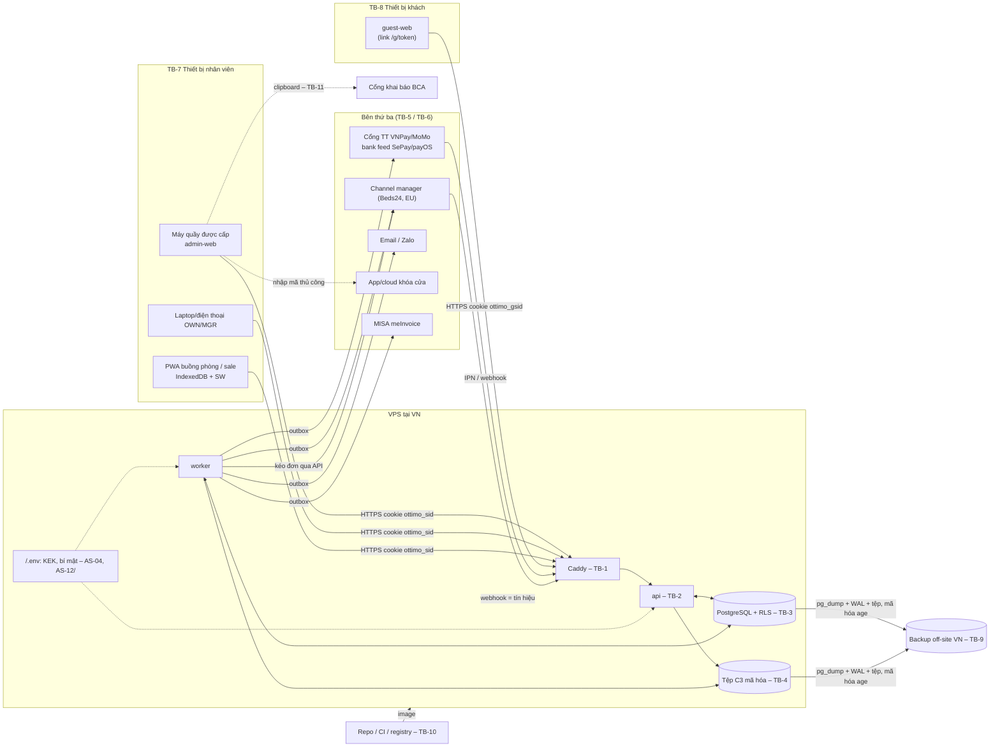
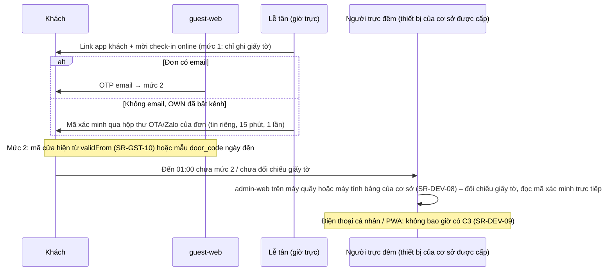

# Threat model (STRIDE) – OTTIMO Desk

- Người lập: SEC | Round 1 – Bước 2 Sản xuất – Đợt 4 (Phần 2) | Ngày: 15/10/2026 | Phiên bản: 0.2 (Bước 4 – sau review ARC và phân xử ORC)
- Đầu vào: `architecture.md` (Pha A + B), `adr/ADR-001…013`, `erd.md`, `api/openapi.yaml` (0.1.0-draft), `rbac-matrix.md`, `integrations.md`, `integrations/smart-lock.md`, `product/integrations/README.md`, `infra/docker-compose.yml`, `infra/caddy/Caddyfile.dev`, `infra/docker/Dockerfile.api`, `.github/workflows/ci.yml`, `.env.example`, `security/data-risk-assessment.md` (gọi tắt **DRA**: C0–C3, D01–D28, T01–T18, R-REG, R-PAY, F01–F14), `rounds/round-01/outputs/ARC/report.md` mục 4 (M1–M11).
- Đọc cùng: `security-requirements.md` (mã **SR-xxx** – mọi biện pháp trong tài liệu này trỏ tới đó).
- Phạm vi: kiến trúc MVP (1 VPS tại Việt Nam, Docker Compose, Caddy, `api` + `worker` NestJS, PostgreSQL 17 có RLS, kho tệp mã hóa, 3 client web: `admin-web`, PWA `mobile`, `guest-web`) và các tích hợp R2–R3 (cổng thanh toán, bank feed, channel manager Beds24, email/Zalo, MISA, khóa cửa thủ công/cloud sau MVP, cổng khai báo BCA bán tự động). `booking-web` (R3) chỉ xét ở mức biên Internet.

> **Tuyên bố giới hạn.** Đây là mô hình mối đe dọa ở mức thiết kế, dựa trên tài liệu – chưa có mã nguồn để kiểm. Mức rủi ro là ước lượng của SEC. Tài liệu không khẳng định hệ thống "an toàn" hay "tuân thủ"; nó liệt kê biện pháp đã/sẽ cài và rủi ro còn lại. Trước khi đưa dữ liệu khách thật vào, cần kiểm tra bảo mật tổng (Round 3) và khuyến nghị kiểm thử xâm nhập độc lập (đề xuất ESC trong report SEC).

---

## 1. Tóm tắt cho người bận

1. **62 mối đe dọa** (TM-01…TM-62) trên 10 nhóm thành phần/luồng. Trước biện pháp: **3 Critical, 25 High**, 27 Medium, 7 Low. Sau khi cài đủ biện pháp R2–R3: **0 Critical, 2 High còn lại** (TM-13 chiếm VPS, TM-17 ảnh giấy tờ ngoài hệ thống – cần INV biết và chấp nhận, mục 9), phần còn lại Medium/Low.
2. Ba điểm thiết kế **phải sửa trước khi code R2** (đã ghi thành phát hiện ở report SEC mục 4, sẽ vào bug-list bước 5):
   - **Xác minh mức 2 của app khách quá yếu** (TM-21): OpenAPI cho lên mức 2 bằng "4 số cuối SĐT **hoặc** mã đặt phòng". Mã đặt phòng là số tăng dần (`OTM-00171`) và nằm **ngay trong tin nhắn chứa link** → ai có link (ví dụ người trong nhóm chat) cũng xem được bill và **mã cửa**. SEC chốt: mức 2 = mã OTP gửi email của đơn **hoặc** mã xác minh do lễ tân cấp (SR-GST-07). Bước 4 (phân xử ORC): mã lễ tân được phép gửi qua hộp thư OTA/Zalo của đơn, **mặc định tắt**, owner bật theo kênh (SR-GST-13) – rủi ro còn lại ở TM-61 và mục 9.
   - **"Xóa bằng hủy khóa" không xóa được trong bản sao lưu** như ADR-013 mô tả (TM-15): khóa dữ liệu đã bọc (`data_key.wrapped_key`) nằm trong chính DB được sao lưu, còn khóa chủ không đổi → backup cũ vẫn giải mã được. Dữ liệu chỉ thực sự hết khi backup cũ hết hạn (≤ 35 ngày, T18). Cần sửa câu chữ ADR-013 + ràng buộc vòng đời backup + nhật ký xóa để áp lại sau khôi phục (SR-BAK-03, SR-BAK-06).
   - **"C3 chỉ trên máy quầy" chưa có cơ chế thật** (M8, TM-46): cờ `device_trusted` theo phiên không ràng buộc với thiết bị. SEC chốt cơ chế **đăng ký thiết bị** (cookie thiết bị riêng, bảng `trusted_device`) và yêu cầu mọi endpoint C3 kiểm (SR-DEV).
3. Rủi ro lớn nhất còn lại **nằm ngoài phần mềm**: ảnh giấy tờ đi qua điện thoại cá nhân/nhóm chat (TM-17, DRA F07), máy quầy dùng chung không được quản lý (TM-46), và toàn bộ dữ liệu nằm trên **một VPS** – ai chiếm được quyền root thì có cả khóa chủ lẫn dữ liệu (TM-13). Giảm bằng quy định nội bộ của INV, cứng hóa máy quầy, và **giữ C3 càng ngắn càng tốt**.

---

## 2. Phương pháp

- **STRIDE theo phần tử** của sơ đồ luồng dữ liệu: **S** giả mạo danh tính · **T** sửa trái phép · **R** chối bỏ · **I** lộ thông tin · **D** từ chối dịch vụ · **E** leo thang đặc quyền.
- **Mức rủi ro** = Khả năng (1 Thấp · 2 Trung bình · 3 Cao) × Tác động (1 Thấp · 2 Trung bình · 3 Cao):
  | Điểm | Mức | Ý nghĩa xử lý |
  |---|---|---|
  | 9 | **Critical** | Chặn phát hành nếu chưa có biện pháp (SEC có quyền chặn) |
  | 6 | **High** | Bắt buộc có ≥ 1 biện pháp cụ thể, cài trước khi có dữ liệu thật; còn lại phải báo INV |
  | 3–4 | **Medium** | Có biện pháp trong round đã nêu; được dời có lý do |
  | 1–2 | **Low** | Theo dõi |
- Tác động "Cao" = lộ dữ liệu C3 / an toàn thân thể khách / sai tiền / mất dữ liệu / vi phạm pháp lý rõ. Tác động "Trung bình" = lộ C2 giới hạn, gian lận nhỏ, gián đoạn vận hành có cách thủ công.
- Cột **Còn lại** = mức sau khi cài đủ biện pháp đã nêu (ước lượng).
- Biện pháp ghi mã `SR-xxx` (xem `security-requirements.md`), kèm round cài.

---

## 3. Tài sản cần bảo vệ

| Mã | Tài sản | Mức (DRA) | Nơi nằm | Vì sao quan trọng |
|---|---|---|---|---|
| AS-01 | Số và trường giấy tờ: CCCD, hộ chiếu, thị thực, địa chỉ, dữ liệu trẻ em (D03–D05, D07, D09) | C3 | `guest_document.*_enc`, `reservation_guest.child_*_enc` | Giả mạo danh tính; nghĩa vụ pháp lý |
| AS-02 | **Ảnh giấy tờ** (D06) | C3 | `BlobStore` (volume) + `document_image` | Như AS-01, kèm ảnh chân dung |
| AS-03 | Mã cửa đang hiệu lực, thẻ phòng (D22) | C3 | `door_credential.code_enc`, app khóa của hãng | **An toàn thân thể** và tài sản khách |
| AS-04 | Khóa chủ KEK, khóa HMAC số giấy tờ, khóa dữ liệu DEK | C3 (bí mật) | `.env` trên VPS; `data_key.wrapped_key` | Lộ KEK + DB = lộ toàn bộ C3 |
| AS-05 | Token phiên nhân viên, token link khách, mã OTP khách, CSRF | C3 | Cookie trình duyệt; băm trong `user_session`, `guest_access_token`, `guest_session` | Chiếm phiên = mang quyền người đó |
| AS-06 | Mật khẩu/PIN duyệt nhân viên, bí mật 2FA | C3 | `app_user.password_hash`, `approval_pin_hash`, (R3) `mfa_secret_enc` | |
| AS-07 | Dữ liệu cá nhân C2: tên, liên hệ, lịch sử lưu trú, quan hệ người đi cùng, ghi chú, yêu cầu khách (D01, D02, D10–D12, D23) | C2 | `guest`, `reservation*`, `guest_request` | Quyền riêng tư, ND 13/Luật 91 |
| AS-08 | Dữ liệu tiền: folio, giao dịch, hoàn tiền, FOC, hoa hồng, tài khoản nhận hoàn (D14, D15) | C2/C3 | `folio_line`, `payment`, `approval_request` | Sai tiền, gian lận |
| AS-09 | **Toàn vẹn tồn phòng** (không đặt trùng, OOO chặn bán) | C1 (toàn vẹn cao) | `room_occupancy`, channel manager | Khách đến không có phòng |
| AS-10 | Dữ liệu kinh doanh mật: giá vốn, P&L, phí kênh, hoa hồng người khác | C2 | báo cáo, `channel_fee`, `commission` | BL 8.2 #27 |
| AS-11 | Nhật ký: `audit_event`, `c3_access_log`, `state_transition`, `consent_record` | C2 | PostgreSQL append-only | Bằng chứng tuân thủ, điều tra |
| AS-12 | Bí mật tích hợp: refresh token Beds24, hash secret VNPay/MoMo, webhook secret bank feed, MISA, Zalo, SMTP | C3 (bí mật) | `.env` (MVP) | Ví dụ lộ token Beds24 → đổi giá/đóng bán mọi OTA |
| AS-13 | Tài khoản cổng khai báo BCA của cơ sở | C3 (bí mật) | Trình quản lý mật khẩu của quản lý (không trong app – R-REG-06) | |
| AS-14 | Bản sao lưu DB + tệp, khóa giải mã backup | C3 | Đích off-site tại VN; khóa riêng của `age` | Chứa mọi thứ trên |
| AS-15 | Tính sẵn sàng của hệ thống (nhận phòng, trả phòng, nhắc hạn khai báo) | – | VPS đơn | Mất hệ thống giờ cao điểm |
| AS-16 | Thiết bị: máy quầy, điện thoại buồng phòng/sale, IndexedDB của PWA | C1–C3 | Thiết bị đầu cuối | Cache dữ liệu, phiên còn sống |

## 4. Tác nhân đe dọa

| Mã | Tác nhân | Động cơ / khả năng | Ví dụ |
|---|---|---|---|
| TA-1 | Kẻ tấn công từ Internet (không có tài khoản) | Dò mật khẩu, quét lỗ hổng, giả webhook, dò token link | Bot credential stuffing; gửi IPN giả |
| TA-2 | Người có link app khách nhưng không phải khách | Tò mò, có ý đồ | Người trong nhóm chat đoàn khách, người nhận email chuyển tiếp |
| TA-3 | Khách ác ý | Lấy thông tin khách khác, gây phiền, gian lận tiền | Thử đổi `reservationId`, spam yêu cầu, tải tệp độc |
| TA-4 | Nhân viên tò mò / vượt quyền (insider) | Xem giấy tờ khách không vì công việc, chụp màn hình | Lễ tân xem ảnh hộ chiếu khách nổi tiếng |
| TA-5 | Nhân viên gian lận | Tiền mặt, FOC, hoa hồng | Ghi thu rồi đảo, tự duyệt FOC |
| TA-6 | CTV/sale ngoài biên chế | Lấy danh sách khách để bán/chào riêng | Dò SĐT qua tìm khách, xem đơn người khác |
| TA-7 | Nhân viên đã nghỉ việc | Còn phiên/mật khẩu, biết mật khẩu chung | Đăng nhập lại từ nhà |
| TA-8 | Kẻ trộm/nhặt thiết bị | Điện thoại buồng phòng, laptop quản lý | Mở PWA còn phiên |
| TA-9 | Bên thứ ba bị xâm nhập | Channel manager, cổng thanh toán, email, nhà cung cấp VPS, thư viện npm | Gói npm độc hại; webhook từ hệ thống CM bị chiếm |
| TA-10 | Người vận hành có quyền máy chủ (OPS, nhà cung cấp VPS) | Truy cập DB/volume/backup | Sao chép ổ đĩa VPS |

## 5. Biên tin cậy (trust boundaries)

| Mã | Biên | Bên ngoài → bên trong | Kiểm soát chính |
|---|---|---|---|
| TB-1 | Internet ↔ Caddy (VPS) | Trình duyệt nhân viên, khách, webhook | TLS, header, giới hạn kích thước, che log `/g/*` |
| TB-2 | Caddy ↔ `api` | Request đã qua proxy | Xác thực phiên, CSRF, rate limit, zod |
| TB-3 | `api`/`worker` ↔ PostgreSQL | Ứng dụng → dữ liệu | Vai DB `ottimo_app` không `BYPASSRLS`; `SET LOCAL` ngữ cảnh cơ sở; REVOKE bảng append-only |
| TB-4 | `api`/`worker` ↔ kho tệp + `CryptoService` | Ứng dụng → C3 | Mã hóa phong bì, KEK ngoài DB |
| TB-5 | `worker` ↔ bên thứ ba (ra) | Lõi → adapter → CM, cổng TT, MISA, email, Zalo, khóa | Outbox, timeout, chỉ gửi trường tối thiểu, host cố định |
| TB-6 | Bên thứ ba ↔ endpoint webhook (vào) | Dữ liệu không tin cậy | Chữ ký, inbox idempotent, kéo lại qua API, khớp số tiền |
| TB-7 | Thiết bị nhân viên ↔ hệ thống | IndexedDB, service worker, clipboard, màn hình | Không cache C3, thiết bị được cấp, phiên hết hạn |
| TB-8 | Thiết bị khách ↔ `guest-web` | Link/QR, phiên khách mức 1/2 | Token băm, đổi sang cookie, xác minh mức 2 |
| TB-9 | VPS ↔ đích sao lưu off-site | Bản sao toàn bộ dữ liệu | Mã hóa `age`, khóa riêng ngoài VPS, đích chỉ cho ghi |
| TB-10 | Repo/CI/registry ↔ VPS (chuỗi cung ứng) | Mã nguồn, gói npm, image | Lockfile, gitleaks, quét phụ thuộc, image không chứa bí mật |
| TB-11 | Lễ tân ↔ cổng BCA (ngoài hệ thống) | Dữ liệu C3 rời hệ thống qua clipboard | Chỉ máy quầy được cấp, xóa clipboard, ghi nhật ký `copy` |

## 6. Sơ đồ luồng dữ liệu

### 6.1 Tổng thể và biên tin cậy



### 6.2 Các luồng dữ liệu được xét kỹ

| Mã | Luồng | Dữ liệu | Biên đi qua | Mối đe dọa chính |
|---|---|---|---|---|
| DF-1 | Ảnh + trường giấy tờ: lễ tân nhập tại quầy (K3) → mã hóa → lưu → xem (A71) → sao chép sang cổng BCA (K6) → xóa theo hạn (J16) | AS-01, AS-02 | TB-7, TB-1…4, TB-11, TB-9 | TM-11…TM-20, TM-46 |
| DF-2 | Khách tải giấy tờ qua app (check-in online, K2) | AS-02 | TB-8, TB-1…4 | TM-16, TM-21, TM-25 |
| DF-3 | Link app khách: cấp link → gửi (email/Zalo/sao chép) → mở `/g/{token}` → đổi cookie mức 1 → xác minh mức 2 → xem bill/mã cửa → hết hạn/thu hồi | AS-05, AS-03, AS-07, AS-08 | TB-8, TB-1, TB-2 | TM-21…TM-27 |
| DF-4 | Thanh toán: tạo giao dịch `pending` → redirect cổng → IPN ký → ghi `succeeded`; VietQR → bank feed → khớp nội dung + số tiền | AS-08 | TB-5, TB-6 | TM-28…TM-33 |
| DF-5 | Channel manager: outbox đẩy tồn/giá; webhook đơn → inbox → kéo lại đơn → tạo/sửa/hủy đơn | AS-07, AS-09 | TB-5, TB-6 | TM-34…TM-37, TM-30 |
| DF-6 | Khóa cửa: lõi sinh mã → lễ tân cài trên app khóa (MVP thủ công) → khách xem mã ở app mức 2 → thu hồi khi trả phòng | AS-03 | TB-7, TB-8 | TM-38…TM-41 |
| DF-7 | PWA offline: đọc cache việc hôm nay; ghi hàng đợi (đổi trạng thái buồng, minibar, ảnh sự cố) → gửi lại có `Idempotency-Key` | AS-07 (tối thiểu), AS-16 | TB-7 | TM-42…TM-45 |
| DF-8 | Máy quầy: đăng nhập dùng chung vị trí, nhiều ca, xem C3, clipboard | AS-01…03, AS-05 | TB-7, TB-11 | TM-02, TM-17, TM-18, TM-46 |
| DF-9 | Sao lưu và khôi phục | AS-14, mọi tài sản | TB-9 | TM-12, TM-15, TM-51, TM-52, TM-56 |
| DF-10 | Đăng nhập nhân viên, đổi vai, duyệt FOC bằng PIN | AS-05, AS-06 | TB-1, TB-2 | TM-01…TM-06 |

### 6.3 DF-1 – vòng đời ảnh giấy tờ (vị trí từng biện pháp)

```mermaid
sequenceDiagram
  participant FD as Lễ tân (máy quầy được cấp)
  participant API as api
  participant CS as CryptoService
  participant DB as PostgreSQL
  participant FS as Kho tệp
  participant J as worker J16 (03:00)
  FD->>API: POST .../documents (multipart) + cookie phiên + cookie thiết bị
  API->>API: kiểm vai (A70), cơ sở (RLS), thiết bị được cấp (SR-DEV-03), kiểm tệp (SR-FILE)
  API->>CS: tạo DEK, mã hóa AES-256-GCM (AAD = bảng+id)
  CS->>DB: data_key(wrapped_key bằng KEK)
  API->>FS: ghi ciphertext, tên ngẫu nhiên
  API->>DB: guest_document *_enc, c3_access_log(create) cùng giao dịch
  FD->>API: GET .../images/{id}?reason=… (xem lại)
  API->>DB: ghi c3_access_log(view) TRƯỚC (thất bại → từ chối)
  API-->>FD: ảnh, no-store, CSP sandbox
  Note over API,J: Khai báo confirmed + không đồng ý lưu → outbox xóa ngay (M3); T01 24 giờ = hạn trên
  J->>DB: hủy DEK (wrapped_key=NULL), ghi purge_journal(id) + retention_run
  J->>FS: xóa tệp
  Note over DB: Backup cũ vẫn còn wrapped_key → chỉ hết hẳn khi backup ≤ 35 ngày hết hạn (TM-15)
```

### 6.4 DF-3/DF-8 – khách đến khuya, không có lễ tân (phân xử ORC 15/10)



---

## 7. Bảng mối đe dọa

Ký hiệu: **K** khả năng, **TĐ** tác động, **M** mức trước biện pháp, **CL** còn lại. Round cài: ghi trong `security-requirements.md`.

### 7.1 Xác thực nhân viên và phiên (DF-10, TB-1/TB-2)

| Mã | Thành phần / luồng | STRIDE | Mối đe dọa | K | TĐ | M | Biện pháp chính | CL |
|---|---|---|---|:-:|:-:|:-:|---|:-:|
| TM-01 | `/v1/auth/login` | S | Dò/nhồi mật khẩu (credential stuffing), mật khẩu yếu hoặc dùng chung giữa nhân viên → vào hệ thống xem C2/C3 | 2 | 3 | **High** | Mật khẩu ≥ 10 ký tự + chặn mật khẩu phổ biến (SR-AUTH-02); khóa tạm theo tài khoản + giới hạn theo IP (SR-AUTH-04, SR-RL-01); thông báo lỗi chung; **2FA TOTP bắt buộc OWN/MGR** trước khi chạy thật (SR-AUTH-06); không tài khoản dùng chung (SR-AUTH-08) | Medium |
| TM-02 | Máy quầy, nhiều ca | S | Lễ tân quên đăng xuất, người khác dùng tiếp phiên → thao tác tiền/xem C3 dưới tên người khác | 3 | 2 | **High** | Hết phiên khi không hoạt động 30 phút + tối đa 12 giờ (SR-SES-03); xem C3 cần xác nhận lại PIN/mật khẩu nếu quá 15 phút (SR-C3-09); khóa màn hình OS 5 phút (SR-DEV-07); đổi ca = đăng xuất (SR-SES-08) | Medium |
| TM-03 | `PUT /users/{id}/roles`, `PATCH /users/{id}` | S/E | Đổi vai/khóa tài khoản chỉ có hiệu lực "lần đăng nhập sau" (OpenAPI) → nhân viên nghỉ việc còn phiên vẫn dùng được | 2 | 3 | **High** | Thu hồi **mọi phiên** của người dùng ngay khi đổi vai, khóa, đặt lại mật khẩu (SR-SES-06); quyền đọc lại từ DB mỗi request hoặc theo `roles_version` (SR-AZ-08) | Low |
| TM-04 | Method ghi của nhân viên | T | CSRF: trang độc hại khiến trình duyệt lễ tân gửi lệnh hủy đơn/ghi thu | 1 | 3 | Medium | `SameSite=Lax` + header `X-CSRF-Token` + kiểm `Origin` (SR-SES-04) | Low |
| TM-05 | admin-web hiển thị dữ liệu từ khách/OTA | S/I | XSS lưu trữ: tên khách từ OTA, ghi chú yêu cầu khách, nội dung mẫu tin chứa script → chạy trong phiên lễ tân, đọc dữ liệu, gọi API | 2 | 3 | **High** | React tự escape, cấm `dangerouslySetInnerHTML` (lint) (SR-INP-04); CSP chặt không `unsafe-inline` (SR-HDR-01); tách origin admin / staff / guest (SR-HDR-04) | Low |
| TM-06 | Duyệt FOC, giảm giá, hoàn tiền | R/S | Người gửi chọn tên người duyệt (BL 8.2 #24); người duyệt chối bỏ | 2 | 2 | Medium | Duyệt bằng tài khoản + PIN của chính người duyệt (BR-432, SR-AUTH-09); `approval_request` lưu snapshot vai/hạn mức; audit append-only (SR-AUD-01) | Low |

### 7.2 Phân quyền và cách ly dữ liệu (TB-2/TB-3)

| Mã | Thành phần | STRIDE | Mối đe dọa | K | TĐ | M | Biện pháp chính | CL |
|---|---|---|---|:-:|:-:|:-:|---|:-:|
| TM-07 | Mọi endpoint có id (`reservationId`, `guestId`, `documentId`…) | E/I | **IDOR**: SAL/CTV/HK đổi id trên URL để xem đơn, khách, folio ngoài phạm vi "của mình/hôm nay" | 3 | 3 | **Critical** | 3 lớp kiểm (SR-AZ-01…05): guard hành động theo `x-roles`; phạm vi M/T/Đ trong truy vấn; RLS theo cơ sở; ngoài phạm vi → 404; **test sinh tự động từ `x-roles`/`x-scope`** cho mọi operation × vai (SR-AZ-09) | Medium |
| TM-08 | Serializer phản hồi | I | Trường nhạy cảm vẫn có trong JSON dù UI ẩn (lặp lại BL 8.2 #27): giá vốn cho HK, số giấy tờ cho SAL, hoa hồng người khác | 3 | 2 | **High** | Serializer **mặc định từ chối** theo `x-visible-to` (SR-AZ-04); test snapshot JSON theo vai; phát hiện lệch rbac ở report SEC mục 4 (SEC-R1-09, -10) | Low |
| TM-09 | RLS, job hệ thống | E | Truy cập chéo cơ sở: quên `SET LOCAL`, job chạy vai `BYPASSRLS`, kết nối pool giữ biến phiên cũ | 1 | 3 | Medium | `SET LOCAL` trong giao dịch (không `SET`); thiếu biến → 0 dòng; job dùng vai riêng có log; test 2 cơ sở (SR-AZ-06) | Low |
| TM-10 | Body PATCH/POST | E/T | Mass assignment: gửi thêm `status`, `roles`, `unitPriceVnd`, `closerUserId`… | 2 | 2 | Medium | zod `.strict()` theo schema OpenAPI, không bind thẳng vào ORM (SR-INP-01) | Low |
| TM-11 | Xem C3 (A71, `.../sensitive`, `portal-data`, mã cửa) | I/E | Nhân viên có quyền nhưng xem **không vì công việc** (khách nổi tiếng, người quen), chụp màn hình, xem hàng loạt | 2 | 3 | **High** | Lý do bắt buộc sau `confirmed`; `c3_access_log` ghi trước khi trả, thất bại thì từ chối (SR-C3-07); **cảnh báo bất thường** (> N lượt/ngày, xem đơn đã trả phòng, ngoài ca) tới OWN (SR-LOG-06); cấm xuất hàng loạt (A75); chỉ máy quầy được cấp (SR-DEV); OWN/MGR rà nhật ký hằng tháng (SR-C3-12) | Medium |

### 7.3 Dữ liệu C3 và ảnh giấy tờ (DF-1, DF-2, TB-4, TB-11)

| Mã | Thành phần | STRIDE | Mối đe dọa | K | TĐ | M | Biện pháp chính | CL |
|---|---|---|---|:-:|:-:|:-:|---|:-:|
| TM-12 | DB, volume tệp, backup | I | Lấy được bản sao DB/ổ đĩa/backup (nhà cung cấp, OPS, kẻ tấn công) → đọc C3 | 2 | 3 | **High** | Mã hóa phong bì DEK/KEK, KEK không nằm trong DB/backup/image (SR-KEY-01…04); backup mã hóa `age`, khóa riêng ngoài VPS (SR-BAK-02); giữ C3 ngắn (T01–T03) | Medium |
| TM-13 | KEK trong `.env` trên **cùng VPS** | I | Chiếm quyền root VPS (lỗ hổng ứng dụng → RCE, SSH yếu) → có cả KEK lẫn DB → giải mã toàn bộ C3 **đang lưu** | 2 | 3 | **High** | Cứng hóa VPS (SR-OPS-01…05); `.env` quyền 600, user riêng; KEK không vào log/dump; tối thiểu hóa thời gian lưu C3 để giới hạn "bán kính nổ"; xoay KEK khi nghi lộ (SR-KEY-05); KEK tách khỏi `.env`, nạp qua Compose secrets, loại khỏi sao lưu tệp – chỉ chống bản sao ổ đĩa, không chống root đang chạy (SR-KEY-10, R3). **Không loại bỏ được** ở ngân sách MVP (KMS/HSM ngoài phạm vi) → báo INV ở mục 9 | **High** |
| TM-14 | KEK | D | Mất KEK (xóa nhầm `.env`, dựng lại VPS) → mất toàn bộ ảnh/số giấy tờ đang lưu | 1 | 2 | Low | INV giữ 2 bản sao KEK ngoại tuyến (SR-KEY-04); kiểm thử khôi phục mỗi round giải mã 1 mẫu (SR-BAK-05) | Low |
| TM-15 | Crypto-shredding vs backup | I | Hủy DEK trong DB **không** làm backup cũ hết giải mã được (backup có `wrapped_key` + KEK không đổi) → ảnh/số giấy tờ "đã xóa" vẫn khôi phục được tới khi backup hết hạn; ADR-013 hiện mô tả sai | 3 | 2 | **High** | Sửa câu chữ ADR-013 và thông báo xử lý dữ liệu: "xóa khỏi bản sao lưu trong ≤ 35 ngày" (T18); vòng đời backup **cứng** ≤ 35 ngày gồm cả snapshot của nhà cung cấp (SR-BAK-03); `purge_journal` áp lại sau khôi phục (SR-BAK-06); (tùy chọn R3) xoay KEK theo tháng + hủy KEK cũ sau khi backup chứa nó hết hạn (SR-KEY-06) | Low |
| TM-16 | Upload ảnh (quầy, app khách, đính kèm) | T/E | Tệp độc: polyglot, HEIC/PDF khai thác thư viện xử lý ảnh, SVG/HTML giả ảnh, PDF có JavaScript, ảnh "bom giải nén" → RCE hoặc XSS khi lễ tân mở | 2 | 3 | **High** | Danh sách loại cho phép theo **magic bytes**, ≤ 10 MB, ≤ 40 MP; server chỉ nhận JPEG/PNG/WebP, client chuẩn hóa ảnh (kể cả HEIC) sang JPEG trước khi tải, server vẫn **mã hóa lại** bằng `sharp` (bỏ EXIF/GPS); **MVP không nhận PDF**; phục vụ với CSP `sandbox`; thư viện ảnh chạy với giới hạn tài nguyên (SR-FILE-01…06) | Low |
| TM-17 | Ngoài hệ thống: điện thoại cá nhân, Zalo, thư mục Downloads | I | Ảnh giấy tờ bị chụp bằng điện thoại cá nhân, gửi nhóm chat, tải về máy quầy; trình duyệt cache ảnh (DRA F07) | 3 | 3 | **Critical** | Kênh tải lên trong app thay chat (R-REG-08); chụp bằng camera trong app (không lưu thư viện ảnh); `no-store`, không nút tải về, xem inline có watermark tên người xem + thời điểm (SR-C3-10); máy quầy không đồng bộ đám mây/không cài app chat (SR-DEV-07); **quy định nội bộ của INV** (DRA Q10) | **High** |
| TM-18 | Clipboard (K6 sao chép sang cổng BCA) | I | Dữ liệu C3 ở clipboard máy quầy, **lịch sử clipboard/Đồng bộ clipboard đám mây** (Windows/macOS/iCloud), app bàn phím | 2 | 3 | **High** | `portal-data` chỉ trên thiết bị được cấp (SR-DEV-03); sao chép **từng trường**, tự xóa clipboard sau 60 giây (SR-C3-11); tắt lịch sử/đồng bộ clipboard trên máy quầy (SR-DEV-07); ghi nhật ký `copy` | Medium |
| TM-19 | `c3_access_log` | R | Không chứng minh được ai xem ảnh (log ghi sau, lỗi ghi bị bỏ qua, thiếu thiết bị/phiên) | 2 | 2 | Medium | Ghi cùng giao dịch **trước** khi trả, thất bại → 503 không trả dữ liệu (fail closed); thêm `actor_type`, `session_id`, `device_id`, `ip_hmac` (SR-C3-07, SR-C3-08) | Low |
| TM-20 | Job J16 `retention.purge`, `legal_hold` | T/R | Ảnh không bị xóa đúng hạn (job lỗi im lặng, tham số bị sửa dài ra, `legal_hold` bị lạm dụng để giữ ảnh) | 2 | 2 | Medium | `retention_run` + cảnh báo OPS khi job lỗi/0 lần chạy trong 26 giờ; tham số thời hạn chỉ OWN sửa + audit; `legal_hold` bắt buộc lý do + ngày xem lại ≤ 90 ngày, báo cáo hold đang mở (SR-RET-01…05) | Low |

### 7.4 Link app khách (DF-3, TB-8)

| Mã | Thành phần | STRIDE | Mối đe dọa | K | TĐ | M | Biện pháp chính | CL |
|---|---|---|---|:-:|:-:|:-:|---|:-:|
| TM-21 | `/v1/guest/sessions/verify`, `GuestStay.doorCode`, `/v1/guest/folio` | S/I | **Link bị chuyển tiếp** (nhóm chat đoàn, email forward). Xác minh mức 2 hiện là "4 số cuối SĐT **hoặc** mã đặt phòng" – mã đặt phòng tăng dần và **nằm trong cùng tin nhắn với link** → người nhận link vượt mức 2, xem bill và **mã cửa** → vào phòng | 3 | 3 | **Critical** | Mức 2 = **OTP 6 số gửi email của đơn** hoặc **mã xác minh lễ tân cấp** (SR-GST-07); mã đặt phòng/4 số SĐT **không** là yếu tố xác minh; giới hạn 5 lần sai **trên token** (không trên phiên) rồi khóa token (SR-GST-08); mã cửa chỉ hiện từ giờ nhận phòng, chỉ mức 2 (SR-GST-10); lễ tân cấp lại link = thu hồi link cũ và mọi phiên (SR-GST-04). Khách không có email: mã lễ tân đọc tại quầy/gọi điện, hoặc (nếu OWN bật kênh) gửi qua hộp thư OTA/Zalo của đơn – mã **một lần**, gắn token, hết hạn 15 phút, đếm sai chung theo token, tin riêng không kèm link (SR-GST-13); ô email không bắt buộc ở form đặt phòng (SR-GST-14). **Rủi ro còn lại khi bật kênh**: nếu link cũng được gửi trong cùng hộp thư/Zalo đó thì mức 2 chỉ chứng minh "người giữ kênh của đơn", không chống được người dùng chung tài khoản OTA/Zalo đó hoặc người được chủ kênh chuyển tiếp **cả hai** tin – xem TM-61 | Medium (kênh tắt) · Medium (kênh bật, rủi ro cao hơn – TM-61) |
| TM-22 | `/v1/guest/sessions` | S | Dò token link | 1 | 3 | Medium | Token ngẫu nhiên 256 bit (tối thiểu 128), DB lưu SHA-256; giới hạn 10 lần/phút/IP + 100/ngày/IP (SR-GST-01, SR-RL-03) | Low |
| TM-23 | URL `/g/{token}` | I | Token lộ qua Referer, log Caddy/API, lịch sử trình duyệt, máy dùng chung, script bên thứ ba | 2 | 2 | Medium | Đổi token sang cookie ngay rồi `history.replaceState` xóa token khỏi thanh địa chỉ; `Referrer-Policy: no-referrer`; che `/g/*` trong log; guest-web **không** có script bên thứ ba/analytics (SR-GST-02, -03, SR-LOG-03) | Low |
| TM-24 | QR trong phòng | I | QR cố định theo phòng lộ dữ liệu khách trước (DRA F09) | 1 | 2 | Low | QR chỉ mở trang công khai của căn + ô nhập link/mã (ADR-006 mục 4) | Low |
| TM-25 | Upload/yêu cầu từ app khách | D | Spam yêu cầu, tải tệp liên tục → làm phiền lễ tân, đầy đĩa | 2 | 1 | Low | 20 yêu cầu/ngày/đơn, 30 tệp/đơn, 10 MB/tệp, tổng 200 MB/đơn (SR-RL-05, SR-FILE-02) | Low |
| TM-26 | Link sau trả phòng (M4) | I | Link còn dùng được sau khi rời → người khác cầm điện thoại xem bill/thông tin | 2 | 2 | Medium | Ân hạn mặc định 24 giờ nhưng **thu hẹp phạm vi**: chỉ xem bill + thanh toán phát sinh, cần mức 2; không Wi-Fi, mã cửa, yêu cầu, upload (SR-GST-11) | Low |
| TM-61 | Mã xác minh lễ tân qua kênh nhắn tin (SR-GST-13) | S/I | (a) **Lừa lễ tân**: kẻ có link (người trong nhóm chat) nhắn Zalo từ số khác/hội thoại OTA khác xưng là khách xin mã → nhận mã → mức 2 → mã cửa; (b) tài khoản OTA/Zalo của khách bị chiếm hoặc dùng chung; (c) mã lộ khi lễ tân dán nhầm hội thoại hoặc gửi bằng Zalo cá nhân | 2 | 3 | **High** | Mặc định **tắt**, OWN bật theo kênh (`guest_verify_code_channels`); chỉ gửi tới hội thoại của đơn trên extranet hoặc Zalo của **SĐT trên đơn**, bằng Zalo **của cơ sở**; mã 6 số một lần, gắn token, 15 phút, lưu băm; đếm sai chung theo token (5/24 giờ) + tối đa 3 lần cấp qua kênh/24 giờ/token; tin mã không chứa link; audit mỗi lần cấp (người, kênh, đơn); cấp lại link hủy mã cũ; hướng dẫn lễ tân "không gửi mã cho hội thoại mới" (SR-GST-08, -13) | Medium |
| TM-27 | Origin guest-web | E | XSS ở guest-web cùng origin với admin → đọc/gửi request bằng cookie nhân viên | 1 | 3 | Medium | Tên miền con riêng cho guest-web; cookie `ottimo_sid` host-only ở origin quản trị; CORS chỉ cùng origin (SR-HDR-04) | Low |

### 7.5 Thanh toán (DF-4, TB-6)

| Mã | Thành phần | STRIDE | Mối đe dọa | K | TĐ | M | Biện pháp chính | CL |
|---|---|---|---|:-:|:-:|:-:|---|:-:|
| TM-28 | `/v1/webhooks/payments/{provider}` (IPN) | S/T | IPN giả mạo hoặc phát lại → đơn ghi "đã thanh toán" khi chưa có tiền; xác nhận cọc giả | 2 | 3 | **High** | Kiểm chữ ký trên **raw body/query**, so sánh hằng thời gian; khớp `paymentId` + **số tiền** + tiền tệ + trạng thái đang `pending`; UK `(provider, provider_txn_id)`; gọi API truy vấn trạng thái của cổng trước khi ghi `succeeded` (B5) (SR-PAY-01…05) | Low |
| TM-29 | ReturnUrl, VietQR, form thu tiền | T | Sửa số tiền ở client/ReturnUrl; tạo VietQR số tiền thấp hơn nợ | 2 | 2 | Medium | Server tính số tiền phải thu; ReturnUrl chỉ hiển thị (INT 3.2); VietQR khác số dư → cần lý do; khớp số tiền khi xác nhận (SR-PAY-06) | Low |
| TM-30 | Ghi chú, đính kèm, payload CM thô | I | **Dữ liệu thẻ lọt vào hệ thống**: nhân viên gõ số thẻ vào ghi chú; ảnh chụp thẻ làm "biên nhận"; channel manager gửi kèm thẻ ảo (VCC) trong payload thô → `ChannelBookingEvent.raw`/`inbox_message.payload_ref` lưu lại → kéo OTTIMO vào phạm vi PCI DSS | 2 | 3 | **High** | Validator Luhn mọi ô văn bản tự do (R-PAY-07, K10); **lọc bỏ trường thẻ khỏi payload CM trước khi lưu**, chỉ lưu trường trong danh sách cho phép, tắt chuyển thẻ trên Beds24 (SR-PAY-09, R-PAY-06); mục đích đính kèm không có "thẻ"; hướng dẫn nhân viên (SR-PAY-10) | Low |
| TM-31 | Bank feed SePay/payOS (R3) | S/T | Webhook biến động số dư giả → tự xác nhận chuyển khoản không có thật | 2 | 3 | **High** | Xác thực khóa/chữ ký của nhà cung cấp; **kéo lại giao dịch qua API** của nhà cung cấp trước khi ghi; khớp nội dung `OTM00171` + số tiền chính xác; lệch → "Cần chú ý", không tự ghi (SR-PAY-07) | Low |
| TM-32 | Folio, thu tiền mặt | R/T | Nhân viên ghi thu tiền mặt rồi đảo, sửa dòng folio, xóa dấu vết | 2 | 2 | Medium | Không xóa, chỉ bút toán đảo (K8); đảo chỉ MGR+ (A34); audit append-only; báo cáo thu theo ca (A44) (SR-AUD-01…03) | Low |
| TM-33 | Cấu hình | E/T | Adapter `mock`, đồng hồ chỉnh được (`CLOCK_MODE=mutable`) hoặc endpoint kiểm thử (`/__test__/*` – chỉnh giờ, chạy job) vô tình bật ở production → ghi tiền giả, sai hạn, lách hạn xóa/khóa | 1 | 3 | Medium | Kiểm khi khởi động theo `APP_ENV`: production mà có adapter tiền `mock`, `CLOCK_MODE` ≠ `system`, `INCLUDE_TEST_SUPPORT=1`/`TEST_SUPPORT_TOKEN`, bí mật trống → **không khởi động**; biến cũ `CLOCK_OVERRIDE` đặt khác rỗng → dừng ở mọi môi trường (SR-SECR-05); mã `test-support` chỉ nạp khi `INCLUDE_TEST_SUPPORT=1`, cần `X-Test-Token` + phiên owner, CI quét bundle production không có `__test__` (fail-closed); route webhook `mock` không đăng ký ở production | Low |

### 7.6 Channel manager (DF-5)

| Mã | Thành phần | STRIDE | Mối đe dọa | K | TĐ | M | Biện pháp chính | CL |
|---|---|---|---|:-:|:-:|:-:|---|:-:|
| TM-34 | `/v1/webhooks/channel/{provider}` | S/T | Webhook giả tạo/hủy đơn, chiếm phòng ảo | 2 | 2 | Medium | Webhook = tín hiệu; worker **kéo lại đơn** bằng thông tin đăng nhập của OTTIMO (ADR-011 B4); kiểm chữ ký nếu có; giới hạn tốc độ (SR-INT-01) | Low |
| TM-35 | Refresh token Beds24 | I/T | Lộ token → kẻ khác đổi giá, đóng bán, đọc đơn trên mọi OTA | 1 | 3 | Medium | Bí mật chỉ trong `.env` production, quyền tối thiểu (nếu Beds24 cho phạm vi), xoay khi nhân sự rời đi; `integration_log` theo dõi lời gọi lạ (SR-SECR-03, SR-INT-02) | Low |
| TM-36 | Dữ liệu ra nước ngoài | I | Dữ liệu khách (C2) tới máy chủ CM ở EU, email/Zalo nước ngoài mà chưa có thủ tục chuyển dữ liệu ra nước ngoài | 3 | 2 | **High** | ESC-002; chỉ gửi trường tối thiểu, **không gửi giấy tờ**, không kéo VCC; hợp đồng xử lý dữ liệu; danh sách bên nhận trong thông báo xử lý (SR-INT-03) – cần luật sư (ESC-001) | Medium |
| TM-37 | Đồng bộ tồn | D/T | Sai lệch tồn (lỗi đẩy, giới hạn credit) → đặt trùng | 2 | 2 | Medium | Exclusion constraint (ADR-009), outbox + đối soát đêm J20, "Cần chú ý" (ngoài phạm vi SEC – ARC/INT) | Low |

### 7.7 Khóa cửa (DF-6)

| Mã | Thành phần | STRIDE | Mối đe dọa | K | TĐ | M | Biện pháp chính | CL |
|---|---|---|---|:-:|:-:|:-:|---|:-:|
| TM-38 | Sinh mã cửa | S | Mã đoán được: theo ngày sinh, chỉ 4 số (OpenAPI cho `^[0-9]{4,10}$`), lặp giữa các lần ở → người khác vào phòng | 2 | 3 | **High** | Mã ngẫu nhiên ≥ 6 số từ CSPRNG (SR-LOCK-01); biến thể sinh nhật chỉ khi khách tự chọn, dạng **`ddmm` + ≥ 3 số ngẫu nhiên**, không ngoại lệ (SR-LOCK-02, decision-log 15/10, chờ ESC-011); không tái dùng mã trên cùng khóa trong 90 ngày | Medium |
| TM-39 | Gửi mã | I | Mã cửa lộ qua tiêu đề email, xem trước thông báo màn hình khóa, nhóm chat, log, outbox | 2 | 3 | **High** | Mã chỉ hiện trong app khách mức 2 từ giờ nhận phòng; mẫu tin **cấm biến mã cửa** trừ mẫu `door_code` gửi đúng ngày đến tới liên hệ đã xác minh, không trong tiêu đề; outbox chỉ chứa ID; không log (SR-LOCK-03, SR-MSG-01) | Medium |
| TM-40 | Thu hồi mã (chế độ thủ công) | T/E | Lễ tân quên xóa mã trên app khóa → khách cũ hoặc người biết mã vào lại | 2 | 3 | **High** | Luôn đặt **hạn trên chính khóa** khi tạo mã (phòng thủ kép); việc "Xóa mã" tạo tự động khi trả phòng, chưa tick → "Cần chú ý" đỏ; đối chiếu hằng ngày (SR-LOCK-04) | Low |
| TM-41 | Cloud khóa (sau MVP) | I | Mã/nhật ký mở cửa nằm ở cloud nước ngoài; vân tay | 2 | 2 | Medium | Không đăng ký vân tay khách (decision-log); tiêu chí chọn hãng (smart-lock.md) + ESC-011, ESC-002 | Medium |

### 7.8 PWA nhân viên và thiết bị (DF-7, TB-7)

| Mã | Thành phần | STRIDE | Mối đe dọa | K | TĐ | M | Biện pháp chính | CL |
|---|---|---|---|:-:|:-:|:-:|---|:-:|
| TM-42 | Điện thoại buồng phòng/sale | I/S | Máy mất/bị mượn: phiên còn sống, IndexedDB có tên khách, số căn, lead | 2 | 2 | Medium | Cache tối thiểu (không C3, không SĐT/email, không tiền) (SR-PWA-01); phiên PWA hết hạn 72 giờ không hoạt động, tối đa 30 ngày; OWN thu hồi phiên từ xa; đăng xuất xóa IndexedDB + cache SW (SR-PWA-04) | Low |
| TM-43 | Hàng đợi offline | T | Sửa IndexedDB để đổi `performedAt`, phát lại thao tác | 1 | 2 | Low | Server kiểm chuyển trạng thái, `Idempotency-Key`, `performedAt` trong [−24 giờ, now]; lưu cả giờ nhận (SR-PWA-05) | Low |
| TM-44 | Service worker | I | SW cache phản hồi API có C2/C3 (bill, giấy tờ) trên thiết bị | 2 | 2 | Medium | SW chỉ cache danh sách endpoint cho phép; mọi phản hồi C3 `no-store`; admin-web **không** cache API bằng SW (SR-PWA-02, -03) | Low |
| TM-45 | Web Push | I | Nội dung thông báo hiện trên màn hình khóa | 2 | 1 | Low | Push chỉ chứa loại + số căn, không tên/liên hệ/mã (ADR-005, SR-PWA-06) | Low |
| TM-46 | Máy quầy (M8) | S/E/I | Máy không được cấp vẫn xem C3 (cờ `device_trusted` theo phiên, không ràng buộc thiết bị); máy quầy dùng việc cá nhân, cài tiện ích trình duyệt/keylogger, không mã hóa ổ đĩa | 2 | 3 | **High** | **Đăng ký thiết bị**: OWN cấp, cookie thiết bị riêng 256 bit, băm trong `trusted_device`, gắn cơ sở, hết hạn 180 ngày, thu hồi được; mọi endpoint C3 kiểm → 403 `DEVICE_NOT_TRUSTED` (SR-DEV-01…06); danh sách cứng hóa máy quầy (SR-DEV-07); thiết bị di động **của cơ sở** cấp với checklist di động, hạn ≤ 30 ngày (SR-DEV-08); máy cá nhân/PWA không bao giờ được cấp (SR-DEV-09) | Medium |
| TM-62 | Máy tính bảng/điện thoại **của cơ sở** được cấp (người trực đêm) | I/S | Thiết bị nhỏ, dễ mang đi/mất/bị mượn; có cookie thiết bị + phiên admin-web → xem C3, mã cửa; cài thêm Zalo rồi chụp màn hình gửi đi | 2 | 3 | **High** | Khóa màn hình ≤ 1 phút + PIN/sinh trắc, mã hóa thiết bị, không app chat/tài khoản cá nhân, tắt đồng bộ ảnh/clipboard, "Tìm thiết bị" để xóa từ xa; hạn cấp ≤ 30 ngày, ở lại cơ sở; phiên admin 30 phút không hoạt động + step-up C3 (SR-C3-09); OWN thu hồi trên S26 khi mất (SR-DEV-06, -08) | Medium |

### 7.9 Hạ tầng, bí mật, chuỗi cung ứng, log (TB-1, TB-9, TB-10)

| Mã | Thành phần | STRIDE | Mối đe dọa | K | TĐ | M | Biện pháp chính | CL |
|---|---|---|---|:-:|:-:|:-:|---|:-:|
| TM-47 | Repo, image, CI | I | Bí mật bị commit, nằm trong image Docker, log CI | 2 | 3 | **High** | gitleaks toàn lịch sử (đã có), pre-commit; `.dockerignore` loại `.env*`, `.data/` (thiếu `.data/` – SEC-R1-23); image không chứa bí mật; kiểm khi khởi động (SR-SECR-01…05) | Low |
| TM-48 | Gói npm, base image, GitHub Actions | T/E | Gói độc hại/lỗ hổng, action bị chiếm | 2 | 3 | **High** | `--frozen-lockfile` (bỏ nhánh fallback ở R2); quét lỗ hổng phụ thuộc trong CI (Critical/High → đỏ); Renovate/Dependabot; ghim action theo SHA; base image theo digest; ít phụ thuộc (SR-SUP-01…05) | Medium |
| TM-49 | VPS, SSH, Postgres | E | Chiếm VPS qua SSH mật khẩu, cổng Postgres/dịch vụ dev lộ | 1 | 3 | Medium | Chỉ 80/443 + SSH bằng khóa, tắt root login, fail2ban; Postgres không publish cổng ở production; vá tự động (SR-OPS-01…04) | Low |
| TM-50 | Toàn hệ thống (1 VPS) | D | DoS vào login, endpoint khách, upload → lễ tân không làm việc được | 2 | 2 | Medium | Giới hạn kích thước body ở Caddy, timeout, rate limit (SR-RL); chế độ xem rack khi mất kết nối (ARC mục 11); chấp nhận phần còn lại | Medium |
| TM-51 | Backup off-site | I | Lộ bản sao lưu | 1 | 3 | Medium | Mã hóa `age` trước khi rời VPS, khóa riêng ngoại tuyến (SR-BAK-02) | Low |
| TM-52 | Backup | T/D | Ransomware/xóa nhầm xóa cả backup (VPS có quyền xóa đích backup) | 1 | 3 | Medium | Thông tin đăng nhập đích chỉ cho ghi thêm (không xóa/ghi đè) hoặc đích kéo về; giữ nhiều thế hệ; kiểm thử khôi phục mỗi round (SR-BAK-04, -05) | Low |
| TM-53 | Log ứng dụng, Caddy, worker | I | Log chứa PII/C3/token: body request, query string IPN, stack trace có dữ liệu, `/g/{token}`, header Cookie/chữ ký | 3 | 2 | **High** | Log JSON có cấu trúc, **không log body**, bỏ query string trừ danh sách cho phép, che theo danh sách khóa, bộ lọc Luhn/số giấy tờ; test kiểm log trong CI (SR-LOG-01…05) | Low |
| TM-54 | Bảng nhật ký | R/T | Ứng dụng hoặc người vận hành sửa/xóa nhật ký | 1 | 2 | Low | REVOKE UPDATE/DELETE với `ottimo_app` (K8); dùng `ottimo_readonly`/`ottimo_owner` có ghi nhận (SR-AUD-02) | Low |
| TM-55 | Email/Zalo/MISA | I | Bên thứ ba lưu nội dung tin (tên, ngày ở, bill) | 3 | 1 | Medium | Nội dung tối thiểu, không C3; danh sách bên xử lý trong thông báo (SR-MSG-02, SR-INT-03) | Low |
| TM-56 | Khôi phục backup | I | Khôi phục bản cũ làm **sống lại** dữ liệu đã xóa theo hạn/theo yêu cầu khách | 2 | 2 | Medium | `purge_journal` (chỉ ID, không dữ liệu) nằm ngoài vòng đời backup thông thường, áp lại ngay sau khôi phục, sau đó chạy J16 (SR-BAK-06) | Low |

### 7.10 Khai báo lưu trú, quyền chủ thể, xuất dữ liệu

| Mã | Thành phần | STRIDE | Mối đe dọa | K | TĐ | M | Biện pháp chính | CL |
|---|---|---|---|:-:|:-:|:-:|---|:-:|
| TM-57 | Tài khoản cổng BCA | S | Tài khoản dùng chung bị lộ, người nghỉ việc vẫn đăng nhập cổng | 2 | 2 | Medium | Không lưu trong app (R-REG-06); quản lý giữ trong trình quản lý mật khẩu; đổi khi nhân sự rời đi (SR-SECR-04) | Medium |
| TM-58 | Yêu cầu của chủ thể dữ liệu (S31) | S/I | Kẻ mạo danh khách qua email/điện thoại xin bản sao dữ liệu hoặc xóa dữ liệu | 2 | 3 | **High** | Chỉ tiếp nhận qua app khách mức 2 hoặc tại quầy có đối chiếu giấy tờ; không gửi bản sao chứa C3 qua email; mọi yêu cầu ghi nhật ký (R-DSR-04, SR-DSR-01…03) | Low |
| TM-59 | Xuất báo cáo (A105) | I/T | File CSV bị chia sẻ; công thức độc trong ô (CSV injection) | 2 | 2 | Medium | Quyền riêng + nhật ký; escape ô bắt đầu bằng `= + - @`; không xuất C3; tên người xuất ở chân file (SR-INP-06) | Low |
| TM-60 | Mẫu tin nhắn (A106) | T | MGR chèn HTML/biến ngoài danh sách vào mẫu email → phishing, lộ biến nhạy cảm | 1 | 2 | Low | Danh sách biến cho phép theo mẫu; escape HTML; mẫu chứa link khách phải đi qua luồng cấp link có kiểm quyền A22 (SR-MSG-03) | Low |

---

## 8. Kiểm tra QC A14 – mọi rủi ro High/Critical có ≥ 1 biện pháp cụ thể

Đếm theo cột **M** ở mục 7.

| Mức trước | Số lượng | Mã | Biện pháp cụ thể (SR) | Round cài | Còn lại |
|---|:-:|---|---|---|---|
| Critical | 3 | TM-07 | SR-AZ-01…09 (guard + phạm vi + RLS + test sinh từ OpenAPI) | R2 | Medium |
| | | TM-17 | SR-C3-10, SR-DEV-07, R-REG-08 + quy định nội bộ INV | R2 + INV | **High** |
| | | TM-21 | SR-GST-07, -08, -10, -04, -13, -14 | R2 | Medium |
| High | 25 | TM-01, 02, 03, 05, 08, 11, 12, 13, 15, 16, 18, 28, 30, 31, 36, 38, 39, 40, 46, 47, 48, 53, 58, 61, 62 | Mỗi dòng ≥ 2 biện pháp, trỏ SR ở bảng 7 | R2 (phần lớn); R3: 2FA (TM-01), IPN/bank feed thật (TM-28, TM-31) | 1 High (TM-13), còn lại Medium/Low |
| Medium | 27 | còn lại | Có biện pháp, một số dời R3 | R2–R3 | Low/Medium |
| Low | 7 | TM-14, 24, 25, 43, 45, 54, 60 | Theo dõi | – | Low |

Kết luận cho QC A14: **28/28 rủi ro Critical/High có ≥ 1 biện pháp cụ thể** có mã SR kiểm chứng được.

## 9. Rủi ro còn lại cần INV biết (2 dòng còn High + 3 dòng Medium ảnh hưởng kinh doanh)

| Mã | Rủi ro còn lại | Vì sao chưa giảm thêm được | Đề xuất |
|---|---|---|---|
| TM-13 | Chiếm quyền root VPS = có KEK + DB → đọc C3 đang lưu | KMS/HSM hoặc tách máy chủ khóa vượt ngân sách ≤ 1 tr/tháng và độ phức tạp MVP | Chấp nhận cho MVP **với điều kiện** C3 giữ ngắn (T01–T03), cứng hóa VPS, kiểm thử xâm nhập trước vận hành thật (đề xuất ESC – report SEC) |
| TM-17 | Ảnh giấy tờ qua điện thoại cá nhân/nhóm chat | Hành vi con người, ngoài phần mềm | INV ban hành quy định nội bộ (DRA Q10), đào tạo; xóa ảnh cũ trong nhóm chat |
| TM-36 | Dữ liệu khách ra nước ngoài (channel manager, email) | Không có CM trong nước đáp ứng (INT/ARC) | Luật sư xác nhận thủ tục (ESC-001, ESC-002) |
| TM-21 / TM-61 | Khi owner **bật** gửi mã xác minh qua hộp thư OTA/Zalo: ai giữ (hoặc dùng chung) tài khoản OTA/Zalo của người đặt, hoặc được người đặt chuyển cả link lẫn mã, sẽ xem được bill và **mã cửa**; lễ tân có thể bị lừa gửi mã sang hội thoại khác | Khách Airbnb/Booking/Zalo không có email dùng được; nếu chỉ cho mã tại quầy/gọi điện thì khách đến khuya không tự lấy được mã cửa và nhân viên sẽ lách bằng gửi mã cửa qua chat (nặng hơn) | Giữ **tắt** mặc định; owner chỉ bật kênh cần thiết; đào tạo lễ tân chỉ gửi vào hội thoại của đơn; owner xem nhật ký cấp mã hằng tháng. ORC báo INV ở round-summary |
| TM-50 | DoS một VPS | Một máy chủ là lựa chọn ngân sách | Chấp nhận; quy trình thủ công khi mất hệ thống (OPS runbook R3) |

(TM-21/61, TM-36 và TM-50 còn Medium, nêu để INV biết vì phụ thuộc quyết định pháp lý và ngân sách.)

## 10. Quan điểm SEC về mâu thuẫn ARC liên quan bảo mật

| # | Mâu thuẫn (ARC report mục 4) | Quan điểm SEC (chốt kỹ thuật, thuộc quyền SEC) | Ảnh hưởng tài liệu khác (thẻ review bước 3) |
|---|---|---|---|
| M3 | T01 "xóa trong 24 giờ sau xác nhận" vs BR-609/US-045 "xóa ngay" | Hai câu **không mâu thuẫn** nếu viết rõ: ảnh của người **không đồng ý** được xóa **ngay khi khai báo chuyển `confirmed`** (qua outbox, mục tiêu ≤ 15 phút); **24 giờ là hạn trên** để job J16 dự phòng bắt mọi trường hợp sót. Không xóa trước `confirmed` vì lễ tân cần ảnh để sửa khi bị từ chối (K8). Nếu chưa `confirmed`: tối đa 7 ngày sau trả phòng (T01). Bản sao lưu: hết trong ≤ 35 ngày (T18) – phải nói rõ trong thông báo xử lý dữ liệu | DOM sửa BR-609, PO sửa US-045 AC2 theo câu chữ này; ARC giữ cách cài (outbox + J16) |
| M4 | Link khách hết hiệu lực khi `checked_out` vs ân hạn 24 giờ | Giữ `guest_link_grace_hours` = **24** mặc định (cần cho BR-427 phát sinh sau trả phòng nhanh), nhưng sau `checked_out` phiên chỉ còn: xem bill + thanh toán phát sinh, **bắt buộc mức 2**; tắt Wi-Fi, mã cửa, gửi yêu cầu, tải giấy tờ. Đơn dài hạn: hết hạn khi HĐ `closed` + 24 giờ cùng phạm vi thu hẹp | PO sửa US-106 AC2, BA sửa rbac 8.6 theo câu "hết quyền vận hành khi `checked_out`; còn xem bill trong ân hạn cấu hình" |
| M8 | C3 chỉ trên máy quầy – chưa có cơ chế | Không dùng cờ theo phiên đơn thuần. Cơ chế **thiết bị được cấp**: OWN bấm "Cấp quyền thiết bị này" trên admin-web (đã đăng nhập + 2FA khi có) → server tạo `trusted_device` (tên, cơ sở, người cấp, hết hạn 180 ngày) + đặt cookie `__Host-ottimo_did` (HttpOnly, Secure, SameSite=Strict, 256 bit, DB lưu băm). Phiên chỉ có `device_trusted=true` khi cookie thiết bị hợp lệ, cùng cơ sở, chưa thu hồi. Endpoint C3 kiểm mỗi request → 403 `DEVICE_NOT_TRUSTED`. PWA `mobile` **không bao giờ** được cấp (origin khác). OWN/MGR có thể cấp cho laptop của mình (ghi nhật ký) | ARC thêm bảng `trusted_device`, mã lỗi `DEVICE_NOT_TRUSTED`, cờ `x-requires-trusted-device` ở OpenAPI; BA cập nhật rbac 8.7 (bỏ "chờ SEC/ARC") |
| M9 | `visa_alert_on` lưu dạng rõ | **Chấp nhận có điều kiện**: cột C2 (không phải C3) vì chỉ là ngày suy ra, không kèm số giấy tờ; điều kiện: (1) đặt NULL khi đơn `checked_out`/`void`/`cancelled` (không chờ T03); (2) không có trong DTO, audit, SSE – chỉ dùng để sinh mục "Cần chú ý" `visa_expiring` (mục này chỉ ghi mã đơn, không ghi ngày hạn); (3) RLS như bảng chứa | ARC cập nhật erd 4.7 ghi chú cột |
| M1 | Hạn khai báo khách NN | Ngoài quyền SEC (luật sư – ESC-001). Khuyến nghị giữ mặc định `earlier_of` vì an toàn hơn về pháp lý cho tới khi luật sư chốt | DOM sửa ví dụ BR-603 |

## 11. Giả định

- `[GIẢ ĐỊNH]` Máy quầy là 1–2 máy tính (Windows hoặc macOS) đặt tại quầy, có tài khoản OS riêng cho cơ sở. Máy tính bảng/điện thoại **của cơ sở** (ví dụ cho người trực đêm) được cấp theo checklist di động SR-DEV-08 – đã đánh giá ở TM-62. Ai trực đêm và bằng thiết bị gì: chờ INV (ESC-010, câu bổ sung theo phân xử ORC).
- `[GIẢ ĐỊNH]` Mã xác minh qua kênh OTA/Zalo ở MVP gửi **tay** (sao chép mẫu) – chưa có API nhắn tin OTA/ZNS; extranet OTA cho nhắn vào hội thoại của từng đơn (INT xác minh với Airbnb/Booking/Agoda).
- `[GIẢ ĐỊNH – chưa xác minh trên thiết bị thật]` Trình duyệt trên iPhone giải mã được ảnh HEIC để vẽ vào `canvas` (SR-FILE-01); MOB/QA thử ở R2, nếu không thì khách dùng nút Chụp trong app.
- `[GIẢ ĐỊNH]` Nhân viên buồng phòng dùng điện thoại cá nhân (BYOD) – không quản lý thiết bị tập trung (MDM) được, nên PWA không giữ C3.
- `[GIẢ ĐỊNH]` VNPay gửi IPN dạng GET có tham số trên query (theo hiểu biết của đội, **INT xác minh** ở R3) – ảnh hưởng SR-LOG-02.
- `[GIẢ ĐỊNH]` Beds24 cho phép tắt chuyển dữ liệu thẻ ảo qua API/webhook (INT xác minh trước R3).
- `[GIẢ ĐỊNH]` Ngân sách MVP không có KMS/HSM, WAF trả phí, SIEM.

## 12. Việc tiếp theo

| Việc | Ai | Khi nào |
|---|---|---|
| Review threat model | ARC (bắt buộc), OPS (khuyến nghị) | R1 bước 3 |
| SEC review ARC, INT, OPS dựa trên tài liệu này + report SEC mục 4 | SEC | R1 bước 3 |
| Cập nhật threat model khi có mã nguồn; review code OWASP Top 10 / MASVS (PWA) | SEC | R2 |
| Kiểm tra bảo mật tổng, rủi ro còn lại, hồ sơ đánh giá tác động nháp | SEC | R3 |
| Kiểm thử xâm nhập độc lập (nếu INV duyệt) | INV + bên ngoài | Trước vận hành thật |

## 13. Lịch sử thay đổi

| Ngày | Round | Thay đổi | Người |
|---|---|---|---|
| 16/10/2026 | 2 – Sprint 1 vòng sửa | TM-33: bỏ `CLOCK_OVERRIDE`, thay bằng `CLOCK_MODE` + mặt kiểm thử `INCLUDE_TEST_SUPPORT`/`/__test__/*`, dùng `APP_ENV` (khớp `security-requirements.md` v0.3 SR-SECR-05) | SEC |
| 15/10/2026 | 1 – Bước 4 | Thêm TM-61 (mã xác minh qua kênh nhắn tin), TM-62 (thiết bị di động của cơ sở), mục 6.4 luồng khách đến khuya; cập nhật TM-16 (không PDF, chuẩn hóa ảnh ở client), TM-21 (rủi ro còn lại khi bật kênh), TM-38 (`ddmm` + ≥ 3 số), TM-46; mục 8 (28/28), mục 9, giả định | SEC |
| 15/10/2026 | 1 – Đợt 4 | Bản đầu: 16 tài sản, 10 tác nhân, 11 biên tin cậy, 10 luồng, 60 mối đe dọa STRIDE, quan điểm M1/M3/M4/M8/M9 | SEC |
