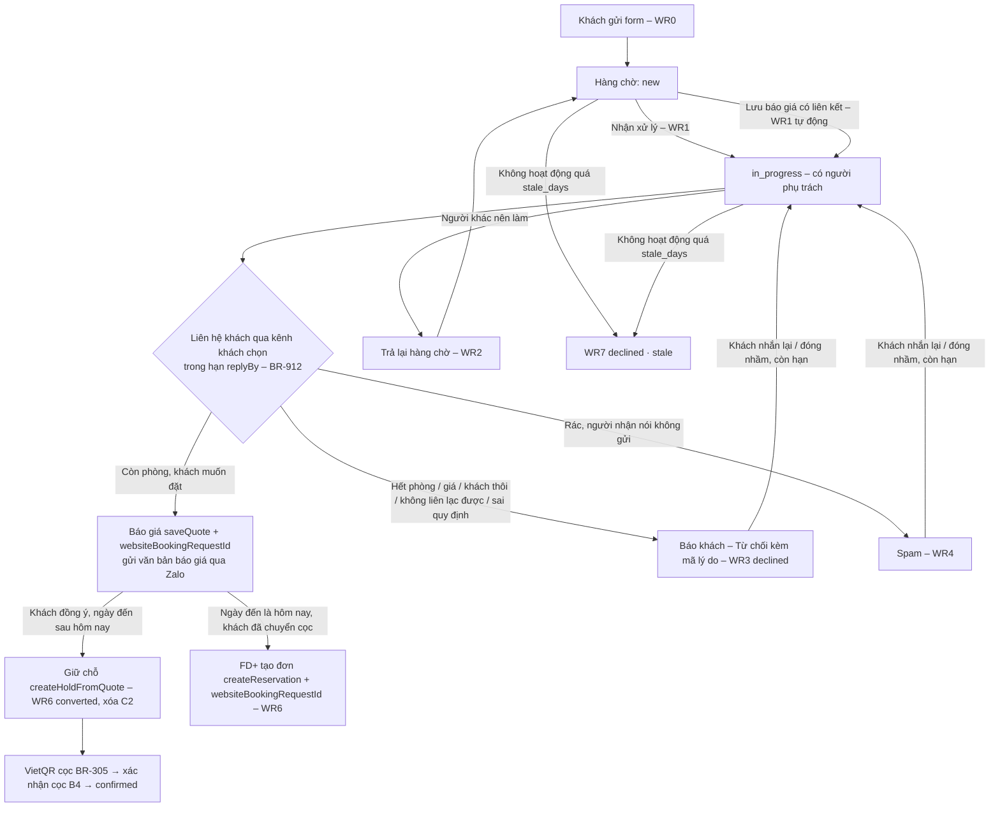

# Đặc tả mức trường – EP19 Yêu cầu đặt phòng từ website (US-155, phương án A) – phía Desk

- Tác giả: BA | Round 2 – Sprint 4 (luồng LP-v1) | Ngày: 17/10/2026 | Phiên bản: 0.1
- Phạm vi: **US-155 phía Desk** – hàng chờ "Yêu cầu từ website", ngăn chi tiết, các hành động, chuyển thành báo giá / giữ chỗ / đơn, danh sách lý do từ chối kèm câu khách thấy, quyền theo vai, thông báo – "Cần chú ý" – SSE, hạn lưu, trạng thái màn. Phía form trên landing (FE-LP) chỉ ghi phần dữ liệu đi vào Desk (mục 2); bố cục và chữ của form, trang cảm ơn do UXD; kỹ thuật endpoint công khai theo ADR-014 mục 4 và OpenAPI. Phương án B (phòng trống + giá trên web – US-131) **không** làm: hợp đồng chỉ đi trước (contract-ahead), Desk không đọc `offerSnapshot`.
- **Quyết định INV**: FB-INV-002 ý 3 = **A** (17/10/2026): "Đồng ý A: yêu cầu đặt phòng vào Desk (nguồn website/facebook), lễ tân xác nhận qua Zalo, chưa thanh toán online." – nhãn `[GIẢ ĐỊNH – chờ INV xác nhận ý 3]` ở backlog US-155 AC7, AC9 và BR-912/913 hết hiệu lực (PO, DOM gỡ nhãn – mục 12 Q-W12).
- **Nguồn và thứ tự ưu tiên khi lệch**: (1) OpenAPI **0.3.7 bổ sung 2** (`openapi.yaml`, `rounds/round-02/outputs/ARC/openapi-0.3.7.md` mục 12 – là thứ BE-D cài); (2) `business-rules.md` **v0.3.7** BR-911…BR-916, BR-112, BR-907; (3) backlog US-155 AC1–AC11; (4) SEC `rounds/round-02/reviews/landing-zalo-SEC.md` (C-2, C-3, ARC-02…ARC-12); (5) `erd.md` 4.14; (6) `state-machines.md` **SM-18**; (7) `rbac-matrix.md` **S35, A64–A68**, D28. `rounds/round-02/reviews/landing-booking-SEC.md` (SEC review riêng cho bổ sung 2) **chưa có** lúc viết – khi có, BA đối chiếu lại mục 4, 7, 9. Chỗ BR v0.3.7 / backlog khác hợp đồng: đặc tả **theo hợp đồng** và ghi ở mục 12 để PO, DOM, ARC chốt.
- Lịch cài: mọi operation của bổ sung 2 mang `x-round: R3` tới khi ORC xếp lịch US-155 (ARC 12.4 (13)); form chỉ bật trên mạng khi đủ US-155 AC4 (SEC-G1/G2, C-2, C-3, luật sư LZ-2, LZ-8).
- Quy ước bảng trường, V-01…V-11, hiển thị lỗi, hộp xác nhận: như `specs/EP00-platform.md` mục 0. Chuỗi **(mới)** = BA đề nghị khóa + nghĩa, UXD viết bản cuối VI/EN trong `gen_strings.py` (nhóm đề nghị `webreq.*`).

---

## 0. Khái niệm

| Khái niệm | Nghĩa |
|---|---|
| Yêu cầu (website booking request) | Lời hỏi phòng khách gửi qua form website/nút "Đặt ngay" của fanpage. **Không** phải đơn, **không** giữ phòng, **không** có tiền, không hiện trên rack. Nhân viên trả lời qua Zalo OA / kênh khách chọn rồi mới làm báo giá, giữ chỗ, VietQR cọc như khách hỏi qua chat (BR-913) |
| `refCode` | Mã yêu cầu 8 ký tự (ví dụ `7K3QX9MD`), khách thấy trên trang cảm ơn và nhắn kèm khi mở Zalo. Chỉ để tra cứu nội bộ – **không** phải yếu tố xác minh danh tính |
| `replyBy` | Hạn trả lời đầu tiên server tính lúc nhận (giờ trực BR-811 + `web_request_response_minutes`); Desk tô quá hạn khi `isReplyOverdue` |
| Nguồn phụ `subSource` | Kênh dẫn khách tới form, server suy **một lần** từ UTM rồi tên miền giới thiệu: `facebook`, `instagram`, `google`, `zalo`, `qr`, `other`, hoặc `null` (không rõ). Hiện "Website · Facebook"…; đơn sinh ra mang `directSubSource` này, nhân viên không sửa (BR-911 (3)) |
| `stayKind` | `long` khi ≥ 28 đêm (BR-108) – cần báo giá dài hạn; `short` còn lại |
| Trường C2 | `guestName`, `phone`, `email`, `note`, `declineNote` (rbac D28). Vắng khi đã xóa (`piiPurgedAt` có giá trị) |
| Chuyển đổi (WR6) | Giữ chỗ (`createHoldFromQuote`) hoặc đơn (`createReservation`) có liên kết yêu cầu → yêu cầu `converted`, xóa C2 ngay |

---

## 1. Luồng (phương án A)

Luồng ngoại lệ: hết phòng → đề xuất theo thứ tự BR-913 (3) (hạng khác cùng ngày → cùng hạng ngày gần → hai căn nối tiếp) trước khi từ chối `no_availability`; khách không trả lời → nhắc theo BR-915 rồi từ chối `guest_unreachable`; trùng yêu cầu khác của cùng khách → giữ một bản, từ chối bản kia `duplicate` (BR-914 (3)). Luồng lỗi: mục 5.3 (409/412/428, mất mạng).

---

## 2. Dữ liệu một yêu cầu (bản nhân viên – `WebsiteBookingRequest`)

| Trường | Nhãn Desk | Kiểu | Luôn có | Cách hiện / ghi chú |
|---|---|---|:-:|---|
| `refCode` | Mã yêu cầu | 8 ký tự | ✔ | Chữ in đậm, font mono; nút Sao chép |
| `status` | Trạng thái | `new`, `in_progress`, `converted`, `declined`, `spam` (SM-18) | ✔ | Chip có icon + chữ **(mới)** `webreq.status.<mã>`: Mới · Đang xử lý · Đã thành đơn · Đã đóng · Spam |
| `createdAt` | Gửi lúc | thời điểm | ✔ | "T3 20/10 09:05" (giờ cơ sở) + "{n} phút trước" khi < 24 giờ |
| `replyBy`, `isReplyOverdue` | Hạn trả lời | thời điểm, bool | ✔ | Chỉ với `new`/`in_progress`: "Trả lời trước 09:20"; quá hạn → tô cảnh báo + "Quá hạn {n} phút" (chữ, không chỉ màu) |
| `arrival`, `departure`, `nights`, `stayKind` | Ngày ở | date, int, enum | ✔ | "T6 23/10 → T2 26/10 · 3 đêm"; `long` → chip **(mới)** `webreq.long_stay` "Ở dài ngày – báo giá dài hạn" |
| `adults`, `children`, `childrenAges[]` | Số khách | int, int, int[] (0–17) | ✔ (`childrenAges` tùy chọn) | "2 người lớn · 1 trẻ (8 tuổi)"; có `children` mà không có tuổi → "1 trẻ (chưa rõ tuổi – hỏi khách)" |
| `roomType`, `roomTypeLabel` | Hạng phòng khách thích | slug, chữ | – | Hiện `roomTypeLabel` (tên hạng công khai, ví dụ "Standard Studio · Garden View"); `roomType` null → "Chưa chọn – tư vấn giúp"; có slug mà `roomTypeLabel` null → cờ `room_type_unmatched` |
| `guestName` | Tên khách | C2 | khi chưa xóa | Văn bản thuần (V-01) |
| `phone` | SĐT (Zalo) | C2, E.164 có `+` | khi chưa xóa | Hiện dạng đọc được ("+84 905 123 456"); nút: Sao chép · Mở Zalo · Gọi · WhatsApp · Viber (mục 4) |
| `email` | Email | C2 | – | Nút Sao chép · Gửi email |
| `preferredChannel` | Khách muốn được trả lời qua | `zalo`, `whatsapp`, `telegram`, `viber`, `phone`, `email` | ✔ | Chip có icon; nút của kênh này đứng đầu nhóm nút liên hệ |
| `note` | Lời nhắn của khách | C2, ≤ 500 | – | Văn bản thuần, giữ xuống dòng; **không** hiện dạng HTML |
| `locale` | Ngôn ngữ khách dùng | `vi`, `en`, `ru` | ✔ | "Tiếng Anh" – nhân viên trả lời bằng ngôn ngữ này; mặc định ngôn ngữ văn bản báo giá |
| `subSource`, `utmSource`, `utmMedium`, `utmCampaign`, `refHost`, `landingPath` | Nguồn | enum/chữ | `subSource` có thể null | "Website · Facebook" (**(mới)** `webreq.source.<subSource>`; null → "Website"); chi tiết UTM trong phần thu gọn "Chi tiết nguồn" (cho quản lý/DATA) |
| `suspiciousFlags[]` | Cờ cần xem | `contains_url`, `unexpected_script`, `far_future`, `repeat_contact`, `room_type_unmatched` | ✔ (có thể rỗng) | Chip cảnh báo **(mới)** `webreq.flag.<mã>`: "Lời nhắn có đường link" · "Chữ lạ" · "Ngày đến xa (> 180 ngày)" · "Liên hệ gửi lặp" · "Hạng phòng không khớp". Chỉ để lọc, **không** chặn |
| `duplicateCount` | Gửi thêm bị chặn | int ≥ 0 | ✔ | > 0 → "Cùng SĐT đã gửi thêm {n} lần hôm nay (không tạo yêu cầu mới)" |
| `assignedUserId`, `assignedUserName`, `claimedAt` | Người xử lý | uuid, chữ, thời điểm | khi `in_progress` | "Lan · nhận lúc 09:08"; của mình → "Bạn" |
| `declineReasonCode`, `declineNote` | Lý do đóng | enum (mục 6), C2 | khi `declined` | Nhãn lý do + ghi chú nội bộ |
| `quoteId` | Báo giá | uuid | – | Nút "Mở báo giá" (S15) |
| `reservationId`, `reservationCode`, `convertedAt` | Đơn | uuid, mã, thời điểm | khi `converted` | "Đã thành đơn OTM-00212" – bấm mở chi tiết đơn (S04) |
| `piiPurgedAt` | – | thời điểm | – | Có giá trị → hộp liên hệ thay bằng **(mới)** `webreq.pii_purged` "Thông tin liên hệ đã xóa theo hạn lưu ({date})." |
| `version` | – | int | ✔ | `If-Match` cho hành động (ETag) |
| `allowedActions[]` | – | `AllowedAction` | ✔ | Nút hiện đúng theo danh sách server trả (mục 5) – client không tự suy theo vai |
| `offerSnapshot` | – | – | luôn null | Phương án B – Desk không hiện |

**Từ form vào (để FE-LP và QA đối chiếu – `WebsiteBookingRequestInput`)**: ngày đến ≥ hôm nay (giờ cơ sở) và ≤ hôm nay + `booking_window_days` (BR-112), ngày đi > ngày đến, ≤ 366 đêm (một ô ngày cho mọi khách – từ 28 đêm server ghi `stayKind = long`); người lớn 1–12; trẻ em 0–8 (có `childrenAges` thì đúng số phần tử, mỗi tuổi 0–17); hạng phòng tùy chọn; **SĐT bắt buộc**, email tùy chọn (bắt buộc khi kênh `email`); kênh ưa thích mặc định `zalo`; lời nhắn ≤ 500 (số thẻ → `CARD_NUMBER_DETECTED`, số giấy tờ → `ID_NUMBER_DETECTED`, không lưu); đồng ý (không tích sẵn) + phiên bản thông báo xử lý dữ liệu; **không** hỏi quốc tịch, giấy tờ, ngày sinh, địa chỉ, số thẻ, ô nhận ưu đãi. Lệch với backlog US-155 AC1 và BR/DOM: mục 12 Q-W07.

---

## 3. Màn hàng chờ "Yêu cầu từ website" (Desk – S35, đường dẫn `/website-requests`)

### 3.1 Vào màn
- Mục menu **(mới)** `nav.website_requests` "Yêu cầu từ website" – chỉ hiện với OWN, MGR, FDL, FD, SAL (rbac S35). CTV, HK, MT không có mục; gõ thẳng đường dẫn → trang "Không có quyền" (server 403).
- Số đếm trên mục menu = số yêu cầu `new` trong phạm vi người xem (SAL: chưa giao + của mình). Lấy từ `listWebsiteBookingRequests?status=new` (trang đầu, `limit` 50) – > 50 hiện "50+" `[GIẢ ĐỊNH BA – hợp đồng không có trường tổng]`; làm mới khi có SSE `website_request.changed` hoặc thông báo `website_request_new`.

### 3.2 Bộ lọc, tìm, sắp
| Điều khiển | Giá trị | Gọi API | Ghi chú |
|---|---|---|---|
| Trạng thái (chip chọn nhiều) | Mới · Đang xử lý (mặc định cả hai) · Đã thành đơn · Đã đóng · Spam | `status=new,in_progress` (`style: form`, `explode: false`) | Bỏ hết chip = mặc định |
| "Chỉ của tôi" (bật/tắt) | – | Không gọi – lọc ở client theo `assignedUserId` trên trang đã tải `[GIẢ ĐỊNH BA – hợp đồng không có tham số người xử lý]` | SAL: mọi yêu cầu `in_progress` thấy được đều là của mình |
| Tìm theo mã | 8 ký tự chữ-số, không phân biệt hoa/thường, khớp **đúng** | `refCode=` | Ô chỉ nhận mã yêu cầu; nhập 1–7 ký tự hoặc ký tự lạ → báo tại ô **(mới)** `webreq.search_hint` "Nhập đủ 8 ký tự của mã yêu cầu." (không gọi API); server 422 → cùng câu. **Không** có ô tìm theo tên/SĐT (C2 không vào URL – SEC); muốn tra khách dùng bộ chọn khách (`lookupGuestByContact` – POST) |
| Sắp | Server quyết: `new` trước theo `replyBy` tăng dần, rồi `updatedAt` giảm dần | – | Không cho đổi |
| Trang | `cursor`, `limit` (mặc định 50) | – | "Xem thêm" ở cuối danh sách |

### 3.3 Cột danh sách (mỗi dòng một yêu cầu)
Mã yêu cầu · Gửi lúc · Ngày ở (đến → đi, số đêm) · Số khách · Hạng phòng · Kênh ưa thích (icon) · Nguồn ("Website · Facebook") · Hạn trả lời (tô quá hạn) · Cờ (chip, tối đa 2 + "+n") · Người xử lý · Trạng thái. **Không** hiện tên/SĐT ở danh sách (chỉ ở ngăn chi tiết – giảm lộ dữ liệu trên màn quầy) `[GIẢ ĐỊNH BA – UXD/SEC xác nhận]`. Bấm dòng → ngăn chi tiết (mục 4).

### 3.4 Trạng thái màn
| Trạng thái | Hiện |
|---|---|
| Đang tải | Khung xương 5 dòng |
| Rỗng (lọc mặc định) | **(mới)** `webreq.empty` "Chưa có yêu cầu mới từ website." |
| Rỗng (có lọc/tìm) | **(mới)** `webreq.empty_filtered` "Không có yêu cầu khớp bộ lọc." + nút Xóa bộ lọc |
| Lỗi tải | `today.error_title` + Thử lại |
| 403 | Trang "Không có quyền" chung |
| Mất mạng | Banner `shell.offline_desk`; dữ liệu lúc {time}; mọi nút hành động khóa (`rsv.need_online`) |
| Có sự kiện mới (SSE) | Danh sách tự làm mới (gộp sự kiện 1 giây); yêu cầu mới vào đầu danh sách; dòng đang mở ngăn chi tiết **không** tự đóng – nếu trạng thái đổi bởi người khác thì ngăn hiện **(mới)** `webreq.changed_by_other` "Yêu cầu vừa được {name} cập nhật." và nạp lại |

---

## 4. Ngăn chi tiết – `getWebsiteBookingRequest`
- Mở bằng `requestId`; lưu `ETag` (= `version`) để gửi `If-Match`. Ngoài phạm vi (SAL mở yêu cầu đã giao cho người khác qua đường dẫn cũ) → 404 → **(mới)** `webreq.not_found` "Không tìm thấy yêu cầu này hoặc yêu cầu đã giao cho người khác."
- Khối thông tin: mọi trường mục 2 (trừ `offerSnapshot`); khối "Chi tiết nguồn" thu gọn.
- **Khối liên hệ** (chỉ khi C2 còn): nút theo thứ tự – kênh ưa thích đứng đầu, rồi Zalo (chính – FB-INV-002 ý 4), Gọi, WhatsApp, Viber, Telegram, Email:
  - **Sao chép SĐT** / **Sao chép email** (bộ nhớ tạm của máy; không ghi nhật ký giá trị);
  - **Mở Zalo**: mở Zalo trên máy quầy tới SĐT bằng **tài khoản Zalo OA / Zalo của cơ sở** (BR-913 (4) – không dùng Zalo cá nhân của nhân viên). Khách chưa nhắn OA thì OA không nhắn trước được → gọi số đó và mời khách nhắn OA kèm mã (hiện câu nhắc **(mới)** `webreq.zalo_hint` "Khách chưa nhắn Zalo OA thì OA chưa nhắn trước được – gọi khách và mời nhắn OA kèm mã {code}.");
  - **Gọi** (`tel:`), **WhatsApp**, **Viber**, **Telegram**, **Gửi email** (`mailto:`): liên kết mở ứng dụng ngoài, **dựng ở client lúc bấm**; không gửi lên server, không ghi vào log/analytics, không đưa vào URL của Desk.
  - Khung gọi điện theo BR-912 (3)/BR-973 – ngoài [08:00, 21:00) nút Gọi vẫn bấm được nhưng có câu nhắc **(mới)** `webreq.call_window` "Ngoài giờ gọi cho khách (08:00–21:00) – nhắn tin thay vì gọi, trừ khách đến tối nay."
- Khối "Đã thành đơn" (`converted`): mã đơn + nút mở đơn; ẩn khối liên hệ (C2 đã xóa – liên hệ khách qua hồ sơ khách của đơn).
- Thanh hành động: nút theo `allowedActions[]` (mục 5) + "Báo giá" / "Tạo đơn" (mục 5.2).

---

## 5. Hành động

### 5.1 Chuyển trạng thái – `transitionWebsiteBookingRequest` (`POST …/website-booking-requests/{id}/actions/{action}`; header `If-Match` + `Idempotency-Key`)
| Nút | `action` | Chuyển (SM-18) | Hiện khi (`allowedActions`) – ai | Thân | Xác nhận | Kết quả |
|---|---|---|---|---|---|---|
| **(mới)** `webreq.claim` "Nhận xử lý" | `claim` | WR1 `new` → `in_progress` | FD+; SAL với yêu cầu chưa giao | – | Không | Giao cho mình; số đếm menu giảm; mục "Cần chú ý" `website_request_new` hết khi không còn `new` |
| **(mới)** `webreq.release` "Trả lại hàng chờ" | `release` | WR2 `in_progress` → `new` | Người đang giữ; OWN/MGR/FDL với yêu cầu người khác | – | Có khi trả yêu cầu người khác: **(mới)** "Trả yêu cầu {code} của {name} về hàng chờ?" | Bỏ giao; `replyBy` giữ nguyên |
| **(mới)** `webreq.decline` "Đóng – không thành đơn" | `decline` | WR3 `new`/`in_progress` → `declined` | FD+; SAL với yêu cầu giao cho mình | `reasonCode` (B) + `note` (ĐK) – hộp ở mục 6 | Hộp từ chối (mục 6.2) | Ra khỏi lọc mặc định; C2 giữ tới hạn lưu |
| **(mới)** `webreq.mark_spam` "Đánh dấu spam" | `mark-spam` | WR4 `new`/`in_progress` → `spam` | FD+; SAL với yêu cầu giao cho mình | – | Có: **(mới)** "Đánh dấu {code} là spam? Không liên hệ khách này nữa; yêu cầu sẽ bị xóa sau {days} ngày." | Không liên hệ thêm, không tạo hồ sơ khách (BR-914 (5)) |
| **(mới)** `webreq.reopen` "Mở lại" | `reopen` | WR5 `declined`/`spam` → `in_progress` | FD+; SAL với yêu cầu mình đã từ chối; chỉ khi C2 chưa xóa và chưa quá tuổi tối đa (server không trả nút khi không đủ) | – | Không | Giao cho người mở |

Thân `transitionWebsiteBookingRequest` (`WebsiteBookingRequestTransition`, `additionalProperties: false`):
| Trường | Kiểu | BB | Kiểm tra | Lỗi |
|---|---|---|---|---|
| `reasonCode` | enum mục 6.1 | B với `decline`; K (bỏ trống) với hành động khác | Thuộc danh sách; `stale` chỉ hệ thống dùng | `REQUIRED`; `NOT_IN_LIST` |
| `note` | text 3–300, C2 (D28) | B khi `reasonCode = other`; K khác | V-08, V-09; không chứa số thẻ (`CARD_NUMBER_DETECTED`) hoặc số giấy tờ (`ID_NUMBER_DETECTED`). Câu nhắc dưới ô **(mới)** `webreq.note_hint` "Ghi chú nội bộ – khách không thấy. Không ghi số thẻ, số giấy tờ." | `REASON_REQUIRED`; `CARD_NUMBER_DETECTED`; `ID_NUMBER_DETECTED` |

### 5.2 Chuyển thành báo giá / giữ chỗ / đơn (WR6 – không có operation "convert" riêng)
| Bước | Ai | Gọi | Điền sẵn từ yêu cầu | Ghi chú |
|---|---|---|---|---|
| 1. Chọn/tạo hồ sơ khách (bộ chọn khách) | FD+, SAL | `lookupGuestByContact` (POST – SĐT, email của yêu cầu) → chọn hồ sơ gợi ý **hoặc** `createGuest` | Tên, SĐT, email, ngôn ngữ ưa thích = `locale` | **Không tự gộp** theo SĐT/email khách nhập (BR-951, ADR-014 4.3): nhân viên xác nhận đúng người trước khi chọn hồ sơ có sẵn. SAL gặp khách của người khác → chỉ thấy "Có thể trùng – liên hệ lễ tân" (`exists_only_or_own`). Hồ sơ mới: ô "Đồng ý nhận ưu đãi" để **chưa hỏi** (đồng ý trên form chỉ cho mục đích trả lời yêu cầu – BR-955, BR-971) |
| 2. Tính báo giá | FD+, SAL | `calculateQuote` | `arrivalDate` = `arrival`; `nights` = `nights`; `adults`; trẻ em chia bậc theo `childrenAges` – tuổi ≥ `adult_from_age` cộng vào người lớn, từ `child_free_under_age` tới dưới `adult_from_age` → `children6to11`, nhỏ hơn → `childrenUnder6` (BR-110); không có tuổi → ô bậc trẻ để trống, Desk nhắc **(mới)** `webreq.ask_child_age` "Hỏi tuổi trẻ em để báo giá đúng."; căn/nhóm căn: lọc các căn có `publicRoomType` = `roomTypeLabel` (không khớp → không lọc); kênh `direct` | `stayKind = long` → mục 12 Q-W05. Tổng người vượt sức chứa tối đa của hạng → gợi ý hai phòng (đơn nhóm R3 – BR-321); R2 làm hai báo giá riêng `[GIẢ ĐỊNH BA]` |
| 3. Lưu báo giá + gửi khách | FD+, SAL | `saveQuote` kèm `websiteBookingRequestId` → `getQuoteText` (ngôn ngữ = `locale`) | – | Yêu cầu còn `new` → server tự nhận cho người lưu (WR1); yêu cầu `declined`/`spam`/`converted` → 409 `INVALID_TRANSITION` → Desk báo **(mới)** `webreq.quote_closed` "Yêu cầu đã đóng – mở lại trước khi báo giá."; kênh khác `direct` → 422 `NOT_ALLOWED`. Yêu cầu giữ `in_progress`, có `quoteId`. Văn bản báo giá gửi qua kênh khách chọn bằng tài khoản cơ sở (BR-913 (4)); **chưa** gửi VietQR hay link có token |
| 4a. Giữ chỗ | Người tạo báo giá (SAL báo giá của mình; FD+) | `createHoldFromQuote` | – | WR6 trong cùng giao dịch: đơn `hold`, kênh `direct`, `directSource = website`, `directSubSource` = `subSource`; yêu cầu `converted`, **xóa C2**. Ngày đến hôm nay → 422 `HOLD_NOT_ALLOWED_TODAY` (BR-302) → bước 4b. Báo giá hết hiệu lực → 409 `QUOTE_EXPIRED` → tính lại. Sau đó: VietQR cọc (S4-28, BR-305) qua chat Zalo OA hoặc kênh khách đang dùng, kèm câu chống giả danh (BR-978) → xác nhận cọc B4 |
| 4b. Tạo đơn đảm bảo | **Chỉ FD+** | `createReservation` kèm `websiteBookingRequestId` (kênh `direct`, `directSource` vắng hoặc `website`) | Khách, ngày, số người từ báo giá | Khi khách đã chốt **và** đã cọc (ví dụ đến hôm nay – BR-302 không giữ chỗ được). `directSource` khác `website` → 422 `NOT_ALLOWED`. SAL gặp trường hợp này → chuyển lễ tân (trả lại hàng chờ hoặc nhắn lễ tân) |

### 5.3 Lỗi chung khi bấm hành động
| Lỗi | Nguyên nhân | Desk làm |
|---|---|---|
| 409 `INVALID_TRANSITION` (`currentState`) | Người khác vừa đổi trạng thái (ví dụ đã nhận trước) | Báo **(mới)** `webreq.already_changed` "Yêu cầu vừa được người khác xử lý." + nạp lại ngăn |
| 412 `VERSION_CONFLICT` | `If-Match` cũ | Như trên |
| 428 | Thiếu `If-Match` – lỗi lập trình | Lỗi chung |
| 404 | Ngoài phạm vi (SAL) / đã xóa (spam quá hạn) | `webreq.not_found`, đóng ngăn, làm mới danh sách |
| 403 | Vai không có quyền | Trang/khối "Không có quyền" |
| 422 trường | Mục 5.1 | Lỗi tại ô trong hộp |
| Mất mạng | – | Giữ dữ liệu trong hộp; gửi lại cùng `Idempotency-Key` |

---

## 6. Lý do đóng (từ chối) và câu khách thấy

### 6.1 Danh sách mã (`WebsiteBookingRequestDeclineReason`, OpenAPI 0.3.7 bổ sung 2)
Phương án A: hệ thống **không** gửi tin cho khách (ADR-014 4.3, BR-913 (10)). "Câu khách thấy" là **mẫu gợi ý** nhân viên gửi qua kênh khách chọn, bằng ngôn ngữ của yêu cầu (`locale`), **trước** khi bấm "Đóng". BA viết nháp ý; UXD viết bản cuối VI/EN theo giọng thương hiệu (Calm – không xin lỗi rườm rà, không hứa ưu đãi – BR-971 chưa có đồng ý tiếp thị). Khóa đề nghị: nhãn Desk `webreq.decline.<mã>`, mẫu câu `webreq.reply.<mã>` (tham số `{code}` = mã yêu cầu, `{arrival}`, `{departure}` = ngày theo định dạng ngôn ngữ khách).

| Mã | Khi dùng (nhân viên chọn) | Nhãn Desk (nháp) | Câu khách thấy – nháp ý VI · EN | Gửi tin? | Ứng với BR-913 (9) |
|---|---|---|---|---|---|
| `no_availability` | Hết phòng cho ngày/hạng khách hỏi **sau khi** đã đề xuất hạng khác, ngày gần, hai căn nối tiếp (BR-913 (3)) mà khách không nhận | Hết phòng | "Cảm ơn bạn đã gửi yêu cầu {code}. OTTIMO đã kín phòng từ {arrival} đến {departure}. Nếu bạn đổi được ngày, cứ nhắn lại – chúng tôi kiểm tra ngày gần nhất còn phòng." · "Thank you for request {code}. OTTIMO is fully booked from {arrival} to {departure}. If your dates are flexible, just reply and we'll check the nearest dates with availability." | Có | `no_availability` |
| `price_not_accepted` | Khách thấy giá chưa phù hợp, không đặt | Khách chưa chọn vì giá | "Cảm ơn bạn đã cân nhắc OTTIMO. Khi có dịp quay lại Đà Lạt, bạn cứ nhắn mã {code} – chúng tôi báo giá cho ngày mới." · "Thank you for considering OTTIMO. If you plan another trip to Da Lat, send us {code} and we'll quote your new dates." | Có (khi khách đã trả lời) | `price` |
| `guest_not_proceeding` | Khách báo đã có chỗ khác / đổi kế hoạch / hủy chuyến | Khách không đặt nữa | "Cảm ơn bạn đã báo OTTIMO. Hẹn gặp bạn dịp khác ở Đà Lạt." · "Thanks for letting us know. We hope to welcome you in Da Lat another time." | Có (trả lời ngắn) | `found_other`, `guest_changed_mind` |
| `guest_unreachable` | Đã liên hệ đủ số lần theo BR-915 mà khách chưa trả lời; hoặc liên hệ sai/không còn cách khác | Không liên lạc được | Lần liên hệ cuối (BR-915 (2)): "OTTIMO chưa liên lạc được với bạn về yêu cầu {code}. Nếu bạn vẫn cần phòng, hãy nhắn lại cho chúng tôi trên Zalo." · "We haven't been able to reach you about request {code}. If you still need a room, message us on Zalo." – gửi ở lần cuối, **không** gửi thêm lúc đóng | Không (đã gửi ở lần cuối) | `unreachable`, `invalid_contact` |
| `duplicate` | Trùng yêu cầu khác của cùng khách (giữ một bản – BR-914 (3)) hoặc khách đã có đơn/giữ chỗ cho chuyến này | Trùng yêu cầu / đã có đơn | Không gửi riêng – tiếp tục trao đổi ở yêu cầu/đơn còn lại. Khách hỏi thì: "Yêu cầu {code} trùng với yêu cầu bạn đã gửi trước – OTTIMO tiếp tục trao đổi với bạn ở yêu cầu đó." | Không | `duplicate`, `already_booked` |
| `policy_mismatch` | Yêu cầu trái quy định: vượt sức chứa tối đa mà khách không nhận hai phòng (BR-110), trái nội quy, dưới số đêm tối thiểu mà khách không đổi (BR-113) | Không phù hợp quy định | "Rất tiếc OTTIMO chưa nhận được yêu cầu {code} theo cách bạn mô tả. Nếu bạn muốn, chúng tôi gợi ý cách khác phù hợp – cứ nhắn lại." · "We're unable to accept request {code} as described. Reply if you'd like us to suggest another option." – nhân viên nói rõ lý do trong hội thoại (không viết sẵn quy định vào mẫu) | Có | `out_of_policy` |
| `other` | Lý do khác – **bắt buộc** ghi chú nội bộ (`note` 3–300) | Lý do khác | Nhân viên tự viết theo tình huống | Tùy | `other` |
| `stale` | **Chỉ hệ thống** (WR7): không hoạt động quá `retention.web_request_stale_days` | Tự đóng – không hoạt động | Không gửi | Không | `stale` (hệ thống) |
| (không phải lý do đóng) Spam | Dùng nút "Đánh dấu spam" (WR4), không dùng "Đóng" | – | Không liên hệ. Ngoại lệ BR-914 (5): người nhận nói không gửi → một câu xin lỗi, không nhắc nội dung yêu cầu | – | trạng thái `spam` |

### 6.2 Hộp "Đóng – không thành đơn"
- Ô chọn lý do (bắt buộc; không có `stale`); khi chọn mã có "Gửi tin? = Có" → hiện **mẫu câu** theo `locale` của yêu cầu, có nút **Sao chép** và nút mở kênh ưa thích; dòng nhắc **(mới)** `webreq.decline_send_first` "Gửi câu này cho khách trước khi đóng – hệ thống không tự gửi."
- Ô ghi chú nội bộ: bắt buộc khi `other` (3–300), không bắt buộc với mã khác; câu nhắc `webreq.note_hint`.
- Nút "Đóng yêu cầu" khóa tới khi chọn lý do (và ghi chú khi `other`) – lý do khóa cạnh nút (mẫu "… để bật nút").
- Gửi `decline` với `If-Match`. Thành công → **(mới)** `webreq.declined_toast` "Đã đóng yêu cầu {code}."; ngăn chi tiết hiện lý do + nút "Mở lại" (nếu `allowedActions` có).

---

## 7. Quyền theo vai (rbac S35, A64–A68, D28; SEC ARC-12)

| Việc | OWN | MGR | FDL | FD | SAL | CTV | HK, MT |
|---|:-:|:-:|:-:|:-:|:-:|:-:|:-:|
| Thấy mục menu, hàng chờ, chi tiết (A64) | ✔ mọi yêu cầu | ✔ | ✔ | ✔ | M: `new` chưa giao + giao cho mình | ✖ | ✖ |
| Thấy tên, SĐT, email, lời nhắn (D28) | ✔ | ✔ | ✔ | ✔ | M (trong phạm vi trên) | ✖ | ✖ |
| Nhận xử lý (A65) | ✔ | ✔ | ✔ | ✔ | M (chưa giao) | ✖ | ✖ |
| Trả lại hàng chờ (A66) | ✔ | ✔ | ✔ | ◐ chỉ yêu cầu mình giữ | M (mình giữ) | ✖ | ✖ |
| Đóng kèm lý do / spam (A67) | ✔ | ✔ | ✔ | ✔ | M (giao cho mình) | ✖ | ✖ |
| Mở lại (A68) | ✔ | ✔ | ✔ | ✔ | M (mình đã đóng) | ✖ | ✖ |
| Báo giá có liên kết (A50) | ✔ | ✔ | ✔ | ✔ | M | ✖ (không thấy yêu cầu) | ✖ |
| Giữ chỗ từ báo giá (A02) | ✔ | ✔ | ✔ | ✔ | M (báo giá của mình) | ✖ | ✖ |
| Tạo đơn đảm bảo có liên kết (A01) | ✔ | ✔ | ✔ | ✔ | ✖ | ✖ | ✖ |
| Thông báo `website_request_new` | – | – | ✔ | ✔ | ✔ | ✖ | ✖ |
| Thông báo `website_request_cap_reached` (chạm trần ngày) | ✔ | – | – | – | – | – | – |
| "Cần chú ý" `website_request_new` | ✔ | ✔ | ✔ | ✔ | ✖ (dùng thông báo) | ✖ | ✖ |
| SSE `website_request.changed` | ✔ | ✔ | ✔ | ✔ | M (trong phạm vi) | ✖ | ✖ |
| Bật/tắt form công khai (`public_booking_requests_enabled`) | ✔ | ✖ | ✖ | ✖ | ✖ | ✖ | ✖ |

Ngoài phạm vi → 404 (không lộ yêu cầu tồn tại); vai không có quyền → 403 + nhật ký từ chối. Lọc phạm vi **trong truy vấn** (SR-AZ-02), không lọc ở client.

---

## 8. Hạn trả lời, "Cần chú ý", thông báo, SSE
- `replyBy` (server): trong giờ trực `front_desk_hours` (BR-811) = lúc nhận + `web_request_response_minutes`; ngoài giờ = giờ mở trực kế tiếp + `web_request_response_minutes`. Mặc định hợp đồng 30 phút `[GIẢ ĐỊNH – DOM]`; BR-912 v0.3.7 đặt 15 phút – mục 12 Q-W04.
- `isReplyOverdue = true` khi yêu cầu còn `new` đã quá `replyBy` → dòng tô quá hạn; mục "Cần chú ý" `website_request_new` lên mức `warning` (EP01 3.1, 3.5).
- Thông báo trong app (`staff_notification`, không tên/SĐT/lời nhắn – chỉ loại + mã): `website_request_new` (FDL, FD, SAL) khi có yêu cầu mới; `website_request_cap_reached` (OWN, một lần/ngày) khi chạm `public_booking_request_daily_cap`. Yêu cầu đến **đêm nay** gửi ngoài giờ trực: BR-912 (3) đòi báo ngay người trực đêm – thông báo `website_request_new` đã tới FDL/FD; câu chữ phân biệt "đến tối nay" chưa có trong hợp đồng – mục 12 Q-W09.
- SSE `website_request.changed` (id = `requestId`) khi tạo, mỗi chuyển WR1–WR7 và khi xóa C2 → Desk làm mới danh sách/ngăn (mục 3.4).

---

## 9. Hạn lưu và hiển thị sau khi xóa (SEC C-2, ARC-03; erd 4.14)
| Trường hợp | Server làm (job, không chờ chuyển trạng thái) | Khóa tham số (mặc định · biên SEC) | Desk hiện |
|---|---|---|---|
| `new`/`in_progress` không hoạt động | WR7 → `declined` (`stale`) | `retention.web_request_stale_days` (30 · 7–60) | Lý do "Tự đóng – không hoạt động" |
| `declined` | Xóa C2 | `retention.web_request_declined_days` (90 · 30–90) | `webreq.pii_purged`; nút Mở lại biến mất |
| `spam` | Xóa **cả bản ghi** | `retention.web_request_spam_days` (7 · 1–7) | Yêu cầu biến khỏi danh sách |
| Mọi trạng thái trừ `converted` | Xóa C2 khi tới tuổi tối đa từ lúc tạo (đang mở thì WR7 trước); mở lại không kéo dài | `retention.web_request_max_age_days` (180 · 90–180) | Như `declined` |
| `converted` | Xóa C2 **ngay** cùng giao dịch WR6 | – | Khối liên hệ ẩn, chỉ còn mã đơn |

Sau khi xóa còn: ngày, số khách, hạng, ngôn ngữ, nguồn phụ, UTM, trạng thái, mã lý do, mốc thời gian (DATA – US-158). Mặc định DOM ở BR §13 khác (stale 14 ngày, khóa `web_inquiry.*`) – mục 12 Q-W06.

---

## 10. Trạng thái màn (DoD)
| Khối | Đang tải | Rỗng | Lỗi | Mất mạng |
|---|---|---|---|---|
| Danh sách | Khung xương | `webreq.empty` / `webreq.empty_filtered` | `today.error_title` + Thử lại | Chỉ xem, nút khóa |
| Ngăn chi tiết | Khung xương | – | `webreq.not_found` (404) / lỗi chung | Chỉ xem |
| Hộp đóng / hành động | Nút "Đang lưu…", chống bấm hai lần | – | Lỗi tại ô / `webreq.already_changed` | Nút khóa (`rsv.need_online`) |
Hỗ trợ VI + EN (Desk); bàn phím và trình đọc màn hình: chip trạng thái/cờ có chữ, hạn quá có chữ "Quá hạn", lý do khóa nút đặt cạnh nút + `aria-describedby`.

---

## 11. Truy vết
| Story / AC / BR | Mục |
|---|---|
| US-155 AC1 (form – dữ liệu vào Desk) | 2 (khối "Từ form vào"), 12 Q-W07 |
| US-155 AC2 (chuyển thành báo giá/giữ chỗ, bộ chọn khách, nguồn `website`) | 5.2 |
| US-155 AC3 (giới hạn, hạn xóa mọi trạng thái) | 9; SM-18 |
| US-155 AC5 (trần ngày, không lộ SĐT đã gửi) | 2 (`duplicateCount`), 8 (`website_request_cap_reached`) |
| US-155 AC6 (nhãn "Website · Facebook") | 0, 2 (`subSource`), 5.2 bước 4a |
| US-155 AC7 (không giữ phòng, không tự gửi tin) | 0, 6.1 |
| US-155 AC8 (hàng chờ, thông báo không C2, đóng kèm lý do, spam, mở lại, "Cần chú ý", quyền xem) | 3, 4, 5.1, 6, 7, 8 |
| US-155 AC10, AC11 (VI/EN, trạng thái lỗi) | 3.4, 10 (phía form: FE-LP/UXD) |
| US-155 AC4, AC9 | Ngoài Desk (điều kiện bật form; phương án B không làm) |
| BR-911 | 0, 2, 5.2; 12 Q-W03 |
| BR-912 | 2 (`replyBy`), 8; 12 Q-W04, Q-W09 |
| BR-913 | 1, 4, 5, 6 |
| BR-914 | 1, 2 (cờ), 6.1 (`duplicate`, spam); 12 Q-W10 |
| BR-915 | 1, 6.1 (`guest_unreachable`); 12 Q-W11 |
| BR-916 | Không áp (phương án B) |
| SM-18 WR0–WR7 | 1, 5.1, 5.2, 9 |

---

## 12. Lệch giữa BR v0.3.7 / backlog và hợp đồng 0.3.7 bổ sung 2 – cần chốt (câu hỏi mở)
Đặc tả này theo **hợp đồng**. Cột "Đề xuất BA" là phương án ít đổi nhất cho BE-D; PO quyết phạm vi, DOM quyết nghiệp vụ, ARC đổi hợp đồng (mọi operation còn `x-round: R3` nên đổi lúc này rẻ).

| # | Điểm lệch | BR v0.3.7 / backlog | Hợp đồng | Đề xuất BA | Ai chốt |
|---|---|---|---|---|---|
| Q-W01 | Danh sách lý do đóng | BR-913 (9): 10 mã `no_availability`, `price`, `found_other`, `guest_changed_mind`, `unreachable`, `duplicate`, `already_booked`, `invalid_contact`, `out_of_policy`, `other` (+ `stale`) | 8 mã (mục 6.1) | Giữ 8 mã hợp đồng cho LP-v1 (ánh xạ ở cột cuối mục 6.1). Nếu DATA cần tách "đã có đơn" và "liên hệ sai": ARC thêm `already_booked`, `invalid_contact` (chỉ thêm giá trị enum) **trước** khi BE-D cài; DOM sửa tên mã BR-913 (9) theo hợp đồng | DOM + DATA → ARC |
| Q-W02 | Thời điểm "đã chuyển" | BR-913 (6): gửi báo giá = chuyển thành lead, yêu cầu `converted`, xóa C2 ngay | WR6 khi **giữ chỗ/đơn**; báo giá chỉ gắn `quoteId`, yêu cầu vẫn `in_progress`; không bắt buộc lead (ARC 12.4 (3)) | Theo hợp đồng: yêu cầu là nơi theo dõi tới khi có giữ chỗ (BR-915 nhắc khách vẫn chạy trên yêu cầu); sale muốn kanban thì tự tạo lead. DOM sửa BR-913 (6) và BR-915 (5) ("lead `lost`" → "yêu cầu đóng `guest_unreachable`") | DOM, PO |
| Q-W03 | Nguồn phụ | BR-911: `facebook`, `google`, `direct`, `other` | `facebook`, `instagram`, `google`, `zalo`, `qr`, `other`, `null` | Theo hợp đồng (chi tiết hơn, DATA gộp được); `null` = `direct` của BR ("không rõ"). DOM sửa BR-911 (2) + ví dụ (`utm_source=instagram` → `instagram`, không phải `other`) | DOM, DATA |
| Q-W04 | Hạn trả lời | BR-912: 15 phút (`web_inquiry.response_minutes`), báo lễ tân trưởng + quản lý ở 30 phút; câu hứa công khai 60 phút / trước 09:00 | `web_request_response_minutes` mặc định 30 `[GIẢ ĐỊNH – DOM]`; `replyBy` trả về trang cảm ơn | Hai số khác nhau cần hai khóa: `replyBy` nội bộ = 15 phút (BR-912) cho tô quá hạn/"Cần chú ý"; trang cảm ơn hiện **câu hứa công khai** (60 phút / trước 09:00) đọc từ tham số, **không** hiện `replyBy`. ARC thêm `publicPromiseBy` vào `WebsiteBookingRequestAccepted` hoặc FE-LP tự tính từ tham số công khai | DOM, ARC, UXD |
| Q-W05 | Ở dài ngày từ form | Form có "dài ngày: ngày đến + số tháng" (AC1, DOM 5.1); báo giá dài hạn US-081 | Một ô ngày; ≥ 28 đêm → `stayKind = long` | Theo hợp đồng cho form. Desk R2: báo giá dài hạn (US-081) là R3 → `stayKind = long` xử lý bằng tin nhắn + HĐ giấy; khi khách chốt: FD+ tạo **đơn dài hạn nhập tay** (US-017 AC5a) kèm `websiteBookingRequestId` – cần ARC xác nhận `createReservation` nhận `manualLongStay` + `websiteBookingRequestId` cùng lúc; không được thì đóng `other` ghi "chuyển HĐ giấy" (mất nguồn website trên đơn) | PO, ARC |
| Q-W06 | Tên khóa + mặc định hạn lưu | BR §13: `web_inquiry.stale_days` **14**, `.retention_days_closed`, `.retention_days_spam`, `.max_age_days`, `.ip_hmac_days`; `public_site.inquiry_daily_cap` | `retention.web_request_*` (stale **30**), `public_booking_request_daily_cap` | Một bộ tên khóa duy nhất theo hợp đồng (ARC sở hữu tên); DOM chốt **một** mặc định `stale_days` (14 hay 30, trong biên SEC 7–60) và sửa BR §13 | DOM, ARC, SEC |
| Q-W07 | Trường form | AC1: "ít nhất một cách liên hệ (Zalo, SĐT, WhatsApp hoặc email)"; DOM 5.1: ba ô đếm người lớn / trẻ 6–11 / dưới 6, `months` 1–24, form chặn vượt sức chứa | SĐT **bắt buộc**; `adults` + `children` + `childrenAges` (tùy chọn); không chặn sức chứa ở form | Theo hợp đồng; PO sửa AC1. Nếu muốn ba ô đếm theo bậc tuổi (không hỏi tuổi): ARC đổi `childrenAges` thành `children6to11` + `childrenUnder6` – Desk điền báo giá thẳng, bỏ bước "hỏi tuổi" ở 5.2 | PO, UXD, ARC |
| Q-W08 | Sửa yêu cầu | BR-913 (9): "khách đổi ngày/số người → sửa yêu cầu, không đóng" | Không có operation sửa yêu cầu | Không sửa yêu cầu ở LP-v1: ngày/số người mới ghi vào **báo giá** (báo giá có ngày riêng); yêu cầu giữ lời hỏi gốc cho DATA. DOM sửa câu BR-913 (9) | DOM |
| Q-W09 | Báo khẩn "đến tối nay" ngoài giờ, báo lên ở 30 phút | BR-912 (2), (3) | Chỉ `website_request_new` (FDL, FD, SAL) + "Cần chú ý"; không có thông báo báo lên quản lý | LP-v1: dùng "Cần chú ý" mức `warning` + thông báo hiện có; ARC thêm `StaffNotification.kind` `website_request_overdue` (FDL + MGR, một lần mỗi yêu cầu) và cờ `arrivesToday` trên `WebsiteBookingRequest` nếu PO giữ yêu cầu BR-912 (2)/(3) cho cổng LP | PO, ARC |
| Q-W10 | Cờ "Có thể trùng" giữa hai yêu cầu | BR-914 (3): cùng liên hệ, cùng mở, ngày giao nhau hoặc cách ≤ 24 giờ | Chỉ `repeat_contact` (lần 4/ngày bị chặn) + `duplicateCount` | ARC thêm cờ `possible_duplicate` vào `suspiciousFlags` + `relatedRefCodes[]` (chỉ mã, không C2), server so `contact_hmac` lúc nhận | DOM, ARC, SEC |
| Q-W11 | Ghi lần liên hệ | BR-915 (4): mỗi lần liên hệ ghi kết quả (đã gửi / không nghe máy / đã nói chuyện) | Không có trường | LP-v1: không ghi trong app (nhân viên theo lịch BR-915 bằng tay, DATA không đo "số lần liên hệ"); R3 thêm `contactAttempts[]` nếu DATA cần | PO, DATA |
| Q-W12 | Nhãn "chờ INV xác nhận ý 3" | Backlog US-155 AC7, AC9; BR-912, BR-913 còn `[GIẢ ĐỊNH – chờ INV]` | – | INV đã chốt A (FB-INV-002, 17/10) → PO, DOM gỡ nhãn; ARC sửa câu "INV **chưa** xác nhận A/B" ở `openapi-0.3.7.md` 12 | PO, DOM, ARC |
| Q-W13 | Nguồn đơn khi trùng nguồn ưu tiên | Backlog AC2: `website` trừ khi `sales_staff`/`returning` ưu tiên hơn | BR-112 v0.3.7 + hợp đồng: đơn từ yêu cầu web **luôn** `website` | Theo hợp đồng + BR-112 v0.3.7; PO sửa AC2 | PO |
| Q-W14 | Thứ tự kênh trên form EN | ESC-020 L2-A cũ: bản EN xếp WhatsApp trước | Zalo đứng đầu mọi ngôn ngữ (ARC 12.8, FB-INV-002 ý 4) | Theo FB-INV-002 ý 4; PO sửa US-151 AC1 | PO, UXD |
| Q-W15 | SEC review bổ sung 2 | `landing-booking-SEC.md` chưa có | – | SEC xác nhận: danh sách cột không hiện C2 (3.3), liên kết `tel:`/`mailto:`/Zalo dựng ở client (4), mẫu câu khách thấy (6.1) không chứa dữ liệu ngoài mã yêu cầu và ngày | SEC |

---

## 13. Đề nghị cho vai khác
| # | Gửi | Nội dung |
|---|---|---|
| E19-01 | UXD | Chuỗi **(mới)** nhóm `webreq.*` ở tài liệu này (trạng thái, nút, cờ, nguồn, lỗi, rỗng, mẫu câu `webreq.reply.<mã>` VI/EN theo giọng thương hiệu), `nav.website_requests`, `attn.website_request_new` (EP01); bố cục hàng chờ + ngăn chi tiết + hộp đóng (FE-B dựng theo mẫu S30/H-yêu cầu khách có sẵn nếu chưa có hi-fi) |
| E19-02 | ARC | Q-W01, Q-W04, Q-W05 (xác nhận `manualLongStay` + `websiteBookingRequestId`), Q-W06, Q-W07, Q-W09, Q-W10 – chỉ thêm/đổi trường của operation còn `x-round: R3`; sửa câu "INV chưa xác nhận" (Q-W12); `AllowedAction.description` và chú thích `reservations/internal/allowed-actions.ts` trỏ "state-machines mục 18" → **mục 19** (BA dời số khi thêm SM-18) |
| E19-03 | BE-D | `allowedActions[].event` dùng mã SM-18 (`claim_website_request`, `release_website_request`, `decline_website_request`, `mark_website_request_spam`, `reopen_website_request`), `transition` = WR1…WR5; WR2 cho FD chỉ khi là người giữ (rbac ghi chú 43) |
| E19-04 | FE-B | Màn mục 3–6; không đưa `refCode`/C2 vào query của trang Desk ngoài `refCode=`; liên kết liên hệ dựng lúc bấm; ngăn chi tiết nạp lại khi 409/412 |
| E19-05 | QA | Ca: SAL thấy đúng phạm vi (yêu cầu người khác → 404, không có trong danh sách); hai người cùng "Nhận xử lý" → một 200, một 409/412; FD trả lại yêu cầu người khác → 403, FDL → 200; `decline` thiếu lý do → 422, `other` thiếu ghi chú → 422, `stale` từ client → 422; `reopen` sau khi C2 xóa → không có nút / 409; lưu báo giá trên yêu cầu `new` → tự nhận; giữ chỗ → `converted`, C2 rỗng, đơn `website` + nguồn phụ; ngày đến hôm nay → `HOLD_NOT_ALLOWED_TODAY` → FD tạo đơn; CTV/HK/MT → 403; thông báo không có tên/SĐT |
| E19-06 | DOM | Q-W01, Q-W02, Q-W03, Q-W04, Q-W06, Q-W08, Q-W10: sửa BR-911…915 và BR §13 theo hợp đồng (hoặc gửi ARC đổi hợp đồng) – **trước** khi BE-D cài (5) |
| E19-07 | PO | Q-W05, Q-W07, Q-W09, Q-W11, Q-W12, Q-W13, Q-W14: sửa AC US-155 (AC1, AC2, AC7, AC8), US-151 AC1; gỡ nhãn chờ INV |
| E19-08 | SEC | Q-W15; review hợp đồng bổ sung 2 (`landing-booking-SEC.md`) |

## 14. Lịch sử thay đổi
| Ngày | Round | Thay đổi | Người |
|---|---|---|---|
| 17/10/2026 | 2 (Sprint 4 – luồng LP-v1, FB-INV-002 ý 3 = A) | Bản đầu: đặc tả phía Desk của US-155 theo OpenAPI 0.3.7 bổ sung 2 – khái niệm, luồng Mermaid, dữ liệu yêu cầu, màn hàng chờ (lọc, tìm theo mã, cột, trạng thái màn), ngăn chi tiết + liên hệ, 5 hành động WR1–WR5 + chuyển đổi WR6 qua báo giá/giữ chỗ/đơn, 8 mã lý do đóng kèm mẫu câu khách thấy (nháp cho UXD), quyền theo vai (rbac S35, A64–A68), hạn trả lời/"Cần chú ý"/thông báo/SSE, hạn lưu SEC C-2; 15 điểm lệch BR v0.3.7 / backlog ↔ hợp đồng (Q-W01…Q-W15); máy trạng thái ở `state-machines.md` SM-18 | BA |
