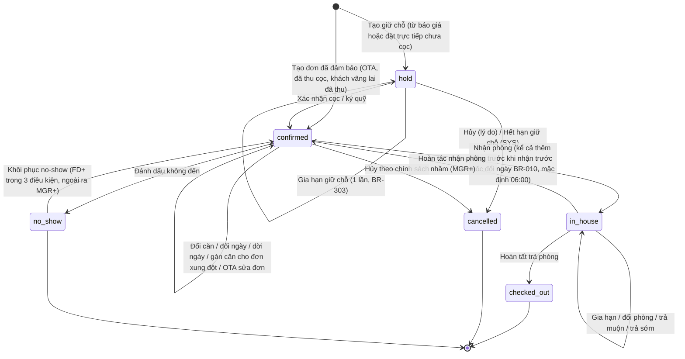
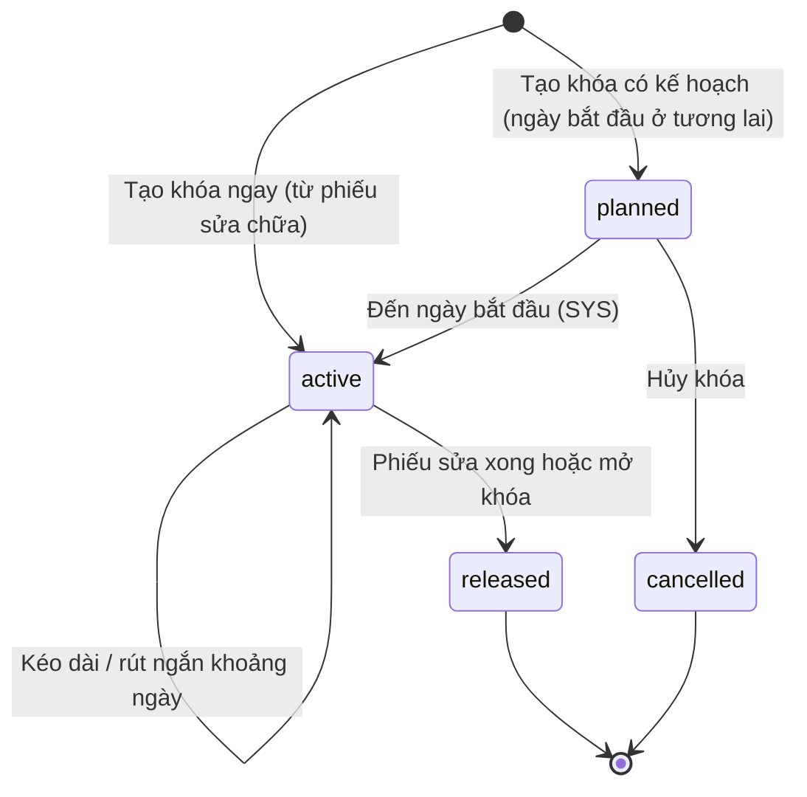
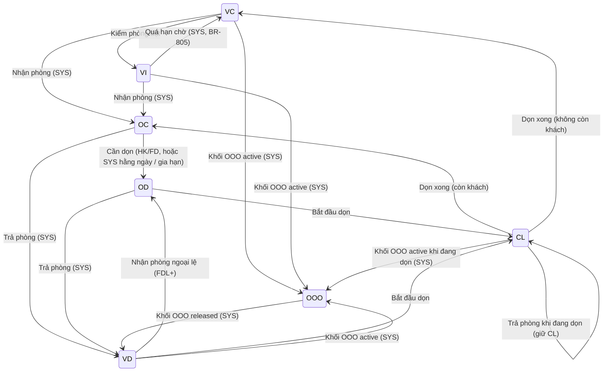
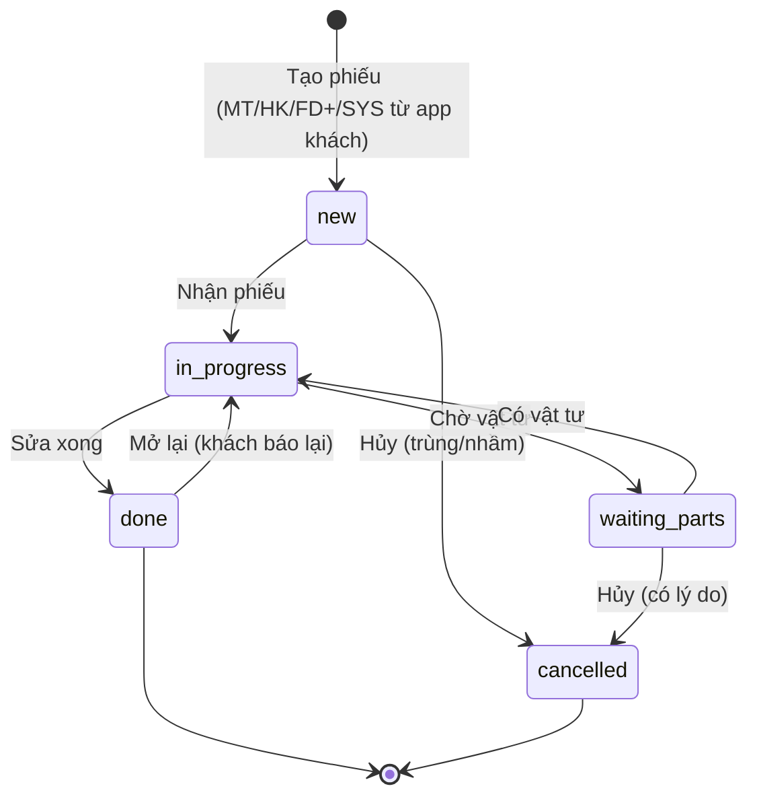
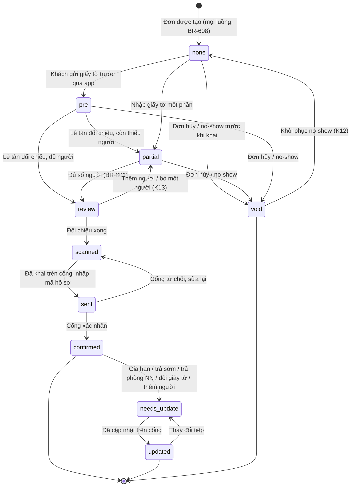
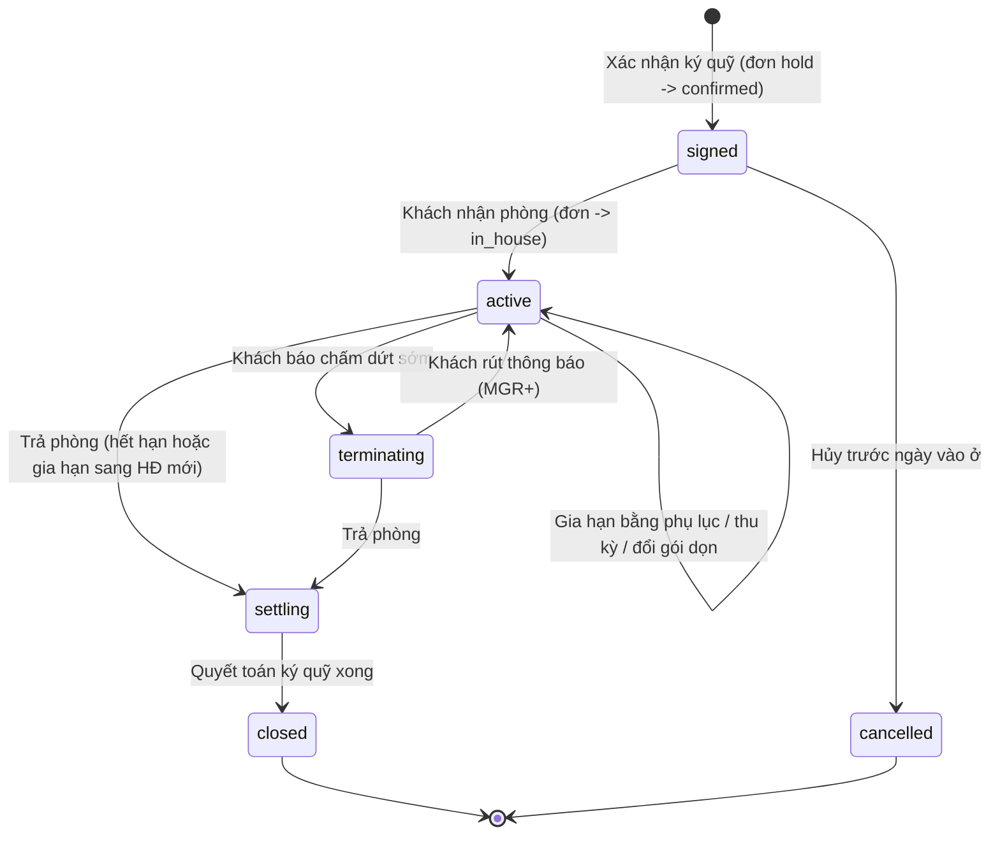
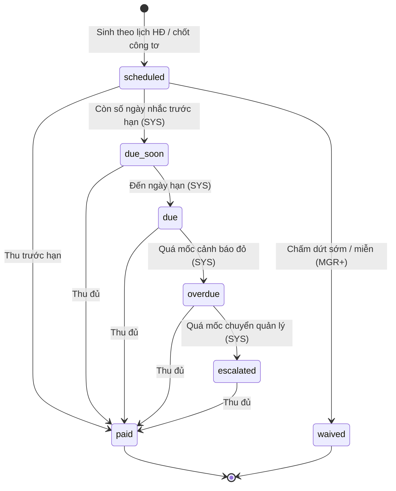
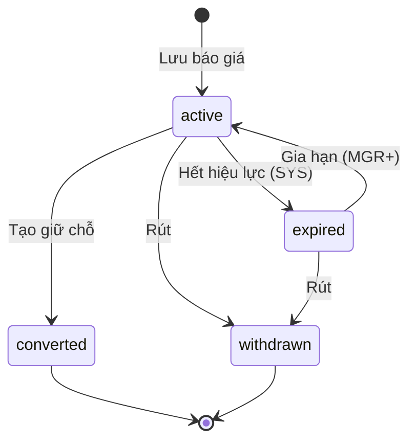
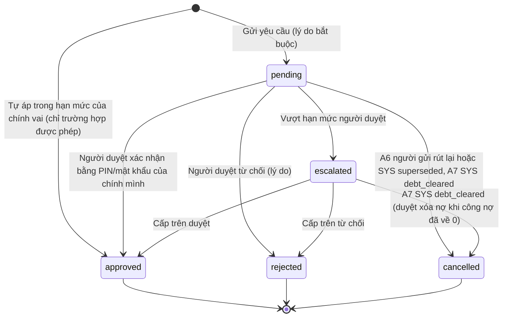

# Sơ đồ trạng thái – OTTIMO Desk

- Tác giả: BA | Round 2 – Đợt 0 | Ngày: 16/10/2026 | Phiên bản: **0.2.7** (18/10, R2 Sprint 4 ổn định sau gộp #19 `f6803d0`: **SM-10** thêm **A7** SYS tự hủy `debt_cleared` khi duyệt FOC `debt_write_off` mà công nợ đang mở đã về 0; mục **10.1** mới – quy tắc yêu cầu xóa nợ: trần lúc gửi, áp một phần lúc duyệt với số áp cố định – FB-R2-ARC-BA-S4-01, ARC 16.30, SEC C.12, BR-525). 0.2.6 (18/10, R2 tuần Ổn định: **SM-13** folio `closed` là chốt cuối – bỏ cạnh "MGR+ điều chỉnh dòng khi `closed`", chỉ còn thu công nợ / FOC `debt_write_off`; điều chỉnh trong cửa sổ 24 giờ khi folio còn `settled` (A32) – BUG-R2-201, ARC 16.28 (b), DOM đồng ý BR-525; FOC `debt_write_off` không vượt công nợ đang mở). 0.2.5 (18/10, R2 tuần Ổn định: **SM-15** thêm cạnh `in_progress → declined` khi việc HK liên kết đã hủy, tách hai đường `→ done` (SYS / lễ tân), ghi lúc thu phí BR-506 theo việc HK đã xong). 0.2.4 (17/10, R2 Sprint 4: **SM-18 mới** – yêu cầu đặt phòng từ website WR0–WR7, US-155, OpenAPI 0.3.7 bổ sung 2; mã sự kiện WR; mục 18–20 cũ dời thành 19–21). 0.2.3 (R2 Sprint 2: trả lời ARC Q-B1, Q-B2; R4 kiểm không đạt; SM-15 tự ghi đã nhận). 0.2.2 (R2: SM-16 G3/G4 theo rbac A23; SM-14 + B2 việc bộ đồ dùng thêm BR-812; B1 sức chứa ESC-014). Bản 0.2.1 (đã xử lý review DOM, ARC, SEC – xem `rounds/round-01/responses/BA-responses.md`; bước 5 sửa BUG-R1-001)
- Nguồn: `business-rules.md` (mã **BR-xxx** – nguồn sự thật duy nhất cho mọi con số), `round-0-baseline.md` (**BL**), `baseline-issues-triage.md`, `security/data-risk-assessment.md` (**SEC**), `PRD.md`, `03-backlog/backlog.md` (**US-xxx**), `rbac-matrix.md` (mã vai).
- Tài liệu này **không chép con số nghiệp vụ**. Mọi mốc giờ, hạn, tỷ lệ, hạn mức đều là tham số trong `business-rules.md` mục 13, ghi bằng mã BR.
- Đọc cùng: `rbac-matrix.md` (vai được phép), `business-processes.md` (quy trình), `use-cases.md` (UC-xx).

## 0. Quy ước

### 0.1 Mã vai dùng trong cột "Ai được chuyển"
| Mã | Vai | Ghi chú |
|---|---|---|
| OWN | Chủ đầu tư (`owner`) | Nhóm U1 |
| MGR | Quản lý (`manager`) | Nhóm U1 |
| FDL | Lễ tân trưởng (`front_desk_lead`) | Nhóm U2; kế thừa toàn bộ quyền FD + quyền duyệt trong hạn mức BR-433 |
| FD | Lễ tân (`front_desk`) | Nhóm U2; người trực đêm (BR-611) dùng vai FD |
| HK | Buồng phòng (`housekeeping`) | Nhóm U3 |
| MT | Bảo trì / kỹ thuật (`maintenance`) | Nhóm U3 |
| SAL | Nhân viên sale nội bộ (`sales_staff`) | Nhóm U4 |
| CTV | Cộng tác viên / môi giới (`collaborator`) | Nhóm U4, ngoài biên chế |
| GST | Khách (qua link app khách của đơn) | U5 |
| SYS | Hệ thống (job theo lịch, sự kiện tự động, webhook đã xác thực) | Không phải người |

"FD+" = FD, FDL, MGR, OWN. "FDL+" = FDL, MGR, OWN. "MGR+" = MGR, OWN. Một tài khoản có thể có nhiều vai (ví dụ lễ tân kiêm sale nội bộ, persona P2) → quyền là **hợp** các vai.

### 0.2 Nguyên tắc chung cho mọi máy trạng thái
1. **Chỉ server chuyển trạng thái.** Giao diện chỉ hiện nút cho chuyển hợp lệ với trạng thái hiện tại **và** vai người dùng (US-020); server kiểm tra lại cả hai. Chuyển không hợp lệ → từ chối, ghi nhật ký lần bị từ chối (US-002 AC2).
2. **Mọi chuyển trạng thái ghi lịch sử**: trạng thái cũ, mới, sự kiện, người/hệ thống, thời điểm (giờ Việt Nam, BR-001), lý do (nếu bắt buộc).
3. **Trạng thái kết thúc không mở lại**. Sửa sai sau khi kết thúc bằng **bút toán điều chỉnh** (BR-008) hoặc chuyển ngoại lệ có tên riêng trong bảng (ví dụ "Khôi phục no-show"), cần MGR+ – **trừ** B12 khi đủ 3 điều kiện của DOM (FD+ tự làm, có lý do, MGR được báo).
4. **Kiểm tra chiếm phòng ở server trong cùng giao dịch** cho mọi chuyển làm thay đổi tồn phòng (BR-906): tạo giữ chỗ, xác nhận, gia hạn, đổi phòng, đổi ngày, khôi phục, tạo/kéo dài khối OOO.
5. **Mọi thay đổi tồn phòng phát sự kiện đồng bộ kênh** (BR-905) – ghi ở cột "Hệ quả" là `sync`.
6. Khóa lạc quan (phiên bản bản ghi): hai người cùng chuyển một bản ghi → người sau nhận thông báo "Dữ liệu vừa thay đổi, tải lại" (cùng tinh thần BR-906 S5). Mã HTTP do ARC chốt trong OpenAPI.
7. **Ngày nghiệp vụ** (decision-log DOM 15/10/2026, FB-R1-DOM-BA-01): "hôm nay" trong mọi bảng dưới đây = **ngày nghiệp vụ**, đổi theo **BR-010** (tham số `business_day_rollover`, mặc định **06:00** giờ VN, cùng mốc BR-003). Từ 00:00 đến 05:59 ngày D+1 vẫn là ngày nghiệp vụ D. Ví dụ: đơn đến 20/10, khách tới 01:30 ngày 21/10 → vẫn ở danh sách "Khách đến" của ngày 20/10, nhận phòng bình thường (B9), đêm đầu là đêm 20/10 như đã đặt. Server tính `business_date(now)` ở một chỗ duy nhất, mọi job/màn "Hôm nay" dùng hàm này.
8. **Thiết bị**: mọi chuyển cần đọc/ghi dữ liệu C3 (B9, K3–K10, xem mã cửa) chỉ chạy trên **thiết bị được cấp** mở admin-web (`rbac-matrix.md` 8.7); gọi từ PWA hoặc thiết bị chưa cấp → server từ chối (`DEVICE_NOT_TRUSTED`).

### 0.3 Danh mục máy trạng thái
| Mã | Đối tượng | Tên trạng thái (dùng trong code) | Mục |
|---|---|---|---|
| SM-01 | Đơn đặt phòng (ngắn ngày và dài hạn) | `hold`, `confirmed`, `in_house`, `checked_out`, `cancelled`, `no_show` | 1 |
| SM-02 | Khối khóa phòng OOO (chặn tồn phòng) | `planned`, `active`, `released`, `cancelled` | 2 |
| SM-03 | Trạng thái buồng | `VC`, `VI`, `VD`, `CL`, `OC`, `OD`, `OOO` | 3 |
| SM-04 | Phiếu sửa chữa | `new`, `in_progress`, `waiting_parts`, `done`, `cancelled` | 4 |
| SM-05 | Khai báo lưu trú (theo đơn) | `none`, `pre`, `partial`, `review`, `scanned`, `sent`, `confirmed`, `needs_update`, `updated`, `void` | 5 |
| SM-06 | Hợp đồng dài hạn | `signed`, `active`, `terminating`, `settling`, `closed`, `cancelled` | 6 |
| SM-07 | Kỳ thu dài hạn | `scheduled`, `due_soon`, `due`, `overdue`, `escalated`, `paid`, `waived` | 7 |
| SM-08 | Báo giá | `active`, `expired`, `converted`, `withdrawn` | 8 |
| SM-09 | Khách tiềm năng (lead) | `new`, `quoted`, `holding`, `won`, `lost` | 9 |
| SM-10 | Yêu cầu duyệt (FOC, giảm giá đặc biệt, ngoại lệ) | `pending`, `approved`, `rejected`, `escalated`, `cancelled` | 10 |
| SM-11 | Hoa hồng (theo đơn/HĐ) | `projected`, `earned`, `payable`, `paid`, `void` | 11 |
| SM-12 | Giao dịch thanh toán | `pending`, `succeeded`, `failed`, `expired`, `reversed` | 12 |
| SM-13 | Folio / bill | `open`, `settled`, `closed` | 13 |
| SM-14 | Việc buồng phòng | `open`, `in_progress`, `done`, `cancelled` | 14 |
| SM-15 | Yêu cầu từ app khách | `new`, `acknowledged`, `in_progress`, `done`, `declined` | 15 |
| SM-16 | Nhóm đơn (đoàn nhiều căn) | `open`, `closed` | 16 |
| SM-17 | Ca làm việc (đóng ca) | `open`, `closing`, `closed` | 17 |
| SM-18 | Yêu cầu đặt phòng từ website (US-155 – không phải đơn, không giữ phòng) | `new`, `in_progress`, `converted`, `declined`, `spam` | 18 |

Tên trạng thái đơn theo decision-log 15/10/2026 (DOM, BR-301). Ánh xạ từ prototype: `cf`→`confirmed`, `in`→`in_house`, `out`→`checked_out`, `cx`→`cancelled`; `ooo` của prototype **không còn là trạng thái đơn** mà là SM-02.

---

## 1. SM-01 – Đơn đặt phòng

Một đơn chiếm khoảng [ngày đến, ngày đi) của một căn (BR-002). Đơn ngắn ngày và đơn dài hạn dùng **cùng** máy trạng thái; đơn dài hạn có thêm hợp đồng (SM-06) sinh khi xác nhận ký quỹ. Đơn con gia hạn OTA (BR-422) cũng là một đơn SM-01 liên kết đơn gốc.

### 1.1 Ý nghĩa và tác động lên số liệu
| Trạng thái | Nghĩa | Khóa tồn phòng | Đêm bán / doanh thu (BR-904) | Hiện ở "Hôm nay" (BR-404) |
|---|---|---|---|---|
| `hold` | Giữ chỗ chờ cọc/ký quỹ, có hạn (BR-302) | Có | Không | Mục riêng "Giữ chỗ chưa cọc" |
| `confirmed` | Đã đảm bảo (cọc/ký quỹ/OTA) | Có (trừ đơn OTA đang **chưa gán căn** – không chiếm căn nào, nhưng vẫn trừ tồn của nhóm căn) | Có | "Khách đến" khi ngày đến = ngày nghiệp vụ hiện tại (0.2 điểm 7); đơn chưa gán căn hiện ở làn "Chưa gán căn" |
| `in_house` | Khách đang ở | Có | Có | "Khách đi" khi ngày đi = hôm nay; "Đang ở" |
| `checked_out` | Đã trả phòng, folio đã chốt | Không (từ thời điểm trả) | Có (các đêm đã ở) | Không |
| `cancelled` | Đã hủy (người hủy hoặc hết hạn giữ) | Không | Không; phí hủy giữ lại vào "doanh thu khác" | Không |
| `no_show` | Không đến | Không (mở bán các đêm còn lại, BR-311) | Không; cọc giữ lại vào "doanh thu khác" | Không |

### 1.2 Bảng chuyển trạng thái
| # | Từ → Đến | Sự kiện | Điều kiện (server kiểm) | Ai được chuyển | Hệ quả |
|---|---|---|---|---|---|
| B1 | [*] → `hold` | Tạo giữ chỗ | Căn trống cả khoảng (BR-906), không có khối OOO (BR-804); ngày đến không phải hôm nay (BR-302); có khách với SĐT (BL 5.16); số người tính sức chứa (người lớn + trẻ 6–11, trẻ dưới 6 không tính) ≤ sức chứa tối đa của căn = định mức + 1 (BR-110, INV quyết ESC-014); ngắn ngày trong giới hạn BR-112, dài hạn từ ngưỡng BR-108; hạn giữ = công thức BR-302 | FD+, SAL, CTV (khách của mình) | Sinh mã đơn (BR-007); sinh bản ghi khai báo `none` (BR-608); lead → `holding`; `sync` đóng phòng |
| B2 | [*] → `confirmed` | Tạo đơn đã đảm bảo | Như B1 trừ điều kiện "không phải hôm nay"; **một trong**: (a) kênh OTA, có mã OTA và kiểu thanh toán (BR-307); (b) đã ghi giao dịch cọc ≥ mức BR-305 (ngắn ngày) – xem SM-12; (c) khách vãng lai, đến hôm nay, đã thu theo BR-402 | FD+ ; SYS (đơn OTA từ channel manager – R3) | Như B1; giá từng đêm được snapshot (BR-106, BR-006); số người tính định mức vượt định mức căn → sinh việc HK "Chuẩn bị bộ đồ dùng thêm" (SM-14, BR-812) – áp cả B4, B7a, B12 |
| B3 | `hold` → `hold` | Gia hạn giữ chỗ | Trước khi hết hạn; chưa gia hạn lần nào; mức gia hạn tối đa BR-303; vẫn không vượt trần BR-302 | Người tạo đơn (SAL/CTV của mình), FD+ | Ghi hạn mới; nhắc lại theo BR-303 |
| B4 | `hold` → `confirmed` | Xác nhận cọc / ký quỹ | Có giao dịch `succeeded` (SM-12) đủ số tiền: ngắn ngày BR-305; dài hạn = ký quỹ BR-206/BR-306; kiểm trùng lại (BR-906) | FD+, SAL ; SYS (IPN/webhook đã xác thực – R3). **CTV không được** (chỉ gửi "báo đã chuyển cọc", xem rbac-matrix 4.3) | Lead → `won`; dài hạn: sinh HĐ `signed` (SM-06) + lịch kỳ thu (SM-07); hoa hồng → `projected` (SM-11); nhật ký tiền (BR-008) |
| B5 | `hold` → `cancelled` | Hủy giữ chỗ | Lý do bắt buộc từ danh mục BR-308; không phí | Người tạo (SAL/CTV của mình), FD+ | Lead → `quoted`; `sync` mở phòng; khai báo → `void` |
| B6 | `hold` → `cancelled` | Hết hạn giữ chỗ | Đến hạn (BR-302/303) mà chưa có giao dịch cọc `succeeded` | SYS | Lý do "Hết hạn giữ chỗ"; báo người tạo; lead → `quoted`; `sync` mở phòng; khai báo → `void` |
| B7 | `confirmed` → `confirmed` | Đổi căn / đổi ngày | Kiểm trùng căn mới/khoảng mới (BR-906); lý do bắt buộc; đơn OTA: chỉ đổi căn nội bộ, ngày theo OTA (đổi ngày đơn OTA chỉ qua B7c) | FD+ | Tính lại giá theo quy tắc của đơn (snapshot giữ nguyên cho đêm không đổi); `sync` |
| B7a | `confirmed` → `confirmed` | Gán căn cho đơn xung đột / chưa gán căn | Đơn có `conflict_state = open` (đơn OTA về hoặc nhập tay khi hết căn – erd mục 7); căn được chọn trống cả khoảng (BR-906) và không có khối OOO; thứ tự ưu tiên gợi ý theo BR-312 (cùng nhóm trước; nhóm cao hơn chỉ gợi ý, không tự gán – decision-log DOM) | FD+ | Chèn chiếm phòng; `conflict_state → resolved`; `overbooking_incident` đóng với cách xử lý "gán căn"; `sync`. Nếu phải dời khách ra ngoài (không còn căn): MGR+ đóng sự cố bằng "xử lý ngoài" (`resolveOverbookingExternal`) và đơn đi B10 theo BR-310/BR-312 |
| B7b | `confirmed` → `confirmed` | Lễ tân nhập tay đơn OTA vào căn đã kín (R2) | Kênh thuộc nhóm OTA; căn đã chọn có đơn/khối trong khoảng → server **không tự đổi căn**: trả `409` kèm danh sách căn trống cùng nhóm (rồi nhóm khác) để lễ tân chọn lại (decision-log PO); **không còn căn nào** trống → lễ tân xác nhận tạo đơn ở làn "Chưa gán căn" (`conflict_state = open`) | FD+ | Như B2; khi vào làn chưa gán: cảnh báo đỏ FD + MGR, tạo `overbooking_incident`; xử lý tiếp bằng B7a |
| B7c | `confirmed` → `confirmed` | OTA sửa đơn (đổi ngày, số khách, loại phòng, hủy một phần đêm) | Sự kiện sửa từ kênh (SYS R3) hoặc lễ tân nhập lại theo extranet (R2); kiểm trùng lại khoảng mới (BR-906): trùng → giữ căn cũ cho phần không đổi, phần không xếp được → `conflict_state = open` như B7b; số khách mới ≤ sức chứa căn (BR-110) – vượt → cờ xung đột "sức chứa", không tự đổi căn | SYS (R3); FD+ (R2) | Giá snapshot theo giá OTA mới; số người cần khai báo cập nhật (khai báo đã `confirmed` → `needs_update`, K9); `sync`. Đơn đang `in_house` mà OTA rút ngắn ngày → **không tự áp**: tạo việc "Xác nhận thay đổi từ OTA" cho FD |
| B8 | `confirmed` → `confirmed` | Dời ngày thay vì hủy (BR-309) | Đơn trực tiếp/CTV đã cọc; chưa dời lần nào; khoảng mới trong giới hạn BR-309 | MGR+ | Giữ nguyên cọc; `sync` |
| B9 | `confirmed` → `in_house` | Nhận phòng | **Ngày nghiệp vụ hiện tại = ngày đến** (0.2 điểm 7 – khách đến 00:00–05:59 của đơn ngày hôm trước vẫn nhận bình thường); `conflict_state` **không** là `open` (đơn chưa gán căn phải qua B7a trước); thực hiện trên **thiết bị được cấp** (0.2 điểm 8); ngày nghiệp vụ = ngày đến − 1 (ví dụ 04:30 **ngày đến**, khác với 04:30 ngày D+1 vẫn là B9) → đi qua B9a; **BR-402**: (1) buồng `VI` hoặc `VC`, nếu khác → cần FDL+ xác nhận ngoại lệ có lý do; (2) đã thu đủ phần còn lại hoặc OTA đã trả/đảm bảo; (3) có giấy tờ người đứng tên (khai báo ≥ `partial` có người đứng tên); giờ nhận mặc định giờ chuẩn BR-401, phụ thu chỉ khi lễ tân nhập giờ sớm (BR-414) | FD+ | Ghi giờ nhận thực tế; buồng → `OC` (hoặc `OD` nếu nhận vào buồng `VD` theo ngoại lệ) – SM-03; phụ thu nhận sớm vào folio (BR-411/BR-413), FOC qua SM-10; mã cửa hiệu lực (BR-403); hạn khai báo bắt đầu tính (BR-602/603) |
| B9a | `confirmed` → `in_house` | Nhận trước mốc đổi ngày (BR-010, mặc định 06:00) – thêm đêm trước | Ngày nghiệp vụ hiện tại = ngày đến D − 1 (trường hợp điển hình: khách tới 00:00–05:59 **của ngày D**; khách tới tối hôm trước cũng đi đường này); căn của đơn trống đêm D−1 (BR-906) và không có khối OOO; giá đêm thêm theo BR-411 (100% giá đêm – decision-log DOM "nhận trước 06:00 = đêm bán"); cùng các điều kiện BR-402 của B9. Căn không trống đêm D−1 → **không cho nhận**, gợi ý gửi hành lý chờ đến giờ nhận (hoặc đổi căn trống đêm D−1 bằng B7 nếu khách đồng ý giá) | FD+ | Đơn **Trực tiếp/CTV**: thêm 1 đêm vào đầu đơn (ngày đến = D−1), đêm thêm là đêm bán (BR-904). Đơn **OTA** (không đổi ngày đơn OTA – B7): tạo **đơn con kênh Trực tiếp** cho đêm D−1 liên kết đơn gốc (như BR-422), đơn con đi thẳng `in_house` cùng lúc; đơn gốc nhận phòng như B9. Khai báo dùng chung bản ghi đơn gốc (K1). `sync` |
| B10 | `confirmed` → `cancelled` | Hủy đơn đã đảm bảo | Lý do bắt buộc (BR-308); đơn trực tiếp/CTV: phí hủy/hoàn theo BR-309 – phần hoàn tạo yêu cầu hoàn (BR-522, MGR+ duyệt); đơn OTA: theo BR-310 (số tiền phạt do kênh báo) | FD+ ; SAL (đơn của mình, chỉ đơn trực tiếp); SYS (đơn OTA hủy từ channel manager – R3) | `sync` mở phòng; khai báo → `void`; hoa hồng → `void`; phần cọc giữ lại ghi "phí hủy" |
| B11 | `confirmed` → `no_show` | Đánh dấu không đến | Sau mốc đánh dấu BR-311, chưa nhận phòng, đã có ghi chú "đã gọi/nhắn, không liên lạc được"; **không tự động** | FD+ | Đơn trực tiếp: giữ cọc theo BR-311; đơn OTA: tạo việc "báo no-show trên kênh"; mở bán các đêm còn lại (`sync`); khai báo → `void`; hoa hồng → `void` |
| B12 | `no_show` → `confirmed` | Khôi phục no-show (DOM SQ-1) | Khách đến muộn sau khi đã đánh dấu; lý do bắt buộc. **FD/FDL tự làm** khi đủ cả 3 điều kiện: (1) còn trong ngày nghiệp vụ của đêm đến (trước 06:00 hôm sau); (2) căn của đơn vẫn trống, chưa bán lại, không phải đổi căn (BR-906); (3) không phát sinh hoàn tiền hay đổi giá. Thiếu một điều kiện, hoặc đơn OTA đã báo no-show lên kênh → yêu cầu duyệt SM-10, **MGR+** | FD+ (3 điều kiện); MGR+ (còn lại) | Đóng lại phòng (`sync`); khai báo `void` → `none` (K12, dùng lại bản ghi); hoa hồng `void` → tạo lại `projected` (bản ghi mới, SM-11); MGR nhận thông báo; dòng "Khôi phục no-show" hiện trong báo cáo đóng ca (P11). Đơn OTA: tạo việc "báo kênh hủy no-show" |
| B13 | `in_house` → `in_house` | Gia hạn | Đêm thêm liên tiếp còn trống (BR-906); giới hạn BR-421, vượt → báo giá dài hạn (BR-108); giá theo BR-421; đơn OTA → tạo **đơn con** kênh Trực tiếp liên kết (BR-422) ở `confirmed` rồi SYS chuyển `in_house` | FD+ ; GST (tự phục vụ – R3, chỉ khi giá hiển thị trước) | Đổi ngày đi; buồng → `OD` (BR-802); thu tiền theo BR-423; khai báo NN → `needs_update` (BR-604); `sync` |
| B14 | `in_house` → `in_house` | Đổi phòng | Căn mới trống (BR-906), buồng `VI`/`VC`; lý do bắt buộc; giá theo BR-424 | FD+ | Căn cũ → `VD`/`OD` + việc dọn; hủy mã cửa cũ, cấp mã mới (BR-403); khai báo không khai lại (BR-424); `sync` |
| B15 | `in_house` → `in_house` | Đặt trả muộn | Theo BR-412, BR-416 (có khách đến cùng ngày và không có căn thay thế → chặn, trừ MGR+); sau mốc 100% của BR-416 → xử lý như gia hạn (B13) | FD+ ; GST yêu cầu (lễ tân xác nhận) | Phụ thu vào folio sau khi lễ tân xác nhận (BR-414); mã cửa kéo dài (BR-403) |
| B16 | `in_house` → `in_house` | Trả sớm (báo trước ngày đi) | Hoàn theo BR-428 v0.3.4 (cơ sở ròng, phụ thu người đêm bỏ hoàn 100 %, không tính lại BR-107, **một** yêu cầu hoàn qua SM-10/SM-12; OTA: nhập số OTA giữ lại) | FD+ | Đổi ngày đi = hôm nay hoặc ngày khách rời; `sync` mở các đêm còn lại; khai báo NN → `needs_update` |
| B17 | `in_house` → `confirmed` | Hoàn tác nhận phòng nhầm (DOM xác nhận) | Chưa có dòng folio nào sinh sau nhận phòng; cùng ngày nghiệp vụ với lúc nhận | MGR+ | Buồng về trạng thái trước khi nhận; hủy mã cửa; nhật ký lý do |
| B18 | `in_house` → `checked_out` | Hoàn tất trả phòng | Đã qua 3 bước (BR-426); ngày nghiệp vụ = ngày đi **hoặc cửa sổ sau nửa đêm** (ngày nghiệp vụ = ngày đi − 1, ngày lịch = ngày đi, trước `business_day_rollover` – BR-416 v0.3.4); khách rời sau mốc cuối BR-412 → "Trả phòng – tính thêm 1 đêm": thêm đêm ngày đi rồi B18 trong **cùng** giao dịch (DOM S3-9); folio "còn phải thu" = 0 **hoặc** MGR+ ghi công nợ có hạn (BR-525); mọi yêu cầu **tiền** (FOC, giảm giá đặc biệt, định giá hư hỏng) đã quyết (SM-10) – yêu cầu vận hành không chặn, tự hủy `superseded` (DOM S3-10); số dư thừa chưa xử lý đã chọn cách xử lý (BR-522); dài hạn: HĐ chuyển `settling` (SM-06) | FD+ ; GST "trả phòng nhanh" (BR-427) chỉ khi còn phải thu = 0 tại thời điểm bấm | Folio → `settled`/`closed` (SM-13); buồng → `VD` (BR-802); hủy mã cửa (BR-403); việc "Dọn trả phòng" + "Bổ sung minibar" (SM-14); khai báo NN → `needs_update` (BR-604); hoa hồng ngắn ngày → `earned` khi thu đủ (BR-903); hóa đơn điện tử (BR-524) |

### 1.3 Ngoại lệ và lỗi cần xử lý
| Tình huống | Hành vi |
|---|---|
| Hai người cùng xác nhận một giữ chỗ / cùng đặt một căn – đêm (BR-906, S5) | Một người thành công; người kia nhận "Căn vừa được đặt/đơn vừa thay đổi", không tạo bản ghi |
| Đơn OTA về trùng đơn đã có (đồng bộ trễ, BR-312) | Vẫn tạo đơn `confirmed` (đơn OTA là cam kết với kênh), **không** tự hủy đơn nào; tự gán căn trống cùng nhóm (decision-log DOM); không còn căn cùng nhóm → **chưa gán căn** (`conflict_state = open`, không chèn chiếm phòng, làn "Chưa gán căn"); cảnh báo đỏ FD + MGR; xử lý bằng B7a (gán căn) hoặc dời khách ra ngoài theo BR-312; **cấm nhận phòng** khi chưa gán (B9) |
| Lễ tân nhập tay đơn OTA (R2) vào căn đã kín | B7b: `409` + gợi ý căn trống; hết căn → làn "Chưa gán căn" |
| Lễ tân nhập tay đơn **Trực tiếp/CTV** vào căn đã kín | Chặn (UC-04 X1); không có làn "Chưa gán căn" cho kênh trực tiếp |
| Job hết hạn giữ chỗ chạy trễ | Khi job chạy, so thời điểm hiện tại với hạn đã lưu; đơn đã có giao dịch cọc `succeeded` trước hạn → không hủy dù job chạy sau hạn |
| Giao dịch cọc đến **sau** khi giữ chỗ đã tự hủy | Không tự khôi phục; tạo cảnh báo cho FD/SAL "Tiền về cho đơn đã hủy" → tạo đơn mới (B1/B2) nếu căn còn trống, hoặc hoàn tiền (BR-522) |
| Khách đến khi đơn còn `hold` (chưa cọc) | Không nhận phòng trực tiếp từ `hold`: thu tiền → B4 → B9 |
| Khách đến khuya, không có lễ tân (BR-611) | Phân xử ORC 15/10/2026, SR-GST-15 (4 nhánh – xem P03 E2): người trực (vai FD) thực hiện B9 trên **thiết bị của cơ sở đã được OWN cấp** (máy quầy hoặc thiết bị di động của cơ sở `device_kind = facility_mobile`, SR-DEV-08) mở **admin-web**; điện thoại cá nhân không bao giờ được cấp (SR-DEV-09); PWA trên điện thoại cá nhân **không bao giờ** làm được B9 vì cần C3. Khuyến khích khách đến khuya check-in online trước (K2) để người trực chỉ đối chiếu. Mã cửa chỉ cấp khi điều kiện BR-402 đạt. Ai trực tối và bằng thiết bị gì: chờ INV trả lời ESC-010 |
| Khách đến trước mốc đổi ngày (BR-010, tham số `business_day_rollover`, mặc định 00:00–05:59) của đơn ngày hôm trước | Vẫn trong ngày nghiệp vụ của ngày đến → B9 bình thường, không tính đêm thêm |
| Khách đến trước mốc đổi ngày (BR-010, mặc định 00:00–05:59) **của chính ngày đến** | B9a (thêm đêm trước) nếu căn trống đêm trước; không trống → gửi hành lý |
| Mất mạng ở quầy khi khách đến | Theo P12 (`business-processes.md`): nhận khách bằng danh sách dự phòng, nhập bù B9 với "giờ thực tế" trong quá khứ và lý do "nhập bù sau mất mạng" khi có mạng lại |
| Đơn dài hạn hết HĐ mà khách chưa trả phòng | Đơn vẫn `in_house`; cảnh báo quá hạn trả phòng; MGR+ chọn: gia hạn HĐ (SM-06) hoặc tính ngày lẻ (BR-210) |

---

## 2. SM-02 – Khối khóa phòng OOO

OOO **không phải đơn khách** (BR-301, BR-804). Là khối chặn tồn phòng của một căn trong khoảng ngày **nửa mở [ngày bắt đầu, ngày mở bán lại)** – cùng cách tính với đơn (BR-002); mở bán lại mặc định = ngày dự kiến xong + 1 (decision-log DOM 15/10/2026, QA #1). Ví dụ khóa 20/10, dự kiến xong 22/10 → lưu [20/10, 23/10), đêm 22/10 vẫn khóa, đêm 23/10 mở bán; rack, kiểm trùng, channel manager, đêm khả dụng (BR-904) đều đọc từ khối này.

| # | Từ → Đến | Sự kiện | Điều kiện | Ai | Hệ quả |
|---|---|---|---|---|---|
| O1 | [*] → `planned`/`active` | Tạo khối | Có lý do và khoảng ngày dự kiến (BR-804); gắn phiếu sửa chữa (bắt buộc với `active` từ sự cố, không bắt buộc với bảo trì định kỳ); **không** khóa căn đang có đơn `in_house` (đổi phòng trước – B14); khoảng trùng đơn `hold`/`confirmed` → hiện danh sách đơn cần dời, chỉ lưu khi không còn đơn trùng hoặc MGR+ xác nhận đã có phương án dời | MT, FD+ | `sync` đóng phòng; `active` → buồng `OOO` (SM-03) |
| O2 | `planned` → `active` | Đến ngày bắt đầu | Căn không có khách `in_house` | SYS | Buồng → `OOO` |
| O3 | `active` → `active` | Đổi khoảng ngày | Kéo dài: kiểm trùng như O1 | MT, FD+ | `sync` |
| O4 | `active` → `released` | Mở khóa | Phiếu liên kết → `done` (SM-04), hoặc MGR+ mở khóa có lý do | SYS (theo phiếu), MGR+ | Buồng `OOO` → `VD` (BR-804); `sync` mở bán; đêm OOO đã qua vẫn trừ khỏi đêm khả dụng |
| O5 | `planned` → `cancelled` | Hủy khóa | Chưa bắt đầu | MT, FD+ | `sync` mở bán |

---

## 3. SM-03 – Trạng thái buồng

Bảy mã theo BR-801. Trạng thái buồng **tách** khỏi trạng thái đơn, đồng bộ qua sự kiện (BR-801, BR-806).

| # | Từ → Đến | Sự kiện | Điều kiện | Ai | Hệ quả |
|---|---|---|---|---|---|
| R1 | `VD`/`OD` → `CL` | Bắt đầu dọn | Có việc dọn mở cho căn (SM-14) – nếu chưa có thì tạo | HK | Việc dọn → `in_progress` |
| R2 | `CL` → `OC` | Dọn xong (căn còn đơn `in_house`) | – | HK | Việc dọn → `done` (BL 5.15) |
| R3 | `CL` → `VC` | Dọn xong (không còn đơn `in_house`) | – | HK | Việc dọn → `done`; căn chờ kiểm |
| R4 | `VC` → `VI` | Kiểm phòng đạt | Checklist BR-808 đủ mục; người kiểm theo BR-802: FDL+/MGR, **hoặc** HK tự kiểm khi đủ checklist + ảnh và cấu hình cơ sở cho phép (ca chỉ 1 người) | FDL+, HK (có điều kiện) | Lưu biên bản kiểm (người, giờ, ảnh). **Không đạt**: buồng **giữ `VC`** (không có `VC → CL`), SYS tạo việc `adhoc_clean` "Dọn lại theo kiểm phòng" kèm các mục không đạt; HK làm xong → kiểm lại `[GIẢ ĐỊNH BA – DOM xác nhận; EP07-08 mục 4.4]` |
| R5 | `VI` → `VC` | Quá hạn chờ khách | Không có khách theo BR-805 | SYS | Cần kiểm lại |
| R6 | `VC`/`VI` → `OC` | Nhận phòng (B9) | – | SYS (theo SM-01) | – |
| R7 | `VD` → `OD` | Nhận phòng ngoại lệ (B9 khi buồng chưa sẵn sàng) | FDL+ xác nhận có lý do (BR-402) | SYS (theo SM-01) | Tạo việc dọn ưu tiên cao |
| R8 | `OC` → `OD` | Cần dọn | (a) HK/FD báo; (b) SYS theo mốc giờ hằng ngày BR-802 cho khách ngắn ngày; (c) SYS khi gia hạn (BR-802); (d) SYS theo lịch gói dọn dài hạn (BR-807) | HK, FD+, SYS | Tạo việc "Dọn phòng khách đang ở" (trừ khi khách từ chối dọn – BR-807) |
| R9 | `OC`/`OD`/`CL` → `VD` | Trả phòng (B18) | Nếu đang `CL` khi khách trả: giữ `CL`, khi dọn xong → `VC` | SYS | Việc "Dọn trả phòng" |
| R10 | `VC`/`VI`/`VD`/`CL` → `OOO` | Khối OOO `active` | Không có đơn `in_house` (O1). Nguồn `CL`: HK đang dọn sau trả phòng thì phát hiện hỏng | SYS | Mọi việc dọn mở/đang làm của căn → `cancelled`, lý do "khóa bảo trì"; sau khi `released` sinh việc "Dọn sau sửa chữa" (R11) |
| R11 | `OOO` → `VD` | Khối OOO `released` | – | SYS | Việc "Dọn sau sửa chữa" |

**Chuyển bị cấm** (server từ chối): bất kỳ chuyển nào vào/ra `OOO` bằng tay (chỉ qua SM-02); `VD`/`CL` → `VI` (phải dọn xong và kiểm); `OC`/`OD` → `VC`/`VI` (chỉ trả phòng mới rời trạng thái có khách); nhận phòng vào `OOO`.

**Đối chiếu buồng – đơn** (BR-806): SYS kiểm theo mốc BR-806 và khi mở rack; lệch → cảnh báo FD, không tự sửa.

---

## 4. SM-04 – Phiếu sửa chữa

Tên hiển thị theo BL 4.7: Mới / Đang xử lý / Chờ vật tư / Xong; BA thêm `cancelled` (phiếu trùng/nhầm). Mức độ và thời hạn theo BR-809.

| # | Từ → Đến | Sự kiện | Điều kiện | Ai | Hệ quả |
|---|---|---|---|---|---|
| W1 | [*] → `new` | Tạo phiếu | Căn, mô tả (bắt buộc), mức độ (mặc định theo BR-809; từ app khách mặc định Trung bình, FD nâng mức); tùy chọn "Khóa phòng" → tạo khối OOO (SM-02, O1) | MT, HK, FD+ ; SYS (yêu cầu "Báo hỏng" từ app khách, BR-811) | Mã phiếu do server cấp (BR-007); hạn nhận/xử lý tính theo BR-809; mức Cao → báo ngay MT + FD + MGR và vào "Cần chú ý" (BR-907) |
| W2 | `new` → `in_progress` | Nhận phiếu | Có người xử lý (tự nhận hoặc được giao) | MT (tự nhận), FD+ (giao) | Ghi thời điểm nhận – đo hạn BR-809 |
| W3 | `in_progress` ↔ `waiting_parts` | Chờ / có vật tư | Ghi chú vật tư cần; mức TB/Thấp: **bắt buộc ngày dự kiến có vật tư** | MT, FD+ | Hạn BR-809 (DOM SQ-2): **mức Cao không dừng** (hạn là "có phương án", chờ vật tư thì phải đổi phòng/bù sự cố); **mức TB/Thấp tạm dừng** khi `waiting_parts`, chạy lại khi `in_progress`; quá ngày dự kiến có vật tư → cảnh báo lại, vào "Cần chú ý". Căn có khách dài hạn và sự cố ảnh hưởng làm việc (Wi-Fi, nước nóng) → nâng một bậc mức độ |
| W4 | `in_progress` → `done` | Sửa xong | Ghi kết quả; ảnh sau sửa (khuyến nghị, bắt buộc với mức Cao) | MT, FD+ | Khối OOO liên kết → `released` (O4) → buồng `VD`; yêu cầu khách liên kết → `done` (SM-15) |
| W5 | `new`/`waiting_parts` → `cancelled` | Hủy | Lý do bắt buộc; nếu có khối OOO → hủy/giải phóng khối | FD+ (MT chỉ hủy phiếu do chính mình tạo, khi còn `new`) | – |
| W6 | `done` → `in_progress` | Mở lại | Trong cùng kỳ lưu trú của khách báo; nếu cần khóa lại → tạo khối OOO mới | FD+ | Hạn tính lại từ thời điểm mở lại |

**Mức Cao và khách đang ở**: nếu hết thời hạn phương án của BR-809 chưa xong → hệ thống gợi ý đổi phòng (B14) + FOC bù sự cố (SM-10) – xem quy trình P04 trong `business-processes.md`.

**Bảo trì định kỳ** (BR-810) không phải phiếu sửa; khi hoàn thành một kỳ → SYS sinh kỳ kế tiếp theo BR-810. Nếu công việc định kỳ cần khóa phòng → tạo khối OOO `planned`.

---

## 5. SM-05 – Khai báo lưu trú (theo đơn)

Tên trạng thái theo BR-607. **Thay đổi so với BL 5.12** theo SEC R-REG-05 và decision-log 15/10/2026: đồng ý lưu ảnh giấy tờ **không** còn là điều kiện để sang `scanned`; đồng ý chỉ quyết định ảnh được lưu theo hạn BR-610 hay xóa ngay sau khi khai báo (BR-609).

| # | Từ → Đến | Sự kiện | Điều kiện | Ai | Hệ quả |
|---|---|---|---|---|---|
| K1 | [*] → `none` | Đơn sinh (B1, B2) | Mọi luồng tạo đơn (BR-608); đơn con gia hạn **không** sinh bản ghi mới (BR-608) | SYS | Số người cần = số khách đơn (BR-601) |
| K2 | `none` → `pre` | Check-in online | Khách tải giấy tờ qua link có thời hạn gắn đơn (SEC R-REG-08); không nhận ảnh qua chat | GST | Ảnh vào kho C3; báo FD |
| K3 | `pre`/`none` → `partial`/`review` | Nhập/đối chiếu giấy tờ | Mỗi người: loại giấy, số, họ tên, ngày sinh, quốc tịch; NN thêm hạn hộ chiếu, thị thực, ngày nhập cảnh (BR-606); trẻ em theo BR-612 | FD+ | Ghi nhật ký C3 mỗi lần xem/nhập (SEC R-REG-09) |
| K4 | `partial` → `review` | Đủ người | Số người có giấy tờ ≥ số khách đơn | SYS | – |
| K5 | `review` → `scanned` | Đối chiếu xong | Đối chiếu tự động đã chạy và lễ tân xử lý mọi cảnh báo: tên khớp đơn, hạn hộ chiếu so thật, thị thực đến ngày trả, ngày đi khai không vượt hạn tạm trú (BR-605) – cảnh báo **không chặn** nhận phòng (SEC R-REG-03) nhưng phải có ghi chú xử lý; trạng thái đồng ý lưu ảnh đã ghi (có / không) | FD+ | Không đồng ý → đánh dấu ảnh "xóa sau khi khai báo xong" (BR-609) |
| K6 | `scanned` → `sent` | Đã khai | Lễ tân chọn đúng loại (NN / công dân VN, BR-602/603/606), sao chép dữ liệu, tự đăng nhập cổng (SEC R-REG-06), dán mã hồ sơ. **Khai báo `mixed`** (có cả khách VN và NN – hai lần khai trên cổng): mỗi khối ghi mã riêng (`portalReferences[]` theo `kind`, có `sentAt` riêng); khai báo chỉ chuyển `sent` khi **mọi** khối đã có mã – trước đó giữ `scanned`, khối còn thiếu vẫn tính hạn riêng (BR-602 cho khối VN, BR-603 cho khối NN) và "Cần chú ý" hiện hạn sớm nhất chưa xong (trả lời ARC Q-B2) | FD+ | Ghi người khai, thời điểm, mã hồ sơ (từng khối) |
| K7 | `sent` → `confirmed` | Cổng xác nhận | Lễ tân ghi nhận xác nhận | FD+ | Áp hạn lưu ảnh (BR-610); ảnh của người **không đồng ý** xóa ngay khi `confirmed`, 24 giờ là hạn trên nếu job xóa chạy trễ (decision-log SEC M3) |
| K8 | `sent` → `scanned` | Cổng từ chối | Ghi lý do từ chối | FD+ | Sửa dữ liệu, khai lại |
| K9 | `confirmed`/`updated` → `needs_update` | Thay đổi phải cập nhật | Với hồ sơ NN: gia hạn (B13), trả sớm (B16), trả phòng (B18), gia hạn HĐ, đổi giấy tờ (BR-604, BR-608); với mọi hồ sơ: thêm người giữa chừng (BR-601) | SYS | Tạo việc "Cập nhật ngày đi / khai bổ sung" cho FD trong ngày (BR-604) |
| K10 | `needs_update` → `updated` | Đã cập nhật | Nhập ngày đi thực tế / mã khai bổ sung | FD+ | – |
| K11 | `none`/`pre`/`partial`/`review` → `void` | Đơn `cancelled`/`no_show` | Chưa khai trên cổng | SYS | Ảnh đã nhận xóa theo hạn của SEC mục 7 cho hồ sơ không lưu trú |
| K12 | `void` → `none` | Khôi phục no-show (B12) | Đơn từ `no_show` về `confirmed` | SYS | **Dùng lại** bản ghi khai báo của đơn (giữ ràng buộc một bản ghi/đơn – erd 4.7 UK); ghi `state_transition`; ảnh đã xóa theo K11 **không** khôi phục, khách nộp lại |
| K13 | `review` → `partial` | Đổi thành phần khách khi đang đối chiếu | Trước K5 (chưa `scanned`); sau khi thêm khách vào đơn hoặc bỏ giấy tờ của một người, **số người có giấy tờ < số khách đơn** (BR-601). Nếu vẫn đủ người thì ở lại `review` | FD+ (bỏ giấy tờ / thêm khách); SYS (số khách đơn tăng do sửa đơn) | Ghi `state_transition` + nhật ký C3 (SEC R-REG-09); giấy tờ bị bỏ xử lý ảnh theo BR-609; khi đủ lại người → K4 về `review`. Sau `confirmed` thì thêm người đi theo K9, không theo K13 |

**Hạn khai báo** (không phải trạng thái mà là thuộc tính tính toán, hiển thị và nhắc):
- Công dân VN: theo BR-602 (mốc trong ngày đến). Người nước ngoài: theo BR-603 = **giờ nhận phòng thực tế + số giờ BR-603**, **không** còn áp mốc 23:00 cho khách nước ngoài (decision-log DOM 15/10/2026 – thay dòng trước, `[GIẢ ĐỊNH – chờ luật sư qua ESC-001]`).
- Tham số tách riêng `registration_deadline_vn` và `registration_deadline_foreigner_hours` để luật sư sửa không phải đổi máy trạng thái. Nhập bù sau mất mạng (P12): hạn tính từ **giờ nhận thực tế**, không từ giờ nhập.
- Cờ "quá hạn" khi trạng thái < `sent` và đã qua hạn → vào "Cần chú ý" (BR-907), nhắc người trực theo BR-611.

---

## 6. SM-06 – Hợp đồng dài hạn

Sinh khi xác nhận ký quỹ cho đơn dài hạn (B4, BR-306). Đơn dài hạn vẫn đi theo SM-01 (`confirmed` → `in_house` → `checked_out`); HĐ theo dõi phần tiền và nghĩa vụ.

| # | Từ → Đến | Sự kiện | Điều kiện | Ai | Hệ quả |
|---|---|---|---|---|---|
| H1 | [*] → `signed` | Xác nhận ký quỹ (B4) | Ký quỹ theo BR-206 đã thu; snapshot tiền thuê, giảm kỳ hạn, hệ số ký quỹ, chu kỳ thu, tỷ lệ hoa hồng, người chốt (BR-006, BR-212); ngày kết thúc theo tháng lịch (BR-209) | FD+, SAL; SYS (R3) | Sinh lịch kỳ thu (SM-07) theo BR-207/208; hoa hồng `projected` (SM-11) |
| H2 | `signed` → `active` | Nhận phòng | Kỳ đầu đã thu trước khi giao mã cửa (BR-208); đơn B9 | SYS (theo SM-01) | Lịch dọn gói (BR-807) bắt đầu; chỉ số công tơ đầu kỳ ghi (BR-502) |
| H3 | `signed` → `cancelled` | Hủy trước vào ở | Hoàn theo BR-314 (yêu cầu hoàn – MGR+ duyệt, BR-522) | MGR+ | Đơn → `cancelled` (B10); hoa hồng `void` |
| H4 | `active` → `active` | Gia hạn HĐ | Theo BR-211: phụ lục hoặc HĐ mới với giá/tham số tại thời điểm gia hạn; ký quỹ chuyển tiếp, bù chênh; NN kiểm thị thực (BR-605) | MGR+, SAL (đề xuất), FD+ | Đơn kéo dài ngày đi (kiểm trùng BR-906); kỳ thu mới; khai báo → `needs_update` |
| H5 | `active` → `active` | Sửa tay con số trên HĐ | Lý do + người duyệt MGR+ (BR-006) | MGR+ | Nhật ký giá trị cũ/mới |
| H6 | `active` → `terminating` | Khách báo chấm dứt sớm | Ghi ngày báo, ngày nghỉ dự kiến; mức mất ký quỹ và tiền hoàn theo BR-313 tính sẵn để quản lý xem | FD+, MGR+ | Kỳ thu chưa bắt đầu sau ngày nghỉ → `waived`; hoa hồng đợt chưa chi → `void` (BR-212) |
| H7 | `terminating` → `active` | Khách rút thông báo | Trước ngày nghỉ | MGR+ | Khôi phục kỳ thu |
| H8 | `active`/`terminating` → `settling` | Khách trả phòng (B18) | Chốt công tơ ngày trả (BR-502), biên bản kiểm phòng có ảnh (BR-214) | SYS (theo SM-01) | Lập bảng quyết toán BR-214 |
| H9 | `settling` → `closed` | Quyết toán xong | Bảng quyết toán đã được MGR+ duyệt; nếu dương → đã thu; nếu âm → giao dịch hoàn `succeeded` trong hạn BR-214 | MGR+ | Ký quỹ = 0; hoa hồng còn lại xử lý theo BR-212 |

---

## 7. SM-07 – Kỳ thu dài hạn

Mỗi HĐ có danh sách kỳ thu (tiền thuê + phí dịch vụ, thu trước) và hóa đơn điện nước hằng tháng (thu sau, BR-504) – cả hai dùng chung máy trạng thái này, khác loại kỳ.

| # | Chuyển | Điều kiện | Ai | Hệ quả |
|---|---|---|---|---|
| T1 | → `due_soon` / `due` / `overdue` / `escalated` | Mốc theo BR-207 (tiền thuê) hoặc hạn BR-504 (điện nước) | SYS | Nhắc khách (app/mẫu tin), "Cần chú ý" (BR-907), cảnh báo đỏ MGR; **không tự khóa cửa** (BR-207) |
| T2 | → `paid` | Tổng giao dịch `succeeded` gắn kỳ ≥ số tiền kỳ | FD+, SYS (IPN – R3) | Hóa đơn điện tử theo BR-524; hoa hồng đợt 1 → `earned` nếu là kỳ đầu (BR-212); `payable` chỉ do job kỳ chi (SM-11) |
| T3 | → `waived` | Chấm dứt sớm (H6) hoặc MGR+ miễn có lý do | MGR+, SYS | Nhật ký tiền (BR-008) |

Thu một phần: kỳ giữ nguyên trạng thái, hiển thị "đã thu x / còn y".

---

## 8. SM-08 – Báo giá

| # | Từ → Đến | Sự kiện | Điều kiện | Ai | Hệ quả |
|---|---|---|---|---|---|
| Q1 | [*] → `active` | Lưu báo giá | Snapshot giá và tham số (BR-006); hiệu lực theo BR-304; **không khóa phòng** | SAL, CTV, FD+ | Mã báo giá (BR-007); lead → `quoted` |
| Q2 | `active` → `converted` | Tạo giữ chỗ từ báo giá (B1) | Còn hiệu lực; căn còn trống | Người tạo báo giá, FD+ | Đơn `hold` liên kết |
| Q3 | `active` → `expired` | Hết hiệu lực | Theo BR-304 | SYS | – |
| Q4 | `expired` → `active` | Gia hạn báo giá | Theo BR-304 | MGR+ | Hạn mới; giá giữ nguyên snapshot |
| Q5 | `active`/`expired` → `withdrawn` | Rút báo giá | – | Người tạo, FD+ | – |

Muốn tạo giữ chỗ từ báo giá `expired` mà không được gia hạn → tạo báo giá mới theo giá hiện hành (BR-304).

---

## 9. SM-09 – Khách tiềm năng (lead)

Nối với khách bằng **mã khách** (BR-954). Giai đoạn kanban theo BL 4.10.

| Từ → Đến | Sự kiện | Ai |
|---|---|---|
| [*] → `new` | Tạo lead | SAL, CTV, FD+ |
| `new` → `quoted` | Báo giá `active` đầu tiên (Q1) | SYS |
| `quoted` → `holding` | Đơn `hold` từ báo giá (B1) | SYS |
| `holding` → `won` | Đơn → `confirmed` (B4) | SYS |
| `holding` → `quoted` | Đơn giữ chỗ hủy/hết hạn (B5, B6) | SYS |
| `new`/`quoted` → `lost` | Đóng lead, lý do bắt buộc (cùng danh mục BR-308) | Người phụ trách, MGR+ |
| `lost` → `quoted` | Mở lại khi khách quay lại | Người phụ trách, MGR+ |

---

## 10. SM-10 – Yêu cầu duyệt (FOC, giảm giá đặc biệt, ngoại lệ có duyệt)

Áp cho: FOC phát sinh và giảm giá đặc biệt (BR-431–435), hoàn tiền (BR-522), sửa tay số trên HĐ (BR-006), chỉ số công tơ nhỏ hơn kỳ trước (BR-503), công nợ khi trả phòng (BR-525), **xóa công nợ sau trả phòng** – FOC dòng bù mã `debt_write_off` trên folio `settled`/`closed` (BR-525, quy tắc riêng ở mục 10.1), trả muộn khi có khách đến (BR-416), chênh lệch kiểm kê (BR-705), định giá hư hỏng ngoài bảng (BR-512). Người duyệt và hạn mức: `rbac-matrix.md` mục 5.

| # | Chuyển | Điều kiện | Ai | Hệ quả |
|---|---|---|---|---|
| A1 | [*] → `pending` | Có lý do từ danh mục BR-432; giá trị; đối tượng (đơn/folio/HĐ). FOC `debt_write_off`: điều kiện và trần lúc gửi ở mục 10.1 (cũng áp cho A2) | Người thao tác (FD+, HK cho báo hư hỏng, MT cho công tơ) | Folio hiện dòng "chờ duyệt"; báo người duyệt có quyền |
| A2 | [*] → `approved` (tự áp) | Quy tắc chung (DOM SQ-3): *không ai duyệt yêu cầu của chính mình, **trừ** khi giá trị nằm trong hạn mức tự áp của vai mình*. Cụ thể: (a) MGR/OWN trong hạn mức BR-433; (b) FD/FDL áp **FOC minibar** (BR-704) khi: ≤ hạn mức lần của vai FD (BR-433) **và** tổng FOC minibar tự áp trong tháng của người đó + giá trị này ≤ hạn mức tháng (`foc_self_monthly_limit`, `[GIẢ ĐỊNH – chờ INV qua ESC-007]`); xác nhận bằng PIN của chính mình; lý do bắt buộc. Vượt hạn mức tháng → đi A1 (`pending`, người duyệt FDL+ khác người gửi). FDL **không** tự áp FOC loại khác | MGR+; FD, FDL (chỉ FOC minibar) | Ghi người thao tác = người duyệt; cộng dồn hạn mức tháng tự áp; vào báo cáo FOC, cảnh báo BR-435, danh sách "FOC tự áp trong ca" của báo cáo đóng ca (P11) để FDL xem lại |
| A3 | `pending` → `approved` | Người duyệt **khác** người gửi (trừ MGR/OWN); giá trị ≤ hạn mức lần và hạn mức tháng còn lại của người duyệt (BR-433); xác thực lại bằng PIN/mật khẩu của chính người duyệt | FDL+, MGR+ theo loại yêu cầu | Folio: dòng phát sinh + dòng FOC âm (BR-434); nhật ký; cộng dồn hạn mức tháng; kiểm cảnh báo thất thoát (BR-435). FOC `debt_write_off`: chỉ áp tới công nợ đang mở lúc duyệt – áp một phần (mục 10.1 điểm 3); công nợ đã về 0 → A7 thay vì A3 |
| A4 | `pending` → `escalated` | Giá trị vượt hạn mức người duyệt hiện tại | SYS | Chuyển cấp trên theo BR-433 |
| A5 | `pending`/`escalated` → `rejected` | Lý do từ chối | Người duyệt | Dòng FOC bị bỏ; phát sinh giữ nguyên phải thu |
| A6 | `pending` → `cancelled` | – | Người gửi; **SYS** khi yêu cầu vận hành (`checkin_room_not_ready`, `late_checkout_conflict`) bị thay thế – lý do `superseded` (DOM S3-10) | – |
| A7 | `pending`/`escalated` → `cancelled` – tự hủy lý do **`debt_cleared`** (v0.2.7) | Chỉ yêu cầu FOC `reasonCode = debt_write_off`. Người duyệt hợp lệ bấm duyệt (đường A3, hoặc cấp trên duyệt yêu cầu `escalated`): đã xác thực lại, đủ vai và hạn mức, nhưng **công nợ đang mở lúc duyệt = 0** (khách đã trả đủ, hoặc nợ đã được xóa bằng yêu cầu khác trong lúc chờ). Công nợ đọc dưới khóa L1 → L3 (ARC 16.19), trong cùng giao dịch với lệnh duyệt | SYS, chạy trong lệnh duyệt của người duyệt | Lệnh duyệt trả **200** (không phải 4xx – lệnh đã thành công, chỉ là không còn gì để áp): `status = cancelled`, `autoCancelReason = debt_cleared`, `effectiveAmountVnd = 0` (luôn có mặt). **Không** ghi dòng FOC; dòng "chờ duyệt" trên folio → `rejected`. Người gửi và mọi người đã nhận `approval_requested` nhận thông báo `approval_cancelled` (người gửi **không** nhận "đã duyệt"). **Không** tính vào hạn mức lần/tháng của người duyệt (BR-433). Nhật ký tiền: `approval.approved` rồi `approval.cancelled` (`before.status = approved`, lý do `auto: debt_cleared`) trong cùng giao dịch – ngoài giao dịch không ai thấy trạng thái `approved`. Gửi lại cùng `Idempotency-Key` → cùng phản hồi; duyệt hoặc từ chối lại yêu cầu đã hủy → 409 `INVALID_TRANSITION` (trạng thái kết thúc, 0.2 điểm 3) |

Chọn cạnh riêng **A7** thay vì mở rộng A6: A6 là người gửi rút lại hoặc hệ thống thay bằng yêu cầu mới (`superseded`); A7 phát sinh **từ lệnh duyệt** và không có yêu cầu nào thay (cùng lý do ARC tách `debt_cleared` khỏi `superseded` – 16.30.3).

**Chặn trả phòng**: folio có yêu cầu `pending`/`escalated` → không hoàn tất trả phòng (B18) cho đến khi xử lý xong hoặc người gửi rút lại.

### 10.1 Yêu cầu xóa công nợ – FOC `debt_write_off` (BR-525) – v0.2.7

Nguồn: BR-525 (DOM 18/10: xóa nợ qua FOC dòng bù, MGR+ trong hạn mức BR-433, **số xóa không vượt công nợ đang mở** để folio đã chốt không bao giờ sinh dư thừa); ARC `openapi-0.3.7.md` 16.27 mục 2, 16.30.3; BE-B `s4-be-b.md` mục 25; SEC `s4-SEC.md` C.12 (FB-R2-SEC-BE-80). Hợp đồng: `requestFoc`, `approveRequest`, `ApprovalRequest.effectiveAmountVnd`/`autoCancelReason` trong `api/openapi.yaml`.

**Công nợ đang mở** = phần nợ đã ghi (B18 chế độ công nợ, đảo khoản thu sau trả phòng G-4, J15 hết cửa sổ 24 giờ) chưa thu hoặc chưa xóa – một nguồn số (`OpenDebt.openDebtVnd`). Khoản phát sinh sau trả phòng còn trong cửa sổ 24 giờ (BR-427 (c)) **chưa** là công nợ nên không xóa được; hết cửa sổ (folio `closed`) thì công nợ đang mở = toàn bộ còn phải thu.

| # | Quy tắc | Chi tiết | Lỗi / kết quả |
|---|---|---|---|
| 1 | Điều kiện gửi (A1, A2) | Folio `settled`/`closed` **và** đơn có công nợ mở; chỉ OWN, MGR; `kind = foc`; ghi chú bắt buộc (vì sao không thu được, đã liên hệ thế nào – BR-525); hạn mức BR-433: MGR tự áp tới giá 1 đêm (A2), vượt → `pending`, OWN duyệt | FOC trên folio đã chốt mà không có công nợ mở → 409 `FOLIO_LOCKED`; folio `open` + `debt_write_off` → 422 `NOT_ALLOWED`; FD/FDL → 403; thiếu ghi chú → 422 `REASON_REQUIRED` |
| 2 | **Trần lúc gửi** | Số xin ≤ `max` = min(giá trị còn lại của dòng được bù, **công nợ đang mở − Σ số xin của các yêu cầu `debt_write_off` đang `pending`/`escalated` trên cùng folio**), không âm. Tính dưới khóa L1 → L3 | Vượt → 422 `AMOUNT_EXCEEDS_BALANCE` kèm `max` (có thể **0** khi các yêu cầu đang chờ đã phủ hết nợ). Hệ quả: yêu cầu tự áp (A2) không bao giờ vượt công nợ nên **không bao giờ** rơi vào A7 |
| 3 | **Áp một phần lúc duyệt** (A3; cấp trên duyệt yêu cầu `escalated`) | Số áp = min(số xin, công nợ đang mở **lúc duyệt**), đọc dưới khóa L1 → L3. Số áp > 0 → `approved` như thường. Số áp < số xin: `amountVnd` **giữ nguyên số xin** (cột số tiền của yêu cầu không sửa); `effectiveAmountVnd` = số thực áp và **cố định** (`applied_cap_vnd`) – mọi lần đồng bộ FOC sau đó áp tối đa số này | Phản hồi 200 `status = approved`, `effectiveAmountVnd` < `amountVnd`. Nhật ký tiền `approval.applied_capped` (hạng `money`, lý do mã `debt_collected_before_approval`, `before.amountVnd`, `after.appliedVnd`, `after.openDebtVnd` – chỉ số tiền). Hạn mức tháng của người duyệt chỉ cộng phần thực áp. Áp xong còn phải thu = 0 → công nợ đóng (`written_off`), mục "Cần chú ý" `checkout_debt` tự hết |
| 4 | Số áp = 0 lúc duyệt | Công nợ đang mở đã về 0 | Đi **A7** (tự hủy `debt_cleared`, lệnh duyệt 200) |
| 5 | Bất biến | Xóa nợ không bao giờ tạo dư thừa trên folio (`creditVnd` không tăng vì `debt_write_off`) | Kiểm bằng ca SEC A (trả đủ trong lúc chờ → 200 `cancelled`, dư 0) và ca SEC B (trả 2.000.000 trong lúc chờ yêu cầu 5.000.000 → áp 3.000.000, công nợ đóng, dư 0) – `s4-be-b.md` mục 25 |

**Chưa có ở R2 – dời R3** (ORC 18/10, đóng băng mã tiền sau lượt kiểm tiền 8; không gây lệch tiền nhờ điểm 3–4):
- **FB-R2-ARC-BE-S4-17** – công nợ đóng (thu đủ, hoặc yêu cầu xóa nợ khác đã áp) khi còn yêu cầu `debt_write_off` đang chờ. R3: SYS hủy ngay các yêu cầu đó (`debt_cleared`) trong cùng giao dịch đóng công nợ. R2: yêu cầu vẫn ở hàng "Cần duyệt" tới khi người duyệt bấm duyệt (A7), từ chối (A5) hoặc người gửi rút lại (A6).
- **FB-R2-ARC-BE-S4-18** – số "khi duyệt sẽ áp" (`effectiveAmountVnd` của yêu cầu `debt_write_off` đang chờ) ở R2 = min(số xin, giá trị dòng), **chưa** trừ công nợ đang mở như hợp đồng ghi. Số thực áp vẫn do điểm 3 quyết lúc duyệt. Đây là lệch đã biết, có thẻ ARC.

---

## 11. SM-11 – Hoa hồng (theo đơn hoặc HĐ, mỗi người chốt)

| Từ → Đến | Sự kiện | Điều kiện | Ai |
|---|---|---|---|
| [*] → `projected` | Đơn/HĐ có người chốt SAL/CTV được xác nhận (B4) | Tỷ lệ và cơ sở tính snapshot (BR-212, BR-903) | SYS |
| `projected` → `earned` | Ngắn ngày: đơn `checked_out` và thu đủ (BR-903). Dài hạn: chia đợt – mỗi đợt là một bản ghi, đợt 1 khi kỳ đầu `paid`, đợt 2 khi qua mốc thời hạn BR-212 | – | SYS |
| `earned` → `payable` | Kỳ chi gộp theo **tháng lịch** (DOM SQ-4): job ngày 1 chuyển mọi bản ghi `earned` của tháng trước sang `payable`; chi trước ngày 10 `[GIẢ ĐỊNH – chờ INV]` | – | SYS |
| `payable` → `paid` | Đánh dấu đã chi, ghi ngày, cách chi, chứng từ | – | OWN, MGR |
| `projected`/`earned` → `void` | Đơn `cancelled`/`no_show`; HĐ chấm dứt sớm trước đợt 2 (BR-212) | – | SYS; MGR+ (điều chỉnh có lý do) |
| (điều chỉnh sau `paid`) | Khách bị hoàn tiền sau khi hoa hồng đã chi | **Không sửa** bản ghi `paid` (BR-008): tạo bản ghi điều chỉnh âm, trừ vào kỳ chi sau | SYS; MGR+ |

---

## 12. SM-12 – Giao dịch thanh toán

Mỗi khoản thu/hoàn là một giao dịch gắn folio (BR-521). OTTIMO không lưu dữ liệu thẻ (decision-log SEC).

| Từ → Đến | Sự kiện | Ai |
|---|---|---|
| [*] → `pending` | Tạo yêu cầu thu online (VietQR động, link VNPay/MoMo – R3) | FD+, SAL, SYS |
| [*] → `succeeded` | Ghi nhận thu tay (tiền mặt, chuyển khoản đã thấy tiền, "đã thu qua OTA"). Chuyển khoản/VietQR ghi tay mang cờ **`reconciliation = pending`** (chờ đối soát); tiền mặt gắn với **ca** đang mở (SM-17) | FD+, SAL (cọc đơn của mình) |
| `pending` → `succeeded` | IPN/webhook đã xác thực chữ ký và khớp số tiền (decision-log INT), hoặc người dùng xác nhận đã thấy tiền VietQR (`confirmPaymentReceived`, OpenAPI 0.3.3) → `reconciliation = pending`; người xác nhận **không** được tự đối soát (A46) | SYS, FD+, SAL (chỉ cọc đơn của mình – như A33 M; trả lời ARC Q-B1) |
| `pending` → `failed` / `expired` | Cổng báo lỗi / quá hạn link | SYS |
| `succeeded` → `reversed` | Ghi sai: tạo giao dịch đảo (không xóa – BR-008) | MGR+ |

Hoàn tiền = giao dịch âm riêng, cần yêu cầu duyệt `approved` (SM-10, BR-522). Người **thực hiện chuyển khoản hoàn** là MGR+ (thấy đầy đủ số tài khoản khách D15); FD chỉ nhập yêu cầu và thấy số tài khoản dạng che. Đổi số tài khoản nhận hoàn sau khi đã duyệt → yêu cầu quay về `pending`, duyệt lại (SEC-BA-03) `[GIẢ ĐỊNH – DOM xác nhận ở R2]`.

**Đối soát** (thuộc tính, không phải trạng thái – FB-R1-DOM-BA-03, DOM BR-526): `reconciliation ∈ {not_required, pending, reconciled, disputed}` + `reconciled_at`, `reconciled_by`.
| Chuyển | Điều kiện | Ai |
|---|---|---|
| → `not_required` | Tiền mặt (đối chiếu qua đếm tiền đóng ca), IPN/webhook đã xác thực, "đã thu qua OTA" | SYS |
| → `pending` | Chuyển khoản/VietQR ghi tay (kể cả SAL xác nhận cọc – SEC-BA-12) | SYS |
| `pending` → `reconciled` | MGR+ tick sau khi xem sao kê ngân hàng; hoặc webhook bank feed khớp số tiền + nội dung (R3) | MGR+, SYS (R3) |
| `pending` → `disputed` | Không thấy tiền trên sao kê sau mốc đối soát (BR-526) | MGR+ |
Giao dịch `disputed` → cảnh báo đỏ OWN + MGR; đơn vẫn giữ trạng thái, MGR+ xử lý bằng đảo giao dịch (`reversed`) và thu lại. Danh sách `pending` quá mốc BR-526 vào "Cần chú ý".

---

## 13. SM-13 – Folio / bill

| Trạng thái | Nghĩa | Ai được ghi dòng |
|---|---|---|
| `open` | Đơn chưa trả phòng; thêm/sửa dòng phát sinh (BR-008: sửa = bút toán điều chỉnh, có nhật ký) | FD+; HK gián tiếp qua kiểm minibar; SYS (gia hạn, công tơ) |
| `settled` | Đã hoàn tất trả phòng, bill phát hành, số bill do server cấp (BR-007) – **bill khóa** (US-038) | **Trong cửa sổ sau trả phòng** BR-427 (d) (24 giờ tính từ lúc trả phòng – `post_checkout_window_until`): MGR+ vẫn ghi bút toán điều chỉnh, có lý do (rbac **A32**); FD+ ghi phát sinh sau trả phòng (BR-427) |
| `closed` | Hết cửa sổ sau trả phòng: bill chốt, mọi khoản còn nợ thành **một** công nợ (BR-525). **Chốt cuối** – v0.2.6 | **Không ai** ghi hay điều chỉnh dòng (`adjustFolioLine` → 409 `FOLIO_LOCKED`, mọi vai). Chỉ còn hai đường tiền, khi đơn có công nợ mở: (1) **thu công nợ** (`recordPayment`, ARC 16.26); (2) **xóa nợ** bằng FOC dòng bù mã `debt_write_off` (SM-10; BR-525 – vai và hạn mức theo BR-433). **Điều kiện DOM (BR-525):** số xóa **không được vượt công nợ đang mở** (và không vượt giá trị còn lại của dòng được bù), để folio đã đóng **không bao giờ** sinh dư thừa; vượt → server từ chối. Trần lúc gửi (trừ các yêu cầu xóa nợ đang chờ), áp một phần và tự hủy `debt_cleared` lúc duyệt: SM-10 mục 10.1 và A7 (v0.2.7) |

Chuyển: `open` → `settled` cùng lúc B18; `settled` → `closed` do SYS (J15) khi hết cửa sổ BR-427 (d): còn phải thu = 0 → đóng; còn phải thu > 0 → ghi công nợ (BR-525) rồi đóng (ARC 16.27 R7LOCK-01).

- **Bỏ (v0.2.6 – BUG-R2-201, ARC 16.28 phương án (b))** cạnh cũ "MGR+ điều chỉnh dòng khi folio `closed`". Lý do: sau khi đóng, công nợ, bill và báo cáo kỳ đã chốt; điều chỉnh giảm sẽ tạo dư thừa mà folio `closed` không chi hoàn được. Cần sửa tiền thì làm **trong cửa sổ** (folio còn `settled`, A32). DOM đã đồng ý (BR-525, 18/10).
- **Điều chỉnh sau khi đóng kèm hóa đơn điều chỉnh: để R3**, cùng hóa đơn điện tử (MISA meInvoice).

---

## 14. SM-14 – Việc buồng phòng

| Từ → Đến | Sự kiện | Ai |
|---|---|---|
| [*] → `open` | SYS sinh (trả phòng, gia hạn, lịch dọn dài hạn BR-807, OC→OD, yêu cầu khách BR-811, bổ sung minibar, **chuẩn bị / chuyển / thu hồi bộ đồ dùng thêm** khi đơn `confirmed` có người vượt định mức – BR-812) hoặc FD+ tạo tay | SYS, FD+ |
| `open` → `in_progress` | Bắt đầu dọn (R1) hoặc nhận việc | HK |
| `in_progress`/`open` → `done` | Dọn xong (R2/R3) hoặc tick xong; việc "Bổ sung minibar" → trừ kho (US-068) | HK, FD+ |
| `open` → `cancelled` | Khách từ chối dọn, khối OOO, đơn hủy; việc bộ đồ dùng thêm khi đơn giảm người còn ≤ định mức, đổi căn, hủy, no-show **trước** khi chuẩn bị (BR-812 (4)) | HK (khách từ chối – ghi lý do), FD+, SYS |

Thứ tự ưu tiên danh sách việc theo BR-807. Việc "Chuẩn bị bộ đồ dùng thêm" có hạn = giờ nhận phòng của đơn (BR-812 (2)); khách đã đến mà việc chưa xong → việc lên **đầu** hàng đợi, **không** chặn nhận phòng B9 (BR-812 (5)). Quy trình: `business-processes.md` P07 bước 1a, 4a, 9.

---

## 15. SM-15 – Yêu cầu từ app khách

| Từ → Đến | Sự kiện | Ai |
|---|---|---|
| [*] → `new` | Khách gửi (6 loại, BR-811) | GST |
| `new` → `acknowledged` | Bộ phận được định tuyến bấm "Đã nhận" – đo thời hạn phản hồi BR-811; ngoài giờ trực → SYS trả lời tự động | FD+, HK, MT theo loại; SYS |
| `acknowledged` → `in_progress` | Việc HK (SM-14) liên kết bắt đầu / phiếu sửa (SM-04) liên kết được nhận (W2); việc/phiếu được **sinh ngay lúc tạo yêu cầu** (BR-811). Bắt đầu việc/nhận phiếu khi yêu cầu còn `new` → SYS ghi luôn `acknowledgedAt` rồi chuyển `in_progress` `[GIẢ ĐỊNH BA – EP14 mục 4.4]` | SYS, người nhận |
| `new`/`acknowledged`/`in_progress` → `done` | Việc HK (SM-14) / phiếu sửa (W4) liên kết `done`. Phí dọn theo yêu cầu (BR-506) ghi folio **một lần** trong cùng giao dịch | SYS |
| `acknowledged`/`in_progress` → `done` | Lễ tân bấm "Xong" (`complete`), kèm câu trả lời tùy chọn (luật B-15 – EP14 4.4). Yêu cầu **có** việc/phiếu liên kết: **không** ghi phí. Yêu cầu **không** có việc liên kết: ghi phí BR-506 lúc này | FD+; HK/MT chỉ với yêu cầu không có việc/phiếu liên kết |
| `new`/`acknowledged` → `declined` | Không thực hiện được, ghi mã lý do gửi khách; việc HK liên kết còn `open` → `cancelled` (SM-14); phiếu sửa không tự hủy. Không ghi phí | FD+ |
| `in_progress` → `declined` **(v0.2.5)** | Như dòng trên, **chỉ khi** việc HK liên kết đã `cancelled` (lễ tân trả lời khách sau khi việc bị hủy). Việc còn đang làm, hoặc yêu cầu gắn phiếu sửa → từ chối chuyển (409). Không ghi phí. ARC đang xác nhận (giả định (s5) – `rounds/round-02/outputs/BE/s4-be-d.md` 7.7) | FD+ |

Khách thấy trạng thái theo nhãn thân thiện (VI/EN, RU từ R3): Đã gửi · Đã nhận · Đang xử lý · Hoàn thành · Không thực hiện được.

**Phí dọn theo yêu cầu (BR-506, DOM 18/10 – S4-07)** – phí tính theo việc HK đã xong, không theo lúc lễ tân đóng yêu cầu:
- Lễ tân đã `complete` (yêu cầu `done`) rồi việc HK liên kết mới `done` → trạng thái yêu cầu **không đổi**, SYS vẫn ghi phí **một lần** lúc việc `done` (ví dụ BR-506: đóng 15:00, HK xong 16:00 → ghi lúc 16:00).
- Việc HK liên kết bị hủy → không ghi phí, dù yêu cầu đóng bằng `complete` hay `declined`. Yêu cầu `declined` không bao giờ ghi phí.
- Chi tiết trường, lỗi, bảng tình huống: `specs/EP14-guest-app.md` mục 4.4, 4.5.

---

## 16. SM-16 – Nhóm đơn (đoàn nhiều căn)

Mỗi căn trong đoàn vẫn là **một đơn SM-01 riêng** (chống đặt trùng giữ nguyên theo căn – đêm). Nhóm đơn chỉ gom để cọc chung, hủy bớt, bill gộp (FB-R1-DOM-BA-05; quy tắc đoàn do DOM bổ sung). Quy trình: `business-processes.md` P01 mục "Đơn nhóm"; UC-31.

| # | Từ → Đến | Sự kiện | Điều kiện | Ai | Hệ quả |
|---|---|---|---|---|---|
| G1 | [*] → `open` | Tạo nhóm từ báo giá nhiều căn hoặc gom các đơn có sẵn | ≥ 2 đơn cùng cơ sở, cùng **người đặt/người trả** (khách đầu mối); các đơn ở `hold`/`confirmed`; mỗi đơn qua B1/B2 riêng | FD+, SAL, CTV (khách của mình) | Mã nhóm (BR-007); đơn mang `group_id` |
| G2 | `open` → `open` | Cọc chung | Một giao dịch gắn **nhóm**, phân bổ theo căn: mặc định theo tỷ lệ tổng tiền phòng từng đơn, lễ tân sửa được; tổng phân bổ = số tiền giao dịch; mỗi đơn đạt mức BR-305 mới sang `confirmed` (B4 từng đơn) | FD+, SAL | Giao dịch có các dòng phân bổ; nhật ký tiền |
| G3 | `open` → `open` | Hủy một căn trong nhóm | B10/B5 cho **đơn đó**; phí hủy/hoàn tính theo BR-309 trên **phần cọc đã phân bổ cho căn bị hủy**; phần hoàn mặc định giữ lại làm cọc của các căn còn lại nếu khách đồng ý, nếu không → yêu cầu hoàn (SM-10) | FD+ ; SAL (đơn trực tiếp của mình – `own_direct_only`); CTV (chỉ đơn `hold` của mình – `own_hold_only`) – theo rbac A05/A06 | Đơn còn lại không đổi |
| G4 | `open` → `open` | Thêm/bớt đơn khỏi nhóm | Đơn chưa `checked_out`; bớt đơn → phần cọc đã phân bổ đi theo đơn. SAL/CTV: chỉ đơn **của mình** (đơn mình tạo/chốt, cùng khách đầu mối của mình); CTV chỉ thêm/bớt đơn `hold` (CTV không phân bổ cọc – A33, rbac ghi chú 36) | FD+ ; SAL, CTV (của mình) – **nguồn: rbac A23** (chốt R2 Đợt 0) | – |
| G5 | `open` → `closed` | Mọi đơn trong nhóm ở trạng thái kết thúc | – | SYS | – |

Trả phòng: người trả có thể chọn **bill gộp** (một bill liệt kê từng căn, số bill server cấp cho bill gộp; folio từng đơn vẫn `settled` riêng) hoặc **bill tách** theo từng căn. Đơn trong nhóm vẫn nhận phòng/trả phòng riêng (khách đi lệch ngày là bình thường). Khai báo lưu trú theo **từng đơn** (K1), không theo nhóm. Phạm vi R2/R3 do PO chốt.

---

## 17. SM-17 – Ca làm việc (đóng ca / chốt ngày)

Đi cùng quy trình P11 (`business-processes.md`). Một ca gắn **một người** (không dùng chung tài khoản – `rbac-matrix.md` 8.8) và một cơ sở.

| # | Từ → Đến | Sự kiện | Điều kiện | Ai | Hệ quả |
|---|---|---|---|---|---|
| C1 | [*] → `open` | Mở ca | Người dùng FD/FDL chưa có ca `open` ở cơ sở; nhập tiền mặt đầu ca (bàn giao từ ca trước) | FD+ | Mọi giao dịch tiền mặt sau đó gắn ca này |
| C2 | `open` → `closing` | Bắt đầu đóng ca | – | Chủ ca | SYS lập báo cáo ca (P11 bước 2) |
| C3 | `closing` → `closed` | Xác nhận đóng ca | Đã nhập tiền mặt đếm thực tế; chênh lệch ≠ 0 → lý do bắt buộc; đã xem danh sách việc tồn | Chủ ca | Chênh lệch ≠ 0 → thông báo MGR; danh sách việc tồn chuyển cho ca sau |
| C4 | `closing` → `open` | Quay lại sửa | Chưa `closed` | Chủ ca | – |
| C5 | `closed` → `closed` | MGR+ xem lại, ghi nhận chênh lệch | – | MGR+ | Nhật ký; chênh lệch đã xử lý không sửa ca, chỉ tạo bút toán (BR-008) |

Ca bị bỏ quên (`open` quá số giờ tham số `shift_max_hours`) → "Cần chú ý" cho MGR. Người trực đêm một mình: mở ca khi bắt đầu trực, đóng ca khi bàn giao buổi sáng.

---

## 18. SM-18 – Yêu cầu đặt phòng từ website

Đối tượng: `website_booking_request` (erd 4.14, module `public-site`) – yêu cầu khách gửi từ form website/nút "Đặt ngay" của fanpage (US-155, **phương án A** – INV chốt 17/10, FB-INV-002 ý 3). Yêu cầu **không** phải đơn, **không** giữ phòng, không có tiền; chuyển thành giữ chỗ/đơn chỉ qua luồng có sẵn (SM-08 báo giá → SM-01 B1, hoặc SM-01 B2). Hợp đồng: OpenAPI 0.3.7 bổ sung 2 (`transitionWebsiteBookingRequest`, `WebsiteBookingRequest`); đặc tả màn: `specs/EP19-website-requests.md`; quyền: `rbac-matrix.md` S35, A64–A68. Mã chuyển do BA chốt (thay "WR1–WR7 đề xuất" của ARC – giữ nguyên số, thêm WR0 cho lúc tạo).

| Trạng thái | Nghĩa | Kết thúc? | Trường C2 (tên, SĐT, email, lời nhắn) |
|---|---|---|---|
| `new` | Mới vào hàng chờ, **chưa ai nhận** (`assignedUserId` rỗng) | Không | Có |
| `in_progress` | Có người phụ trách (`assignedUserId` bắt buộc – CHECK DB); có thể đã gắn báo giá (`quoteId`) | Không | Có |
| `converted` | Đã thành giữ chỗ hoặc đơn (`reservationId` bắt buộc) | **Có** – không mở lại | Xóa **ngay** trong cùng giao dịch (dữ liệu đã ở hồ sơ khách) |
| `declined` | Đóng không thành đơn, có mã lý do (`declineReasonCode`, gồm `stale` do hệ thống) | Có thể mở lại (WR5) trong hạn | Xóa sau `retention.web_request_declined_days` |
| `spam` | Rác/giả danh – không liên hệ thêm, không tạo hồ sơ | Có thể mở lại (WR5) trong hạn (đánh dấu nhầm) | Xóa **cả bản ghi** sau `retention.web_request_spam_days` |

| # | Từ → Đến | Sự kiện | Điều kiện (server kiểm) | Ai | Hệ quả |
|---|---|---|---|---|---|
| WR0 | [*] → `new` | Khách gửi form (`createWebsiteBookingRequest`) | Origin landing, form token hợp lệ một lần, ô bẫy trống, đồng ý + phiên bản thông báo, giới hạn IP/liên hệ/trần cơ sở (SEC C-2, C-3, ARC-02…08); lần thứ 4/ngày cùng SĐT → **không** tạo bản ghi, `duplicateCount + 1` trên bản gần nhất | Khách (công khai, không đăng nhập) | `refCode`, `replyBy`, `subSource` suy từ UTM/tên miền giới thiệu (một lần); thông báo `website_request_new` (FDL, FD, SAL); "Cần chú ý" `website_request_new` (FD+); SSE `website_request.changed` |
| WR1 | `new` → `in_progress` | Nhận xử lý (`claim`) | Yêu cầu chưa giao; `If-Match` đúng phiên bản (hai người bấm cùng lúc → người sau 412/409) | FD+; SAL (yêu cầu chưa giao); SYS khi `saveQuote` kèm `websiteBookingRequestId` lúc yêu cầu còn `new` (giao cho người lưu báo giá) | `assignedUserId`, `claimedAt`; rời mục "Cần chú ý" khi không còn `new` |
| WR2 | `in_progress` → `new` | Trả lại hàng chờ (`release`) | – | Người đang giữ; OWN/MGR/FDL với yêu cầu người khác (rbac ghi chú 43) | Bỏ giao; quay lại hàng chờ, `replyBy` **không** đổi (quá hạn vẫn tô quá hạn) |
| WR3 | `new`, `in_progress` → `declined` | Từ chối (`decline`) kèm mã lý do | `reasonCode` bắt buộc, ∈ danh sách EP19 mục 6 (trừ `stale`); `other` → `note` 3–300 bắt buộc; `note` không chứa số thẻ/số giấy tờ | FD+; SAL (yêu cầu giao cho mình) | Nhân viên đã tự báo khách qua kênh khách chọn **trước** khi bấm (hệ thống không gửi gì); dữ liệu vẫn giữ tới hạn lưu |
| WR4 | `new`, `in_progress` → `spam` | Đánh dấu spam (`mark-spam`) | Theo dấu hiệu BR-914 (5) | FD+; SAL (yêu cầu giao cho mình) | Không liên hệ thêm, không tạo hồ sơ khách; đếm spam/tuần (điều kiện bật tầng chống spam 2 – ADR-014 4.4) |
| WR5 | `declined`, `spam` → `in_progress` | Mở lại (`reopen`) – khách nhắn lại, đóng nhầm | Trường C2 **chưa** xóa (`piiPurgedAt` rỗng) **và** chưa quá `retention.web_request_max_age_days` từ lúc tạo; mở lại không kéo dài hạn tuổi tối đa | FD+; SAL (yêu cầu mình đã từ chối) | Giao cho người mở; xóa mã lý do cũ khỏi trạng thái hiện tại (giữ trong lịch sử) |
| WR6 | `new`, `in_progress` → `converted` | Chuyển thành giữ chỗ/đơn | Gọi từ `createHoldFromQuote` (báo giá có `websiteBookingRequestId`) hoặc `createReservation` kèm `websiteBookingRequestId` (FD+) – cùng giao dịch với B1/B2 | SYS (theo lệnh của người tạo giữ chỗ/đơn) | Đơn kênh `direct`, `directSource = website`, `directSubSource` = nguồn phụ của yêu cầu; `reservationId`, `convertedAt`; **xóa C2** ngay; yêu cầu rời hàng chờ |
| WR7 | `new`, `in_progress` → `declined` | Tự đóng vì không hoạt động (job `web_request.stale`, 06:05) | Không hoạt động (`last_activity_at`) quá `retention.web_request_stale_days` | SYS | `declineReasonCode = stale` (client gửi `stale` → 422 `NOT_IN_LIST`) |

Ngoại lệ và lỗi:
- Sai trạng thái → 409 `INVALID_TRANSITION` (`currentState`); phiên bản lệch → 412 `VERSION_CONFLICT`; thiếu `If-Match` → 428; ngoài phạm vi (SAL với yêu cầu người khác) → 404; vai không có quyền (CTV, HK, MT) → 403.
- `converted` là cuối: giữ chỗ sau đó hết hạn/hủy (SM-01 B5/B6/B10) **không** đưa yêu cầu về lại; khách hỏi lại → nhân viên làm báo giá mới từ hồ sơ khách (không cần yêu cầu).
- Giữ chỗ/đơn tạo từ báo giá có liên kết khi yêu cầu đã `declined`/`spam`/`converted` → vẫn tạo với nguồn `website`, yêu cầu **không** đổi (`createHoldFromQuote`); lưu báo giá mới gắn yêu cầu ở các trạng thái đó → 409 (`saveQuote`).
- **Hạn lưu chạy theo thời gian, không chờ chuyển trạng thái** (SEC C-2, ARC-03; job `web_request.purge` 03:10): `declined` → xóa C2 sau `retention.web_request_declined_days`; `spam` → xóa cả bản ghi sau `retention.web_request_spam_days`; mọi trạng thái trừ `converted` → xóa C2 khi tới `retention.web_request_max_age_days` từ lúc tạo (đang `new`/`in_progress` thì WR7 trước). Sau khi xóa C2 bản ghi còn số liệu không định danh (ngày, số khách, hạng, ngôn ngữ, nguồn phụ, UTM, trạng thái, mã lý do, mốc thời gian) cho DATA (US-158).
- Mỗi chuyển ghi `state_transition` + `audit_event category='state'` (không ghi C2) và phát SSE `website_request.changed`.

---

## 19. Mã sự kiện (máy đọc – FB-R1-ARC-BA-10) – *trước v0.2.4 là mục 18 (OpenAPI `AllowedAction` còn ghi "mục 18")*

Dùng làm tên hành động trong `allowedActions` của OpenAPI và trong `packages/contracts/src/state-machines/*.ts`. ARC khớp tên hiện có theo bảng này ở bước 4; tên khác bảng → ARC gửi danh sách để BA cập nhật.

| Mã | Mã sự kiện | Mã | Mã sự kiện | Mã | Mã sự kiện |
|---|---|---|---|---|---|
| B1 | `create_hold` | B2 | `create_confirmed` | B3 | `extend_hold` |
| B4 | `confirm_deposit` | B5 | `cancel_hold` | B6 | `expire_hold` |
| B7 | `move` | B7a | `assign_room` | B7b | `create_ota_manual` |
| B7c | `apply_ota_modification` | B8 | `postpone` | B9 | `check_in` |
| B9a | `check_in_add_prior_night` | B10 | `cancel` | B11 | `mark_no_show` |
| B12 | `restore_no_show` | B13 | `extend_stay` | B14 | `change_room` |
| B15 | `set_late_checkout` | B16 | `early_departure` | B17 | `undo_check_in` |
| B18 | `check_out` | O1 | `create_block` | O2 | `activate_block` |
| O3 | `update_block_range` | O4 | `release_block` | O5 | `cancel_block` |
| R1 | `start_cleaning` | R2/R3 | `finish_cleaning` | R4 | `pass_inspection` |
| R5 | `inspection_expired` | R8 | `mark_dirty` | W1 | `create_work_order` |
| W2 | `accept_work_order` | W3 | `wait_parts` / `resume_work_order` | W4 | `complete_work_order` |
| W5 | `cancel_work_order` | W6 | `reopen_work_order` | K2 | `submit_online_checkin` |
| K3/K4 | `record_documents` | K5 | `complete_review` | K6 | `mark_sent` |
| K7 | `mark_confirmed` | K8 | `mark_rejected` | K9 | `require_update` |
| K10 | `mark_updated` | K11 | `void_registration` | K12 | `restore_registration` |
| K13 | `change_party` | – | – | – | – |
| H1 | `sign_contract` | H2 | `activate_contract` | H3 | `cancel_contract` |
| H4 | `renew_contract` | H5 | `amend_contract` | H6 | `notify_termination` |
| H7 | `withdraw_termination` | H8 | `start_settlement` | H9 | `close_settlement` |
| T2 | `mark_installment_paid` | T3 | `waive_installment` | Q1 | `save_quote` |
| Q2 | `convert_quote` | Q4 | `extend_quote` | Q5 | `withdraw_quote` |
| A1 | `submit_approval` | A2 | `self_apply` | A3 | `approve` |
| A4 | `escalate` | A5 | `reject` | A6 | `cancel_approval` |
| A7 | `approve` – SYS tự hủy trong cùng lệnh duyệt (nhật ký `approval.cancelled`, lý do `auto: debt_cleared`) | – | – | – | – |
| G1 | `create_group` | G2 | `allocate_group_deposit` | G3 | `cancel_group_member` |
| C1 | `open_shift` | C3 | `close_shift` | – | `reconcile_payment` (SM-12 đối soát) |
| WR0 | `submit_website_request` | WR1 | `claim_website_request` | WR2 | `release_website_request` |
| WR3 | `decline_website_request` | WR4 | `mark_website_request_spam` | WR5 | `reopen_website_request` |
| WR6 | `convert_website_request` | WR7 | `expire_website_request` | – | – |

SM-18: `AllowedAction.action` (đoạn đường dẫn) = `claim`, `release`, `decline`, `mark-spam`, `reopen` (OpenAPI 0.3.7 bổ sung 2); `event` = mã cột bên; WR0, WR6, WR7 không có trong `allowedActions` (khách/hệ thống).

## 20. Câu hỏi đã được trả lời (lưu vết)
| # | Câu hỏi | Trả lời (người quyết) | Đã áp vào |
|---|---|---|---|
| SQ-1 | Khôi phục no-show – ai làm khi chỉ có người trực đêm? | FD/FDL tự làm khi đủ 3 điều kiện; còn lại MGR+ (DOM) | B12, K12, rbac A10, 5.1 |
| SQ-2 | Hạn BR-809 có dừng khi `waiting_parts`? | Mức Cao không dừng; TB/Thấp dừng khi có ngày dự kiến vật tư (DOM) | W3 |
| SQ-3 | FOC minibar trong hạn mức của FD: tự áp? | Tự áp + hạn mức tháng + PIN + vào báo cáo đóng ca (DOM) | SM-10 A2, rbac ghi chú 24 |
| SQ-4 | Hoa hồng `payable` gộp theo tháng? | Có, tháng lịch, job ngày 1, chi trước ngày 10 `[GIẢ ĐỊNH – chờ INV]` (DOM) | SM-11, SM-07 T2 |
| SQ-5 | Trạng thái buồng là bảng riêng có lịch sử? | Có – ARC đã thiết kế trong ERD | SM-03 |
| B17 | Hoàn tác nhận phòng nhầm | DOM xác nhận: MGR+, cùng ngày nghiệp vụ, chưa có dòng folio mới | B17 |

## 21. Lịch sử thay đổi
| Ngày | Round | Thay đổi | Người |
|---|---|---|---|
| 15/10/2026 | 1 (đợt 2) | Bản đầu: 15 máy trạng thái, bảng chuyển có điều kiện + vai | BA |
| 15/10/2026 | 1 (bước 4) | Ngày nghiệp vụ 06:00; B7a/B7b/B7c (gán căn đơn xung đột, OTA nhập tay vào căn kín, OTA sửa đơn); B9a (nhận trước 06:00 thêm đêm trước); B9 điều kiện thiết bị được cấp + không xung đột; B12 FD tự khôi phục trong 3 điều kiện; K12; R10 từ `CL`; W3 theo SQ-2; SM-10 A2 hạn mức tháng tự áp; SM-11 kỳ chi tháng; SM-12 đối soát; OOO nửa mở; thêm SM-16 nhóm đơn, SM-17 ca làm việc; bảng mã sự kiện | BA |
| 16/10/2026 | 1 (bước 5) | SM-05 thêm K13 `review → partial` (sự kiện `change_party`) cho khớp sơ đồ – BUG-R1-001; ERD mục 5 cần sửa thành "K1–K13" (ARC, BUG-R1-018) | BA |
| 16/10/2026 | 1 (bước 5) | BUG-R1-019: mọi chỗ ghi mốc "06:00" / "00:00–05:59" của ngày nghiệp vụ dẫn **BR-010** (tham số `business_day_rollover`, mặc định 06:00); không đổi nghiệp vụ | BA |
| 16/10/2026 | 2 (Đợt 0) | **SM-16 G4** (và G3) chốt một nguồn = **rbac A23/A05/A06** (khớp OpenAPI 0.3): thêm/bớt đơn khỏi nhóm FD+, SAL/CTV phạm vi của mình (CTV chỉ đơn `hold`); bỏ ghi "FD+" cũ – theo đề nghị ARC (w1-report). B1 ghi rõ cách tính sức chứa (ESC-014). B2 + SM-14: việc HK chuẩn bị/chuyển/thu hồi bộ đồ dùng thêm (BR-812) | BA |
| 16/10/2026 | 2 (Sprint 2) | Trả lời ARC Q-B1 (SM-12 `pending → succeeded` thêm SAL cọc đơn của mình) và Q-B2 (K6 khai báo `mixed` – `sent` khi mọi khối có mã); R4 ghi rõ kết quả kiểm không đạt; SM-15 việc/phiếu sinh lúc tạo yêu cầu + tự ghi "đã nhận" – theo specs EP07-08, EP14 | BA |
| 17/10/2026 | 2 (Sprint 4 – luồng LP, US-155) | v0.2.4: **SM-18 mới** – yêu cầu đặt phòng từ website (phương án A – INV 17/10): 5 trạng thái, chuyển WR0–WR7 chốt theo đề xuất ARC (OpenAPI 0.3.7 bổ sung 2, erd 4.14) + WR0 lúc tạo, ai được chuyển (khớp rbac S35, A64–A68), ngoại lệ, hạn lưu theo thời gian (SEC C-2); mã sự kiện WR0–WR7. Mục 18 "Mã sự kiện" dời thành **19** (OpenAPI `AllowedAction` còn trỏ "mục 18" – báo ARC), 19 → 20, 20 → 21 | BA |
| 17/10/2026 | 2 (Sprint 3 – Phản hồi & sửa) | B18: cửa sổ sau nửa đêm + "Trả phòng – tính thêm 1 đêm" (BR-416 v0.3.4, S3-9), chỉ yêu cầu tiền chặn (S3-10), số dư thừa (BR-522); B16 theo BR-428 v0.3.4; SM-10 A6: SYS hủy yêu cầu vận hành `superseded` | BA |
| 18/10/2026 | 2 (tuần Ổn định – Phản hồi & sửa; theo `outputs/BE/s4-be-d.md` mục 7, ARC FB-R2-ARC-BE-S4-07, `business-rules.md` BR-506 18/10) | v0.2.5: **SM-15** thêm `in_progress → declined` **chỉ khi** việc HK liên kết đã `cancelled` (FD+; việc đang làm hoặc phiếu sửa → 409; ARC đang xác nhận giả định (s5)); tách `→ done` thành đường SYS (việc/phiếu liên kết xong, từ `new`/`acknowledged`/`in_progress`) và đường lễ tân `complete` (từ `acknowledged`/`in_progress`; HK/MT chỉ khi không có việc liên kết); ghi lúc thu phí BR-506 (một lần khi việc HK xong, kể cả sau khi lễ tân đã đóng; việc hủy hoặc yêu cầu `declined` → không phí; không có việc liên kết → thu lúc `complete`) – DOM đã xác nhận. Chi tiết ở EP14 v0.3 mục 4.4, 4.5 | BA |
| 18/10/2026 | 2 (tuần Ổn định – Phản hồi & sửa; BUG-R2-201, ARC `outputs/ARC/openapi-0.3.7.md` 16.28 phương án (b)) | v0.2.6: **SM-13** folio `closed` là **chốt cuối**: bỏ cạnh "MGR+ điều chỉnh dòng khi `closed`" (`adjustFolioLine` → 409 `FOLIO_LOCKED` mọi vai, khớp mã); sau `closed` chỉ còn thu công nợ (`recordPayment`, 16.26) và xóa nợ bằng FOC `debt_write_off` (BR-525); trong cửa sổ BR-427 (d) 24 giờ, folio còn `settled`, MGR+ vẫn điều chỉnh như A32; điều chỉnh kèm hóa đơn điều chỉnh để R3; ghi rõ chuyển `settled → closed` (J15, công nợ khi còn phải thu > 0 – 16.27 R7LOCK-01). **Cập nhật cùng ngày:** DOM đồng ý (b) (BR-525) – bỏ nhãn chờ DOM; thêm điều kiện FOC `debt_write_off` không vượt công nợ đang mở (folio đóng không sinh dư thừa) | BA |
| 18/10/2026 | 2 (Sprint 4 ổn định, sau gộp #19 `f6803d0` – Phản hồi & sửa; FB-R2-ARC-BA-S4-01, ARC `outputs/ARC/openapi-0.3.7.md` 16.27–16.30, BE-B `outputs/BE/s4-be-b.md` mục 25, SEC `reviews/s4-SEC.md` C.12 / FB-R2-SEC-BE-80, `business-rules.md` BR-525) | v0.2.7: **SM-10** thêm **A7** SYS `pending`/`escalated` → `cancelled` lý do `debt_cleared` khi người duyệt xác nhận FOC `debt_write_off` mà công nợ đang mở = 0 (lệnh duyệt trả 200, không ghi FOC, dòng chờ duyệt → `rejected`, người gửi và người được hỏi duyệt nhận `approval_cancelled`, không tính hạn mức người duyệt); mục **10.1** mới: điều kiện gửi; trần lúc gửi = min(dòng, công nợ đang mở − Σ yêu cầu `debt_write_off` đang chờ), vượt → 422 `AMOUNT_EXCEEDS_BALANCE` kèm `max`; áp một phần lúc duyệt = `approved`, `amountVnd` giữ số xin, `effectiveAmountVnd` = min(số xin, công nợ đang mở lúc duyệt) cố định (`applied_cap_vnd`), nhật ký `approval.applied_capped`; bất biến không dư thừa; hai thẻ dời R3 (BE-S4-17 hủy ngay khi công nợ đóng, BE-S4-18 số "sẽ áp" của yêu cầu chờ). Kèm: "Áp cho" thêm xóa nợ; sơ đồ thêm cạnh `escalated → cancelled`; A1/A3 trỏ 10.1; SM-13 `closed` trỏ 10.1; mã sự kiện A7. Không đổi quy tắc nghiệp vụ (khớp DOM BR-525 "không vượt công nợ đang mở") – DOM xem theo thẻ | BA |
